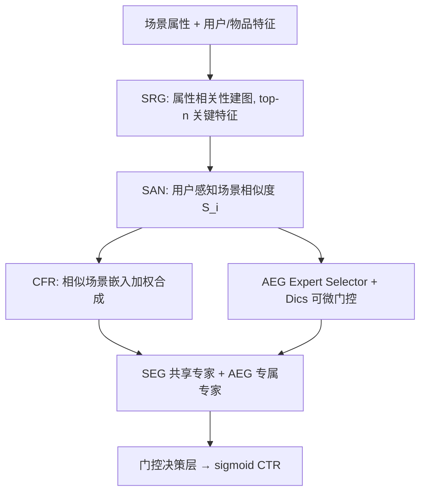

# Scene-wise Adaptive Network for Dynamic Cold-start Scenes Optimization in CTR Prediction (面向动态冷启动场景优化的场景自适应网络)

- **会议/期刊**: RecSys 2024
- **作者与机构**: Wenhao Li (HUST)、Jie Zhou / Chuan Luo (北软)、Chao Tang / Kun Zhang (美团)、Shixiong Zhao (港大)
- **推荐链路定位**: 精排 (CTR 预估)
- **研究方向**: 跨域与多场景推荐 / 冷启动与长尾推荐
- **论文原文**: [https://arxiv.org/abs/2408.07278v3](https://arxiv.org/abs/2408.07278v3)
- **开源代码**: [https://github.com/ChrisLiiiii/SwAN](https://github.com/ChrisLiiiii/SwAN)

## TL;DR (1分钟核心速览)

美团到餐业务每月有 200+ 场景上线/下线，新场景上线即冷启动、下线即样本清零，STAR/PEPNet/HMoE 等静态多场景模型必须"先有数据再分结构"，无法应对。SwAN 用场景属性构建场景关系图 (SRG) 检索相似场景，再用用户感知的相似度注意力 (SAN) 与跨场景特征表征 (CFR) 把相似场景的嵌入直接"借"给新场景，最后用可微门控 MoE (AEM) 在线自适应分配专家。在美团 70M/30M 工业数据与 Taobao 数据上，全场景 AUC 0.7860、冷启动 AUC 0.7799，线上 A/B 的 CTR 相对最优基线 PLE 提升 5.64%。

## Background & Motivation (背景与核心矛盾)

- **主流范式**: 多场景推荐 (MSR) 主流是"静态分结构"——STAR 为每场景设独立分支、PEPNet 做参数个性化、HMoE 用重参数化共享场景信息，前提是场景在离线训练前已预定义。
- **前人局限**: ① 场景生命周期极短（情人节活动仅上线一天），系统没有"收集数据→离线微调→重新上线"的时间窗；② 静态模型对新场景只能随机初始化分支或整体重训，既算力冗余又无法复用相似场景的成熟结构。
- **核心洞察 (Key Insight)**: 作者从十亿级日志观察到，用户对"场景相似"与"场景内物品特征相似"存在正相关（如 71.69% 用户偏好 2km 内早餐、63.41% 用户在 2–5km 选正餐），因此**新场景的可用先验不在自身交互数据里，而在属性相似的旧场景里**；且同一对场景在不同用户眼中相似度不同（仅 49.62% 用户认为僵尸片属于恐怖片）。
- **本文切入点**: 把"冷启动"从"学新参数"改写为"检索+加权迁移旧场景的参数与结构"，实现零样本在线推理。

<figure class="paper-figure" markdown="span">
  <figcaption>图 1：该图展示了多个业务场景随时间的在线/离线状态。𝑥 轴表示时间，绿色和蓝色线段分别表示春季和冬季。𝑥 轴上方的方框展示了每个季节内某些时段的在线和离线活动。活动图表示在线状态，虚线表示离线（例如，左图中的情人节活动仅在周二在线）。研究发现，场景在活动开始时立即上线（冷启动问题），并在活动结束后立即下线（有限的在线时</figcaption>
</figure>

## Method (核心方法设计)

### 1. 整体框架 (Overall Architecture)

SwAN 沿用 Embedding&MLP 范式。输入侧先由 SRG 依据物品基础属性（价格、品类等）离线构建目标场景与历史场景的带权关系图；SAN 以用户、目标场景、相似场景三元组做注意力，得到用户视角下的场景相似度 $S_i$；CFR 用$S_i$ 加权多个"场景专属嵌入表"的查表结果，为新场景合成特征表征；AEM 中 SEG（多门 MoE）抽取场景共享逻辑，AEG（稀疏 MoE + Expert Selector）依据相似场景先验动态挑选专家；最后由门控决策层输出 CTR。全流程无需新场景的任何交互样本即可前向推理。

### 2. 关键设计拆解 (Key Designs)

1. **SRG + SAN：把"场景相似"从人工规则变成用户条件化注意力**：仅靠属性相似不足以刻画个体差异。SRG 先用用户关键交互作标签算 Pearson 相关系数筛 top-$n$关键特征，再聚合均值/方差/极值并统计场景间相同特征数作边权；SAN 则对相似场景做注意力：$\hat{S}_i=\mathrm{MLP}[E_u\oplus E_t\oplus(E_t-E_i^s)\oplus(E_t\otimes E_i^s)]$，$S_i=\mathrm{softmax}(\hat{S}_i)$。差值项与乘积项同时刻画"目标-相似"的一阶偏移与交互，使同一场景对不同用户给出不同迁移权重。

2. **CFR：为新场景合成"伪嵌入"**：新场景无专属嵌入表，直接随机初始化是性能塌陷主因。CFR 令 $E_{cfr}=\sum_i S_i\cdot \mathrm{EMB}_i(f_{target\_scene})$，即用相似场景各自的嵌入表编码同一批目标场景特征再加权求和，输入变为$E_{in}=E_o\oplus E_u\oplus Vec_{san}\oplus(E_t+E_{cfr})$。本质是"多字典查表 + 加权求和"，几乎不增开销，却让距离、价格等特征在新场景中获得符合其语义的表示。

3. **AEM 与可微条件选择 $Dics$：把"结构分配"变成可训练算子**：硬阈值选专家会导致梯度中断。Expert Selector 输出$P_k=\sigma[\mathrm{MLP}_p(E_u\oplus Vec_{san})]$与统一阈值$T=\sigma[\mathrm{MLP}_{thre}(Vec_{san})]$，再用$W_k=\frac{1}{1-e^{-\frac{1}{\tau}(P_k-T)}}$软化 0/1 门控；$\tau\to 0$时逼近硬选择但训练不稳，故加方差损失$\mathcal{L}_{var}$把门值推向两极，并对 AEG 内专家输出加余弦损失$\mathcal{L}_{cos}$提升子学习器差异性。总损失$\mathcal{L}=\alpha\mathcal{L}_{ce}+\beta\mathcal{L}_{cos}+\gamma\mathcal{L}_{var}$（$\alpha=1,\beta=\gamma=10^{-3},\tau=10^{-3}$）。训练用交叉熵 + Adam，负样本按约 1:3 采样，线上每半小时增量更新，单样本推理 0.1741 ms。

## Experimental Setup & Evaluation Protocol (实验设置与评估协议)

- **数据集与预处理**:

| 数据集 | #Scenes (Train/Test) | #Interactions | 冷启动场景数 | 特征/场景说明 |
| :--- | :---: | :---: | :---: | :--- |
| Dataset-1 (美团到餐) | 751 / 309 | 70M 训练 + 30M 测试 | 207 | 促销活动场景，正负比约 1:3，双目标（点击+下单） |
| Dataset-2 (Taobao) | 250 / 105 | 官方划分 | 105（测试场景全未见于训练） | 原数据品类覆盖仅 23.18%，用 k-means ($k=3$，轮廓系数 0.1437) 对物品嵌入聚类补全场景属性 |

- **数据划分与防穿越**: 工业集按时间取 3 个月训练 / 1 个月测试，测试集 207 个场景在训练集中从未出现，构成严格场景级冷启动划分；Taobao 遵循官方指令保证测试场景不泄漏。
- **排名评测协议**: 属曝光级 CTR 二分类评估，报告 **AUC（全场景）** 与 **AUC（冷启动场景）**，非 Full-Ranking 全库排序；线上用 CTR 与 Gini 系数（衡量各场景提升的均衡性）。
- **对比基线与超参设置**: SSM（DNN、DCN、xDeepFM、DCN-v2、MMoE、PLE）与 SMSM（HMoE、STAR、PEPNet、HiNet，冷启动场景按属性聚类并入大场景）；AEG/SEG 专家数均 10，$\tau=10^{-3}$，重复 10 次并以 Friedman 检验验证$p<0.05$ 显著性。

## Key Experimental Results (实验关键数据)

### 1. 主实验对比 (Main Results)

| 模型 | 类型 | D1 AUC(all) | D1 AUC(cold) | D2 AUC(cold) |
| :--- | :---: | :---: | :---: | :---: |
| DNN | SSM | 0.7646 | 0.7568 | 0.6601 |
| DCN-v2 | SSM | 0.7758 | 0.7655 | 0.6643 |
| MMoE | SSM | 0.7755 | 0.7656 | 0.6638 |
| PLE | SSM | 0.7787 | 0.7701 | 0.6682 |
| HMoE | SMSM | 0.7749 | 0.7644 | 0.6673 |
| STAR | SMSM | 0.7731 | 0.7607 | 0.6669 |
| PEPNet | SMSM | 0.7767 | 0.7659 | 0.6679 |
| HiNet | SMSM | 0.7759 | 0.7648 | 0.6677 |
| **SwAN** | DMSM | **0.7860** | **0.7799** | **0.6733** |
| Improv. vs 最优基线 | — | +0.94% | +1.27% | +0.76% |

10 个随机抽取的冷启动子场景中 SwAN 全部最优，均值 0.7869，较 MMoE (0.7676)、PLE (0.7638)、STAR (0.7552) 分别高 1.93/2.31/3.17 个百分点。

### 2. 消融实验 (Ablation Study)

| 变体 | AUC(all) | Δ | AUC(cold) | Δ |
| :--- | :---: | :---: | :---: | :---: |
| SwAN 完整 | **0.7860** | — | **0.7799** | — |
| w/o SRG | 0.7805 | −55 BP | 0.7732 | −67 BP |
| w/o AEM | 0.7819 | −41 BP | 0.7749 | −50 BP |
| w/o CFR | 0.7840 | −20 BP | 0.7771 | −28 BP |
| w/o $\mathcal{L}_{var}$ | 0.7838 | −22 BP | 0.7767 | −32 BP |
| w/o $\mathcal{L}_{cos}$ | 0.7841 | −19 BP | 0.7774 | −25 BP |

### 3. 关键实验发现 (Key Findings)

1. **SRG 是冷启动收益的第一来源**：移除后冷启动 AUC 掉 67 BP，远大于全场景的 55 BP，说明"相似场景先验"对无交互数据的新场景边际价值最高；AEM 次之（冷启动 −50 BP），印证结构自适应与先验迁移是互补而非冗余。
2. **门控软化程度存在明确甜点**：$\tau$从 1 降到$10^{-3}$时 AUC 由 0.7821 单调升至 0.7860，再降到$10^{-4}$ 无增益；专家数从 3 增至 10 带来 +58 BP，10→15 仅 +3 BP 而推理从 0.1741 ms 升至 0.1814 ms，故 10 是性价比拐点。
3. **线上收益在小场景更显著**：6 个新场景相对默认排序提升 33.35%–55.07%，相对基线提升 2.92%–13.07%，其中曝光仅 7K 的最小场景提升最大（13.07%）；SwAN 的场景间提升 Gini 为 0.0727（基线 0.0858），相对基线的跨场景 Gini 仅 0.2651，证明增益并非只来自大场景。

## Highlights & Limitations (亮点、对比与审稿批判)

- **与代表作对比 (vs. Prior Work)**: STAR/PEPNet 靠"每场景一套参数/分支"区分场景，冷启动时无参数可依；HMoE 靠重参数化在场景间共享信息，但仍需新场景历史数据参与训练；$s^2Meta$ 用元学习适配新场景，但多场景下训练成本高。SwAN 的差异在于**把场景结构本身作为可检索、可加权的对象**，实现零样本在线前向。
- **可迁移亮点**: ① "多嵌入表 + 相似度加权查表"合成冷启动表征，可直接移植到新物品/新广告主冷启动；② $Dics$ 用 sigmoid 软化硬阈值门控并配方差损失，是任何稀疏 MoE 路由都可复用的可微化技巧。
- **审稿级局限批判**: ① SRG 依赖人工设定的相关系数阈值（经验值 0.05）与 top-$n$ 关键特征，属性缺失时退化明显——Taobao 上需 k-means 人造品类，AUC 仅 0.6733、提升仅 0.76%，泛化性证据偏弱；② 场景相似度只用静态属性统计量，未建模场景随时间的演化与用户行为漂移；③ 线上 A/B 仅与 PLE 单基线对比，未与 STAR/PEPNet 同场竞技，且 Gini 指标缺乏置信区间。

## Rating (四维评分)

- **方法创新性 (Novelty)**: ⭐⭐⭐⭐ （把冷启动重构为"场景检索+参数迁移"，SRG/SAN/CFR 三段式设计自洽，但各组件均为 DIN、MMoE、软门控的成熟组合）
- **评估协议与实验扎实度 (Protocol & Experiments)**: ⭐⭐⭐⭐ （工业 70M/30M + 严格场景级冷启动划分 + 10 次重复 Friedman 检验 + 两月线上 A/B，惟公开集经人工聚类改造、线上仅单基线）
- **写作与数学规范度 (Clarity & Rigor)**: ⭐⭐⭐ （公式完整、超参实验充分，但符号 $E_i^s$/$Vec_{san}$ 定义略松散，SRG 建图细节与复杂度分析偏简）
- **工业落地与复现价值 (Industrial & Practical Value)**: ⭐⭐⭐⭐⭐ （已开源，2.21×10⁷ 参数、0.1741 ms 推理与 PLE 同量级，半小时级增量更新，可直接照搬到活动型场景业务）

