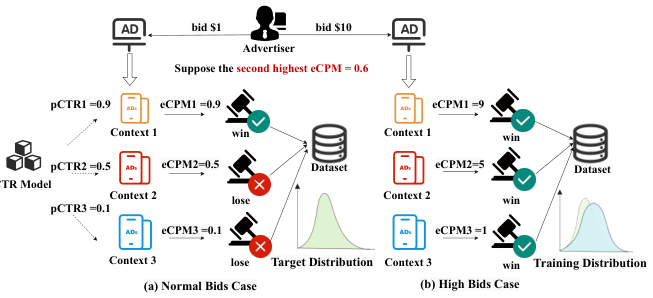
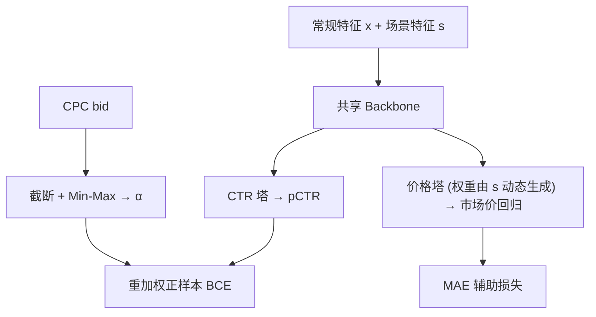
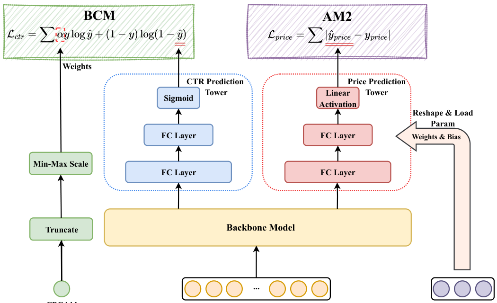

# AIE: Auction Information Enhanced Framework for CTR Prediction in Online Advertising (在线广告 CTR 预估的竞价信息增强框架)

- **会议/期刊**: RecSys 2024
- **作者与机构**: Yang Yang, Bo Chen, Chenxu Zhu, Menghui Zhu, Xinyi Dai, Huifeng Guo, Muyu Zhang, Zhenhua Dong, Ruiming Tang（华为诺亚方舟实验室、华为技术）
- **推荐链路定位**: 精排（CTR 预估）
- **研究方向**: CTR/CVR 预估与特征交叉 / 去偏公平与工业架构
- **论文原文**: [https://arxiv.org/abs/2408.07907v1](https://arxiv.org/abs/2408.07907v1)
- **开源代码**: [https://github.com/mindspore-lab/models](https://github.com/mindspore-lab/models)

## TL;DR (1分钟核心速览)

在线广告精排只吃用户/广告/上下文特征，却忽略了决定曝光的**后验竞价信号**（市场价、CPC 出价），且高出价导致低相关上下文被过度曝光、训练 CTR 分布偏移（本文命名为 auction bias）。AIE 用两个仅训练期生效的可插拔模块破局：AM2 以场景感知动态权重网络做市场价回归辅助任务，BCM 用截断+Min-Max 的出价因子重加权正样本。iPinYou 全库 AUC 上 7 个 backbone 平均 RelaImpr 1.01%、Rev 3.95%；线上一个月 A/B 提升 eCPM 5.76%、CTR 2.44%、预测偏差降 5.38%，推理耗时仅 +0.5%。

## Background & Motivation (背景与核心矛盾)

- **主流范式**: 工业精排以 eCPM = pCTR × bid 排序，CTR 模型只用 $\boldsymbol{x}$（用户/广告/上下文）训练；近期 MTAE 尝试把后验市场价作为辅助任务引入。
- **前人局限**: ①MTAE 把市场价**人工分桶做多分类**，桶边界靠经验，而图 1(b) 显示不同行业场景的市场价分布差异极大，分桶一旦错位收益即翻负；②完全忽略竞价本身对训练分布的影响——bid 直接决定曝光，进而决定样本分布。
- **核心洞察 (Key Insight)**: 同一广告给出价 \$1 时仅在 pCTR=0.9 的上下文胜出，给出 \$10 时连 pCTR=0.1 的低相关上下文也胜出（图 2），这些"被买来的曝光"压低该广告的统计 CTR，训练分布$P(x,y)$系统性偏离无偏目标分布$Q(x,y)$；同时市场价与真实 CTR 呈正相关（图 1(a)），说明价格是可学的强信号而非噪声。
- **本文切入点**: 后验信号只在训练期注入——用"回归替代分桶"吃满价格信息，用"出价重加权"把分布拉回目标分布，两个模块推理期完全下线。

<figure class="paper-figure" markdown="span">
  <figcaption>图2：拍卖偏差示意图。当广告主为广告给出正常出价时，如图(a)所示，由于点击相关性高，该广告仅在上下文1中赢得拍卖。当广告主为同一广告给出高出价时，如图(b)所示，尽管上下文2和3的点击相关性低，该广告在所有三个上下文中赢得更多拍卖。因此，训练数据分布不同于原始目标分布，导致数据偏差，这种由高出价导致的偏差称为拍卖偏差。</figcaption>
</figure>

## Method (核心方法设计)

### 1. 整体框架 (Overall Architecture)

共享 backbone 吃常规特征 $\boldsymbol{x}$，末端分叉出 CTR 塔与价格塔：AM2 用场景特征$\boldsymbol{s}$（广告位、App 类目、小时等）生成的价格塔权重，让价格辅助任务在不同竞价环境下自适应；BCM 在样本级用 CPC 出价算出权重$\alpha$，仅乘在 CTR 塔的正样本交叉熵上。两者协同训练，梯度经共享 embedding 与 backbone 回灌主任务；由于市场价与 bid 均为**后验特征**，两模块在推理阶段被整体摘除，线上只走原模型，零延迟代价。工程上采用小时级流式增量训练以跟上竞价波动。

<figure class="paper-figure" markdown="span">
  <figcaption>图3：AIE的整体框架，包含两个关键模块：AM2和BCM。AM2利用市场价格和场景特征构建辅助任务。BCM利用出价影响交叉熵损失。</figcaption>
</figure>

### 2. 关键设计拆解 (Key Designs)

1. **AM2：场景感知的价格辅助任务**：痛点是从未见过的人工分桶与跨场景分布漂移。做法是把场景 embedding $\boldsymbol{E}_s$经 reshape+split 直接生成价格塔每层参数而非共享静态参数：$\mathbf{W}^{(k)},\mathbf{b}^{(k)}=\text{Reshape}(\text{Split}(\boldsymbol{E}_s))$，$\mathbf{h}^{(k)}=\sigma(\mathbf{W}^{(k-1)}\mathbf{h}^{(k-1)}+\mathbf{b}^{(k-1)})$，输出$\hat{y}_{price}$后以 MAE 回归$\mathcal{L}_{price}=\sum|\hat{y}_{price}-y_{price}|$。用回归而非分桶分类，免去桶边界先验；用动态权重，等价于为每个竞价环境实例化一条"专用价格塔"，从而把场景差异从主任务中剥离出去，只需共享底层表征即可反哺 CTR。
2. **BCM：出价校准的样本重加权**：痛点是被高出价"买来"的低相关曝光污染正样本。先截断极端值 $C'=\text{clip}(C,min,max)$，再线性映射到$[a,b]$得$\alpha=a+\frac{b-a}{max-min}(C'-min)$，$[a,b]$默认$[0.5,2]$，按场景分别统计以适配分布差异；随后$\mathcal{L}_{ctr}=\sum\alpha\,[y\log\hat{y}+(1-y)\log(1-\hat{y})]$，**只加权正样本**，并通过调$a,b$使加权后正样本比例的整体期望与原分布一致，避免预测系统性上偏。理论上它与 IPS 同构：倾向分$p_i=P(x_i,y_i)/Q(x_i,y_i)\approx 1/\alpha$，但广告场景下$Q$ 不可观测，故用出价作为其可计算的代理。
3. **训练目标、负采样与推理效率**：总损失 $\mathcal{L}=\mathcal{L}_{ctr}+w\cdot\mathcal{L}_{price}$，$w$从$10^{-5}\sim10^{-3}$ 搜索（只关心 CTR 表现，价格塔精度不设约束）；负样本沿用曝光日志中的真实未点击样本，不做额外负采样。推理侧仅保留原 backbone，实测训练 10.5→11 GPU·h、全测试集推理 553→556 s，开销可忽略。副作用是 BCM 抬高了高出价物品的 pCTR，平台在与其他 DSP 争夺高价值流量时获得竞价优势，收益二次放大。

## Experimental Setup & Evaluation Protocol (实验设置与评估协议)

- **数据集与预处理**:

| 数据集 | #样本/曝光 | 特征维度 | 稀疏度/场景说明 | 划分方式 |
| :--- | :---: | :---: | :---: | :---: |
| iPinYou | 19.50M | 937.67K (one-hot) | 含 market price 与 bid，10 天日志 | 每广告主前 7 天训练 / 后 3 天测试 |
| 工业数据集 | >600M | 未披露 | 数百站点与 App，含创意/类目/行为/广告位 | 时间戳切分（前 7 天训练，第 8 天测试） |

- **数据划分与防穿越**: iPinYou 沿用按广告主的时间切分；工业集严格按全局时间戳切分并留出验证集，竞价特征仅存在于训练侧，测试集不注入任何后验信息。
- **排名评测协议**: 非采样排序，在全测试集上算 **AUC / csAUC**（csAUC 为 CPM 敏感 AUC，衡量高价值正样本是否被排得更高）；Rev / Rev NDCG 按 (weekday, hour, slotid) 分组模拟单坑拍卖，取 eCPM 最高者计费，属全库 Auction-level 模拟评估。
- **对比基线与超参**: backbone 为 DNN、DCN、DeepFM、AutoInt、FiBiNET、DCNv2、DFFM，外加引入市场价的 MTAE；embedding 维度 $d=8$、batch 2000、Adam，价格塔 1–3 层、每层 {16,32,64}，5 次重复取均值，$p<0.05$ 显著性检验，RelaImpr 相对基线归一。

## Key Experimental Results (实验关键数据)

### 1. 主实验对比 (Main Results)

iPinYou（Bold 为最优，* 表示 $p<0.05$；Metric 列为各 backbone 的 AIE 相对自身基线的平均 RelaImpr）:

| Backbone | AUC (Base/MTAE/AIE) | csAUC (Base/AIE) | Rev (Base/AIE) | Rev NDCG (Base/AIE) |
| :--- | :---: | :---: | :---: | :---: |
| DNN | 0.7755 / 0.7780 / **0.7792*** | 0.7762 / **0.7798*** | 26.489 / **28.428*** | 0.1249 / **0.1341*** |
| DCN | 0.7770 / 0.7769 / **0.7797*** | 0.7777 / **0.7804*** | 27.317 / **28.355*** | 0.1289 / **0.1338*** |
| DeepFM | 0.7757 / 0.7759 / **0.7780*** | 0.7763 / **0.7786*** | 27.640 / **27.652*** | 0.1304 / **0.1305*** |
| AutoInt | 0.7738 / 0.7772 / **0.7793*** | 0.7743 / **0.7798*** | 26.778 / **28.536*** | 0.1263 / **0.1346*** |
| FiBiNET | 0.7763 / 0.7763 / **0.7785*** | 0.7768 / **0.7792*** | 26.544 / **27.808*** | 0.1252 / **0.1312*** |
| DCNv2 | 0.7766 / 0.7776 / **0.7781*** | 0.7771 / **0.7787*** | 27.681 / **27.954*** | 0.1306 / **0.1319*** |
| DFFM | 0.7766 / 0.7757 / **0.7782*** | 0.7775 / **0.7787*** | 26.440 / **27.540*** | 0.1247 / **0.1299*** |
| **RelaImpr (Avg)** | MTAE 0.32% → **AIE 1.01%** | — → **1.00%** | 1.47% → **3.95%** | 1.46% → **3.97%** |

工业集（离线）: FiBiNET 0.8207→0.8225、DCN 0.8219→0.8231、EDCN 0.8226→0.8240、DFFM 0.8228→0.8239、HierRec 0.8239→0.8249（AUC），csAUC 亦全面提升。

### 2. 消融实验 (Ablation Study)

以 AutoInt 为 base（原文仅给图 4 曲线，下列趋势为图示读数定性结论；Base 数值取自表 1）:

| 变体 | AUC | csAUC | Rev | Rev NDCG | 说明 |
| :--- | :---: | :---: | :---: | :---: | :--- |
| Base | 0.7738 | 0.7743 | 26.778 | 0.1263 | 基准 |
| + BCM | 微增 | 微增 | 显著 ↑ | 显著 ↑ | 纠偏主要体现收益而非排序 |
| + AM2 | 明显 ↑ | 明显 ↑ | ↑ | ↑ | 价格辅助显著增强高价值排序 |
| + AIE (BCM+AM2) | **最高** | **最高** | **最高** | **最高** | 两模块互补 |

### 3. 关键实验发现 (Key Findings)

1. **回归优于分桶**：MTAE 在 DCN 上 AUC 0.7769 < 基线 0.7770（负增益），而 AIE 在全部 7 个 backbone 上均为正增益，AutoInt 上 AUC RelaImpr 达 2.01%；平均从 MTAE 的 0.32% 提升到 1.01%，印证人工分桶对价格分布把握不稳、回归+场景动态权重更鲁棒。
2. **收益不是靠牺牲排序换来的**：以 DCN 为基，低出价物品曝光占比 57.8%→52.2%（−5.6 pt），中/高出价 +3.2 / +3.5 pt，同时 AUC 同步上升，说明模型学会了"感知高价值流量"而非单纯放大高价广告。
3. **模块分工清晰**：线上 AM2 单独 eCPM +3.94% 但预测偏差反而恶化 +2.58%；叠加 BCM 后 eCPM +5.76%、RPM +6.14%、bias −5.38%，证明 AM2 负责增益、BCM 负责纠偏，二者缺一不可。

## Highlights & Limitations (亮点、对比与审稿批判)

- **与代表作对比 (vs. Prior Work)**: 相比 MTAE，本文把"价格多分类"换成"场景感知动态参数回归"，并额外启用 MTAE 完全没用到的 bid 信号做去偏；相比 IPS 类去偏工作，无需估计不可观测的无偏分布 $Q$，直接用出价构造倾向分代理；相比 DFFM/HierRec 等场景建模，场景信息只用于生成**辅助塔**参数，不侵入主任务，因而可插拔。
- **可迁移亮点**: ①"后验特征只在训练期注入 + 推理期摘除"是低成本引入外部信号的通用范式，可迁到 CVR、LTV 预估；②用可计算的业务量（出价/预算）替代难以估计的倾向分做重加权，适用于任何有竞争性分配机制的场景（如拍卖式召回、流量分配）。
- **审稿级局限批判**: ①BCM 假设广告主调价不频繁且模型可小时级更新，一旦调价策略高频或反馈延迟，$\alpha$与实际倾向分脱钩，重加权可能反向放大偏差；②离线 AUC 增益仅 0.2–0.4 个点，且作者自承测试集本身有偏、离线指标难以反映真实效果，结论高度依赖单平台一个月 A/B，公开验证仅 iPinYou 一个较老数据集，泛化性证据偏薄；③$[a,b]$ 上下界、截断阈值与场景切分粒度均为人工超参且敏感，缺少敏感度分析。

## Rating (四维评分)

- **方法创新性 (Novelty)**: ⭐⭐⭐⭐ （首次形式化 auction bias，并用"场景动态参数辅助塔 + 出价代理 IPS"两条互补路径同时解决信号利用与分布偏差，思路干净但单点算子不算突破性）
- **评估协议与实验扎实度 (Protocol & Experiments)**: ⭐⭐⭐⭐ （7 个 backbone + 公共集 + 6 亿曝光工业集 + 一个月线上 A/B 与置信区间，全库排序与 Rev 模拟设计考究；扣分在消融仅有曲线、公开数据单一）
- **写作与数学规范度 (Clarity & Rigor)**: ⭐⭐⭐⭐ （BCM 与 IPS 的形式化对照清晰、损失与参数生成公式完备；但 BCM 最优性仅以 $\hat{\theta}=\arg\min\sum l(z_i,\theta)p_i+\lambda R(\theta)$ 一笔带过，缺少重加权后方差/一致性的严格论证）
- **工业落地与复现价值 (Industrial & Practical Value)**: ⭐⭐⭐⭐⭐ （推理零开销、训练 +0.5 GPU·h，MindSpore 代码开源，线上全量落地并带来 eCPM +5.76%，是极少数"离线小涨、线上大涨"的可复现工业范式）

