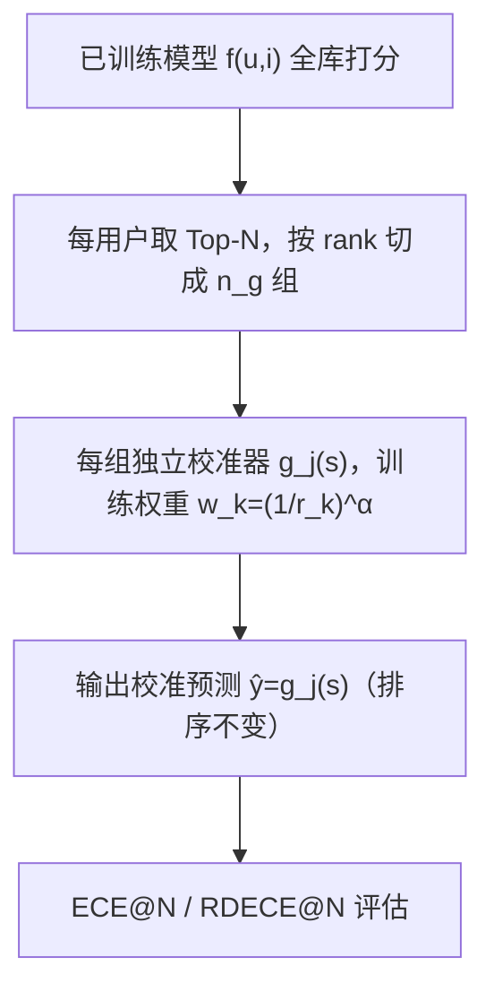
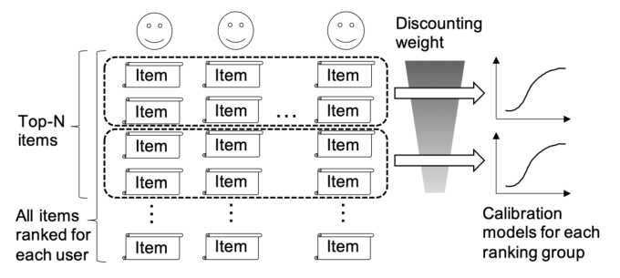

# Calibrating the Predictions for Top-N Recommendations (Top-N 推荐结果的预测校准)

- **会议/期刊**: RecSys 2024
- **作者与机构**: Masahiro Sato (FUJIFILM, 东京)
- **推荐链路定位**: 重排 / 后处理（精排打分之后、业务展示之前）
- **研究方向**: CTR 预估与特征交叉 / 多任务学习与列表级重排
- **论文原文**: [https://arxiv.org/abs/2408.11596v1](https://arxiv.org/abs/2408.11596v1)
- **开源代码**: [https://github.com/PreferredAI/cornac](https://github.com/PreferredAI/cornac)（复现实验所用框架，本文方法未单独开源）

## TL;DR (1分钟核心速览)

全库评估下 ECE 仅 0.001 的"完美校准"模型，在被推荐的 Top-20 条目上 ECE@20 却高达 0.070，且偏差方向随排名变化（高分区高估、中分区低估）。本文先定义 `ECE@N` 与秩折扣 `RDECE@N` 两个只统计 Top-N 的指标，再提出通用后处理优化 TNF：把 Top-N 按排名切成 $n_g$组、每组训练独立校准器，并用$w_k=(1/r_k)^{\alpha}$ 对训练样本加权。在 ML-1M 与全观测 KuaiRec 上对 6 类校准器、5 类推荐模型普遍生效，NCF+Beta 的 ECE@20 从 0.093 降至 0.010（相对降 89%）。

## Background & Motivation (背景与核心矛盾)

- **主流范式**: 分类/排序模型的打分普遍欠校准，业界采用**后处理校准**（Isotonic Regression、Platt/Beta/Gaussian/Gamma、直方图分箱）把原始分数 $s_{ui}$映射为$\hat{y}_{ui}=g(s_{ui})$，且校准器一律在**全部 user-item 对**上训练与评估。
- **前人局限**: ① 应用侧只消费 Top-N 条目的预测值（展示预估评分、多目标重排的购买概率），但全库 ECE 的高分区样本极稀疏、且 Top-N 与 Top-N 之外的偏差方向相反、相互抵消，导致指标"看起来很好"却对线上无效；② 最新的 VAD 去偏 [Fan et al.] 只假设 Top-N 存在**高估**并从方差中扣减，实测显示 Top-N 同样存在大量**低估**，盲目扣减反而放大误差（表 1/2 中 VAD 几乎全线劣于原始校准）。
- **核心洞察 (Key Insight)**: 作者用 reliability diagram 与秩分段图给出关键现象——**校准误差是 rank-dependent 的**：排名靠后（rank>200）的条目本就校准良好，而 rank 靠前的条目在概率高区系统性高估、中区系统性低估，偏差方向与幅度随排名漂移；单一全局校准器在函数形式上无法拟合这种分段异质映射。
- **本文切入点**: 既然偏差由"排名"这一变量决定，就把**排名当作分组变量与样本权重变量**，让校准器只在 Top-N 上、且按秩分段地被优化。

## Method (核心方法设计)

### 1. 整体框架 (Overall Architecture)

流程完全后置、与推荐模型解耦：先用已训练模型 $f$对验证集全库打分并取每用户 Top-N；把 Top-N 条目按名次切成$n_g$个连续 rank 组，每组$\{y_k,s_k,r_k\}$训练一个独立校准器$g_j$；训练时对样本施加秩折扣权重$w_k=(1/r_k)^{\alpha}$，使高名次的拟合误差被优先压低；测试阶段先按原模型排序取 Top-N（校准不改变排序），再用对应组的校准器映射出$\hat{y}$，最后用 `ECE@N` 与 `RDECE@N` 度量。分组解决"偏差随 rank 漂移"的异质性，加权解决"高名次更重要"的效用不对称。

<figure class="paper-figure" markdown="span">
  <figcaption>图2：所提出的校准方法。Top-N 项目按其排名分组。然后，用随每个训练样本排名增加而降低的权重，为每个排名组训练校准模型。</figcaption>
</figure>

### 2. 关键设计拆解 (Key Designs)

1. **Top-N 专用评估指标 ECE@N / RDECE@N**：传统 ECE 把全部样本分箱，Top-N 只占极少数 bin 且正负偏差抵消。本文把分箱与平均限制在 Top-N 子集内：$ECE@N=\sum_{m=1}^{M'}\frac{|B'_m|}{n'}\left|\frac{\sum_{k\in B'_m}y_k}{|B'_m|}-\frac{\sum_{k\in B'_m}\hat{y}_k}{|B'_m|}\right|$；并进一步以名次为变量做折扣$RDECE@N=N\sum_{r=1}^{N}w_r\frac{|B'_r|}{n'}\left|\cdot\right|$，$w_r=1/r$。直觉：ECE@N 等价于"列表内平均校准精度"，RDECE@N 则把曝光位价值纳入，二者分别对应"整体可信"与"头部可信"两种业务诉求。

2. **秩分组分段校准（Rank-Grouped Calibrators）**：单一 $g(\cdot)$无法同时拟合高估区与低估区。把 Top-N 按 rank 划分为$n_g$组（默认$n_g=N/5$，即每组 5 个名次），组内单独拟合$g_j$，相当于给校准函数增加一个离散的 rank 协变量，实现**分段非单调映射**，从而在同一条推荐列表的不同区间分别修正过估/低估。

3. **秩折扣加权训练与推理开销**：组 $j$的优化目标为$\mathcal{L}_j=\sum_{k\in G_j}w_k\,\ell\!\left(g_j(s_k),y_k\right),\ w_k=(1/r_k)^{\alpha}$，$\ell$沿用各校准器原损失（Isotonic 的 PAV、Beta/Platt 的交叉熵等），因此该方法是**对校准器的通用包装**而非新校准器。训练侧无负采样需求（直接用验证集正负样本），推理仅一次查表/一次标量函数调用，$O(1)$ 额外延迟、不触碰召回与排序阶段。

## Experimental Setup & Evaluation Protocol (实验设置与评估协议)

- **数据集与预处理**:

| 数据集 | #Users | #Items | #Interactions | 稀疏度/密度 | 特征/场景说明 |
| :--- | :---: | :---: | :---: | :---: | :--- |
| ML-1M | 6,040 | 3,706 | 1,000,209 | 4.47% | 显式 5 级评分，评分预测任务 |
| KuaiRec | 1,411 | 3,327 | 4,694,397 | 100% | 隐式 0/1 偏好，**全观测**子集，可无曝光偏差评估 |

- **数据划分与防穿越 (Splitting Strategy)**: 按 **60%/20%/20% 比例随机划分** train/valid/test；推荐模型仅在 train 上训练，校准器仅在 valid 上拟合，指标在 test 上报告；重复 10 次不同随机种子划分取均值±标准差。默认 $N=20$。
- **排名评测协议 (Ranking Protocol)**: Top-N 由模型对**全库**打分排序得到（KuaiRec 全观测，等价无偏 Full-Ranking 取头）；因先截取 Top-N 再校准，**排序指标 AUC/NDCG 与 RMSE 与校准无关**，故置于附录，正文只评校准质量。分箱数在单调性约束下取最大以稳定 ECE 估计。
- **对比基线与超参设置**: 推荐模型 itemKNN、MF（显式）与 BPR、NCF、LightGCN（隐式），均用 Cornac / Recommenders 默认超参；校准器含非参（直方图分箱、Isotonic）与参数（Platt、Beta、Gaussian、Gamma）两类；对比 **Original**（全样本校准）、**VAD**（方差调整去偏）；默认 $n_g=N/5$、$\alpha=1$；显式评分任务因参数化校准器输出限于$[0,1]$ 只测非参模型。

## Key Experimental Results (实验关键数据)

### 1. 主实验对比 (Main Results)

| 数据集 / 模型 / 校准器 | ECE@20 Original | ECE@20 VAD | ECE@20 TNF | RDECE@20 Original | RDECE@20 VAD | RDECE@20 TNF |
| :--- | :---: | :---: | :---: | :---: | :---: | :---: |
| ML-1M / itemKNN / Isotonic | 0.177 | 0.462 | **0.026** (↓85.3%) | 0.197 | 0.521 | **0.070** (↓64.5%) |
| ML-1M / MF / Isotonic | 0.036 | 0.325 | **0.017** (↓52.8%) | 0.047 | 0.348 | **0.027** (↓42.6%) |
| KuaiRec / NCF / Beta | 0.093 | 0.147 | **0.010** (↓89.2%) | 0.102 | 0.183 | **0.023** (↓77.5%) |
| KuaiRec / NCF / Gaussian | 0.089 | 0.139 | **0.016** (↓82.0%) | 0.093 | 0.175 | **0.023** (↓75.3%) |
| KuaiRec / LightGCN / Isotonic | 0.070 | 0.128 | **0.014** (↓80.0%) | 0.078 | 0.152 | **0.022** (↓71.8%) |
| KuaiRec / BPR / Isotonic | 0.034 | 0.046 | **0.011** (↓67.6%) | 0.064 | 0.077 | **0.019** (↓70.3%) |
| KuaiRec / BPR / Beta | 0.072 | 0.076 | **0.013** (↓81.9%) | 0.039 | 0.051 | **0.020** (↓48.7%) |

参考锚点（Vanilla，不做校准）：ML-1M/itemKNN 的 ECE@20 = 0.075、KuaiRec/NCF = 0.340、LightGCN = 0.554；即**用全局校准器反而可能把 itemKNN 从 0.075 恶化到 0.177**。

### 2. 消融实验 (Ablation Study)

原文未提供传统 "w/o 模块" 消融，组件级影响由超参扫描（图 4）与推荐数扫描（图 3）体现，整理如下（趋势性结论，具体数值见原文图）：

| 配置 | 含义 | ECE@20 / RDECE@20 表现 |
| :--- | :--- | :--- |
| $n_g=1$ | 退化为单一全局校准器（仅剩加权） | 明显劣于分组，接近 Original 水平 |
| $n_g=N$| 每个名次单独建模 | 样本过少、方差大，劣于$n_g\approx5$ |
| $n_g=5$（默认） | 每组 5 个名次 | 两指标均最优/近优 |
| $\alpha=0$ | 取消秩折扣（等权） | ECE@N 尚可，RDECE@N 变差 |
| $\alpha=0.2$ | 轻折扣 | ECE@N 最优（与等权评估口径一致） |
| $\alpha=1.0$（默认） | MRR 式折扣 | RDECE@N 最优 |
| $N$ 减小（20→更小） | 名单更短 | 所有方法 ECE@N 上升，但 TNF 上升幅度显著更小 |

### 3. 关键实验发现 (Key Findings)

1. **全局校准的"指标幻觉"被量化**：同一 NCF+Gaussian 模型全库 ECE 仅 0.001，而 ECE@20 达 0.070（近 70 倍差距），且分箱证据显示高分区高估、中区低估并存——这说明过往"校准已达 SOTA"的结论在 Top-N 场景并不成立。
2. **去偏方向假设错比不校准更糟**：VAD 只扣减高估，在 ML-1M/itemKNN/Isotonic 上把 ECE@20 从 0.177 拉到 0.462、RDECE@20 拉到 0.521，全面劣于 Vanilla（0.075/0.069）；TNF 同期降到 0.026/0.070，证明"分段双向修正"优于"单向扣减"。
3. **收益与模型/校准器无关、且对短名单更关键**：NCF、LightGCN、BPR 三种隐式模型配 6 种校准器的 18 组设置中 TNF 全部最优（ECE@20 相对降 67%–89%，绝对值落到 0.010–0.020 量级）；随着 $N$变小 ECE@N 整体升高，而 TNF 的抑制效果最明显，说明其在"只推十几条"的真实场景中价值最大；$\alpha$与$n_g$在$[0.2,1.0]$与$n_g\approx5$区间内不敏感，仅在极端值（$\alpha=3$、$n_g=1,20$）时退化。

## Highlights & Limitations (亮点、对比与审稿批判)

- **与代表作对比 (vs. Prior Work)**: 与 Isotonic/Gaussian/Gamma 等校准器 [Menon; Kwong] 相比，本文不改校准器函数族，只改**训练样本的采样域与权重**，因此可无缝叠加；与 VAD [Fan et al.] 相比，本文不预设偏差方向，用分段模型自动学到过估/低估；与 Steck 的类别比例校准相比，本文校准的是**预测分数本身**而非列表内容构成，解决的问题正交。
- **可迁移亮点**: ① "把排序名次当协变量"的分组+折扣训练套路，可直接迁移到 CTR 预估的**位置偏差修正**与多目标重排的概率融合；② `ECE@N`/`RDECE@N` 可直接作为线上"预估购买概率是否可信"的监控指标，替代无效的全库 ECE。
- **审稿级局限批判**: ① 需要**全观测或近似无偏的验证集**来估计 Top-N 区间的经验频率，真实工业数据存在严重曝光偏差（MNAR），KuaiRec 之外的场景落地需先做 IPS/曝光校正；② 分组数 $n_g$与折扣因子$\alpha$需按$N$调节，且作者自己的结果显示 ECE@N 与 RDECE@N 的**最优$\alpha$不一致**（0.2 vs 1.0），缺少统一的调参准则；③ 每组校准器只在高名次小样本上拟合，$N$ 大时组内样本量激增但组数固定，泛化性论证偏弱；④ 未报告校准对下游业务指标（点击/转化）的收益，缺少线上 A/B。

## Rating (四维评分)

- **方法创新性 (Novelty)**: ⭐⭐⭐ （问题定义新颖——首次系统区分"Top-N 内部校准"与"全局校准"，但技术手段是分组+加权这类轻量包装，理论刻画偏弱）
- **评估协议与实验扎实度 (Protocol & Experiments)**: ⭐⭐⭐⭐ （10 次随机划分取均值±方差、5 类推荐模型×6 类校准器×2 任务的矩阵式验证扎实，并诚实报告 VAD 失效；扣分在于无显著性检验、无传统消融表）
- **写作与数学规范度 (Clarity & Rigor)**: ⭐⭐⭐⭐ （RQ 明确、图表动机链完整，指标公式与 VECE 的渊源交代清晰；但分组/加权的超参选择缺乏理论指导）
- **工业落地与复现价值 (Industrial & Practical Value)**: ⭐⭐⭐⭐ （后处理、零排序改动、$O(1)$ 推理开销，极易插入现有精排链路；但依赖无偏验证集，方法本身未单独开源）

