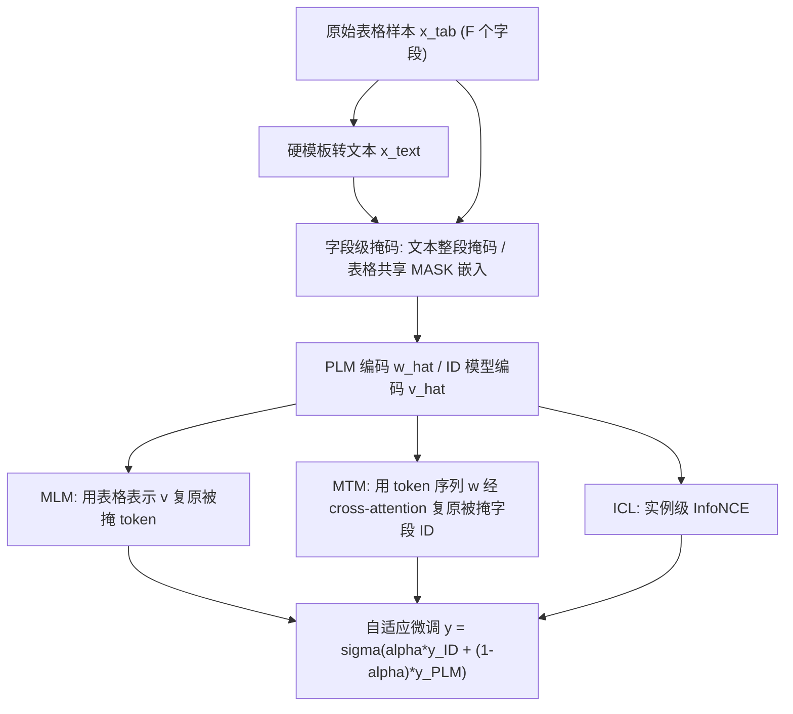

# FLIP: Fine-grained Alignment between ID-based Models and Pretrained Language Models for CTR Prediction (ID 模型与预训练语言模型的细粒度对齐用于 CTR 预估)

- **会议/期刊**: RecSys 2024 (18th ACM Conference on Recommender Systems)
- **作者与机构**: Hangyu Wang, Jianghao Lin, Weinan Zhang, Yong Yu 等（上海交通大学）；Xiangyang Li, Bo Chen, Chenxu Zhu, Ruiming Tang（华为诺亚方舟实验室）
- **推荐链路定位**: 精排（CTR 预估）
- **研究方向**: CTR/CVR 预估与特征交叉 / 大语言模型推荐
- **论文原文**: [https://arxiv.org/abs/2310.19453v4](https://arxiv.org/abs/2310.19453v4)
- **开源代码**: [https://github.com/justarter/FLIP](https://github.com/justarter/FLIP)（另有 MindSpore 版）

## TL;DR (1分钟核心速览)

ID 类 CTR 模型靠 one-hot 学协同信号却丢掉文本语义，PLM 类模型保留语义却把字段切成 subword、丢失 field-wise 协同信号且难以区分 "The Room" 与 "Room" 这类细微文本差异。FLIP 将二者视为同源数据的两种模态，提出**字段级双向掩码重建（MLM+MTM）**：一种模态被挖空的字段必须借助另一模态的完整表示来还原，从而在 ID 与词元之间建立特征级互信息对齐，再叠加实例级 InfoNCE 与可学习权重的联合微调。在 MovieLens-1M / BookCrossing / GoodReads 三个数据集、按时间序 90/10 划分的 AUC 评估下，FLIP 达 0.8621 / 0.8061 / 0.7787，相对各数据集最强基线分别提升 0.57% / 0.89% / 0.59%，且单塔变体 FLIP$_{\text{ID}}$ 在不增加推理成本下已超越全部 ID 基线。

## Background & Motivation (背景与核心矛盾)

- **主流范式**: 一条路线是 ID 模型（Embedding + 特征交叉 + MLP，如 DCNv2、AutoInt、DeepFM）；另一条是把样本硬模板转成句子后用 PLM 做二分类或 seq2seq（CTR-BERT、PTab、P5）。
- **前人局限**: 其一，one-hot 编码丢弃字段语义、在稀疏交互下不稳；其二，PLM 的输入被 tokenizer 拆成子词，字段边界被打散，难以聚合 field-wise 协同信号，且对几乎同文的特征（片名 "The Room" vs "Room"）区分力弱。融合类方法 CTRL / MoRec 要么仅把文本当附加特征、忽略跨模态交互，要么只用 **instance 级对比** 做全局粗对齐。
- **核心洞察 (Key Insight)**: 表格与文本承载几乎相同的原始信息，只是格式不同；若只用实例级对比，缺少对 ID↔token 的细粒度监督，易出现表征退化（Figure 6 中 ICL-only 变体的 ID 嵌入塌缩成窄锥）。
- **本文切入点**: 让"填字游戏"成为跨模态监督——挖掉哪一模态的字段，就必须从另一模态里"借答案"，天然强迫模型抽取特征级互信息。

## Method (核心方法设计)

### 1. 整体框架 (Overall Architecture)

FLIP 是 model-agnostic 的三阶段框架：**① 模态转换**：以极简模板 $t_{i,f}=[m_f \oplus \text{"is"} \oplus v_{i,f} \oplus \text{"."}]$把每个字段拼成描述句，避免花哨模板稀释关键信息；**② 模态对齐预训练**：对同一原始样本的 (文本, 表格) 对分别做字段级掩码，得到$(\hat{x}^{\text{text}}_i, \hat{x}^{\text{tab}}_i)$，PLM 与 ID 模型各自编码，联合执行 MLM / MTM / ICL 三目标；**③ 自适应微调**：两塔各自出分后加权融合，三路 BCE 联合优化。推理解码即一次加权概率输出。

<figure class="paper-figure" markdown="span">
  ![图2：我们提出的FLIP的整体框架。在文本上下文上，从而限制了跨模态交互并丧失了泛化能力\[45\]。](../../../../assets/papers/2310.19453v4/figure_2.png)<figcaption>图2：我们提出的FLIP的整体框架。在文本上下文上，从而限制了跨模态交互并丧失了泛化能力[45]。</figcaption>
</figure>

### 2. 关键设计拆解 (Key Designs)

**① 字段级掩码 + 联合重建（本文最核心增量）**：常规 BERT 式 token 级随机掩码的漏词可被上下文自身猜出，跨模态交互无从发生。FLIP 改为按比例 $r_{\text{text}}$选中字段后**整段掩掉该字段所有 token**，表格侧则把整字段替换为全局共享的 `<MASK>` 特征（不给字段专属先验）。MLM 侧把被掩位置的隐状态与表格表示拼接后预测原词：$q_{i,l}=g_{\text{PLM}}([\hat{w}_{i,l}\oplus v_i])$，损失$\mathcal{L}^{\text{MLM}}_i=\frac{1}{|\mathcal{I}^{\text{text}}|}\sum_{l}\text{CE}(q_{i,l},x^{\text{text}}_{i,l})$。因答案不在本模态内，模型必须学习"哪个字段 ID 对应哪些词元"。

**② MTM 的跨模态注意力 + NCE 降复杂度**：表格侧复原需动态选取相关词元，故先用 $u_i=\text{Softmax}\big(\hat{v}_i Q w_i^{\top}/\sqrt{D_{\text{text}}}\big) w_i$把完整文本序列聚合为查询向量，再对每个被掩字段用独立 MLP 打分。原始做法要在百万级特征空间做 softmax，不可行；改用按训练集频次采样$K$个噪声特征的 NCE，$\mathcal{L}^{\text{MTM}}_i=-\frac{1}{|\mathcal{I}^{\text{tab}}|}\sum_{f}\big(\log\sigma(c_{i,f,t})+\sum_{k=1}^{K}\log(1-\sigma(c_{i,f,k}))\big)$，把多分类降为二分类，兼顾效率与对长尾 ID 的判别。

**③ 训练目标、掩码策略与推理成本**：预训练总损失 $\mathcal{L}_{\text{pretrain}}=\frac{1}{B}\sum_i(\mathcal{L}^{\text{MLM}}_i+\mathcal{L}^{\text{MTM}}_i)+\mathcal{L}_{\text{ICL}}$（ICL 为双向 InfoNCE，温度$\tau$）。微调采用$\hat{y}_i=\sigma(\alpha\cdot\text{Linear}_{\text{ID}}(v_i)+(1-\alpha)\cdot\text{Linear}_{\text{PLM}}(w_i))$，$\alpha$可学习（硬性约束用$\alpha$而非固定 0.5），并以$\mathcal{L}_{\text{finetune}}=\mathcal{L}_{\text{BCE}}(y,\hat{y})+\mathcal{L}_{\text{BCE}}(y,\hat{y}^{\text{ID}})+\mathcal{L}_{\text{BCE}}(y,\hat{y}^{\text{PLM}})$防止单塔崩塌。**无需负采样**（BCE 用真实曝光正负样本）；MTM 中$K=25$个噪声特征按频次采样。推理时 FLIP 需同时跑两塔，而 FLIP$_{\text{ID}}$ 只保留 ID 塔、零额外开销。

## Experimental Setup & Evaluation Protocol (实验设置与评估协议)

- **数据集与预处理**（评分为正/负二值化：ML-1M 与 GoodReads 取 >3 为正并剔除 =3 的中性样本，BookCrossing 取 >5 为正）：

| 数据集 | #Samples | #Fields | #Features | 特征/场景说明 |
| :--- | :---: | :---: | :---: | :--- |
| MovieLens-1M | 739,012 | 8 | 16,849 | 电影评分，用户/电影属性为明文文本 |
| BookCrossing | 1,031,171 | 8 | 722,235 | 图书评分，特征空间大、ID 稀疏 |
| GoodReads | 20,122,040 | 15 | 4,565,429 | 千万级图书评分，字段最丰富 |

- **数据划分与防穿越**: 按时间戳排序后取**前 90% 训练、后 10% 测试**（全局时间序切分）；预训练与微调共享同一训练集，无未来信息泄漏。
- **排名评测协议**: 属**点式 CTR 评估**，报告 AUC 与 Logloss（非 Full-Ranking，不做全库排序）；作者沿用领域惯例，0.001 量级的 AUC 提升即视为显著。
- **对比基线与超参**: 基线覆盖 ID 类（AFM/PNN/W&D/DCN/DeepFM/xDeepFM/AFN/AutoInt/DCNv2）、PLM 类（CTR-BERT/P5/PTab）、融合类（CTRL/MoRec）；默认骨干 TinyBERT + DCNv2，ID 嵌入维 $d=32$，DNN 层 [300,300,128]，掩码率$r_{\text{text}}=r_{\text{tab}}=0.15$，$\tau=0.7$，$K=25$；显著性$p<0.001$。

## Key Experimental Results (实验关键数据)

### 1. 主实验对比 (Main Results)

| 模型 | ML-1M AUC | ML-1M Logloss | BookCrossing AUC | BookCrossing Logloss | GoodReads AUC | GoodReads Logloss |
| :--- | :---: | :---: | :---: | :---: | :---: | :---: |
| AFM | 0.8449 | 0.3950 | 0.7946 | 0.5116 | 0.7630 | 0.5160 |
| DeepFM | 0.8539 | 0.3905 | 0.7947 | 0.5122 | 0.7671 | 0.5138 |
| xDeepFM | 0.8454 | 0.3934 | 0.7953 | 0.5108 | 0.7720 | 0.5079 |
| AutoInt | 0.8509 | 0.4013 | 0.7953 | 0.5118 | 0.7716 | 0.5071 |
| DCNv2 | 0.8548 | 0.3893 | 0.7956 | 0.5103 | 0.7724 | 0.5057 |
| PTab (PLM) | 0.8426 | 0.4195 | 0.7880 | 0.5384 | 0.7456 | 0.5268 |
| CTRL (ID+PLM) | 0.8572 | 0.3838 | 0.7985 | 0.5101 | 0.7741 | 0.5045 |
| MoRec (ID+PLM) | 0.8561 | 0.3896 | 0.7990 | 0.5087 | 0.7731 | 0.5085 |
| **FLIP$_{\text{ID}}$** | **0.8600** | **0.3802** | **0.8030** | **0.5043** | **0.7779** | **0.5014** |
| **FLIP (Ours)** | **0.8621** | **0.3788** | **0.8061** | **0.5004** | **0.7787** | **0.5001** |
| **Improv.%** | **+0.57%** | — | **+0.89%** | — | **+0.59%** | — |

（Improv.% 为相对各数据集最强基线：CTRL / MoRec / CTRL；FLIP 全部优于基线且 $p<0.001$。）

### 2. 消融实验 (Ablation Study)

| 变体 | ML-1M AUC | ML-1M Logloss | BookCrossing AUC | BookCrossing Logloss |
| :--- | :---: | :---: | :---: | :---: |
| FLIP (full) | **0.8621** | **0.3788** | **0.8061** | **0.5004** |
| w/o MLM | 0.8610 | 0.3791 | 0.8042 | 0.5035 |
| w/o MTM | 0.8615 | 0.3806 | 0.8053 | 0.5032 |
| w/o ICL | 0.8618 | 0.3790 | 0.8039 | 0.5026 |
| w/o MLM&MTM | 0.8598 | 0.3815 | 0.8020 | 0.5044 |
| w/o MLM&MTM&ICL | 0.8593 | 0.3810 | 0.8008 | 0.5061 |
| w/o Field-level Masking (退化为 token 级) | 0.8605 | 0.3785 | 0.8054 | 0.5015 |
| w/o Joint Reconstruction (各自复原) | 0.8618 | 0.3820 | 0.8050 | 0.5036 |

### 3. 关键实验发现 (Key Findings)

- **细粒度重建是真正的增益来源，而非 PLM 规模**：去掉 MLM&MTM 仅剩 ICL 时 AUC 降至 0.8593 / 0.8008，甚至低于无预训练的 DCNv2 之外的多数对照；而保留二者、仅去掉 ICL 仍有 0.8618 / 0.8039，说明联合掩码建模提供了 ICL 无法替代的特征级监督。
- **掩码粒度决定对齐质量**：把字段级掩码换成 token 级随机掩码，Logloss 反而从 0.3788 恶化到 0.3785（AUC 0.8621→0.8605），且"去联合重建"使 BookCrossing Logloss 从 0.5004 升到 0.5036——被掩信息若能从本模态自洽猜出，跨模态互信息就消失。
- **单塔迁移即可零成本落地**：FLIP$_{\text{ID}}$ 在各数据集上均超所有 ID 基线（ML-1M 0.8600 vs DCNv2 0.8548），且推理开销与原生 ID 模型完全相同；对 PLM 规模也稳健，RoBERTa-Large 下 FLIP 进一步升至 0.8650 / 0.8092，但 Base→Large 的增量远小于 Tiny→Base，收益呈递减。

## Highlights & Limitations (亮点、对比与审稿批判)

- **与代表作对比 (vs. Prior Work)**: 相比 CTRL 把文本特征"拼"进 ID 塔、MoRec 把 ID 信息"塞"进 PLM，FLIP 不改任何骨干结构，只在共享表示空间上施加双向掩码重建；相比单靠 instance 级 InfoNCE 的对齐方案，它补上了 ID↔token 的一对一特征级监督（Figure 5 的热力图对角线最优即为证据）。
- **可迁移亮点**: ① "字段级整段掩码 + 跨模态答案"这一构造可用于任何双模态（ID/文本、ID/图像、ID/音频）对齐预训练；② MTM 用频次采样 NCE 替代百万级 softmax，可直接复用于大规模特征 ID 的重建任务。
- **审稿级局限批判**: ① 仅报告 AUC / Logloss 的点式指标，缺少 Full-Ranking 的 NDCG/HR 与校准分析，"提升 0.001 即显著"的论断在工业界稀疏场景下说服力有限；② 完整版 FLIP 推理需并行前向 PLM（RoBERTa-Large 355M），在线延迟与显存成本高，实际只能退回 FLIP$_{\text{ID}}$，此时自适应权重$\alpha$的收益也随之消失；③ 掩码率固定 0.15、$\tau=0.7$，超参在三个数据集上均取同一值，缺乏跨域敏感度与预训练轮次成本的报告。

## Rating (四维评分)

- **方法创新性 (Novelty)**: ⭐⭐⭐⭐ （以"跨模态填字"把粗粒度实例对比推进到特征级对齐，并用 SVD 可视化给出表征退化的实证支撑，思路干净且可解释）
- **评估协议与实验扎实度 (Protocol & Experiments)**: ⭐⭐⭐⭐ （三数据集、时间序切分、$p<0.001$ 显著性、消融+兼容性+超参+案例分析齐备；扣分点在于仅用点式 AUC/Logloss，无排序指标与大模型延迟实测）
- **写作与数学规范度 (Clarity & Rigor)**: ⭐⭐⭐⭐ （三目标与两阶段损失定义清晰、掩码示例具象；MTM 的 NCE 近似仅简述而缺复杂度对比推导）
- **工业落地与复现价值 (Industrial & Practical Value)**: ⭐⭐⭐⭐ （代码双框架开源、框架 model-agnostic 可插拔任意 ID 模型与 PLM，FLIP$_{\text{ID}}$ 变体零推理增量即可上线；完整版在线部署受 PLM 成本约束）

