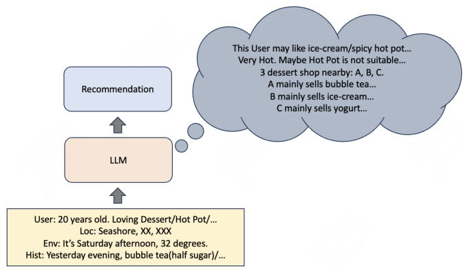
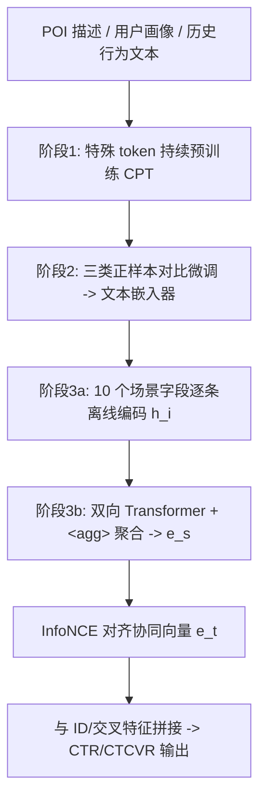
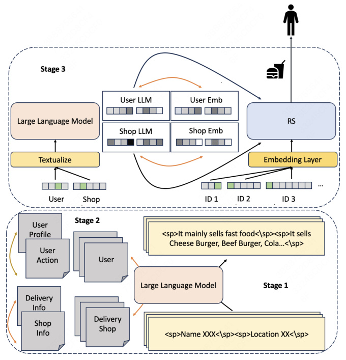

# LARR: Large Language Model Aided Real-time Scene Recommendation with Semantic Understanding (大语言模型辅助的实时场景语义推荐)

- **会议/期刊**: RecSys 2024 (ACM RecSys '24, Bari, Italy)
- **作者与机构**: Zhizhong Wan, Bin Yin, Junjie Xie, Fei Jiang, Xiang Li, Wei Lin（美团）
- **推荐链路定位**: 精排（CTR/CTCVR 预估），语义特征供给贯穿召回实验
- **研究方向**: CTR/CVR 预估与特征交叉 / 大语言模型推荐 (LLM4Rec)
- **论文原文**: [https://arxiv.org/abs/2408.11523v1](https://arxiv.org/abs/2408.11523v1)
- **开源代码**: 暂未开源

## TL;DR (1分钟核心速览)

外卖场景强依赖 POI 语义与实时环境（地理、时段、天气），传统 CTR 模型只用 ID + 特征交叉，把"卖披萨的店"与"卖热汤的店"视为无关 ID；而直接上 LLM 又因实时场景特征组合指数爆炸而无法在线推理。LARR 给出三阶段解：特殊 token 持续预训练注入领域知识 $\to$三类正样本对比学习把 LLM 变成文本嵌入器$\to$ 双向 Transformer 聚合分字段场景向量并与协同嵌入做 InfoNCE 对齐。LLM 完全离线化，美团外卖 3.5B 样本上 CTR AUC 相对 PLE 提升 0.58%，线上 A/B CTR +2.5%、GMV +1.2%。

## Background & Motivation (背景与核心矛盾)

- **主流范式**: 工业 CTR 模型（Wide&Deep / DeepFM / PLE）以 ID token + 交叉统计特征为核心，靠特征共现概率刻画用户点击意愿，参数量集中在 embedding 层。
- **前人局限**: ① 每个 POI 映射唯一 ID，语义相同的店（不同品牌披萨店、同类菜品）在参数空间完全无关，无法理解"夏天更想点冷的""雨夜想吃热汤"这类场景语义；② 把 LLM 塞进在线链路需拼接组合式场景文本，特征组合数呈指数级，服务延迟不可接受；而 P5 / M6-rec 等 text-to-text 范式在外卖 CTR 任务上反而显著掉点（P5 AUC 0.7439 < Wide&Deep 0.7912）。
- **核心洞察 (Key Insight)**: 实时场景的语义关联（各字段之间"谁影响谁"）在 LLM 的**分字段输出向量中已被隐式编码**，因此无需让 LLM 读整段组合文本，只需逐字段独立编码 + 轻量聚合器即可还原场景语义。
- **本文切入点**: 用"自然语言描述替代 ID"解决语义鸿沟，用"逐字段离线编码 + 在线小模型聚合"解决效率瓶颈。

<figure class="paper-figure" markdown="span">
  <figcaption>图 1：LLM 如何理解实时场景并帮助推荐系统工作。</figcaption>
</figure>

## Method (核心方法设计)

### 1. 整体框架 (Overall Architecture)

LARR 分三阶段闭环。**阶段一（持续预训练 CPT）**：为每个 POI 构造由名称、地理位置、简介、菜品、统计量组成的描述文本 $D_i$，用字段级特殊 token 包裹后切分为输入段$x_i$（名称+位置）与目标段$y_i$（简介、主菜等），以生成式语言建模损失注入领域知识，使 LLM 学会"店名+位置 \(\to\) 菜品/业态"的关联。**阶段二（对比微调）**：加入十亿级用户画像与历史行为文本，用 user-user、POI-POI、user-POI 三类正样本对做 InfoNCE，把自回归解码器改造成文本嵌入模型。**阶段三（信息对齐）**：冻结 LLM，离线逐字段编码 10 个实时场景特征，经 1 层双向 Transformer 编码器与 `<agg>` 聚合 token 融合为场景向量$e_s$，与推荐模型（PLE 骨干）的协同向量$e_t$ 对比对齐后拼接进精排塔；线上仅运行轻量聚合器与 PLE，LLM 不参与推理。

<figure class="paper-figure" markdown="span">
  <figcaption>图 2：模型概览，包括 3 个阶段。阶段 1，LLM 在店铺相关语料上进行持续预训练任务；阶段 2，LLM 通过 3 类正样本上的对比学习进行微调并转化为文本嵌入模型；阶段 3，对 LLM 的语义嵌入和 RS 的协同嵌入进行对齐，以提升推荐结果性能。</figcaption>
</figure>

### 2. 关键设计拆解 (Key Designs)

1. **ID $\to$自然语言描述 + 字段特殊 token（CPT）**：直接编码百万级 POI ID 会带来"语义无意义"与"tokenizer 把 `id_499` 切碎产生 4/9 数字误关联"两大问题，整体词嵌入又内存爆炸。作者以"店名 + 地理坐标"唯一标识 POI，并用$sp_p=\{(sp_{bos}^k, sp_{eos}^k)\}$包裹每个字段，将描述拆为$x_i$（名称、位置）与$y_i$（简介、主菜），训练生成式损失$\mathcal{L}_1=-\frac{1}{|N_p|}\sum_{x_i,y_i}\sum_{s=1}^{|y_i|}\log P_\theta(y_i^s\mid x_i,y_i^{<s})$。这样既保留 ID 的唯一性，又让模型从文本中习得"菜品相似$\Rightarrow$ 语义相近"。
2. **三视角正样本对比学习（LLM $\to$嵌入器）**：仅靠 dropout 扰动构造正例在推荐域不合理，因为用户-POI 配对本身极强。作者改用语义切分构造正例：同一用户的画像$U_p$与行为$U_a$、同一 POI 的业态文本$P_d$与基础文本$P_b$、以及真实下单的$(U,P)$组合。嵌入由末位 token 隐状态投影得到$h_z=\mathrm{MLP}(\mathrm{LLM}_\theta(z)_m)$，损失为对称 InfoNCE 加权和$\mathcal{L}_2=\lambda_1\mathcal{L}_{UU}+\lambda_2\mathcal{L}_{PP}+\lambda_3\mathcal{L}_{UP}$。直觉是：把"谁在什么环境下买了什么"压进同一向量空间，使 embedding 天然携带场景偏好。
3. **聚合对齐与训练目标**：分字段向量 $h_i$之间缺少显式交互，因此用 1 层双向编码器$\xi$加可学习 `<agg>` token 聚合：$e_s=\mathrm{MLP}(\mathrm{pooling}(\xi([\text{agg},h_0,\dots,h_r])))$，$r=10$。对齐损失$\mathcal{L}_{cl}=(\mathcal{L}_{st}+\mathcal{L}_{ts})/2$最大化场景语义与协同嵌入的互信息，最终$\mathcal{L}_3=\beta_1\mathcal{L}_{ctr}+\beta_2\mathcal{L}_{cl}$（BCE + InfoNCE，$\beta_2=0.05$，$\tau=0.1$，batch 2400）。负采样采用 in-batch 天然负例，**无额外难负采样**，在线零 LLM 开销。

## Experimental Setup & Evaluation Protocol (实验设置与评估协议)

- **数据集与预处理**: 美团外卖日志（2024-04-01 至 04-07 训练，04-08 采样测试），CTR 任务对日志做负采样构造约 3.5B 样本：

| 数据集 | #Users | #Items(POIs) | #Interactions | 稀疏度/密度 | 特征/场景说明 |
| :--- | :---: | :---: | :---: | :---: | :--- |
| Meituan Waimai (train) | 0.24 B | 4.37 M | 3.5 B | 密度 $\approx 3.3\times10^{-6}$ | 用户/POI 统计、实时上下文、交叉统计 + 语义描述 |
| Meituan Waimai (test) | 同上 | 同上 | 84 M | — | 次日均匀采样，不做额外过滤 |

- **数据划分与防穿越 (Splitting Strategy)**: **全局时间戳切分**（前 7 天训练、次日测试），严格避免未来行为泄漏；CPT 语料由 4M POI 构建约 1B token，混入 9B 中文通用语料（Wudao）共 10B。
- **排名评测协议 (Ranking Protocol)**: 非全库排序任务，采用**点击概率打分的 AUC / GAUC**族指标（CTR AUC、CTCVR AUC、CTR GAUC、CTCVR GAUC）；训练侧对曝光日志做负采样，测试侧不采样。
- **对比基线与超参设置**: 基线含 Wide&Deep、DeepFM（传统特征交叉）、P5（LLM 生成式）、PLE（多任务 MMoE 骨干，亦为 LARR 的协同塔基础）；语义塔用 Baichuan2-7B，场景向量 128 维，1 层 Transformer 聚合，投影头为 MLP；CPT 在 32×A100-80G 上约 96 小时；统一 batch 2400、lr 8e-4、1 epoch，CTR 塔测试于 8×A100。

## Key Experimental Results (实验关键数据)

### 1. 主实验对比 (Main Results)

| Model | CTR AUC | CTCVR AUC | CTR GAUC | CTCVR GAUC |
| :--- | :---: | :---: | :---: | :---: |
| Wide&Deep | 0.7912 | 0.8894 | 0.7011 | 0.6869 |
| DeepFM | 0.7918 | 0.8896 | 0.7009 | 0.6865 |
| P5 (LLM 生成式) | 0.7439 | 0.8363 | 0.6422 | 0.6318 |
| PLE (骨干基线) | 0.7983 | 0.8947 | 0.7088 | 0.6939 |
| **LARR (Ours)** | **0.8030** | **0.8978** | **0.7107** | **0.6955** |
| Improv. vs PLE | +0.58% | +0.34% | +0.27% | +0.23% |

### 2. 消融实验 (Ablation Study)

| 变体 | 移除内容 | CTR AUC | CTCVR AUC |
| :--- | :--- | :---: | :---: |
| LARR-PLE | 完全去掉 LLM 语义塔 | 0.7983 | 0.8947 |
| LARR-noCPT | 去掉持续预训练阶段 | 0.8017 | 0.8969 |
| LARR-noFT | 去掉对比微调（嵌入器）阶段 | 0.7985 | 0.8948 |
| LARR-noAL | 去掉对齐，改为朴素向量拼接 | 0.8007 | 0.8961 |
| **LARR-Complete** | — | **0.8030** | **0.8978** |

### 3. 关键实验发现 (Key Findings)

1. **对齐（AL）是最大增益源，CPT 次之**：去掉对齐掉 0.0023（0.8030→0.8007），去掉 CPT 掉 0.0013；说明语义向量直接拼接会因"语义空间 vs 协同空间"几何错位而浪费收益，InfoNCE 对齐才是把语义信号转成 CTR 增益的关键闸门。
2. **只做对比微调而不对齐几乎无效**：LARR-noFT (0.7985) ≈ LARR-PLE (0.7983)，即原始 Baichuan 输出或未精细化嵌入对协同塔几乎零贡献——语义塔的价值不在"接入"本身，而在"CPT 注入领域知识 + 对齐"两端的协同。
3. **负采样比例与温度均非单调有效**：$\tau=0.1$ 最优，过低/过高都掉点；增大对比学习的负样本采样比反而使 CTR AUC 下降（引入噪声、稀释正例学习），与"更多负例总是更好"的直觉相反，提示工业场景下 in-batch 负例已足够。线上 A/B（04-15 至 04-21）验证：CTR +2.5%、GMV +1.2%，且因 LLM 离线化未引入显著延迟；异地出游案例中 Top-10 召回 5 次落在广州、覆盖肠粉/牛肉炒河粉/煲仔饭/糖水等本地菜，体现跨地域场景泛化。

## Highlights & Limitations (亮点、对比与审稿批判)

- **与代表作对比 (vs. Prior Work)**: 与 P5/M6-rec 的 text-to-text 生成式推荐不同，LARR 不把推荐当生成任务，而是把 LLM 降级为**离线文本编码器**，避免生成式推理的延迟与掉点；与 CTRL 的两阶段跨模态对齐相比，LARR 的差异在"逐字段分散编码 + `<agg>` 聚合"——用聚合器替代让 LLM 读整段组合文本，从而把指数级组合成本转移到廉价小模型；与 RLMRec 相比，额外加入 CPT 与三类正样本构造，并给出线上 A/B 证据。
- **可迁移亮点**: ① "字段级独立编码 + 轻量 Transformer 聚合"可作为任何含大量动态上下文特征（天气/时段/位置）的推荐系统的通用降本范式；② 用"店名 + 坐标"作为 ID 的自然语言代理，兼顾唯一性与语义性，可直接迁移到商品/POI/内容 ID。
- **审稿级局限批判**: ① 主实验仅在单一外卖业务、单一指标族（AUC/GAUC）上验证，缺少与更多语义增强基线（RLMRec、CTRL）的直接对照，且提升幅度（+0.58% AUC 绝对 0.0047）未做显著性检验；② 训练成本极高（32×A100 96 小时 CPT + 十亿级语料），超参 $\tau$、负采样比对性能敏感，且文中未报告分桶（新用户/冷启 POI/异地场景）量化结果，语义增益的作用边界仍不清晰。

## Rating (四维评分)

- **方法创新性 (Novelty)**: ⭐⭐⭐⭐ （以"分字段编码 + `<agg>` 聚合"绕开 LLM 在线推理是工程上真正有新意的取舍，三阶段 CPT/对比/对齐链路完整，但各组件单点均有前人原型）
- **评估协议与实验扎实度 (Protocol & Experiments)**: ⭐⭐⭐⭐ （3.5B 工业样本、时间戳切分、离线 + 线上 A/B + 案例研究齐备，短板是无显著性检验、基线偏少且缺分桶分析）
- **写作与数学规范度 (Clarity & Rigor)**: ⭐⭐⭐ （三阶段流程叙述清楚、公式完整，但符号略松散——如 Eq.14 中"负样本"符号排版错乱、部分定义重复，缺少复杂度定量分析）
- **工业落地与复现价值 (Industrial & Practical Value)**: ⭐⭐⭐⭐ （LLM 完全离线、线上零额外延迟、CTR +2.5%/GMV +1.2% 的 A/B 结果极具说服力；但未开源、CPT 算力门槛高，复现成本偏大）

