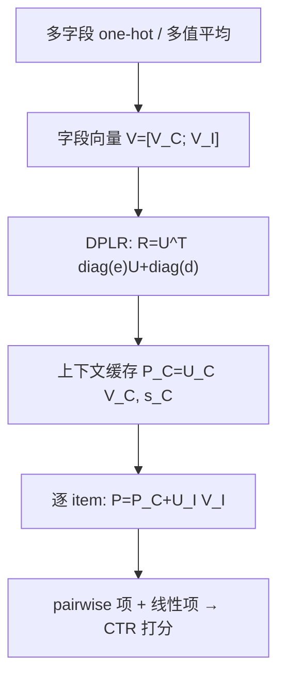

# Low Rank Field-Weighted Factorization Machines for Low Latency Item Recommendation (低秩字段加权因子分解机用于低延迟物品推荐)

- **会议/期刊**: RecSys 2024
- **作者与机构**: Alex Shtoff, Michael Viderman, Naama Haramaty-Krasne, Oren Somekh, Ariel Raviv, Tularam Ban; Yahoo Research
- **推荐链路定位**: 精排（广告 CTR 预估与候选排序）
- **研究方向**: CTR/CVR 预估与特征交叉 / 工业级低延迟架构
- **论文原文**: [论文原文链接](https://arxiv.org/abs/2408.00801v1)
- **开源代码**: [开源代码仓库链接](https://github.com/michaelviderman/pytorch-fm)

## TL;DR (1分钟核心速览)

针对 FwFM 在广告精排中推断随字段数平方增长的痛点，本文用对角+对称低秩分解重参数化字段交互矩阵，并利用上下文缓存把逐物品推断降到 $O(\rho|I|k)$。在 Criteo/Avazu/MovieLens 的点式评测中，同参数预算下 DPLR 优于剪枝 FwFM，Criteo rank1 AUC 提升 0.61%、LogLoss 降低 1.30%；线上 82 字段广告系统推理 P95 延迟降 29.11%。

## Background & Motivation (背景与核心矛盾)

- **主流范式**: FM 以二阶交叉建模稀疏特征，且通过代数恒等式把推断降到线性复杂度；FwFM 进一步用字段交互矩阵 $R$ 提升精度，是低延迟广告 CTR 的常用精排模型。
- **前人局限**: FwFM 推断需显式算所有字段对，复杂度 $O(m^2k)$；工业上只能按幅度剪枝$R$，但激进剪枝会丢失弱而有效的交互，精度明显下降。
- **核心洞察 (Key Insight)**: 字段交互矩阵常呈块状、低有效秩；但普通 FM 的 $R_{FM}=11^\top-I$ 是满秩矩阵，纯低秩近似连 FM 都表达不了，必须保留对角项。
- **本文切入点**: 用“对角 + 对称低秩”分解 $R$，把上下文相关计算按 query 缓存一次，逐 item 只算 item fields。

## Method (核心方法设计)

### 1. 整体框架 (Overall Architecture)

输入为多字段 one-hot 向量（多值字段如 genres 取嵌入平均），得到字段向量矩阵 $\mathbf{V}=[\mathbf{V}_C;\mathbf{V}_I]$。模型不直接学习$R$，而学习其 DPLR 分解；推断时先按上下文缓存$U_CV_C$与对角项上下文贡献，再对每个候选 item 计算$P=U_CV_C+U_IV_I$并输出 pairwise 交互项与线性项，最后接 sigmoid 得 CTR。训练仍走标准点式损失，推断复杂度从$O(m^2k)$降到$O(\rho|C|k)$每 query +$O(\rho|I|k)$ 每 item。

### 2. 关键设计拆解 (Key Designs)

1. **DPLR-FwFM 重参数化（解决满秩与零对角矛盾）**：FwFM 直接学 $R$导致$O(m^2k)$；本文令$\mathbf{R}=\mathbf{U}^\top\mathrm{diag}(e)\mathbf{U}+\mathrm{diag}(d)$，且$d_i=-[\mathbf{U}^\top\mathrm{diag}(e)\mathbf{U}]_{ii}$强制零对角。对角项吸收$R_{FM}$的$-I$ 异常，低秩项共享跨字段交互结构，因此低秩也不牺牲 FM 表达能力。
2. **上下文缓存与逐物品快速推断**：由 $\mathrm{Tr}(\mathbf{V}^\top\mathbf{R}\mathbf{V})$得 pairwise 项$=\sum_i d_i\|v_i\|^2+\sum_{r=1}^{\rho}e_r\|P_{r,:}\|^2$，其中$P=UV$。拆分后$U_CV_C$与$\sum_{i\in C}d_i\|v_i\|^2$每 query 只算一次，逐 item 仅$O(\rho|I|k)$；比 FM 只慢常数$\rho$，却保留字段交互。
3. **训练目标、负采样与推理开销**：CTR 用点式 LogLoss $\mathcal{L}=-\frac{1}{N}\sum_i[y_i\log\hat y_i+(1-y_i)\log(1-\hat y_i)]$；MovieLens 用 MSE。无采样负例，曝光未点击即负；稀有特征替换为 `rare`，数值特征按$\lfloor\ln^2(x)\rfloor$分桶。训练亦从$O(m^2k)$降至$O(\rho mk)$，线上只需缓存上下文向量。

## Experimental Setup & Evaluation Protocol (实验设置与评估协议)

- **数据集与预处理**:

| 数据集 | #Users | #Items | #Interactions | 字段数/稀疏度 | 特征/场景说明 |
| :--- | :---: | :---: | :---: | :---: | :--- |
| Criteo | 未披露 | 未披露 | ~45M | 39 / 高度稀疏 | Display 广告 CTR，类别高基数 |
| Avazu | 未披露 | 未披露 | ~40M | 33 / 高度稀疏 | 移动广告 CTR |
| MovieLens-1M | 6,040 | 3,706 | ~1M / 4.47% | 8 原始→11 展开 | 评分回归，genres 多值平均 |

- **数据划分与防穿越**: 公开集随机 80%/10%/10% 训练/验证/测试；验证集仅调学习率。未采用全局时间切分，CTR 场景存在一定时间穿越风险。
- **排名评测协议**: 非 Full-Ranking/Sampled Ranking；CTR 任务用点式 AUC、LogLoss，MovieLens 用 MSE；线上按 query 对候选广告逐条打分后排序。
- **对比基线与超参**: FM、完整 FwFM、同参数预算 Pruned FwFM、DPLR-FwFM；按 $\rho(m+1)$匹配参数量，rank 1–5，embedding$k\in\{8,16\}$，Optuna 调 lr。

## Key Experimental Results (实验关键数据)

### 1. 主实验对比 (Main Results)

下表为 $k=16$，DPLR 与同参数剪枝模型对比；括号内为 DPLR 相对 Pruned 的改善，LogLoss/MSE 按误差下降计。

| 数据集/指标 | FM | FwFM | Pruned-r1 | DPLR-r1 (Δ) | Pruned-r2 | DPLR-r2 (Δ) |
| :--- | :---: | :---: | :---: | :---: | :---: | :---: |
| Criteo AUC | 0.8069 | **0.8100** | 0.8020 | 0.8069 (+0.61%) | 0.8049 | 0.8066 (+0.21%) |
| Criteo LogLoss | 0.4449 | **0.4417** | 0.4508 | 0.4449 (+1.30%) | 0.4469 | 0.4454 (+0.34%) |
| Avazu AUC | 0.7787 | **0.7796** | 0.7738 | 0.7776 (+0.49%) | 0.7756 | 0.7769 (+0.16%) |
| Avazu LogLoss | 0.3800 | **0.3795** | 0.3830 | 0.3810 (+0.52%) | 0.3817 | 0.3812 (+0.11%) |
| MovieLens MSE | **0.7376** | 0.7394 | 0.7630 | 0.7445 (+2.43%) | 0.7484 | 0.7398 (+1.15%) |

DPLR 未超过完整 FwFM，但在同参数压缩预算下全面优于剪枝模型。

### 2. 消融实验 (Ablation Study)

原文未做逐组件消融；下表用 Criteo $k=16$ 的秩/稀疏度扫描验证 DPLR 相对剪枝的必要性。

| 配置 | AUC | LogLoss | 相对同参数 Pruned |
| :--- | :---: | :---: | :---: |
| Full FwFM | 0.8100 | 0.4417 | 上界参考 |
| Pruned r1 | 0.8020 | 0.4508 | — |
| DPLR r1 | 0.8069 | 0.4449 | +0.61% / +1.30% |
| Pruned r2 | 0.8049 | 0.4469 | — |
| DPLR r2 | 0.8066 | 0.4454 | +0.21% / +0.34% |
| Pruned r3 | 0.8076 | 0.4444 | — |
| DPLR r3 | 0.8083 | 0.4435 | +0.09% / +0.21% |

### 3. 关键实验发现 (Key Findings)

1. **同参数预算下低秩优于幅度剪枝**：Criteo r1 上 DPLR 比 Pruned 的 AUC 高 0.61%、LogLoss 低 1.30%；Avazu 分别 +0.49%/+0.52%，MovieLens MSE 改善 2.43%。说明“按幅度置零”丢弃了弱但有用的全局交互。
2. **低秩本身即正则，rank 1–3 是甜点**：Criteo r3 仍有 +0.09%/+0.21% 增益，但 r4/r5 的 AUC 已略输同参数剪枝（-0.05%/-0.10%）；过度增大秩反而失去正则收益。
3. **工业延迟收益明确**：82 字段广告系统部署 rank3，相对生产 FwFM LogLoss 改善 0.36%、AUC 提升 0.10%；单次推理平均延迟降 34.27%，P95/P99 分别降 29.11%/25.57%，整 query 排序 P95 降 5.45%。

## Highlights & Limitations (亮点、对比与审稿批判)

- **与代表作对比 (vs. Prior Work)**: 完整 FwFM 精度高但 $O(m^2k)$；工业剪枝靠阈值置零，快但伤精度。本文把$R$ 改为 DPLR 并做上下文/物品拆分，兼具字段交互与近 FM 推断。相比一般低秩 FM，本文显式加入对角项并利用 item/context 缓存，这是低延迟系统的关键。
- **可迁移亮点**: 对角+低秩可推广到任意字段交互矩阵压缩；上下文缓存适用于“user/context 固定、item 变化”的召回/精排打分。
- **审稿级局限批判**: ①公开集提升幅度小，且随机划分而非时间切分，线上仅 10 小时小流量验证；②仍依赖秩 $\rho$与字段划分，多值字段平均会丢信息；事后对已训练$R$ 做 DPLR 近似误差谱更差，说明必须训练时分解。

## Rating (四维评分)

- **方法创新性 (Novelty)**: ⭐⭐⭐⭐ （DPLR 重参数化并非全新，但零对角约束+上下文缓存把 FwFM 推断压到 item fields，工程洞察强）
- **评估协议与实验扎实度 (Protocol & Experiments)**: ⭐⭐⭐ （三公开集+线上延迟较完整，但随机划分、无全库排序、缺逐组件消融）
- **写作与数学规范度 (Clarity & Rigor)**: ⭐⭐⭐⭐ （恒等式与复杂度推导清楚，DPLR 动机用 FM 满秩反例讲透）
- **工业落地与复现价值 (Industrial & Practical Value)**: ⭐⭐⭐⭐⭐ （代码可用，批矩阵乘即可实现，线上 P95 延迟下降显著）

