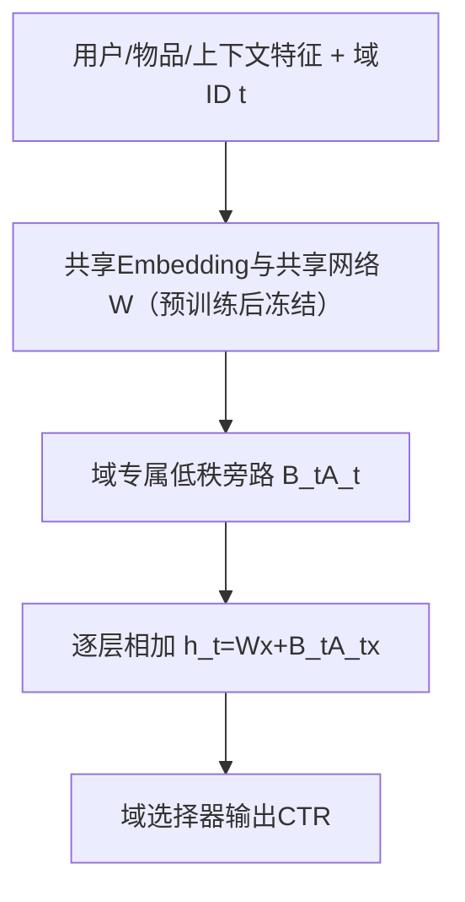
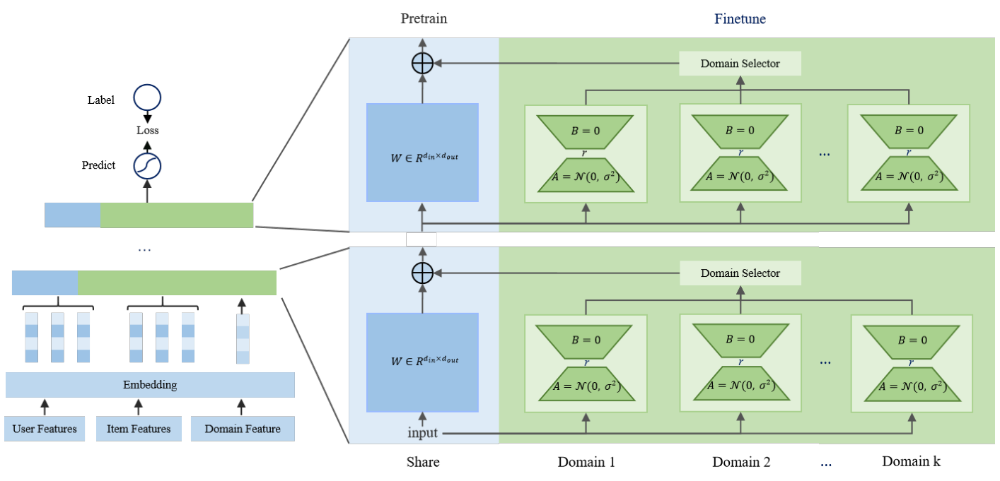

# MLoRA: Multi-Domain Low-Rank Adaptive Network for CTR Prediction (多域低秩自适应CTR预估网络)

- **会议/期刊**: RecSys 2024
- **作者与机构**: Zhiming Yang, Haining Gao, Dehong Gao, Luwei Yang, Libin Yang, Xiaoyan Cai, Wei Ning, Guannan Zhang；西北工业大学、阿里巴巴
- **推荐链路定位**: 精排 / CTR预估
- **研究方向**: CTR/CVR预估与特征交叉 / 跨域与多场景推荐
- **论文原文**: [https://arxiv.org/abs/2408.08913v1](https://arxiv.org/abs/2408.08913v1)
- **开源代码**: [https://github.com/gaohaining/MLoRA](https://github.com/gaohaining/MLoRA)

## TL;DR (1分钟核心速览)

针对多域CTR中独立建模数据稀疏、混合建模抹平域差异、STAR/PLE式专属FCN参数膨胀且小域欠训练的问题，本文提出MLoRA：冻结共享主干，为每个域注入低秩适配器，逐层输出$h_t=W\mathbf{x}+B_tA_t\mathbf{x}$，并按层宽自适应设定秩。Taobao、Amazon、Movielens多域基准的WAUC平均提升0.50点，Amazon-6相对提升1.13%；阿里线上CTR +1.49%、CVR +3.37%、付费买家 +2.71%，新增参数仅1.76%。

## Background & Motivation (背景与核心矛盾)

- **主流范式**: 多域CTR有独立单域模型、全量混合统一模型、共享网络+域专属模块三条路线；STAR、MMoE、PLE是代表。
- **前人局限**: 独立模型受限于单域稀疏；混合模型共享充分却忽视域分布差异；STAR/PLE复制域专属FCN，参数激增且小数据域训练不足。
- **核心洞察 (Key Insight)**: 域间差异可视为共享主干上的低秩参数偏移，无需复制完整网络；LoRA的$\Delta W=BA$足以以极少参数刻画域个性化。
- **本文切入点**: 每域配置一个LoRA旁路，先混合数据预训练共享主干，再冻结主干、仅微调各域$A_t/B_t$，实现“共享泛化+域低秩特化”。

<figure class="paper-figure" markdown="span">
  ![图 2：(a) 为每个域训练分离模型。(b) 通过混合多域数据训练统一模型。(c) 多域框架 \[29, 45, 48\]。(d) 我们提出的 MLoRA。](../../../../assets/papers/2408.08913v1/figure_2.png)<figcaption>图 2：(a) 为每个域训练分离模型。(b) 通过混合多域数据训练统一模型。(c) 多域框架 [29, 45, 48]。(d) 我们提出的 MLoRA。</figcaption>
</figure>

## Method (核心方法设计)

### 1. 整体框架 (Overall Architecture)

输入用户、物品、上下文特征与域ID $t$；Embedding和共享FCN先在混合多域数据上预训练，学习跨域共性。微调阶段冻结共享主干，每层并联域专属低秩网络$B_tA_t$，与共享输出逐层相加，再由域选择器按$t$路由对应适配器得到$\hat{y}_t$。推理时仅需选择域对应低秩矩阵，新增域只需追加并微调新适配器；训练目标为BCE，整体是模型无关的插件式多域适配框架。

<figure class="paper-figure" markdown="span">
  <figcaption>图 3：所提出 MLoRA 的总体架构，包括输入特征、嵌入层、共享网络、多域网络和域选择器。每个域网络由低秩矩阵 A 和 B 组成，域网络与共享网络的输出相加，作为整个层的输出。嵌入层和共享网络在预训练阶段训练，域网络在微调阶段训练。</figcaption>
</figure>

### 2. 关键设计拆解 (Key Designs)

1. **域专属低秩适配 (Domain-Specific LoRA)**：针对专属FCN参数多且小域欠训练，将每层拆为共享$W$与域偏移$\Delta W_t=B_tA_t$，$h_t=W\mathbf{x}+B_tA_t\mathbf{x}$。$A_t$高斯初始化、$B_t$零初始化使初始$\Delta W_t=0$，不破坏预训练表示；小域只需学习低秩偏移，降低过参数化与欠拟合风险。
2. **温度系数自适应秩 (Temperature-Controlled Rank)**：CTR各层宽度差异大，固定秩不公平。令$r=\max(d_{\text{out}}/\alpha,1)$，$\alpha$越大秩越小；底层输出维度高时自动压缩，避免适配器参数膨胀。离线$\alpha=32$，线上取16并限制$A/B$参数不超过1024。
3. **两阶段训练与推理**：预训练用混合大数据学习共享分布；微调只更新各域$A_t,B_t$，损失为$\mathcal{L}_{\text{BCE}}=-\frac{1}{N}\sum_i[y_i\log\hat{y}_i+(1-y_i)\log(1-\hat{y}_i)]$。原文未报告额外负采样/重采样策略；推理按域选择适配器，路由开销近似为零，新增域可热插拔。

## Experimental Setup & Evaluation Protocol (实验设置与评估协议)

- **数据集与预处理**: 基于Taobao主题场景构造Taobao-10/20/30，Amazon按品类取6域，Movielens按性别构造2域；未报告`5-core`过滤。

| 数据集 | #Users | #Items | #Interactions | 稀疏度/密度 | 特征/场景说明 |
| :--- | :---: | :---: | :---: | :---: | :--- |
| Amazon-6 | 445,789 | 172,653 | 16,926,876 | 密度0.022% | 6个商品品类域 |
| Taobao-10 | 23,778 | 6,932 | 173,284 | 密度0.105% | 10个主题场景 |
| Taobao-20 | 58,190 | 16,319 | 446,683 | 密度0.047% | 20个主题场景 |
| Taobao-30 | 99,143 | 29,945 | 725,426 | 密度0.024% | 30个主题场景 |
| Movielens-gen | 6,041 | 3,953 | 1,000,209 | 密度4.19% | 性别二域 |

- **数据划分与防穿越 (Splitting Strategy)**: `Random 60/20/20 split`，训练/验证/测试随机比例划分，非全局时间戳切分；存在时间外推乐观风险。
- **排名评测协议 (Ranking Protocol)**: CTR二分类评估，采用按域样本量加权的`WAUC`，$\text{WAUC}=\sum_i\omega_i\text{AUC}_i$；不是Full-Ranking或Sampled Ranking协议，未报告校准指标。
- **对比基线与超参设置**: 单域MLP/WDL/NFM/AutoInt/PNN/DCN/FiBiNET/DeepFM/xDeepFM与多域STAR；隐藏层$[256,128,64]$，学习率0.001，dropout 0.5，batch 1024，Amazon/Movielens embedding维度$d=8$，Taobao使用已有embedding；配对T检验，AUC 0.1%视为显著。

## Key Experimental Results (实验关键数据)

### 1. 主实验对比 (Main Results)

| 数据集 | 版本 | MLP | STAR | NFM | AutoInt | PNN | FiBiNET | DeepFM | xDeepFM | Avg |
| :--- | :--- | ---: | ---: | ---: | ---: | ---: | ---: | ---: | ---: | ---: |
| Taobao-10 | Base | 72.92 | 75.51 | 76.88 | 75.56 | 76.42 | 76.51 | 75.01 | 75.26 | 74.93 |
| Taobao-10 | +MLoRA | 74.53 | 76.17 | **77.08** | 75.83 | 76.74 | 76.77 | 75.66 | 75.64 | 75.41 |
| Taobao-10 | Δ | +1.61 | +0.66 | +0.20 | +0.27 | +0.32 | +0.26 | +0.65 | +0.38 | +0.48 |
| Amazon-6 | Base | 75.07 | 77.26 | 65.07 | 74.10 | 74.03 | 74.93 | 73.55 | 74.64 | 73.75 |
| Amazon-6 | +MLoRA | **77.48** | 77.28 | 67.41 | 74.46 | 75.18 | 75.27 | 74.08 | 74.83 | 74.58 |
| Amazon-6 | Δ | +2.41 | +0.02 | +2.34 | +0.36 | +1.15 | +0.34 | +0.53 | +0.19 | +0.83 |

平均提升：Taobao-10 +0.48 pt（+0.64%）；Amazon-6 +0.83 pt（+1.13%）；Movielens-gen +0.18 pt（+0.22%），三数据平均+0.50 pt。FiBiNET+MLoRA在Movielens-gen达80.74%。

### 2. 消融实验 (Ablation Study)

| 消融/敏感度 | 设置 | WAUC(%) | Δ/结论 |
| :--- | :--- | :---: | :--- |
| w/o MLoRA | Taobao-10共享混合 | 74.93 | — |
| +MLoRA | $\alpha=32$ | 75.41 | +0.48 |
| 域数增加 | Taobao-20 Base→+ | 78.27→78.62 | +0.35 |
| 域数增加 | Taobao-30 Base→+ | 77.44→77.73 | +0.29 |
| 网络宽度 | MLP+MLoRA 1x→5x | 75.39→76.93 | +1.54 |
| 秩敏感度 | 最优$\alpha$: MLP/DeepFM/FiBiNET | 128/64/32 | 模型越复杂需更小$\alpha$、更大$r$ |

### 3. 关键实验发现 (Key Findings)

1. **普遍增益且域差异越大收益越高**：10个基模型三数据平均提升0.50点；Amazon-6因域分布差异大、数据量大，平均+0.83点（+1.13%），Movielens-gen仅+0.18点，说明MLoRA主要在域异构时兑现价值。
2. **小域与过参数化模型受益最明显**：Taobao-10的MLP在Domain_1、Domain_6分别提升4.02、3.55点AUC，小域稀疏性被低秩偏移显著缓解；STAR+MLoRA仍平均+0.66点，验证其能修正专属FCN的欠训练。
3. **域数增多收益递减，主干容量是瓶颈**：Taobao-10/20/30的平均提升为0.48/0.35/0.29点；将MLP+MLoRA隐藏层从1x扩到5x，WAUC由75.39升至76.93，说明冻结主干的容量与适配器秩需随数据/域数协同扩展。

## Highlights & Limitations (亮点、对比与审稿批判)

- **与代表作对比 (vs. Prior Work)**: 相比STAR复制共享FCN+PN，MLoRA只加低秩旁路，线上参数仅+1.76%；相比MMoE/PLE依赖专家或门控扩容，它以$B_tA_t$实现轻量域特化；相比独立单域模型和全量混合模型，同时保留跨域共享与域内差异。
- **可迁移亮点**: “冻结共享大模型+每域低秩适配+按层宽设秩”可直接迁移到多场景精排、跨业务CVR与多租户推荐；新域热插拔适合快速试新场景。
- **审稿级局限批判**: 采用随机60/20/20划分而非时间切分，CTR评估仅WAUC，缺少校准与时间外推验证；$\alpha$需逐模型调（最优128/64/32），且冻结主干使域数增加时增益由0.48降至0.29，主干与适配器联合微调仍是开放问题。

## Rating (四维评分)

- **方法创新性 (Novelty)**: ⭐⭐⭐⭐ （将LoRA的低秩域偏移引入多域CTR，机制简洁且模型无关，但本质是参数高效微调的跨域迁移）
- **评估协议与实验扎实度 (Protocol & Experiments)**: ⭐⭐⭐⭐ （5个多域数据集、10类基线与线上A/B较完整；但随机划分、仅WAUC、缺校准/时间切分）
- **写作与数学规范度 (Clarity & Rigor)**: ⭐⭐⭐⭐ （核心公式与两阶段流程清晰，温度系数秩设计有解释；部分训练细节与复杂度分析略简）
- **工业落地与复现价值 (Industrial & Practical Value)**: ⭐⭐⭐⭐⭐ （已上线Alibaba.com，10域参数仅+1.76%，CTR/CVR/付费买家均正向，开源代码可复现）

