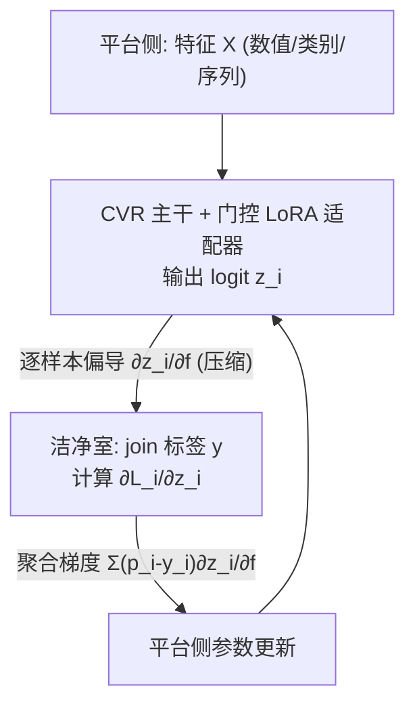
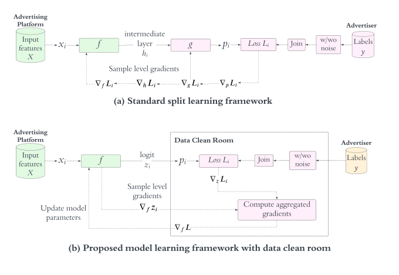
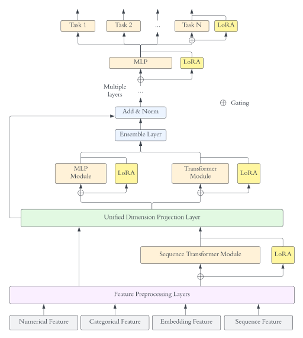

# Privacy Preserving Conversion Modeling in Data Clean Room (数据洁净室中的隐私保护转化率建模)

- **会议/期刊**: RecSys 2024 (18th ACM Conference on Recommender Systems, Bari, Italy)
- **作者与机构**: Kungang Li, Xiangyi Chen, Ling Leng, Jiajing Xu, Jiankai Sun, Behnam Rezaei — Pinterest Inc.
- **推荐链路定位**: 精排 (CVR 预估)
- **研究方向**: CTR/CVR 预估与特征交叉 / 去偏公平、可信隐私与工业架构
- **论文原文**: [arXiv:2505.14959](https://arxiv.org/abs/2505.14959v1)
- **开源代码**: 暂未开源

## TL;DR (1分钟核心速览)

广告主不愿把转化标签交给平台，而数据洁净室算力与带宽受限，标准拆分学习（split learning）又必须回传样本级梯度、存在标签反演风险。本文提出「批量聚合梯度 + 门控 LoRA 适配器 + 梯度压缩 + 标签 DP 去偏」四件套：平台只发 $\partial z_i/\partial f$，洁净室聚合后回传$\nabla_f\mathcal{L}$，全部可训练参数留在平台侧以支持单边推理。工业数据集（10B 曝光、约 300 特征）上仅训 1% 参数即获全量微调 95% 的 ROC-AUC 收益（+3.44% vs +3.63%），$\epsilon=3$ 的标签 DP 配去偏后 AUC 仅降 0.5%、校准比回到 1.0，8-bit 压缩再降 0.61%，线上 A/B 预估 CPA 下降 10%+。

## Background & Motivation (背景与核心矛盾)

- **主流范式**: 广告平台用自家特征 + 广告主回传的转化标签训练大规模 CVR 精排模型；隐私敏感场景下改走洁净室（clean room）做双方 ID 匹配后的联合训练，常见技术底座是拆分学习。
- **前人局限一**: 标准拆分学习在洁净室与平台之间交换**样本级梯度** $(\nabla_f L_i)$，DLG 类梯度匹配攻击可由梯度反推标签，广告主无法接受。
- **前人局限二**: 洁净室算力低、训练可见性差、按量计费，且线上推理由平台独立完成——拆分学习"半模型推理"的形态与工业推理链路根本不兼容。
- **核心洞察 (Key Insight)**: 若干净室只做「标签 join + 标量损失求导 + 批内求和」这类零成本计算，而把全部参数与非线性计算留在平台，则隐私与工程可落地性可同时满足；再叠加标签 DP 时必须显式纠正类别极度不平衡下的概率偏移。
- **本文切入点**: 用**批量级聚合梯度替代样本级梯度**作为隐私屏障，用**参数高效适配器**对抗通信瓶颈，用**标签转移概率入损失**消除 DP 带来的校准崩塌。

## Method (核心方法设计)

### 1. 整体框架 (Overall Architecture)

平台（特征方）持有原始特征 $X$，执行从预处理、序列 Transformer、特征交叉到多任务塔的全部前向计算，产出 logit$z_i$与服务侧所需完整模型参数；洁净室（标签方，广告主）仅接收 logit，与含噪标签$y$做 join、计算损失对 logit 的偏导$\partial L_i/\partial z_i$，并把平台传来的逐样本$\partial z_i/\partial f$ 在批内加权求和成聚合梯度回传，由平台执行参数更新。整条链路上，洁净室只接触标量与低维偏导，不持有任何模型层，因此线上推理天然闭环；训练阶段的可训练参数被 LoRA 适配器压缩到 1% 量级，再叠加 QSGD/BF16 梯度压缩以适配 10 Gbps 带宽下的洁净室。

<figure class="paper-figure" markdown="span">
  <figcaption>图1：(a) 标准拆分学习框架与 (b) 所提出的用于在数据洁净室中训练转化模型的框架对比。</figcaption>
</figure>

### 2. 关键设计拆解 (Key Designs)

1. **批量级聚合梯度协议 (Batch-Level Aggregated Gradient)**：痛点是不回传样本级梯度就无法更新模型。核心算子是把 BCE（sum reduction）的链式拆解移到洁净室侧完成：
   $\nabla_f \mathcal{L}=\sum_{i=1}^{b}(p_i-y_i)\,\frac{\partial z_i}{\partial f}$，
   平台只发送 $\partial z_i/\partial f$，洁净室用含隐私预算的$y$计算残差$(p_i-y_i)$后求和回传。由于每轮批大小$b$达$10^4$量级，攻击者面对的方程数$b$远大于未知量难以唯一定解；当可训练参数量$\|f\|>b$ 时再叠加 DP 噪声封堵"参数多于方程"的反解路径。直觉：把标签信息稀释进一个标量和的统计平均里。

2. **门控 LoRA 适配器 + 梯度压缩 (Gated Adapter & Compression)**：痛点是 TB 级 CVR 主干逐样本偏导回传需 2.5 天。作者在序列 Transformer 的 QKV、特征交叉线性层与多任务塔线性层插入门控 LoRA（低秩旁路 + 门控加权融合），仅训 0.06M–4M 参数（全量 200M 的 0.03%–2%），并在发送前用 QSGD 8-bit / BF16 量化把偏导压至 4×。关键是所有 LoRA 参数挂在平台侧主干上，不破坏"平台独立推理"的部署形态。

<figure class="paper-figure" markdown="span">
  <figcaption>图2：基于 Adapter 的 CVR 模型。</figcaption>
</figure>

3. **标签 DP 去偏损失 (De-biased Label DP Loss)**：痛点是对称翻转噪声下 BCE 会系统性偏移，CVR 校准比飙到 4.0。设保留原标签概率 $q_\epsilon=\frac{e^{\epsilon}}{e^{\epsilon}+1}$，则观测标签期望为$\tilde{p}_i = p_i q_\epsilon+(1-p_i)(1-q_\epsilon)$，作者直接把该期望概率塞回原损失：
   $l_{\text{deb}}(p_i)=l\big(p_i q_\epsilon+(1-p_i)(1-q_\epsilon)\big)$。
   该式等价于对噪声转移矩阵做解析解卷积，无额外参数、零推理开销，因此在高不平衡 CVR 上能同时恢复排序与校准。

- **训练目标与开销**: 主任务 CVR + 5 个辅助任务（CTR 等）多任务联合，总损失为各塔加权 BCE；无负采样概念（真实转化标签）。通信侧仅回传逐样本偏导（压缩后）与一个聚合梯度向量；推理侧与普通 CVR 模型完全一致，LoRA 权重可离线合并进主干，**零额外延迟**。

## Experimental Setup & Evaluation Protocol (实验设置与评估协议)

- **数据集与预处理**: 全部为 Pinterest 内部工业数据，未公开。主任务为 click-through CVR，另含 5 个辅助任务；约 300 个特征，含数值、类别与序列特征。

| 数据集 | #Users | #Items | #Interactions | 稀疏度/密度 | 特征/场景说明 |
| :--- | :---: | :---: | :---: | :---: | :--- |
| Pinterest 工业日志 | 未披露 | 未披露（广告维度） | > 10B 条曝光 | 转化极稀疏（CVR ≪ CTR） | 约 300 特征；数值+类别+序列；1 主任务 + 5 辅助任务 |

- **数据划分与防穿越 (Splitting Strategy)**: 工业离线流水按时间顺序组织（原文未显式声明 LOO / 比例切分细节），以"1 天数据"为通信成本核算单位。
- **排名评测协议 (Ranking Protocol)**: 仅报告 **ROC-AUC**（全库打分下的排序指标），作者称其与线上业务指标强相关；同时报告**校准比（Calibration，理想值 1.0）**衡量 DP 噪声下的概率无偏性。未采用 Sampled Ranking，也未做显著性检验。
- **对比基线与超参设置**: 基线为「无转化数据」的 CVR 模型；对照组为全参数微调、LoRA rank ∈ {64, 32, 1}（对应可训参数 200M / 4M / 2M / 0.06M）、以及 $\epsilon \in \{5,3\}$ 的标签 DP（含/不含去偏）、QSGD 8-bit、BF16 16-bit。

## Key Experimental Results (实验关键数据)

### 1. 主实验对比 (Main Results)

| 模型设置 | ROC-AUC 相对变化 | #可训参数 (M) | 备注 |
| :--- | :---: | :---: | :--- |
| Baseline（无转化数据） | 0 | 200 | 下限参照 |
| Fine-tune all params | **+3.63** | 200 | 性能上界，通信不可承受 |
| Fine-tune LoRA (rank 64) | +3.48 | 4 | 保留上界的 95.9% |
| Fine-tune LoRA (rank 32) | +3.44 | 2 | **本文默认配置** |
| Fine-tune LoRA (rank 1) | +3.02 | 0.06 | 极低带宽兜底 |
| QSGD 8-bit 压缩 | −0.61 | 2 | 4× 压缩代价 |
| BF16 16-bit 压缩 | −0.67 | 2 | 4× 压缩代价 |

### 2. 消融实验 (Ablation Study)

| 隐私组件配置 | ROC-AUC 相对变化 | 校准比 Calibration |
| :--- | :---: | :---: |
| Baseline（无隐私约束） | 0 | 1.0 |
| 标签 DP, $\epsilon=5$，**无去偏** | −2.1 | 1.4 |
| 标签 DP, $\epsilon=3$，**无去偏** | −8.3 | 4.0 |
| 标签 DP, $\epsilon=5$，**+ 去偏** | **−0.2** | **1.0** |
| 标签 DP, $\epsilon=3$，**+ 去偏** | **−0.5** | **1.0** |

### 3. 关键实验发现 (Key Findings)

1. **参数效率极高**：2M 可训参数（全量的 1%）拿到 +3.44 的 AUC 增益，为全量微调 +3.63 的 94.8%；对 10 Gbps 带宽的大广告主，单日数据训练时长从 2.5 天压到 1 小时以内，是"可上线"与"不可上线"的分水岭。
2. **去偏项是 DP 落地的必要条件而非可选优化**：$\epsilon=3$ 时无去偏 AUC 崩 8.3%、校准比 4.0（预测概率被系统性高估 4 倍，直接毁掉出价），加去偏后 AUC 只降 0.5%、校准比精确回 1.0——说明该解析解卷积几乎无损地抵消了标签翻转噪声。
3. **压缩与隐私的代价可叠加但均温和**：4× 梯度压缩（QSGD/BF16）仅损失 0.6% 左右 AUC，与 LoRA 的参数削减正交；结合线上 A/B，作者预估对缺乏转化数据的广告主可降 CPA 10%+，即隐私成本被广告效率收益完全覆盖。

## Highlights & Limitations (亮点、对比与审稿批判)

- **与代表作对比 (vs. Prior Work)**: 相较标准拆分学习（如 SplitNN / VFL 系列）把"切模型"作为隐私边界，本文把边界上移到"标量损失求导"，从根上消除样本级梯度泄露面；相较纯广告主侧建模（无平台特征的 baseline），本文通过 logit 交换获得了平台 300 维特征与序列行为的信息增益；相较在洁净室内直接训练大模型，本文用 1% 适配器绕过了算力与计费瓶颈。
- **可迁移亮点**: (1)「平台发偏导、标签方回传聚合残差」的梯度协议可平移到任何双边数据不可共享的联合建模场景（如金融机构×电商、医院×药企）；(2) 把 DP 噪声转移概率直接代入损失函数的 $l_{\text{deb}}$ 技巧，无参、零推理开销，可直接复用到任何带标签噪声的 CVR/CTR 精排任务。
- **审稿级局限批判**: (1) **隐私论证偏定性**——仅以"批大 $10^4$"和"参数量超过批大时加 DP"作为防御论据，既无形式化隐私预算会计（隐私放大/组合定理），也无 DLG 类攻击的实证实验；(2) **实验证据薄弱**——全文仅 5 页，全部为单公司内部数据、单指标 ROC-AUC，无公开基准、无多次运行的方差或显著性检验，且校准比定义与计算方式未给出，可复现性与泛化性存疑；此外通信成本核算依赖特定带宽假设，缺乏与其它 VFL 方案的横向对比。

## Rating (四维评分)

- **方法创新性 (Novelty)**: ⭐⭐⭐⭐ （把拆分学习边界从"层"推到"标量损失导数"，并以标签 DP 解析去偏补齐校准，工程组合新颖但单项技术多为已有组件的巧妙拼装）
- **评估协议与实验扎实度 (Protocol & Experiments)**: ⭐⭐⭐ （有工业规模数据与线上 A/B 预估，但仅 ROC-AUC 单指标、无显著性检验、无公开数据集与攻击实验，协议严谨度偏弱）
- **写作与数学规范度 (Clarity & Rigor)**: ⭐⭐⭐⭐ （$q_\epsilon$与$l_{\text{deb}}$ 的推导干净利落、公式极少但命中要害；隐私保证缺乏形式化引理是清晰度之外的硬伤）
- **工业落地与复现价值 (Industrial & Practical Value)**: ⭐⭐⭐⭐⭐ （所有设计均围绕上线约束——平台独立推理、1 小时训练、零推理延迟、CPA 降 10%，是少见的"能直接照抄架构"的隐私 CVR 论文，唯代码未开源）

