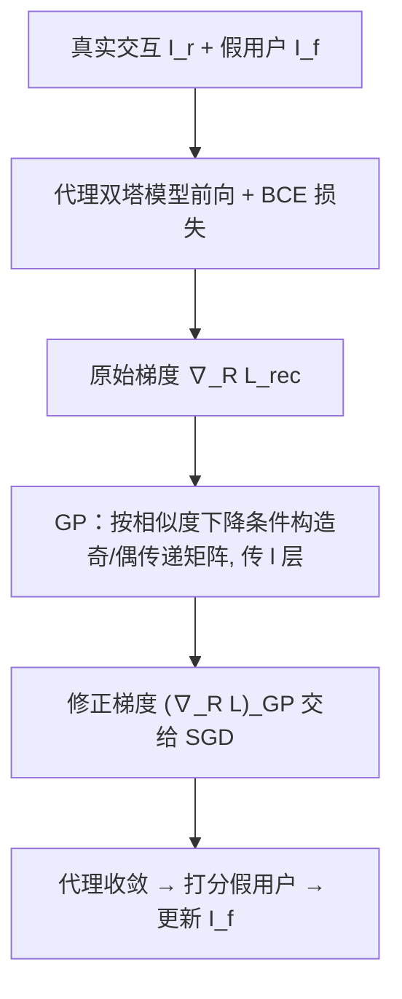
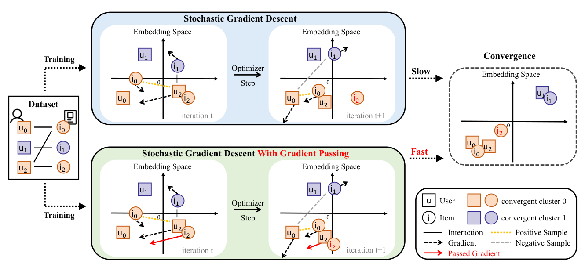

# Accelerating the Surrogate Retraining for Poisoning Attacks against Recommender Systems (加速面向推荐系统投毒攻击的代理模型重训练)

- **会议/期刊**: RecSys 2024
- **作者与机构**: Yunfan Wu, Qi Cao, Shuchang Tao, Kaike Zhang, Fei Sun, Huawei Shen（中科院计算所 AI 安全重点实验室 / UCAS）
- **推荐链路定位**: 召回（协同过滤代理模型的训练/重训练环节）
- **研究方向**: 可信推荐（投毒攻击） / 协同过滤双塔
- **论文原文**: [https://arxiv.org/abs/2408.10666v1](https://arxiv.org/abs/2408.10666v1)
- **开源代码**: [https://github.com/WuYunfan/GradientPassingAttack](https://github.com/WuYunfan/GradientPassingAttack)

## TL;DR (1分钟核心速览)

优化式投毒攻击每更新一轮假用户，就要在中毒数据上重训练一次代理推荐器，这一步占去绝大部分攻击时间。本文提出 Gradient Passing (GP)：在反向传播时把梯度当作"消息"，沿用户-物品交互图在交互对之间显式传递，并只保留"相似度正在下降"的传递路径，使一次更新即可逼近多轮迭代的级联效应。在 Gowalla / Yelp / Tenrec 三数据集、6 个受害模型的黑盒协议下，DPA2DL+GP 平均 Recall@50 相对"重训练两轮"提升 29.57% / 18.02% / 177.21%，而耗时反而降低 43.27% / 40.54% / 26.67%。

## Background & Motivation (背景与核心矛盾)

- **主流范式**: 优化式投毒攻击（PGA、RevAdv、RAPU-R、DPA2DL）用一个代理推荐器评估假用户的攻击效果，并在每次假用户更新后于中毒数据上重训练代理模型以给出新一轮对抗梯度。
- **前人局限**: ①限制重训练轮次/时间虽省时，但代理欠训练、行为偏离受害模型，攻击效果打折；②用影响函数直接估计新假样本的影响可免重训练，但影响函数的推导假设样本已在训练中出现，对新构造的假用户不准。
- **核心洞察 (Key Insight)**: 推荐损失本质上要求交互对表征相似，因此某节点表征更新会沿交互图级联传播；而这一级联的承载信号正是**梯度**——若在反传时就把梯度传给邻居，等于提前兑现未来若干轮的传播。
- **本文切入点**: 把梯度传播从"未来多轮前向+反传"提前压缩进**当前一次反传**，用一个稀疏、可落地的传递算子近似级联，从而在同等时间预算下得到更贴近受害模型的代理。

## Method (核心方法设计)

### 1. 整体框架 (Overall Architecture)

流程仍是标准优化式攻击：注入最新假用户 → 在中毒数据上重训练代理（MF-BCE / MF-MSE 双塔）→ 用代理打分计算对抗损失并更新假用户交互。本文只改造重训练环节：反传算出原始梯度 $\nabla_{\boldsymbol{R}}\mathcal{L}_{rec}$后，GP 根据交互图与"交互对相似度是否下降"的条件构造奇/偶两个稀疏传递矩阵，把梯度在用户–物品、用户–用户、物品–物品之间各传$l=2$ 层，得到修正梯度交给 SGD；代理更快收敛到与受害模型一致的状态，攻击侧因而获得更可信的对抗反馈。推理解码零额外开销，GP 只是训练期的梯度算子。

### 2. 关键设计拆解 (Key Designs)

1. **梯度即消息：级联效应的闭式刻画（Lemma 4.1）**：前人只把"消息传递"用于前向以增强表达力，从未刻画重训练过程中的级联。作者把 BCE 损失对表征矩阵 $\boldsymbol{R}$的梯度写成邻接乘表征的形式$\nabla_{\boldsymbol{R}}\mathcal{L}_{rec}=-\boldsymbol{A}_{grad}\boldsymbol{R}$，其中块矩阵由$\boldsymbol{P}^{grad}_{i,j}=\sigma(-\boldsymbol{r}_{u_i}^{\top}\boldsymbol{r}_{i_j})$（交互对）与$-\beta\sigma(\boldsymbol{r}_{u_i}^{\top}\boldsymbol{r}_{i_j})$（非交互对）拼成。物理直觉：一次梯度下降等同于在交互图上做一次带权聚合，所以"多做几轮"与"多传几层"在数学上同源。

2. **从两步 SGD 展开到奇偶分解的可落地 GP**：直接对两步更新做代数展开可得 $\boldsymbol{R}_{t+2}=\boldsymbol{R}_t-\alpha\boldsymbol{A}_{GP}\nabla_{\boldsymbol{R}}\mathcal{L}_{rec}$，$\boldsymbol{A}_{GP}=2\boldsymbol{I}+\alpha\boldsymbol{A}^{t+1}_{grad}+(\boldsymbol{A}^{t+1}_{grad}-\boldsymbol{A}^{t}_{grad})(\boldsymbol{A}^{t}_{grad})^{-1}$，但该项依赖未来状态、需矩阵求逆且为稠密阵（$O(nmd)$）不可用。作者据其结构拆解：第二项是块反对角 → 负责**交互对之间**传梯度（odd）；第三项块对角 → 负责**用户对/物品对内部**传梯度（even）；$\boldsymbol{A}^{t+1}_{grad}-\boldsymbol{A}^{t}_{grad}$则提示只对"相似度在下降"的交互对传递，用可算的判据$-\Delta(\boldsymbol{r}_u^{\top}\boldsymbol{r}_i)\approx\boldsymbol{r}_u^{\top}\boldsymbol{g}_i+\boldsymbol{r}_i^{\top}\boldsymbol{g}_u>\xi$实现，再做 GCN 式度归一化$\boldsymbol{D}^{-1/2}\boldsymbol{A}\boldsymbol{D}^{-1/2}$。

<figure class="paper-figure" markdown="span">
  <figcaption>图2：替代推荐器在两次迭代中的表示优化：比较单独 SGD（蓝色）与使用 GP 的 SGD（绿色）。GP 通过在已交互用户-物品对之间传递梯度，加速重训练至收敛状态。</figcaption>
</figure>

3. **训练目标、传递层数与推理开销**：最终梯度为 $(\nabla_{\boldsymbol{R}}\mathcal{L})_{GP}=\nabla_{\boldsymbol{R}}\mathcal{L}_{rec}+\alpha_{odd}\boldsymbol{G}^{GP\text{-}odd}+\alpha_{even}\boldsymbol{G}^{GP\text{-}even}$，优化目标仍为$\mathcal{L}_{rec}+\mathcal{L}_{adv}$（DPA2DL 的 BCE + 对抗损失），不改负采样（每轮正负配对，沿用原攻击的 in-batch 采样）。复杂度仅$O(\|\boldsymbol{I}\|_0\,l\,d)$，与交互数线性；实测单轮重训练仅由 885s 增至 999s（Gowalla），却省掉第二轮。

## Experimental Setup & Evaluation Protocol (实验设置与评估协议)

- **数据集与预处理**: 过滤交互数 <15 的用户/物品；Yelp 取评分 >3 为交互，Tenrec 取点击为交互。

| 数据集 | #Users | #Items | #Interactions | 密度 | 场景 |
| :--- | :---: | :---: | :---: | :---: | :--- |
| Gowalla | 13,149 | 14,009 | 535,650 | 0.291% | 地理位置签到 |
| Yelp | 35,528 | 24,573 | 1,268,345 | 0.145% | 本地商户 |
| Tenrec | 1,195,207 | 97,761 | 40,806,690 | 0.035% | 新闻/短视频点击 |

- **数据划分与防穿越**: 每个用户交互按**时间戳 80%/20% 划分**为训练/验证集；中毒后受害模型在这 80%+20% 上**从零重训练**，攻击方不接触受害模型参数（黑盒，代理 MF-MSE / MF-BCE 与受害模型可不同）。
- **排名评测协议**: **Full-Ranking 式全库排序**，取 top-$k$（$k=50$）计算 Recall@50（单目标物品时退化为 HR@50），排除已交互物品；每个数据集随机抽 5 个目标物品 ×5 次重复，报均值与标准差。
- **攻击预算与基线**: 假用户数 $n_f=0.01n_r$，每假用户交互预算$\tau=$真实用户平均交互数；基线含 Random、Bandwagon、PGA、RevAdv、RAPU-R、DPA2DL 及其 ×2 轮版本；受害模型 6 个（MF-BPR、MF-APR、LightGCN、MultiVAE、NeuMF、MF-BCE）。GP 默认$l=2$，$\xi$在$\{-\infty,0,\infty\}$、$\alpha$在$\{0.1,1,10,100,1000\}$ 上按验证集调参。

## Key Experimental Results (实验关键数据)

### 1. 主实验对比 (Main Results)

6 个受害模型的平均 Recall@50(%)：

| 攻击方法 | Gowalla | Yelp | Tenrec |
| :--- | :---: | :---: | :---: |
| None（无攻击） | 0.380 | 0.229 | 0.015 |
| Bandwagon（启发式） | 0.587 | 0.399 | 0.062 |
| PGA（对抗梯度） | 0.525 | 0.343 | OOM |
| RAPU-R | 0.627 | 0.472 | 0.018 |
| RAPU-R+GP | 0.935 | 0.549 | 0.014 |
| DPA2DL | 0.703 | 1.286 | 0.096 |
| DPA2DL×2（双倍轮次） | 1.092 | 1.304 | 0.079 |
| **DPA2DL+GP** | **1.415** | **1.539** | **0.219** |
| Improv. vs. ×2 | **+29.57%** | **+18.02%** | **+177.21%** |

### 2. 消融实验 (Ablation Study)

文中以变体方式给出"是否 GP""单/双轮""预训练+采样"三轴对照（平均 Recall@50(%) 与耗时 s）：

| 变体 | Gowalla | Yelp | 时间(Gowalla/Yelp) |
| :--- | :---: | :---: | :---: |
| DPA2DL（1 轮） | 0.703 | 1.286 | 885 / 2730 |
| DPA2DL×2（2 轮） | 1.092 | 1.304 | 1761 / 5500 |
| **DPA2DL+GP（1 轮 + GP）** | **1.415** | **1.539** | **999 / 3270** |
| Pre-train（仅真实交互预训练） | 1.328 | 1.583 | — |
| Pre-train+Sample(10% 真实交互) | 5.651 | 5.248 | — |
| Pre-train+Sample×2 | 3.332 | 4.349 | — |
| **Pre-train+Sample+GP** | **7.296** | **9.671** | — |

### 3. 关键实验发现 (Key Findings)

1. **GP 严格优于"多跑一轮"而非仅等价**：Gowalla 上 +GP 得 1.415，高于 ×2 的 1.092（+29.57%），耗时却从 1761s 降到 999s（−43.27%）；在极稀疏的 Tenrec（密度 0.035%）增益放大到 +177.21%，说明阈值/权重筛选让有限的传播只作用于"信息量大的路径"，比盲目多迭代更划算。
2. **GP 缓解采样式重训练的过拟合**：Pre-train+Sample 加训一轮反而从 5.651 掉到 3.332（对 10% 子集过拟合），而 +GP 在子集上训练、在**全图**上传梯度，回升到 7.296 / 9.671，验证"梯度传递 = 用全图结构正则化局部重训练"。
3. **代理-受害一致性与受害模型类型强相关**：增益最大处是代理同构的 MF-BCE（Gowalla 1.623 vs. ×2 的 1.004，+61.65%）；APR 因面向参数扰动而非数据投毒，鲁棒收益有限（1.450 vs. 1.069）；LightGCN 上迁移不保证（部分设置 RAPU-R+GP 反降）。另测得交互对梯度余弦相似度早期 >0.5、随机对近 0，且 GP 下 5 轮重训练的 JS@50 已≈原始 10 轮，构成动机的直接实证。

## Highlights & Limitations (亮点、对比与审稿批判)

- **与代表作对比**: 相较 PGA/RevAdv（依赖高阶对抗梯度，难以扩展到百万级用户/物品），GP 只加一次稀疏图传播即可扩展；相较 DPA2DL/RAPU-R 的"限时重训练"策略，GP 不牺牲代理成熟度，反而提升其与受害模型的 Jaccard 一致性；相较影响函数路线（假设样本已见过），GP 对新造假用户天然适用。
- **可迁移亮点**: ①"梯度作为反向消息"可移植到增量学习/在线推荐的快速再收敛，或用于防御侧快速评估鲁棒性；②"只对相似度下降的边传递"这一条件门控（用 $\boldsymbol{r}^{\top}\boldsymbol{g}$近似$\Delta$ 相似度）可嵌入任意双塔训练的加速器。
- **审稿级局限批判**: ①GP 需在反传中额外构造/归一化传递矩阵，单轮开销升约 13%，且 Yelp/Tenrec 必须按概率（0.5/0.25）启用，超参 $\xi_{odd},\xi_{even},\alpha_{odd},\alpha_{even}$ 数据集敏感，缺乏自适应设定；②跨受害架构迁移不稳（LightGCN 上收益波动甚至为负），且只验证了双塔 CF 代理，未覆盖 GNN/序列推荐；③作为攻击侧工作，对防御的讨论仅停留在"防止交互数据泄露"，未给出可操作的检测/鲁棒训练方案。

## Rating (四维评分)

- **方法创新性 (Novelty)**: ⭐⭐⭐⭐ （把 GNN 式消息传递搬到反传阶段的梯度空间，并给出"一次更新≈两次 SGD"的命题与可落地奇偶分解，理论—实现闭环）
- **评估协议与实验扎实度 (Protocol & Experiments)**: ⭐⭐⭐⭐ （3 数据集 × 6 受害模型 × 5 目标集 × 5 重复的黑盒全库 Recall@50，含时间对比与预训练/采样泛化实验，惜无逐组件 w/o odd/even 的显式消融）
- **写作与数学规范度 (Clarity & Rigor)**: ⭐⭐⭐⭐ （Lemma/Proposition 与复杂度分析齐备，符号表清晰；$\boldsymbol{A}_{GP}$ 的近似误差未量化界）
- **工业落地与复现价值 (Industrial & Practical Value)**: ⭐⭐⭐⭐ （代码开源、复杂度线性于交互数、可与现有攻击/增量学习直接叠加，但主要价值在安全评测而非线上部署）

