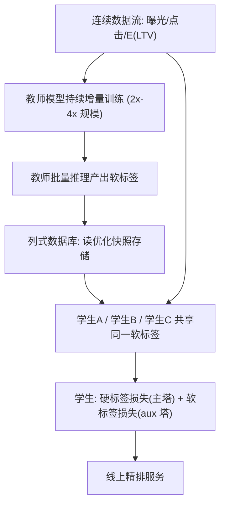
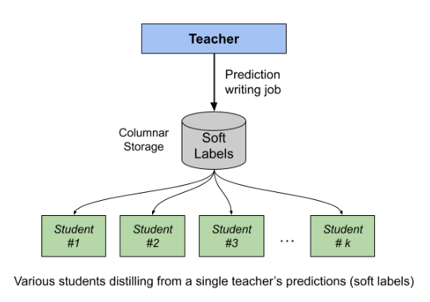

# Bridging the Gap: Unpacking the Hidden Challenges in Knowledge Distillation for Online Ranking Systems (弥合鸿沟：解构在线排序系统知识蒸馏中的隐藏挑战)

- **会议/期刊**: RecSys 2024 (Industry Track, 4 页短文)
- **作者与机构**: Nikhil Khani, Shuo Yang, Aninddh N. 等（Google / YouTube / Google DeepMind / UC Davis）
- **推荐链路定位**: 精排（多目标 pointwise 排序模型压缩与服务）
- **研究方向**: 去偏公平、可信隐私与工业架构 / 多任务学习与列表级重排
- **论文原文**: [https://arxiv.org/abs/2408.14678v1](https://arxiv.org/abs/2408.14678v1)
- **开源代码**: 暂未开源（YouTube 内部系统与数据）

## TL;DR (1分钟核心速览)

KD 研究几乎被 CV/NLP 的静态数据范式垄断，而推荐系统存在三处独有矛盾：数据流持续漂移导致教师软标签过期、欠校准目标（如 E(LTV)）把教师偏差一并蒸馏进学生、单个大教师的训练成本无法在多场景学生间摊销。本文提出**在线蒸馏框架**（教师持续增量训练）+ **辅助蒸馏（auxiliary distillation，硬/软标签走独立 logit 分支）**，并给出教师规模与目标选取的工程启发式。在 Google 大规模视频推荐线上 A/B（95% CI 显著）中，学生互动率最高 **+1.13%**、满意度 **+0.39%**。

## Background & Motivation (背景与核心矛盾)

- **主流范式**: 三步 KD——大教师用硬标签训练 → 教师在学生训练数据上产软标签 → 学生在硬+软标签上联合训练（direct distillation，单一 logit 同时承载两种损失）。
- **前人局限 (1)**: CV/NLP 数据分布近似静态，而推荐系统用户偏好与物料库日级漂移，离线训好的教师一旦上线软标签即"过期"，师生分布错位（data distribution shift）。
- **前人局限 (2)**: 排序模型多目标中 E(LTV) 这类长期目标天然噪声大且**欠校准**，教师即便容量更大也只能给出有偏预测；单 logit 结构使学生被迫用同一份参数同时拟合"真实分布"与"教师的偏置"，形成 noise-compounding。
- **核心洞察 (Key Insight)**: 蒸馏传递的**不只是知识，还有教师的系统偏差**；因此需要结构性地把"拟合教师"与"拟合真实标签"的梯度通路解耦。
- **本文切入点**: 用持续更新的教师消解时序漂移，用独立 aux tower 承接软标签损失以阻断偏差回传，并把教师标签写入列式数据库供学生机群共享以摊销成本。

## Method (核心方法设计)

### 1. 整体框架 (Overall Architecture)

系统闭环为：教师在**连续数据流**上增量训练（学习率 warmup + activation clipping + Clippy 优化器稳定大模型）→ 教师对最新样本批量推理，将每任务软标签写入列式数据库（内部 BigQuery，读优化、放松 ACID 但保证快照一致性）→ 多个场景的学生模型从同一份软标签快照读取，与硬标签联合训练 → 学生上线服务，教师继续滚动更新。关键在于"教师训练—标签落库—标签分发"三段都以最小延迟在同一新鲜数据上完成，使师生面对同一分布；同时一个教师摊销给 N 个学生，把大模型成本摊薄。

<figure class="paper-figure" markdown="span">
  <figcaption>图3：共享单一教师标签的学生群体</figcaption>
</figure>

### 2. 关键设计拆解 (Key Designs)

1. **辅助蒸馏 (Auxiliary Distillation)：切断教师偏差的梯度通路**
   痛点：直接蒸馏下，任务 $k$的共享层梯度由硬、软两项叠加，教师偏差$\delta_k=\hat{y}_k-y_k$直接注入共享参数。做法：为软标签损失单独开辟 aux logit$z_k^{\text{aux}}$，令$\partial z_k/\partial z_k^{\text{aux}}=0$，其损失为
   $\mathcal{L}_{\text{aux}}=\sum_{k\in\mathcal{T}}\left[\ell(y_k,\sigma(z_k))+\alpha\,\ell(\hat{y}_k,\sigma(z_k^{\text{aux}}))\right]$而直接蒸馏对应$\mathcal{L}_{\text{direct}}=\sum_{k\in\mathcal{T}}\left[\ell(y_k,\sigma(z_k))+\alpha\,\ell(\hat{y}_k,\sigma(z_k))\right]$。直觉：偏差只能经共享层被$\alpha$ 缩放地间接传导，aux 塔成为"偏差吸收器"，推理时被剪除，零额外服务开销。

2. **目标选择启发式：只蒸 PET + PST**
   痛点：多任务蒸馏中无法先验判断哪些目标该蒸。做法：按 Primary Engagement (PET) / Primary Satisfaction (PST) / Others 分组做消融（表 3）。直觉：在共享层上同时拟合大量边缘目标会引入 task conflict，稀释主目标的蒸馏收益。

3. **训练目标与工程开销**: 总损失即 $\mathcal{L}_{\text{aux}}$（各任务求和，软标签权重$\alpha$），无额外负采样设计（pointwise 多目标，直接用日志样本）；线上推理仅保留主塔，与无蒸馏学生**完全同构同延迟**，新增成本只在离线的教师训练与标签落库/分发链路。

## Experimental Setup & Evaluation Protocol (实验设置与评估协议)

- **数据集与预处理**: 论文未公开任何数据集，实验均在 Google/YouTube 内部多个大规模个性化视频推荐系统上完成；训练样本为流式日志，多目标 pointwise 建模（CTR 等短期目标 + E(LTV) 长期目标）。

| 实验对象 | 相对学生规模 | 训练数据 | 目标 | 评估方式 |
| :--- | :---: | :--- | :--- | :--- |
| Teacher-Large | 2x | 连续数据流（滚动更新） | CTR / E(LTV) 等多目标 | 离线 AUC、RMSE |
| Teacher-X-Large | 4x | 同上 | 同上 | 离线 AUC、RMSE |
| Student / Control | 1x | 同一批新鲜样本 | 同上 | 离线 + 线上 A/B |

- **数据划分与防穿越**: 未披露比例，采用**时间序贯的流式切分**（教师/学生均在新数据上训练，训练-评估按时间推进），天然避免未来信息穿越。
- **排名评测协议**: 离线用 AUC（分类类任务）与 RMSE（回归类任务，如 E(LTV)），非 Full-Ranking 列表评测；线上以互动率（engagement）与满意度（satisfaction）两个长期指标（LE metrics）为准。
- **对比基线与超参设置**: 唯一基线为**同架构、仅硬标签训练**的 Control（no-distillation），对比 direct vs auxiliary 两种蒸馏策略、2x vs 4x 两种教师规模；线上结果均报告 95% 置信区间下的统计显著性（*）。

## Key Experimental Results (实验关键数据)

### 1. 主实验对比 (Main Results)

| 配置 | Teacher AUC | Student AUC | Engagement | Satisfaction |
| :--- | :---: | :---: | :---: | :---: |
| Control（无蒸馏） | – | 77.86 | – | – |
| Large 教师 (2x) | 78.34 | 78.02 | +0.42%* | +0.34%* |
| X-Large 教师 (4x) | **78.65** | **78.06** | **+0.85%*** | **+0.80%*** |
| X-Large 相对 Large 的增量 | +0.31 | +0.04 | +0.43% (`Improv.`) | +0.46% (`Improv.`) |

### 2. 消融实验 (Ablation Study)

| 变体 | E(LTV) RMSE ↓ | Engagement | Satisfaction |
| :--- | :---: | :---: | :---: |
| w/o 蒸馏（Control） | 12.21 | 基准 | 基准 |
| w/ 直接蒸馏（全目标） | 12.20 | – | – |
| w/ 辅助蒸馏（全目标） | **12.15** | – | – |
| w/ 仅蒸 PET | – | +0.75% | +0.39% |
| w/ 蒸 PET + PST | – | **+1.13%** | **+0.39%** |
| w/ 蒸 PET + PST + Others | – | +0.85% | +0.39% |

### 3. 关键实验发现 (Key Findings)

1. **直接蒸馏在噪声目标上几乎零收益**：E(LTV) RMSE 为 12.20，与无蒸馏的 12.21 几乎无差异，说明学生"学不动"——教师偏差与真实信号在单 logit 中互相抵消；改用辅助蒸馏降至 12.15（相对 direct 下降约 0.41%），证明解耦 logit 才能真正释放教师知识。
2. **教师规模存在明显边际递减**：教师 AUC 从 78.34 → 78.65（+0.31），学生离线 AUC 仅 78.02 → 78.06（+0.04），但线上指标仍有 +0.43% / +0.46% 的显著增量；结合 Mirzadeh 等的容量鸿沟结论，作者建议**从 2x 起步**，避免教师过度参数化导致学生难以拟合。
3. **目标选择比教师规模更关键**：仅蒸 PET 只得 +0.75% 互动（过度强调互动易催生标题党式推荐）；PET+PST 达 +1.13%，反而高于蒸全部目标的 +0.85%，说明共享层上的边缘目标引入 task conflict，**选择性蒸馏**是提升多任务学生的核心杠杆；而满意度在三种组合下均锁死在 +0.39%，提示满意度目标本身的蒸馏通道尚未被有效激活。

## Highlights & Limitations (亮点、对比与审稿批判)

- **与代表作对比 (vs. Prior Work)**: 相较 Hinton 式单 logit 直接蒸馏与 CV/NLP 的离线 KD 流程，本文的核心差异不在损失函数形式（依旧是 BCE/KL 类），而在于**用结构解耦对抗标签偏差**、**用在线滚动教师对抗分布漂移**、**用列式标签库把教师成本在多学生间摊销**，三点都是推荐工业场景独有约束的产物。
- **可迁移亮点**: ① "分离 aux logit + 推理剪枝"是几乎零成本的通用技巧，可直接迁移到 CTR/CVR 多目标精排的去偏蒸馏；② 按 PET/PST/Others 分组做"该蒸哪些目标"的消融，是任何多任务蒸馏上线前的低成本体检流程。
- **审稿级局限批判**: ① 全文无公开数据集、无开源代码、无基线模型横向对比，唯一基线是自家 Control，可复现性与结论外推性弱；② 关键工程指标（教师标签落库到可读的端到端延迟、标签覆盖率、N 个学生共享时的存储成本）均无量化，且教师规模只测到 4x，容量鸿沟的拐点位置未知；③ 4 页短文省略了 $\alpha$、软标签温度、各任务塔宽度等超参，削弱了工业复现的可操作性。

## Rating (四维评分)

- **方法创新性 (Novelty)**: ⭐⭐⭐ （auxiliary distillation 本质是结构解耦的工程式创新，机制简洁有效但缺理论/谱分析支撑）
- **评估协议与实验扎实度 (Protocol & Experiments)**: ⭐⭐⭐ （线上 A/B 带 95% CI 且覆盖互动+满意度双指标是强项，但无公开数据、无第三方基线、无 Full-Ranking 离线排序评测）
- **写作与数学规范度 (Clarity & Rigor)**: ⭐⭐⭐⭐ （问题—对策—数据三段式叙事极其清晰，公式虽少但直击偏差传导本质；受 4 页篇幅限制细节偏薄）
- **工业落地与复现价值 (Industrial & Practical Value)**: ⭐⭐⭐⭐⭐ （来自 YouTube 真实系统的完整链路经验：教师选型、目标筛选、标签分发架构，对任何做模型压缩的排序团队都有直接借鉴价值）

