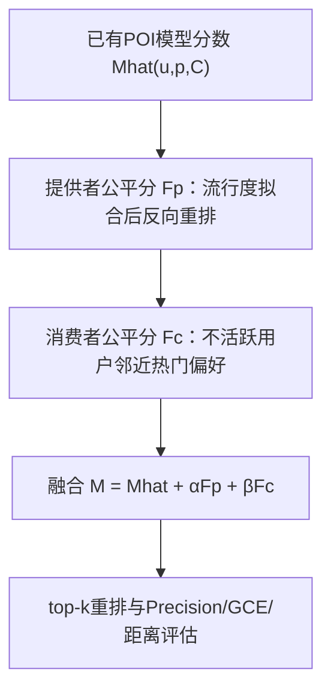

# CAPRI-FAIR: Integration of Multi-sided Fairness in Contextual POI Recommendation Framework (上下文POI推荐框架中的多侧公平性集成)

- **会议/期刊**: RecSys 2024
- **作者与机构**: Francis Zac dela Cruz, Flora D. Salim, Yonchanok Khaokaew, Jeffrey Chan；UNSW / RMIT University
- **推荐链路定位**: 重排（post-filter / re-ranking）
- **研究方向**: 去偏公平、可信隐私与工业架构 / 时空轨迹与POI本地生活推荐
- **论文原文**: [论文原文链接](https://arxiv.org/abs/2406.03109v3)
- **开源代码**: [开源代码仓库链接](https://github.com/cruiseresearchgroup/CAPRI-FAIR)

## TL;DR (1分钟核心速览)

针对POI推荐中长尾商家曝光不足与不活跃用户精度偏低，CAPRI-FAIR在已有模型分数上做免训练后置重排，分别注入提供者流行度惩罚与消费者邻近热门偏好；在Yelp/Gowalla按时间70/20/10划分、Precision@10与GCE评测下，线性提供者因子最高将USG长尾曝光从近零提至3.08，但精度随$\alpha$上升而下降。

## Background & Motivation (背景与核心矛盾)

- **主流范式**: USG、GeoSoCa、LORE等上下文POI推荐器融合地理距离、社交影响、类别与时间，主要优化top-k命中精度。
- **前人局限**: 其一，POI签到呈幂律分布，少数热门商家占据大部分曝光，长尾提供者长期缺曝光；其二，不活跃用户交互稀疏，模型更偏向活跃用户，且现有公平后处理多为单侧公平，缺少提供者-消费者联合权衡。
- **核心洞察 (Key Insight)**: 公平性可在不重训原模型的前提下，通过重排分数注入；提供者公平的关键是“曝光模型形状”而非单纯惩罚热门物品。
- **本文切入点**: 在CAPRI式上下文分数上增加$\alpha F_p$与$\beta F_c$两项，系统扫描$\alpha,\beta$并分析精度、GCE与距离的Pareto前沿。

## Method (核心方法设计)

### 1. 整体框架 (Overall Architecture)

CAPRI-FAIR是模型无关的后置重排层：先由已有POI模型输出上下文匹配分$\hat{M}(u,p,C(u,p))$，再对候选POI分别计算提供者公平分$F_p$与消费者公平分$F_c$，线性加权后重排top-k。提供者项依据签到流行度拟合曝光模型，提升长尾物品分数；消费者项仅对不活跃用户强化“已访问POI附近的热门POI”。全流程无新增训练损失与负采样，推理时只需对候选列表重算分数，适合在线轻量部署。

### 2. 关键设计拆解 (Key Designs)

1. **提供者公平因子与曝光模型选择**：痛点起因是幂律签到使长尾POI曝光趋零。本文按物品签到数$c_p$构造单调递减公平分，核心融合式为$M(u,p)=\hat{M}(u,p,C(u,p))+\alpha F_p(p)+\beta F_c(u,p)$，其中$F_p(p)=g(c_p^{-1})$，$g$可选Linear、Logistic、PowerLaw。PowerLaw先对$y=w_0x^{w_1}$做log-log线性拟合并加L2正则$\lambda=10.0$；Linear对中度热门POI惩罚更缓，避免精度骤降。原文符号写作$F_p(u),F_c(u)$，此处按实现语义显式标出作用对象。
2. **消费者公平因子**：痛点是不活跃用户缺历史，个性化分不可靠。本文对不活跃用户提高“距其历史访问POI最近20%距离内且热门”的候选分数，可概括为 $F_c(u,p)=\mathbb{I}[u\in U_{\mathrm{inact}}]\cdot\tilde{c}_p\cdot\mathbb{I}[d(u,p)\le d_{20\%}(u)]$，其中$\tilde{c}_p$为归一化流行度。直觉是稀疏用户先从大众热门POI探索，同时保持地理可达性。
3. **训练目标、负采样与推理效率**：无新增训练目标，也无Uniform/In-batch/Hard Negative设计；不改原模型参数。在线仅对每个用户的候选列表计算$O(|P_R|)$次重排分，复杂度由原模型打分与top-k排序主导，额外开销低，但$\alpha,\beta$需离线扫描。

## Experimental Setup & Evaluation Protocol (实验设置与评估协议)

- **数据集与预处理**: 过滤访问POI少于10用户、用户访问少于10 POI的记录；按签到频次前20%划为active用户/短头物品，后80%为inactive用户/长尾物品。

| 数据集 | #Users | #Items | #Interactions | 稀疏度/密度 | 特征/场景说明 |
| :--- | :---: | :---: | :---: | :---: | :--- |
| Yelp | 7,135 | 未报告 | 未报告 | 未报告 | 本地商家POI；含地理、类别等上下文 |
| Gowalla | 5,628 | 未报告 | 未报告 | 未报告 | 签到POI；含地理与社交上下文 |

- **数据划分与防穿越 (Splitting Strategy)**: 每个用户按签到时间序列做70%/20%/10%训练、验证、测试，保持时间顺序。
- **排名评测协议 (Ranking Protocol)**: 以Precision@5/10/20判断目标POI是否进入top-k；论文未说明候选池与负采样细节，应视为基于模型top-k列表的评估，而非严格无偏Full-Ranking。公平性用GCE与Pearson $\chi^2$衡量item/user曝光差异，并报告mean median distance。
- **对比基线与超参设置**: 基座为USG、GeoSoCa、LORE三类上下文POI推荐器；$\alpha,\beta\in\{0,0.25,0.5,0.75,1\}$，主分析$k=10$，PowerLaw正则$\lambda=10.0$。显著性用Kruskal-Wallis、Mann-Whitney U与Wilcoxon检验，原文未统一标注$p$值阈值。

## Key Experimental Results (实验关键数据)

### 1. 主实验对比 (Main Results)

采用Linear提供者因子时，$\alpha$增大显著提升长尾曝光，但精度下降；USG在Yelp上从近零曝光获益最大。

| 数据集 | 基座 | P@10 $\alpha=.25$| P@10$\alpha=1$| LTE$\alpha=.25$| LTE$\alpha=1$ | LTE变化 |
| :--- | :--- | :---: | :---: | :---: | :---: | :---: |
| Yelp | GeoSoCa | .0134 | .0107 | 3.4467 | **4.6888** | +36.0% |
| Yelp | LORE | .0179 | .0124 | 2.7975 | 4.4426 | +58.8% |
| Yelp | USG | **.0314** | **.0186** | .0341 | 3.0765 | 大幅↑ |
| Gowalla | GeoSoCa | .0300 | .0266 | .9796 | 1.2465 | +27.3% |
| Gowalla | LORE | .0427 | .0378 | .9356 | **1.2961** | +38.5% |
| Gowalla | USG | **.0504** | **.0424** | .1056 | .3689 | +249.3% |

### 2. 消融实验 (Ablation Study)

固定$\alpha=1$比较三种提供者曝光模型，Linear在六个基座/数据集组合上精度均为最高。

| 数据集/基座 | Linear | Logistic | PowerLaw |
| :--- | :---: | :---: | :---: |
| Yelp/GeoSoCa | **.0107** | .0073 | .0081 |
| Yelp/LORE | **.0124** | .0072 | .0082 |
| Yelp/USG | **.0186** | .0042 | .0036 |
| Gowalla/GeoSoCa | **.0266** | .0132 | .0203 |
| Gowalla/LORE | **.0378** | .0125 | .0156 |
| Gowalla/USG | **.0424** | .0103 | .0158 |

### 3. 关键实验发现 (Key Findings)

- 在Yelp/USG上，Linear的P@10为.0186且LTE达3.0765；Logistic虽把LTE推到5.6810，但P@10仅.0042，说明过度惩罚热门物品会以精度换曝光。
- $\beta$对消费者公平并非单调增益：Yelp上GeoSoCa/LORE对不活跃用户精度可由2.3%升至2.6%后回落，USG则由3.0%降至2.8%，表明“邻近热门”策略强依赖基座与数据分布。
- 多侧Pareto存在明显精度代价：Yelp/GeoSoCa在$(0,0.5)$时P@10=.02537、item GCE=-4.548；在$(0.5,0)$时item GCE接近0但P@10降至.01173，最小化GCE几乎牺牲一半精度。

## Highlights & Limitations (亮点、对比与审稿批判)

- **与代表作对比 (vs. Prior Work)**: USG/GeoSoCa/LORE只优化上下文匹配精度；CAPRI-FAIR不改模型、以post-filter同时纳入提供者与消费者公平，并用GCE-Pareto显式揭示权衡。相较单侧公平重排，本文更强调多利益相关方联合评估。
- **可迁移亮点**: 流行度-曝光回归核可迁移到电商长尾扶持；$\alpha,\beta$网格扫描+Pareto前沿可作为公平重排的通用调参模板。
- **审稿级局限批判**: 仅3个浅层上下文基座，缺深度/图/生成式模型与线上A/B；评测未明确全库排序或采样负例比例，且曝光采用二元命中，未刻画排名位置折扣，结论对$\alpha,\beta$与数据集较敏感。

## Rating (四维评分)

- **方法创新性 (Novelty)**: ⭐⭐⭐ （多侧公平后处理与曝光模型比较有实用价值，但机制本身是线性重排融合，理论新意有限）
- **评估协议与实验扎实度 (Protocol & Experiments)**: ⭐⭐⭐ （Yelp/Gowalla双数据集与显著性检验较完整，但仅3个基座、候选池与负采样协议交代不足）
- **写作与数学规范度 (Clarity & Rigor)**: ⭐⭐⭐ （核心公式简洁，但$F_p(u)$/物品侧与$F_c(u)$/用户-物品侧符号略含混，部分实现细节需读代码）
- **工业落地与复现价值 (Industrial & Practical Value)**: ⭐⭐⭐⭐ （模型无关、免训练、候选级重排开销低，代码开源，适合作为公平约束插件快速验证）

