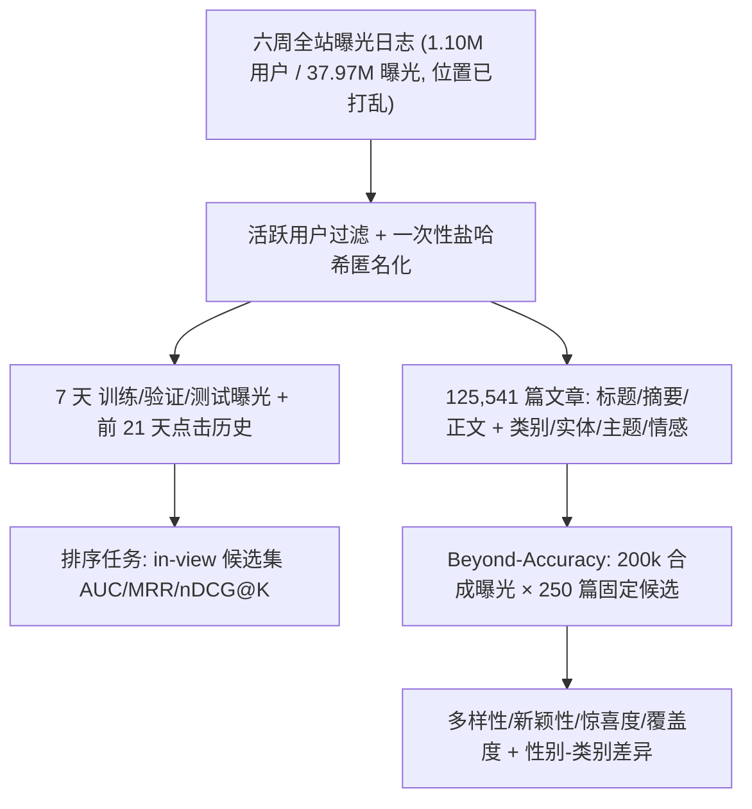

# EB-NeRD: A Large-Scale Dataset for News Recommendation (Ekstra Bladet 新闻推荐数据集)

- **会议/期刊**: RecSys 2024 (RecSys Challenge '24)
- **作者与机构**: Johannes Kruse, Kasper Lindskow 等 (JP/Politikens Media Group, DTU, ETH Zürich, Univ. Bari, IIM Visakhapatnam)
- **推荐链路定位**: 精排（曝光候选集排序）+ 离线评估基准
- **研究方向**: 去偏公平、可信隐私与工业架构 / 冷启动与长尾推荐
- **论文原文**: [https://arxiv.org/abs/2410.03432v1](https://arxiv.org/abs/2410.03432v1)
- **开源代码**: [https://github.com/reczoo/RecSys2024_CTR_Challenge](https://github.com/reczoo/RecSys2024_CTR_Challenge)

## TL;DR (1分钟核心速览)

新闻推荐长期受制于"文章秒级过期导致严重冷启动、只有隐式点击、文本强依赖"三大技术痛点，以及"推荐系统实质承担编辑把关、却缺乏价值对齐度量"的规范痛点。本文发布 EB-NeRD：110 万用户、3,797 万条**位置已随机打乱**的曝光日志、12.5 万篇丹麦语文章（标题/摘要/正文/实体/主题/情感）。在 in-view 候选集排序协议下，Transformer + GBDT 集成将 AUC 从流行度基线的 59.70 提升至 88.64（+48.5%）；同时首次给出跨性别新闻流差异的量化证据。

## Background & Motivation (背景与核心矛盾)

- **主流范式**: 新闻推荐以内容驱动建模为主（NRMS/HUIM 类 Transformer 用户兴趣编码），协同过滤因文章生命周期短而几乎不可用；公开数据集中于 MIND（新闻**聚合器**）、Adressa（挪威）。
- **前人局限**: ① MIND 公开版缺失正文、仅记录首页事件、元数据只有 user/article/time，无法支撑内容与情境建模；② 聚合器与"传统报纸出版商"的内容结构与读者结构差异显著，MIND 上的结论未必可迁移。
- **核心洞察 (Key Insight)**: 现有数据集普遍缺少"曝光级 + 全站（首页与文章页）+ 富文本 + 用户属性"四者兼具的日志，更缺少对推荐结果**新闻流构成**（类别/情感/性别差异）的度量，导致精度之外的价值对齐研究无基准可用。
- **本文切入点**: 以出版商一手日志构建低资源语种数据集，并把"打乱位置 + 固定候选集 + 分组统计"的评估协议一并标准化。

## Method (核心方法设计)

### 1. 整体框架 (Overall Architecture)

数据集取自 Ekstra Bladet 六周（2023-04-27–06-08）全站日志：先按"3 周内点击 5–1,000 次"筛活跃用户，再一次性盐哈希匿名化；每条曝光记录当次访问中**经过随机打乱**的 in-view 文章列表与其中被点击项，并附时间戳、停留时长、滚动比例、设备、订阅状态与部分用户人口属性。文章侧提供标题、摘要、正文及类别/子类别/实体/主题/情感标注。划分上，训练/验证/测试各含 7 天曝光 + 其前 21 天点击历史 + 该期全部文章；另设隐藏测试集（20 万条合成曝光 × 250 篇新发文章）专用于超越准确率评估。

### 2. 关键设计拆解 (Key Designs)

1. **去位置偏置的曝光日志构建**：前人日志保留真实展示位次，模型极易学到位置捷径而非兴趣。本文在记录前对 in-view 列表做随机置换，使点击标签近似与位次独立，从而支持无偏的候选集排序评估；同时保留停留时长与滚动比例作为"弱相关性"信号，缓解纯点击标签的假阳性。
2. **超越准确率评估框架（本文真正的方法增量）**：把 IR 通用指标重解释到新闻出版语境，并新增**分组差异**度量，用于量化同一模型对不同读者群体的新闻流差异：

$$\mathrm{Div}(L)=1-\frac{1}{|L|(|L|-1)}\sum_{i\neq j}\mathrm{sim}(d_i,d_j),\qquad \mathrm{Nov}(L)=\frac{1}{|L|}\sum_{i\in L}-\log_2\frac{n_i}{N}$$

$$\Delta_c=p_c^{\text{F}}-p_c^{\text{M}}$$

其中 $n_i$为文章$i$的历史曝光数、$N$为总曝光数（新颖性即自信息），$p_c$为类别$c$在推荐列表中的占比，$\Delta_c>0$表示该类别在女性读者新闻流中被**过度**推荐。该设计的物理直觉是：精度指标只看"是否点中"，而$\Delta_c$ 与 Div/Nov 联合刻画"系统把什么内容喂给了谁"。
3. **训练目标与推理开销**：本文不提出新损失；排序基线统一在曝光候选集上做二分类/成对学习（in-view 未点击即隐式负样本，无额外负采样），用二元交叉熵或 pairwise ranking loss 优化。推理即对一次访问的 10.5 篇候选打分（NP-ratio 均值 10.5），开销极低；但冠军方案为 Transformer + LightGBM + CatBoost 集成，线上部署成本被作者列为后续待解问题。

## Experimental Setup & Evaluation Protocol (实验设置与评估协议)

- **数据集与预处理**: 无 k-core 过滤，改用"活跃用户"阈值（3 周内 5–1,000 次点击），上下界分别排除低活与异常行为。

| 数据集 | #Users | #Items | #Interactions | 稀疏度/密度 | 特征/场景说明 |
| :--- | :---: | :---: | :---: | :---: | :--- |
| EB-NeRD | 1,103,602 | 125,541 | 37,966,985 | 每用户均 34.4 次曝光 | 丹麦语；32 类别 / 263 子类；标题 6.6 词、摘要 17.3 词、正文 363.2 词 |
| MIND (对比) | 1,000,000 | 161,013 | 24,155,470 | — | 聚合器、英文、公开版无正文 |
| Adressa (对比) | 3,083,438 | 48,486 | 27,223,576 | — | 出版商、挪威语、10 周 |

- **数据划分与防穿越 (Splitting Strategy)**: 全局时间戳切分——训练/验证/测试各为连续 7 天曝光窗口，历史特征只允许取该窗口前 21 天点击，严格避免未来信息泄漏；隐藏测试集为 20 万条合成曝光，候选固定为测试期起始时新发的 250 篇文章（对所有用户均未见）。
- **排名评测协议 (Ranking Protocol)**: **候选集排序（in-view 曝光集）**，非全库 Full-Ranking；指标为 AUC、MRR、nDCG@5、nDCG@10。Beyond-Accuracy 用同一 250 篇静态候选计算 Div/Serendipity/Coverage/Novelty 与类别、情感分布及男女差异 $\Delta_c$。
- **对比基线与超参设置**: 基线含 4 类——竞赛队伍方案（:D 的 Transformer/LightGBM/CatBoost、BlackPearl 的 HUIM 与成对/query 级 CatBoost）、新闻专用模型 NRMS、广告迁移模型 DIN，以及 4 个非个性化基线（最高点击、最高阅读时长、最高 in-view 率、随机）。各队数据管道与特征工程不同、超参未共享，作者亦承认这削弱了严格可比性，未做显著性检验。

## Key Experimental Results (实验关键数据)

### 1. 主实验对比 (Main Results)

| 方法 | 类型 | AUC | MRR | nDCG@5 | nDCG@10 |
| :--- | :--- | :---: | :---: | :---: | :---: |
| **Transformer (:D)** | 冠军集成 | **88.64** | **72.28** | **78.27** | **79.10** |
| LightGBM:D | GBDT | 88.17 | 71.04 | 77.99 | 78.09 |
| CatBoost:D | GBDT | 88.05 | 70.79 | 76.75 | 77.89 |
| CatBoostQL (BlackPearl) | GBDT pairwise/query | 87.89 | 71.12 | 77.13 | 78.18 |
| CatBoostPL (BlackPearl) | GBDT pairwise | 87.54 | 70.33 | 76.48 | 77.58 |
| HUIM (BlackPearl) | 长短期兴趣网络 | 87.29 | 70.05 | 76.21 | 77.35 |
| DIN (FuxiCTR) | 兴趣注意力 | 71.53 | 49.33 | 55.08 | 59.58 |
| NRMS (Intel_recsys) | 多头自注意力 | 61.03 | 39.75 | 44.45 | 51.24 |
| Clicks (流行度) | 非个性化 | 59.70 | 37.74 | 42.36 | 49.65 |
| Random | 随机 | 49.98 | 31.56 | 34.89 | 43.38 |
| *Improv. (最佳 vs 流行度)* | — | *+48.5%* | *+91.5%* | *+84.8%* | *+59.3%* |

### 2. 消融 / 组件分析 (Ablation & Beyond-Accuracy)

本文为数据集与基准论文，无传统 `w/o 模块` 消融；下表为等价的"模型 → 新闻流构成"分解分析（差异列为女性减男性，单位 pp）：

| 方法 | Diversity | Serendipity | Coverage | Novelty | SPT $\Delta$| CRM$\Delta$ | NWS 占比 | AGC 占比 |
| :--- | :---: | :---: | :---: | :---: | :---: | :---: | :---: | :---: |
| Transformer | 0.70 | 0.76 | 0.56 | 4.3 | −14.5 | +7.1 | 13.0 | 0.7 |
| CatBoost:D | **0.79** | 0.77 | 0.48 | 3.4 | −6.5 | +1.3 | 45.7 | 0.0 |
| HUIM | 0.59 | 0.78 | 0.52 | 10.1 | +1.2 | +1.8 | 0.6 | 33.0 |
| CatBoostQL | 0.71 | 0.76 | 0.15 | 4.7 | −1.3 | −1.6 | 9.1 | 1.9 |
| NRMS | 0.61 | 0.79 | **0.88** | **12.0** | −10.2 | −0.2 | 10.2 | 44.6 |
| Random | 0.76 | **0.81** | 1.00 | 11.1 | −0.1 | −0.1 | 16.0 | 38.0 |
| Top@32 均值 | 0.72 | 0.79 | 0.35 | 7.6 | −6.3 | +1.9 | 16.8 | 14.0 |

### 3. 关键实验发现 (Key Findings)

1. **流行度偏置压倒模型收益**：最高点击基线 AUC 已达 59.70（随机仅 49.98），而新闻定制的 NRMS 仅 61.03，相对提升约 2.2%——说明在真实曝光集上，纯内容注意力模型几乎打不过热度；跃升到 88.64 主要来自时间感知特征工程 + GBDT 集成（相对流行度 +48.5%），而非架构创新。
2. **精度与新闻流生态解耦甚至反向**：CatBoost:D 精度 AUC 88.05 却给出最高 Diversity 0.791 与最低 Novelty 3.368；NRMS 精度垫底却 Coverage 0.884、Novelty 11.956。同时 NRMS 的自动生成内容占比高达 44.6%，而 CatBoost:D 仅 0.02%——同一数据集上不同优化路径可产出完全不同的编辑画像。
3. **性别导向偏置系统性存在且与模型强相关**：Top-32 均值中体育内容对女性少 6.3pp、娱乐多 2.6pp、负面情感多 2.6pp（Top-48/78 分别为 4.7/3.1、1.8/1.2、1.8/1.1）；个别模型更极端，Transformer 对女性少推 14.5pp 体育、多推 7.1pp 犯罪内容，说明偏置幅度取决于建模方式而非数据固有属性。

## Highlights & Limitations (亮点、对比与审稿批判)

- **与代表作对比 (vs. Prior Work)**: 相比 MIND，EB-NeRD 直接公开正文、覆盖首页+文章页、提供停留/滚动/订阅/人口属性，且位置已打乱；相比 Adressa，增加了实体/主题/情感等富标注与系统化的超越准确率评测；相比纯算法论文（如 NRMS），本文的价值在于暴露"NRMS 类模型在该域打不过流行度"这一可复现的负结果。
- **可迁移亮点**: ① 曝光列表随机置换 + 固定候选集是评测新闻/信息流去偏的低成本标准做法，可直接用于任何"位置偏置严重"的场景；② 用 $\Delta_c$ 这类"分组-内容占比差"度量替代难解释的公平性损失，工程上易于在线监控。
- **审稿级局限批判**: ① 各提交方数据管道与超参不统一、单次运行无多种子，精度排名与 $\Delta_c$ 归因不具备严格因果性；② 候选集仅为 in-view 曝光（NP-ratio 10.5）而非全库排序，与真实召回-精排链路差距大；静态 250 篇候选也无法刻画长期过滤气泡与多样性演化的动态效应；③ 冠军方案为重集成，计算开销与实时性未经讨论，落地可行性存疑。

## Rating (四维评分)

- **方法创新性 (Novelty)**: ⭐⭐⭐ （数据集与评估协议本身贡献明确，但无新模型/新损失，指标仍沿用 IR 通用定义，方法增量有限）
- **评估协议与实验扎实度 (Protocol & Experiments)**: ⭐⭐⭐⭐ （时间切分防穿越、位置打乱去偏、10 个基线与隐藏测试集齐备，扣分于无显著性检验、多种子与统一管道）
- **写作与数学规范度 (Clarity & Rigor)**: ⭐⭐⭐⭐ （统计口径、指标定义与差异符号约定清晰，公式简洁；个别指标计算细节置于附录）
- **工业落地与复现价值 (Industrial & Practical Value)**: ⭐⭐⭐⭐ （百万级真实出版商日志 + 全站曝光 + 富文本公开可用，并配套 Challenge 代码库，是新闻推荐与价值对齐研究的稀缺基座）

