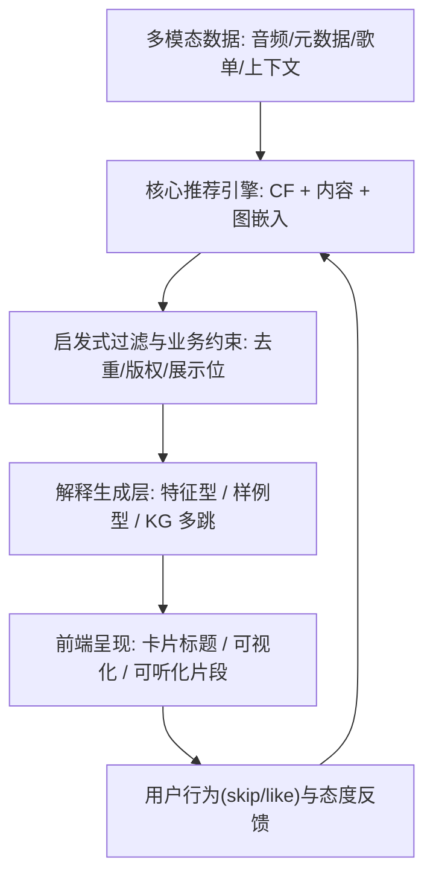
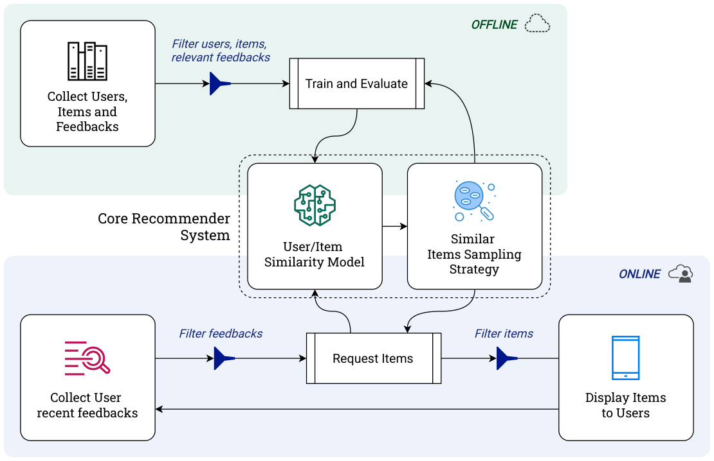

# Explainability in Music Recommender Systems (音乐推荐系统中的可解释性)

- **会议/期刊**: AI Magazine 43(2), 190–208, 2022（Special Topic on Recommender Systems）
- **作者与机构**: Darius Afchar, Romain Hennequin, Elena V. Epure, Manuel Moussallam（Deezer Research, Paris）；Alessandro B. Melchiorre, Markus Schedl（JKU Linz / LIT）
- **推荐链路定位**: 重排与前端解释层（Explanation Layer）；跨越召回/排序核心之外
- **研究方向**: 去偏公平、可信隐私与工业架构 / 对话推荐与解释理由生成
- **论文原文**: [https://arxiv.org/abs/2201.10528v1](https://arxiv.org/abs/2201.10528v1)
- **开源代码**: 暂未开源

## TL;DR (1分钟核心速览)

工业音乐推荐系统（MRS）为追求准确率堆叠了协同过滤、内容特征与图挖掘多模块，潜因子空间对外不可读，导致"为什么推给我"无法回答，而这恰是用户面对**意外/不当推荐**时维持信任与宽恕的关键。本文不提出新模型，而是给出一个对齐框架：先界定"解释受众 + 待补足的不完整性 (incompleteness)"，再把 RS 的 7 类解释目标与 XAI 目标做映射，系统梳理特征型、样例型、知识图谱多跳型解释及其评估协议（用户研究行为/态度指标 + 离线稳定性、鲁棒性、一致性、稀疏性、覆盖率），最后以 Deezer 工业链路为例指出"解释简洁性 vs 系统复杂性"的硬矛盾。原文为定性立场文，无可复现的数值主实验。

## Background & Motivation (背景与核心矛盾)

- **主流范式**: 真实 MRS 是多块拼装体——CF 潜因子（SVD/FM）、内容与音频表征、图嵌入/随机游走，再叠加启发式过滤与业务约束（近期去重、版权规则、端上展示位）。
- **前人局限**: 其一，解释研究多在"透明度"窄义下讨论模型内部机制，而用户真正需要的是"补充信息"（如与已听艺人的相似性）；其二，主流解释目标（Tintarev 七目标）与通用 XAI 目标（Arietta 等）互不覆盖，RS 独有的 **persuasiveness** 在 XAI 中缺席，甚至与透明度目标相冲突。
- **核心洞察 (Key Insight)**: 解释的价值应由"目标受众 + 该受众面临的不完整性"来定义，即解释是填补 $x$ 到决策之间缺失环节的界面，而非对模型的二次预测。作者同时指出两个流行谬误：把"解释模型"当作"解释数据"；以及"树模型可解释、神经网络不可解释"的一刀切判断。
- **本文切入点**: 以 MRS 的多模态、短时长、强上下文、序列化消费四个特性为约束，把 XAI 的轴（局部/全局、内在/事后、模型/数据、有无监督）逐条落到音乐场景，给出可实施的解释生成与评估路径。

## Method (核心方法设计)

### 1. 整体框架 (Overall Architecture)

文章的组织逻辑本身即"方法论"：第一步刻画音乐消费的四个特异性（单曲消费仅数分钟、音频/MIDI/文本/封面多模态、情绪-场景-社交强上下文、以歌单与续播为主的序列消费），据此筛选可用解释轴；第二步建立 RS 目标与 XAI 目标的映射表，并引入"受众—不完整性—可理解性"三元组来约束解释任务；第三步在特征型、样例型、图谱型三条技术路线上分别讨论相关性定义、失效模式与评估手段；第四步把解释层嵌入工业 MRS 的在线/离线闭环（图 5），暴露工程约束；第五步给出评估协议与开放挑战。

<figure class="paper-figure" markdown="span">
  <figcaption>图 5. 工业 MRS 概述。解释推荐可能需要可解释核心 MRS 之外的更多内容。</figcaption>
</figure>

### 2. 关键设计拆解 (Key Designs)

1. **目标—不完整性对齐（Goal / Incompleteness Alignment）**：痛点是"解释做了却答非所问"。作者主张先固定受众 $a$与不完整性类型$q$，解释优劣应按该目标判定，而非统一打分：$\mathcal{E}^{\star}(a,q)=\arg\max_{e\in\mathcal{E}}\ \mathbb{I}\big[\mathrm{Und}(e,a)\ \wedge\ \mathrm{Rel}(e,q)\big]$，其中$\mathrm{Und}$为可理解性、$\mathrm{Rel}$ 为该不完整性被补足的程度。直觉上，这把"解释质量"从模型属性转成任务条件属性，避免了"看到就知道好"的确认偏误。

2. **三类解释算子的相关性重定义**：特征型解释的关键在于 "relevance" 是多义的——SHAP 用联盟边际贡献 $\phi_j=\sum_{S\subseteq F\setminus\{j\}}\frac{|S|!\,(|F|-|S|-1)!}{|F|!}\big[v(S\cup\{j\})-v(S)\big]$，而 L2X 用互信息刻画对响应变量的信息量；因此同一推荐可给出互相矛盾的 top 特征。样例型解释退化为模板 "we recommend$i$because of its similarity to$j$"，其风险是流行度偏置使 The Beatles 恒为近邻，需引入 hook+discovery 的电台 clock 编排原则保证区分度。图谱型解释用多跳路径取代单一相似度：$p=(u\to A\to a_A\to L\leftarrow a_B\to B)$ 逐跳可读，但要求每条边语义非黑箱（泛化的 "similar to" 边等于没解释）。

3. **训练目标与推理开销**：本文不训练模型，故无损失函数与负采样；其"推理开销"体现在解释生成侧——特征选择本身是 NP-hard，实际依赖特征独立性或一阶近似假设；图方法则受限于构图成本与多跳路径枚举代价，需固定最大跳数并估计路径相关性。作者强调应在部署前量化覆盖率（top-$k$ 中可解释条目占比）与生成时延。

## Experimental Setup & Evaluation Protocol (实验设置与评估协议)

- **证据基础**: 原文为立场/综述文，**无公开数据集、无离线主实验、无统计显著性检验**。其证据来自（i）作者所在 Deezer 的工业 MRS 实践与真实界面案例（图 4），（ii）对可解释推荐与 XAI 文献的定性归纳。下表替代常规数据集统计表，标注证据类型：

| 证据来源 | 类型 | 规模/说明 | 用途 |
| :--- | :---: | :---: | :--- |
| Deezer 工业 MRS | 系统案例 | 数千万级曲库的在线服务 | 说明核心引擎+启发式过滤的真实链路 |
| 商业平台解释界面 | 界面观察 | Top 10 / "70's soul" / "Because you like X" | 三类解释的工业落地形态 |
| 可解释推荐文献 | 定性归纳 | Tintarev 七目标、Zhang & Chen 六类解释 | 目标与解释类型映射 |
| XAI 文献 | 定性归纳 | Arietta 等轴、SHAP/L2X/TCAV | 方法迁移与批判 |

- **数据划分与防穿越**: 不适用（无训练实验）。作者代之以"离线训练 / 在线服务"的系统划分，并指出解释层跨越该边界。
- **评估协议（本文核心贡献之一）**: 双轨制。①**用户侧**：between-subject（含工业 A/B）与 within-subject（小样本时用，需控制界面顺序混淆），指标分行为类（CTR、交互时长、跳过率）与态度类（问卷、半结构化访谈、"你是否信任该推荐"），并要求样本在性别、年龄、国家、音乐素养、听歌习惯、人格与认知需求上具代表性；②**技术侧**：稳定性（重估后解释不变）、鲁棒性（小数据扰动）、跨模型一致性、稀疏性、区分度、覆盖率、生成效率。
- **对比基线**: 无模型基线；文中对比对象是解释范式之间（视觉型 vs 社交型 vs 句子型）与内在解释 vs 事后解释。

## Key Experimental Results (实验关键数据)

### 1. 主实验/文献证据对比 (Main Evidence)

原文无表格化数值，以下汇总文中给出的定性证据及其适用目标（原文未给 `Improv.%`，故不臆造）：

| 解释形态/方法 | 主要支撑目标 | 证据结论 | 主要风险 |
| :--- | :---: | :--- | :--- |
| 视觉型解释 | 可理解性 | 用户研究显示提升理解度 | 需图像资源，语义表达力有限 |
| 社交/句子型解释 | 说服力 | 比视觉型更 persuasive | 说服 ≠ 用户最终喜欢该艺人 |
| 用户近邻解释 | 好奇心/社交 | 逐步被平台弃用，说服力与准确性弱于物品近邻 | 可能损害信任 |
| 特征型（SHAP/L2X） | 信息量/公平性 | 可暴露敏感特征（性别、地域）影响 | 相关≠因果，特征共线导致伪解释 |
| 样例型 | 信息量 | 模板化、低成本、工业主流 | 流行度偏置，区分度低 |
| KG 多跳路径 | 信息量/因果 | 可支撑发现性与多跳推理 | 需深度知识工程，路径相关性难估 |

### 2. 消融式对比 (Ablation-like Analysis)

原文以"移除某个设计前提"的方式做概念性消融，整理如下：

| 移除/放宽的条件 | 现象 | 结论 |
| :--- | :--- | :--- |
| 去掉受众约束 | 解释目标互相拉扯（透明度 vs 说服力） | 评估指标无法对齐 |
| 去掉"简化"约束（详细如 Table 1 八条） | 认知过载，满意度下降 | 简洁性是硬约束 |
| 去掉流行度去偏 | 解释恒为头部艺人 | 信息量与区分度崩塌 |
| 去掉因果考量，仅用共听相似度 | 巧合共听被当作理由 | 解释可能具有误导性 |

### 3. 关键实验发现 (Key Findings)

- **认知负荷存在硬阈值**：文中多项用户研究一致显示，解释细节过多会被负向感知，故工业界面被压缩为卡片标题（如 "Because you like artist X"），这意味着图型与多跳解释在端侧几乎不可直接呈现，只能退化为短标签或对话式追问。
- **说服力与真实效用脱耦**：用户因"朋友在听"而点击艺人推荐，并不等于其最终会喜欢该艺人；单一解释类型不足以同时满足信任与满意度，需多类型互证（社交+特征）或引入对话反馈闭环。
- **解释会反向塑造反馈信号**：若用户得知 skip 会被计入负反馈，可能为避免喜好艺人被排除而不敢跳过，从而污染隐式反馈；这提示解释设计必须与反馈采集机制联合评估，而非仅看 CTR。

## Highlights & Limitations (亮点、对比与审稿批判)

- **与代表作对比**: 相较 Tintarev 的七目标综述，本文补上 XAI 目标映射与"不完整性"这一任务化判据；相较 Zhang & Chen 的解释类型分类，本文把每条类型推进到"相关性定义差异 + 失效模式 + 评估指标"；相较常规可解释推荐论文只报离线准确率，本文强调解释质量评估必须与准确率评估解耦。
- **可迁移亮点**: ①"受众—不完整性—可理解性"三元组可直接用于电商/短视频解释体系的指标设计；②稳定性/鲁棒性/一致性/稀疏性/覆盖率五指标可作为解释模块上线前的 sanity check 清单。
- **审稿级局限批判**: ①作为立场文，全文无任何定量实验与统计检验，三类解释的优劣对比停留在文献转述，无法验证其在同一 MRS 上的相对收益；②对图/多跳解释的算力代价仅定性提及，缺少复杂度与延迟量化的工程数据；③"简洁性约束"与"对话式细粒度解释"之间的折中未给出可操作方案，且公司竞争性透明度的讨论缺乏实证。

## Rating (四维评分)

- **方法创新性 (Novelty)**: ⭐⭐⭐ （不提出新模型，但"目标—不完整性对齐"框架与 RS/XAI 目标映射具概念增量）
- **评估协议与实验扎实度 (Protocol & Experiments)**: ⭐⭐ （双轨评估清单有价值，然全文无数据集、无主实验表、无显著性检验）
- **写作与数学规范度 (Clarity & Rigor)**: ⭐⭐⭐⭐ （分类轴清晰、术语辨析严谨，明确指出解释模型与解释数据的谬误）
- **工业落地与复现价值 (Industrial & Practical Value)**: ⭐⭐⭐⭐ （出自 Deezer 研究团队，真实链路与界面案例对工业解释层设计直接可用，但无开源代码可复现）

