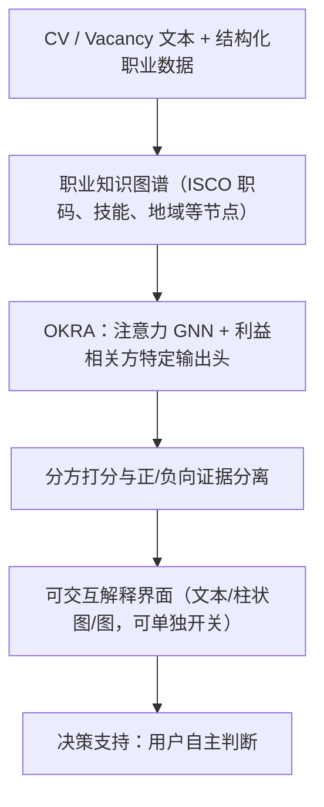
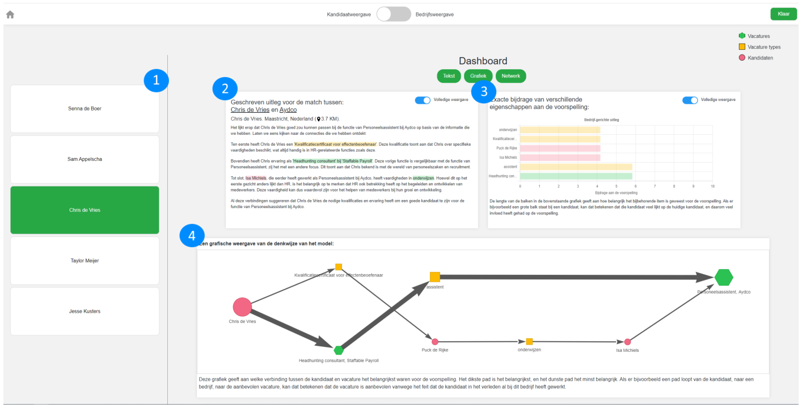

# Explainable Multi-Stakeholder Job Recommender Systems (可解释的多利益相关方职位推荐系统)

- **会议/期刊**: ACM RecSys 2024（Doctoral Symposium，5 页进展报告）
- **作者与机构**: Roan Schellingerhout（Maastricht University；导师 Francesco Barile、Nava Tintarev）
- **推荐链路定位**: 解释层 / 决策支持（覆盖召回—排序之后的解释与交互界面）
- **研究方向**: 去偏公平与可信隐私 / 图神经网络与知识图谱推荐
- **论文原文**: [https://arxiv.org/abs/2410.00654v1](https://arxiv.org/abs/2410.00654v1)
- **开源代码**: 暂未开源

## TL;DR (1分钟核心速览)

本文是一篇博士生论坛的**研究议程与阶段性发现**报告，而非完整方法论文。针对招聘推荐中求职者（candidate）、企业（company）、HR（recruiter）三方目标冲突且受 GDPR / EU AI Act 强监管的痛点，作者先以 6 人深度访谈 + 30 人（每类 10 人）在线解释环境实验刻画三方解释偏好，再构建基于职业知识图谱的注意力 GNN（OKRA）实现分利益相关方打分与正/负向证据分离。最关键的负结果：用户**几乎无法区分真实解释与随机解释**（主观指标差异不显著），且真实解释下决策正确率反而下降——据此作者主张解释应从"说服式"转向"决策支持式"。

## Background & Motivation (背景与核心矛盾)

- **主流范式**: 招聘推荐（JRS）主流做法是 Transformer 文本匹配 CV 与 vacancy 文本；可解释推荐主流是面向单一终端用户的事后解释（attention 可视化、文本理由），目标是提升信任与说服力。
- **前人局限**: ① 缺乏多利益相关方视角——求职者关心职业匹配与公平，企业关心人岗效率，HR 关心可向客户复述的论证链条，三者诉求直接冲突，单一解释无法同时服务；② 招聘属高风险域，其"ground truth"由人工 HR 标注，本身不客观，因此以"让用户同意模型"为目标的解释在逻辑上不成立。
- **核心洞察 (Key Insight)**: 用户在真实决策中并不采纳模型给出的理由，而是叠加自身领域经验独立判断；当解释与用户自身推理冲突时会产生"摩擦"，反而损害决策质量。
- **本文切入点**: 用可交互、可单独开关的多模态解释界面承载**异质偏好**，并将 OKRA 输出的 grounded 证据作为决策支持材料而非说服工具。

## Method (核心方法设计)

### 1. 整体框架 (Overall Architecture)

研究按三个子问题串成闭环：SQ1（访谈 + 原型环境）确定三方解释偏好 → SQ2（OKRA）在职业知识图谱上产出分利益相关方打分与可分离的正/负向证据 → SQ3（拟落地真实系统）在个人化数据上评估有用性、透明度与信任。当前已完成 SQ1 与 SQ2 的离线部分，SQ3 尚未开展，因此下文所述方法多为**设计描述而非可复现算法**（原文未给出损失函数与打分公式的具体形式）。

### 2. 关键设计拆解 (Key Designs)

1. **多利益相关方解释偏好建模（SQ1）**：痛点在于既有 XAI 研究默认"一种解释服务所有读者"。作者用约 1 小时/人的半结构化访谈让 6 名参与者共同设计解释形态，发现**跨方差异与方内分歧同时存在**：candidate 与 recruiter 强烈偏好文本解释（易理解、有"个人感"）；company 代表在理解图解释的读法后转向偏好图结构解释（可一眼总览复杂关系），这被归因于其日常更常处理图表。方内分歧（如 recruiter 对解释详略的要求两极分化）直接推出设计约束：界面必须**可交互、按偏好单独开关**。对应下图的在线解释环境即该约束的落地形态。

<figure class="paper-figure" markdown="span">
  <figcaption>图1：参与者所交互的在线环境界面。在此截图中，所有解释均已启用。这些解释可根据用户偏好单独切换。该网络环境仅使用荷兰语文本，因为受访者均为荷兰语母语者。该环境由以下组件组成：(1) 推荐项目列表，以随机顺序呈现（即，顶部项目不一定是最大匹配）；(2) 文本解释；(3) 柱状图解释；(4) 基于图的解释。该示例</figcaption>
</figure>

2. **OKRA：职业知识图谱上的注意力 GNN（SQ2）**：痛点在于纯文本匹配丢弃了结构化职业关系（职码层级、技能共现、地域）中的大量预测力。OKRA 将 CV、vacancy 与职业本体统一建图为异构知识图谱，用注意力聚合邻居，并为 candidate 侧与 company 侧设置**独立输出头**以容纳"双方并不总是一致"的事实；其解释能力来自注意力权重可按正/负贡献拆分，从而对同一次预测给出多条证据。原文仅给出这一架构级描述，未披露层数、维度、聚合算子与训练目标，故无法复现其公式。

3. **从"说服"到"决策支持"的范式转换**：这是本文最具增量的观点性贡献。实验显示真实解释既未显著提升信任/透明度，也未提升正确率，说明 persuasive 路线在专业人员面前失效；作者据此提出两条替代准则——① 解释应**明确 grounded 在源材料**（CV/vacancy 原文）中，若解释引用了 CV 上未写出的结构化信息（如简历未列但库里记录的技能），用户会困惑于信息出处；② 系统目标是支撑而非替代用户的专业判断。

## Experimental Setup & Evaluation Protocol (实验设置与评估协议)

- **数据集与预处理**: 未使用公开基准。第一阶段用"低质量但公开"的招聘数据做原型；第二阶段改用与某大型国际招聘机构合作获取的**人工标注专有数据集**。原文未披露任何规模统计、过滤规则或划分方式，故下表只能标注可得信息：

| 数据/实验对象 | 规模 | 划分或设计 | 备注 |
| :--- | :---: | :--- | :--- |
| 访谈研究（SQ1） | 6 人（每类 2 人） | 半结构化 + 协同设计 | 约 1 小时/人，荷兰语母语者 |
| 原型环境实验（SQ1） | 30 人（每类 10 人） | **被试内设计**，真实解释 vs 随机解释，顺序随机化 | 角色扮演：阅读他人 CV/vacancy 后代为决策 |
| OKRA 离线评测（SQ2） | 未披露 | 未披露 | 专有数据集，对比 text-only 与 SOTA graph-based 模型 |

- **数据划分与防穿越**: 原文未说明。离线评测的划分协议、是否采用时间切分均缺失，属于评估透明度上的明显短板。
- **排名评测协议**: 未说明是 Full-Ranking 还是 Sampled Ranking；亦未报告 NDCG/Recall/HR 等排序指标的具体数值，仅以"显著更好"定性表述。
- **对比基线与超参设置**: 基线分为 text-only（Transformer 文本匹配类）与 graph-based（SOTA 图模型）两类；未给出嵌入维度、训练轮次、显著性检验方法与随机种子设置。

## Key Experimental Results (实验关键数据)

### 1. 主实验对比 (Main Results)

原文**未提供任何数值表格**（属 5 页进展报告的体例限制），仅给出定性结论。下表为可提取的结论性对照，不含量化数字：

| 对比维度 | 结论方向（原文表述） | 证据强度 |
| :--- | :--- | :--- |
| Graph-based vs Text-only JRS | 图模型"strongly outperformed"文本模型 | 定性，无指标 |
| OKRA vs SOTA graph-based | OKRA"significantly better"，代价是训练时间增加 | 定性，无显著性检验 |
| 真实解释 vs 随机解释（主观） | 有用性/信任/透明度仅有上升**趋势，不显著** | n=30，未报 p 值 |
| 真实解释 vs 随机解释（客观） | 决策**正确率下降** | n=30，未报幅度 |
| 地域公平性 | 多数 SOTA 模型对农村 candidate 与农村 company 存在轻度偏置 | 定性 |

### 2. 消融实验 (Ablation Study)

原文未设计组件消融。可视为"概念性消融"的是解释类型对比（文本 / 柱状图 / 图）与被试内真实-随机解释对照，其结果见下表。

| 变体 | 主观指标 | 客观指标 | 结论 |
| :--- | :---: | :---: | :--- |
| 真实（GNN 生成）解释 | 略升（不显著） | 下降 | 真实解释未带来决策增益 |
| 随机（无意义）解释 | 基线 | 略优 | 低摩擦反而"不干扰"用户自有推理 |
| 仅文本解释 | 偏好最高（candidate/recruiter） | 难以辨别细微差异 | 措辞差异（"somewhat" vs "strongly"）被忽略 |
| 图解释 | company 代表偏好上升 | 未单独报告 | 需先教会读图，学习成本高 |

### 3. 关键实验发现 (Key Findings)

1. **解释的"可辨识性"比"正确性"更致命**：30 人被试内实验中真实与随机解释的主观指标差异不显著，而最受偏好的文本解释恰恰最难传达注意力权重的细微差别（0.7 与 0.2 若被表述为"中等偏高/略低"则几乎不可辨），说明当前 LLM 生成式理由在**区分度**上失效。
2. **真实解释降低正确率是反向证据**：被试倾向于用自己的领域知识覆盖模型理由，解释与自身判断冲突时产生"摩擦"，因此无意义的随机解释反而更少干扰——这直接否证了 persuasive XAI 在专业决策场景的前提。
3. **解释必须与源材料可对齐**：多名被试对"CV 上未出现却被解释引用"的结构化信息感到困惑；同时作者观察到多数 SOTA 图/文本模型对**农村侧**双方均存在轻度偏置，提示招聘域需引入区域公平性约束。

## Highlights & Limitations (亮点、对比与审稿批判)

- **与代表作对比 (vs. Prior Work)**: 相较于主流可解释推荐（如单用户视角的 attention 归因、自然语言理由生成），本文的价值不在模型而在**问题重构**：把"解释是否让人信服"改写为"解释是否支撑专业判断"。相较于常规 JRS（BERT 类 CV-vacancy 匹配），OKRA 通过引入职业知识图谱与分方输出头，主张结构化职业关系被文本模型系统性浪费——这一论断若被量化证实，将直接挑战当前 JRS 的主流技术路线。
- **可迁移亮点**: ① "真实 vs 随机解释"的被试内对照是检验解释是否真正被使用的**低成本强检验**，可迁移到任意 XAI 用户研究；② 解释内容必须 grounded 在用户可见源材料，这一准则对 LLM 生成推荐理由的幻觉抑制同样适用。
- **审稿级局限批判**: ① **证据强度严重不足**——n=6 访谈与 n=30 原型实验均未报告效应量与显著性检验，OKRA 的性能优势完全依赖定性表述，"显著更好"无可核查依据；② **方法不可复现**——OKRA 的知识图谱 schema、注意力聚合、训练目标与损失函数全部缺失，专有数据也使结论无法被独立验证；③ 以角色扮演（阅读他人 CV）代替真实求职决策，存在明显的代入偏差，作者自己亦承认这一点；④ 决策支持与 persuasive 解释的边界并未给出可操作的形式化定义。

## Rating (四维评分)

- **方法创新性 (Novelty)**: ⭐⭐⭐ （问题重构与"决策支持替代说服"的论点有洞察力，但 OKRA 仅为架构级描述，缺少可辨识的算法增量）
- **评估协议与实验扎实度 (Protocol & Experiments)**: ⭐⭐ （被试内真实/随机对照设计巧妙，但样本仅 30 人且无显著性检验、无任何数值表格，离线评测划分协议完全缺失）
- **写作与数学规范度 (Clarity & Rigor)**: ⭐⭐⭐ （议程梳理清晰、子问题分解自洽，但全文无一条公式与复杂度分析，"显著"等统计措辞使用不严谨）
- **工业落地与复现价值 (Industrial & Practical Value)**: ⭐⭐⭐ （与招聘机构合作的专有数据与可切换解释界面具备真实落地形态，但无开源代码、OKRA 训练开销偏高，短期内复现价值有限）

