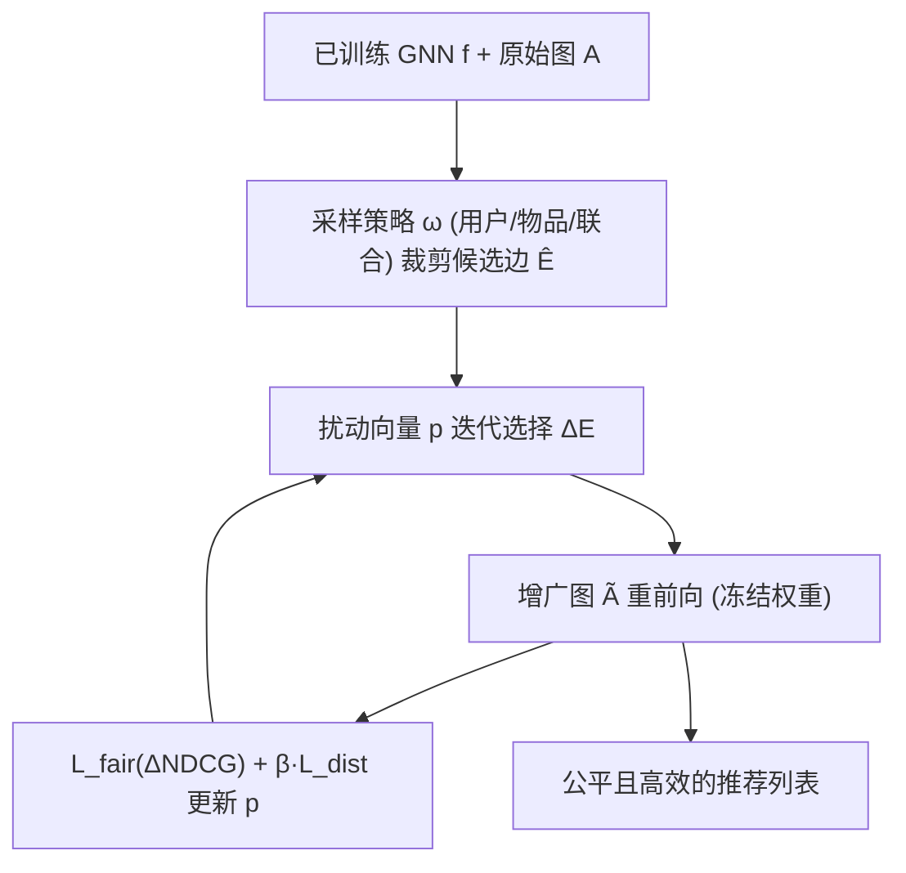
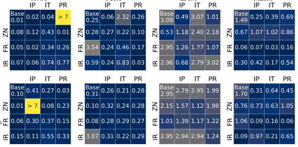

# Fair Augmentation for Graph Collaborative Filtering (图协同过滤的公平增广)

- **会议/期刊**: RecSys 2024
- **作者与机构**: Ludovico Boratto, Gianni Fenu, Mirko Marras, Giacomo Medda (University of Cagliari)；Francesco Fabbri (Spotify)
- **推荐链路定位**: 训练后 / 推理前的图数据增广（Post-processing Graph Augmentation）
- **研究方向**: 去偏公平、可信隐私与工业架构 / 图神经网络与知识图谱推荐
- **论文原文**: [https://arxiv.org/abs/2408.12208v1](https://arxiv.org/abs/2408.12208v1)
- **开源代码**: [https://github.com/jackmedda/FA4GCF](https://github.com/jackmedda/FA4GCF)

## TL;DR (1分钟核心速览)

本文是面向消费者公平性（NDCG 跨人口组差异 $\Delta$NDCG）的**可复现性研究**：将被复现方法"学习式公平图增广"从经验性启发式提升为严格形式化——给出采样策略$\omega$的统一定义、证明增广边如何进入 MPNN 与 SVD-GCN 的前向传播，并新增基于交互时效、物品时效与 PageRank 的 3 条策略。在 5 个真实网络、11 个 GNN 与 5 个非 GNN 模型上，作者证明该增广在**大图 + 高效用模型**上稳定同时降$\Delta$提 NDCG（如 ML1M-SGL$\Delta$ 1.78%→0.03%），但公平知识**无法跨模型迁移**。

## Background & Motivation (背景与核心矛盾)

- **主流范式**: 公平感知 GCF 研究集中在 in-processing（多目标损失、对比去偏），而 pre-processing 数据增广与 post-processing 重排在 GCF 中鲜有系统研究。
- **前人局限**: 被复现工作（Boratto 等）用"训练好的 GNN + 扰动向量"学到增广图，但 (i) 采样策略仅由经验推理提出，缺乏形式化，也未考虑交互时间与经典图拓扑；(ii) 实验仅覆盖 GCMC/NGCF/LightGCN 与 2 个数据集，无法判断在新式架构与大图上是否成立。
- **核心洞察 (Key Insight)**: 增广是**模型权重冻结**下的纯图结构后处理，其效果完全依赖"新增边打通了哪个子图"——若被增广子的子图本身呈强簇结构，则新增边能定向抬升劣势组效用而不伤优势组。
- **本文切入点**: 用形式化 + 扩展策略集 + 大规模基准 + 迁移性实验，回答"公平图增广到底何时有效、是否可复用"。

## Method (核心方法设计)

### 1. 整体框架 (Overall Architecture)

给定已训练 GNN $f$，从候选边集$\tilde{E}$（$R$中的零元素）采样边，由可学习扰动向量$p$迭代决定实际加入集$\Delta E$，得到增广邻接矩阵$\tilde{A}$并重新前向推理得到$\tilde{R}$；优化目标同时最小化组间效用差与图距离。本文不改动该闭环，而是把闭环中两个黑箱——采样策略与增广在前向传播中的作用——显式化，并扩展策略库。

### 2. 关键设计拆解 (Key Designs)

1. **采样策略的形式化（把 5 条启发式统一为过滤器算子）**：把策略视为对劣势组 $\mathcal{U}_D$或物品集$\mathcal{I}$（记作$Z$）的比例过滤$\bar{Z}=\{z\mid z\in\omega(Z,\Psi_Z)\}$，并据此给出三种候选边裁剪场景$\tilde{E}=\{(u,i)\mid u\in\bar{\mathcal{U}}_D, i\in\bar{\mathcal{I}}\}$。这一步的价值在于：任何新策略只需写出$\omega$即可插入框架，也解释了为何"用户采样"天然比"物品采样"重叠度更高（$\Psi_U=35\%>\Psi_I=20\%$）。图 1 的 Jaccard 分析显示多数设置下策略间至少有 60% 节点互斥，说明它们确实作用于图的不同区域。

2. **增广在前向传播中的显式化（解释"为何只学 $p$就够"）**：对 MPNN，增广等价于把聚合邻域从$\mathcal{N}(u)$扩为$\mathcal{N}(u)\cup\mathcal{N}_{\Delta E}(u)$：
$\mathbf{e}_u^{(l)}=\gamma^{(l)}\Big(\mathbf{e}_u^{(l-1)},\sum_{i\in\mathcal{N}(u)\cup\mathcal{N}_{\Delta E}(u)}\phi^{(l)}(\mathbf{e}_u^{(l-1)},\mathbf{e}_i^{(l-1)})\Big)$；
对隐式消息传递的 SVD-GCN，增广必须发生在重归一化之前：
$\bar{R}=(D_U+\alpha I)^{-1/2}R_{\Delta E}(D_I+\alpha I)^{-1/2},\ (R_{\Delta E})_{u,i}=1 \text{ if } (u,i)\in\Delta E$。
由此可预测：SVD-GCN 的奇异向量/权重是为原图谱结构冻结优化的，扰动 $R$ 会破坏其特征基——这正好解释了实验中它 NDCG 从 19.07 崩到 14.99 的反常。

3. **新增 3 条策略与训练/推理开销**：Interaction Recency（按最近一次交互时间采样劣势用户，$\arg\max\sum_u \max \text{time}(R_u)$）、Item Timelessness（按首末交互时间跨度采样"常青"物品）、PageRank（仅在物品侧取高 prestige 节点，避免只惠及本就高效用用户）。总损失仍是$\mathcal{L}(A,\tilde{A})=\mathcal{L}_{fair}(\tilde{R})+\beta\mathcal{L}_{dist}(A,\tilde{A})$，其中$\mathcal{L}_{fair}=\|\mathcal{S}(\hat{R},A_{\mathcal{U}_1})-\mathcal{S}(\hat{R},A_{\mathcal{U}_2})\|_2^2$，$\beta=0.5$。**注意：无负采样、无参数更新**，只优化$|E|$维$p$，增广阶段 800 epoch + 早停（$\Delta$连续 7 轮改善$<10^{-4}$），推理成本即一次额外 GNN 前向。

## Experimental Setup & Evaluation Protocol (实验设置与评估协议)

- **数据集与预处理**: 统一 `k-core` 过滤（RENT 为 5-core，其余 20-core）：

| 数据集 | #Users | #Items | #Interactions | 密度 | 域/敏感属性 |
| :--- | :---: | :---: | :---: | :---: | :--- |
| FNYC | 4,832 | 5,651 | 182,164 | 0.67% | POI 签到 / 性别 |
| FTKY | 7,240 | 5,785 | 353,847 | 0.85% | POI 签到 / 性别 |
| LF1M | 4,546 | 12,492 | 1,082,132 | 1.91% | 音乐 / 性别+年龄 |
| ML1M | 6,040 | 3,706 | 1,000,209 | 4.47% | 电影 / 性别+年龄 |
| RENT | 5,050 | 3,397 | 43,770 | 0.26% | 时尚租赁 / 年龄 |

- **数据划分与防穿越**: **按用户时间戳的比例划分 7:1:2**（user-based temporal split），验证集既用于选最优 epoch 也用于优化 $\hat{NDCG}$，测试集仅评估；年龄二值化为 Younger(≤33)/Older。
- **排名评测协议**: 基于 RecBole 的 **Full-Ranking（全库未交互物品排序）**，指标 NDCG@10 与 $\Delta$NDCG@10（绝对值百分比），未使用采样排序。
- **对比基线与超参**: 11 个 GNN（AutoCF/DirectAU/HMLET/LightGCN/NCL/NGCF/SGL/SVD-GCN/SVD-GCN-S/UltraGCN/XSimGCL）+ 5 个非 GNN（BPR/NeuMF/ENMF/EASE/DiffRec）；统一 $d=64$、消息传递 3 层、训练负采样 1:10、100 epoch、$\Psi_U=35\%,\Psi_I=20\%$；显著性用 Wilcoxon 符号秩检验（95% CI，表中标 `*`）。

## Key Experimental Results (实验关键数据)

### 1. 主实验对比 (Main Results)

下表节选性别维度上 Base→Aug（按验证集 $\Delta$最小选策略）的结果，NDCG↑ /$\Delta$↓（%）：

| 模型 | ML1M NDCG | ML1M $\Delta$| LF1M NDCG | LF1M$\Delta$ | 采纳策略(ML1M/LF1M) |
| :--- | :---: | :---: | :---: | :---: | :--- |
| NGCF | 13.44 → **13.72** | 2.27 → **1.25** | 17.98 → 17.98 | 3.38 → 3.39 | ZN+IP / FR+IT |
| LightGCN | 12.54 → **13.00** | 1.70 → **0.06** | 17.27 → 17.14 | 2.95 → **1.39** | FR+PR / FR+IP |
| SGL | 12.51 → **13.01** | 1.78 → **0.03** | 19.82 → 19.81 | 2.77 → 2.78 | IR+IP / PR |
| XSimGCL | 12.03 → 12.16 | 1.71 → **1.13** | 21.14 → **21.47** | 3.17 → **1.03** | ZN+IT / ZN+PR |
| HMLET | 12.19 → 12.65 | 1.49 → **0.16** | 18.32 → 18.15 | 3.09 → **1.18** | FR+PR / ZN+IP |
| NCL | 12.36 → 12.53 | 1.93 → **1.23** | 14.88 → **15.01** | 1.77 → **0.45** | ZN+IT / FR+PR |
| SVD-GCN | 13.20 → 6.13 | 2.20 → 0.41 | 19.07 → 14.99 | 2.93 → 2.53 | ZN+PR / IR+IP |
| DirectAU | 10.24 → 10.24 | 1.27 → 1.27 | 17.09 → 17.09 | 3.02 → 3.02 | 早停即触发，几乎无边加入 |

RENT 与两个 FourSquare 子集上多数设置无显著改善（如 RENT-XSimGCL $\Delta$ 0.67→0.71），是本文承认的失效区。

### 2. 消融实验 (Ablation Study)

以"移除可增广性"为消融轴——把最优增广图喂给**不可增广**的 GNN 与非 GNN 重训练（弱/强迁移），LF1M(性别, 增广图由 XSimGCL 生成)：

| 重训练模型 | NDCG Base→Aug | $\Delta$ Base→Aug | 迁移结论 |
| :--- | :---: | :---: | :--- |
| UltraGCN (弱) | 18.77 → 18.37 | 3.00 → 4.13 | 负迁移 |
| SVD-GCN-S (弱) | 15.97 → 15.86 | 2.78 → 3.49 | 负迁移 |
| BPR | 18.42 → 18.16 | 3.78 → 4.12 | 负迁移 |
| NeuMF | 17.92 → 17.28 | 3.37 → 3.55 | 负迁移 |
| ENMF | 1.00 → 0.96 | 0.21 → 0.14 | 近乎无效 |
| EASE | 22.81 → 22.78 | 2.56 → 2.65 | 无改善 |
| DiffRec | 21.63 → 21.73 | 2.70 → 3.19 | 更不公平 |

### 3. 关键实验发现 (Key Findings)

1. **规模与效用是有效性的前提**：改善几乎全部集中在 LF1M/ML1M（交互量 $10^6$级），而 RENT 的$\Delta$ 与 NDCG 多无显著变化；同时 SGL、LightGCN、XSimGCL 等高 NDCG 模型收益最大，AutoCF/DirectAU 等低效模型基本无效——增广能"拉平"的前提是系统本身已能从簇结构中抽取信号。
2. **含 FR（最远用户）的策略最稳**：ML1M 与 LF1M 上 FR+PR / FR+IP 反复给出最优 $\Delta$（LightGCN ML1M$\Delta$1.70→0.06），说明"劣势用户与优势用户在图上距离远"是效用差距的结构性来源；此外$\Psi_U$/$\Psi_I$扫参显示$\langle35\%,20\%\rangle$在多数设置下处于效用-公平折中的甜点，过小采样会同时损失两者。图 2 汇总了各策略的$\Delta$ 缓解幅度。

<figure class="paper-figure" markdown="span">
  <figcaption>图2：不同性别组间不公平性缓解（Δ百分比）方面的采样策略比较。基模型的Δ标记为Base。每个子图的第一列（行）对应用户采样（物品采样）设置。其余单元格对应用户-物品采样设置。数值越小（即单元格颜色越深）越好。</figcaption>
</figure>

3. **公平知识不可迁移**：将最优增广图用于重训练，7 个模型几乎全是 NDCG 降、$\Delta$升，唯一亮点是 FNYC 上 DiffRec$\Delta$ 0.25→0.13，但幅度不显著；这反证公平性附着在"特定模型 + 特定图"的耦合中，而非图本身携带的可复用知识。

## Highlights & Limitations (亮点、对比与审稿批判)

- **与代表作对比 (vs. Prior Work)**: 相比被复现工作（2 数据集 / 3 个旧 GNN / 无形式化），本文把采样策略写成闭式算子、证明了增广在 MPNN 与 SVD-GCN 中的插入位置，并把基准扩到 5 数据集 × 16 模型；相比 SGL/SimGCL 式**训练期**图增广（为对比学习造视图），本文增广是**训练后、只学扰动向量 $p$** 的推理期结构后处理，成本与目标都不同。
- **可迁移亮点**: (i) 用 Jaccard 重叠度检验"不同增强算子是否真的作用于不同子图"，可作为任何增广/去偏 pipeline 的前置诊断；(ii) 用"验证集 $\Delta$ 选 step"的早停协议，可低成本嵌入线上 A/B 前的离线筛查。
- **审稿级局限批判**: (i) 早期停止按 $\Delta$最小选 epoch，会引入"越增广越差仍被采纳"的离群点（FNYC 上 PR/HMLET、ZN+IP/LightGCN 的$\Delta$反高于 Base）；(ii) 公平性仅在二元性别/年龄、单一 NDCG 标签上评估，缺少多属性交叉与 provider 侧公平；(iii) 增广对 SVD-GCN 类谱方法破坏性极大（NDCG −4.08），缺乏"哪些模型可增广"的先验判据，工程上仍需逐模型试错；(iv) 每个模型-数据集组合需重跑 800 epoch 增广，超参$(\Psi_U,\Psi_I)$ 敏感，规模化部署代价未被量化。

## Rating (四维评分)

- **方法创新性 (Novelty)**: ⭐⭐⭐ （核心算法非原创，但策略形式化 + 3 条新策略 + 迁移性否定结论具备研究增量）
- **评估协议与实验扎实度 (Protocol & Experiments)**: ⭐⭐⭐⭐⭐ （5 数据集 × 11 GNN + 5 非 GNN、Full-Ranking、Wilcoxon 检验、$\Psi$ 扫参与迁移实验齐全）
- **写作与数学规范度 (Clarity & Rigor)**: ⭐⭐⭐⭐ （MPNN/SVD-GCN 两条前向路径的增广推导清晰，但 $\Delta$ 定义与离群点处理说明偏简）
- **工业落地与复现价值 (Industrial & Practical Value)**: ⭐⭐⭐ （FA4GCF 基于 RecBole 可直接接入，但仅适用可增广 GNN、需冻结权重重推理，线上收益依赖大图与簇结构）

