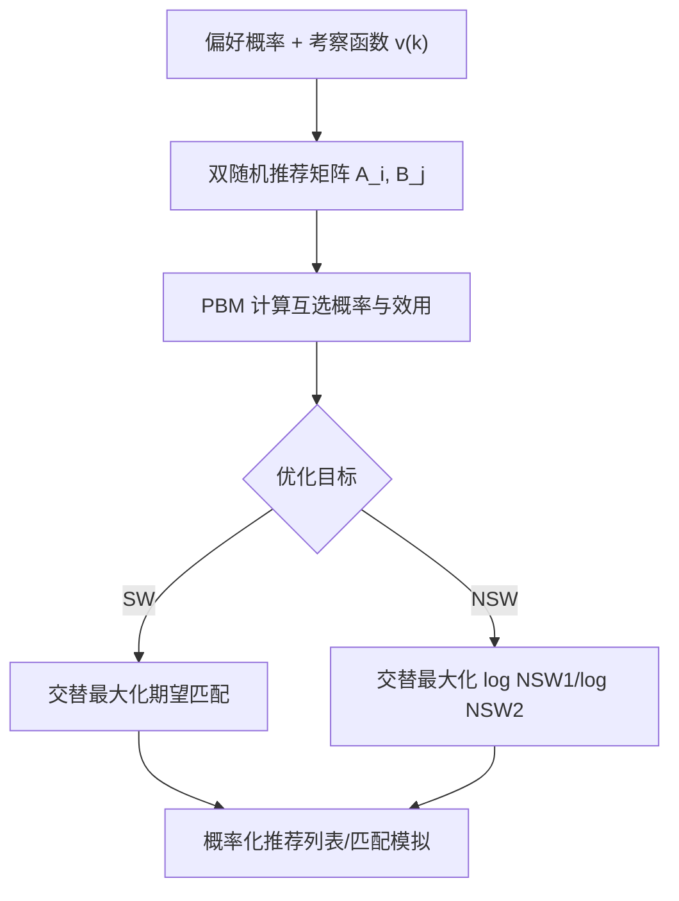

# Fair Reciprocal Recommendation in Matching Markets (双边匹配市场中的公平互惠推荐)

- **会议/期刊**: RecSys 2024
- **作者与机构**: Yoji Tomita (CyberAgent, Inc.)；Tomohiko Yokoyama (The University of Tokyo)
- **推荐链路定位**: 重排 / 推荐机会分配
- **研究方向**: 去偏公平、可信隐私与工业架构
- **论文原文**: [arXiv:2409.00720v1](https://arxiv.org/abs/2409.00720v1)
- **开源代码**: [CyberAgentAILab/FairReciprocalRecommendation](https://github.com/CyberAgentAILab/FairReciprocalRecommendation)

## TL;DR (1分钟核心速览)

针对双边约会平台的互惠推荐：最大化期望匹配的社会福利策略会集中曝光，导致同侧用户对推荐机会产生强烈嫉妒。本文把公平分配中的嫉妒自由引入互惠推荐，提出交替最大化Nash社会福利(NSW)并用Frank-Wolfe求解；在合成数据与日本约会平台200×200数据上，以PBM全曝光模拟评估，实现匹配数接近SW且双侧嫉妒近零。

## Background & Motivation (背景与核心矛盾)

- **主流范式**: 互惠推荐多先估计双边偏好，再做后处理排序；近期工作用匹配理论/TU匹配避免热门用户曝光过度，以提升总匹配数。
- **前人局限**: 这些方法直接优化匹配效率，未显式定义“被推荐机会”在同侧用户间的公平性；单侧物品曝光公平的嫉妒自由方法也无法处理互选匹配。
- **核心洞察 (Key Insight)**: 作者用反例表明，社会最优策略可能让同质用户因排位差而嫉妒；而完全均匀曝光虽无嫉妒，匹配数很低，因此存在效率-公平权衡。
- **本文切入点**: 将每个用户的“被推荐机会”视为可分配商品，用Nash社会福利的乘积效用平衡双边效用，从理论上逼近双嫉妒自由。

## Method (核心方法设计)

### 1. 整体框架 (Overall Architecture)

输入是两方偏好概率 $\hat{p}_1(i,j)$、$\hat{p}_2(j,i)$与考察函数$v(k)$；将每个用户的推荐表示为双随机矩阵$A_i$、$B_j$，在位置点击模型(PBM)下计算互选概率、效用与SW/NSW。优化器用Frank-Wolfe交替更新两侧推荐矩阵：固定一侧时另一侧子问题为凹，线性化后解双随机矩阵上的LP并做凸组合；收敛后得到概率化推荐列表，可采样或解码为Top-K。

### 2. 关键设计拆解 (Key Designs)

1. **机会矩阵与双嫉妒自由**：前人只评偏好/匹配数；本文将左侧用户 $a_i$在右侧所有列表中的被推荐行拼成机会矩阵$C_i$，其效用为$U_i(C_i)=\sum_j p_{i,j}\sum_{k,\ell}v(k)v(\ell)A_i(j,k)B_j(i,\ell)$。若$U_i(C_i)\ge U_i(C_{i'})$对所有$i,i'$ 成立，则左侧无嫉妒；双侧同时成立即double envy-free。直觉是把曝光机会当作可分商品，避免同质用户因排位差而嫉妒。

2. **NSW目标替代SW**：SW最大化易把曝光集中给高互选概率用户；NSW用乘积效用惩罚极低效用者：$\mathrm{NSW}_1=\prod_i U_i$，$\mathrm{NSW}_2=\prod_j V_j$。定理表明，$K=1$时双侧均NSW-best的策略双嫉妒自由；$K>1$且在$\varepsilon$-similarity 下近似满足，差为$O(\varepsilon)$。物理直觉是乘积目标自然选择“更均衡”的效用分配。

3. **交替Frank-Wolfe与推理代价**：联合目标非凹，但固定一侧后对另一侧凹；每步线性化后解双随机矩阵LP，并更新 $\boldsymbol{A}\leftarrow(1-\eta_t)\boldsymbol{A}+\eta_t\boldsymbol{X}^*$、$\boldsymbol{B}\leftarrow(1-\eta_t)\boldsymbol{B}+\eta_t\boldsymbol{Y}^*$。总目标为$\max_{\boldsymbol{A},\boldsymbol{B}}\log\mathrm{NSW}_1+\log\mathrm{NSW}_2$。无需负采样；但变量规模$n^2m+nm^2$，大规模在线推理开销高。

## Experimental Setup & Evaluation Protocol (实验设置与评估协议)

- **数据集与预处理**: 真实数据来自日本在线约会平台，抽取男/女各200人、较密集的200×200子矩阵，用ALS从like/dislike与match/sorry估计 $\hat{p}_1,\hat{p}_2$。

| 数据集 | #Users | #Items | #Interactions | 稀疏度/密度 | 特征/场景说明 |
| :--- | :---: | :---: | :---: | :---: | :--- |
| 合成-平衡 | 左50/右50 | 50 | $50\times50$偏好矩阵 | 全连接/非稀疏 |$\lambda$ 混合流行度与均匀偏好；10次生成 |
| 合成-非平衡 | 左75/右50 | 50 | $75\times50$ 偏好矩阵 | 全连接/非稀疏 | 考察双侧规模不平衡 |
| 真实约会平台 | 男200/女200 | 200 | 采样200×200 like/match | 较密集子矩阵 | ALS估计双边偏好概率 |

- **数据划分与防穿越 (Splitting Strategy)**: 无监督策略仿真，无训练/测试切分；合成每设定独立生成10个样本并报告均值与95%CI，真实数据用200×200采样全矩阵估计偏好后做仿真。
- **排名评测协议 (Ranking Protocol)**: 非传统Top-N采样排序；在完整对手方列表上按PBM $v(k)$ 计算曝光与互选，指标为期望匹配数、同侧嫉妒对数；未使用负采样，属于全库策略模拟。
- **对比基线与超参设置**: Naive、Prod、IterLP、TU、SW、NSW；$v(k)=1/\log_2(k+1)$或$1/k$；$n\in\{50,75\},m=50,\lambda\in\{0,0.2,\ldots,1.0\}$；真实数据200×200。原文未给ALS隐维度。

## Key Experimental Results (实验关键数据)

### 1. 主实验对比 (Main Results)

原文仅以图1/图2给出趋势，未提供可复制的逐点数值表；下表按图中趋势归纳，避免虚构数值与 `Improv.%`。

| 方法 | 合成匹配 | 合成左/右嫉妒 | 真实匹配 | 真实男/女嫉妒 |
| :--- | :---: | :---: | :---: | :---: |
| Naive | 低-中 | 高/高 | 低-中 | 高/高 |
| Prod | 中 | 高/高 | 中 | 高/高 |
| IterLP | 较高 | 低-中/低 | 较高 | 低/低 |
| TU | 较高 | 中/中 | 较高 | 中/中 |
| SW | **最高** | 高/高 | **最高** | 高/高 |
| NSW | 接近SW | **≈0/≈0** | 接近SW | **≈0/≈0** |

### 2. 消融实验 (Ablation Study)

原文未做严格组件消融；以下为目标替换与启发式对照的归纳。

| 对照/替换 | 期望匹配 | 公平性 | 结论 |
| :--- | :---: | :---: | :--- |
| SW目标 | **最高** | 嫉妒多（$\lambda\ge0.6$） | 效率-公平权衡显著 |
| NSW目标（本文） | 接近SW | 双侧≈0 | 乘积效用平衡有效 |
| IterLP启发式 | 较高 | 平衡数据小；$n=75$ 左嫉妒不可避 | 非平衡场景脆弱 |
| 考察函数log vs inv | 趋势一致 | NSW均≈0 | 对 $v(k)$ 较稳健 |

### 3. 关键实验发现 (Key Findings)

1. 在10次合成重复与95%CI下，SW在 $\lambda\le0.6$匹配最高，但$\lambda\ge0.6$嫉妒上升；$\lambda=0.8$ 时其他方法高嫉妒而NSW仍近零，说明公平不必以大幅牺牲匹配为代价。
2. $n=75,m=50$ 非平衡场景中，IterLP左侧嫉妒无法消除，NSW双侧近零；表明逐位置最大权匹配LP对侧规模不平衡敏感，而双NSW交替同时约束两侧。
3. 真实200×200约会数据、两种 $v(k)$ 下，NSW匹配数接近Prod/IterLP/TU且低于SW，但男/女嫉妒均最小；验证PBM仿真下兼顾匹配与机会公平的可行性。

## Highlights & Limitations (亮点、对比与审稿批判)

- **与代表作对比 (vs. Prior Work)**: 相比Saito & Joachims的单侧物品曝光嫉妒自由，本文将嫉妒自由扩展到双边互选匹配，并给出双嫉妒自由定理；相比Su/Tomita的TU匹配与后处理，本文显式建模机会公平；相比Xia/Do的群体或Lorenz公平，本文采用个体级机会嫉妒。
- **可迁移亮点**: “机会矩阵 + NSW乘积效用”可迁移到创作者/商家曝光、招聘与双边市场；Frank-Wolfe双随机矩阵优化可作为受约束排序策略的通用后处理，IterLP可作大规模回退。
- **审稿级局限批判**: ①变量数 $n^2m+nm^2$，大规模平台计算成本高，文中仅小规模仿真；②仅在PBM与给定偏好概率下仿真，无真实在线A/B；公平目标可能把效用“平均化”，需与长期留存/收益联合评估。

## Rating (四维评分)

- **方法创新性 (Novelty)**: ⭐⭐⭐⭐ （将fair division的双嫉妒自由迁移到双边互惠推荐，并有NSW近似定理支撑）
- **评估协议与实验扎实度 (Protocol & Experiments)**: ⭐⭐⭐⭐ （合成+真实数据、10次重复与95%CI较规范；但仅图形式、无在线验证）
- **写作与数学规范度 (Clarity & Rigor)**: ⭐⭐⭐⭐ （模型、机会矩阵与定理定义清晰；实验数值表缺失稍影响可复现阅读）
- **工业落地与复现价值 (Industrial & Practical Value)**: ⭐⭐⭐ （代码开源、IterLP可回退；NSW全变量优化在工业规模上仍偏重）

