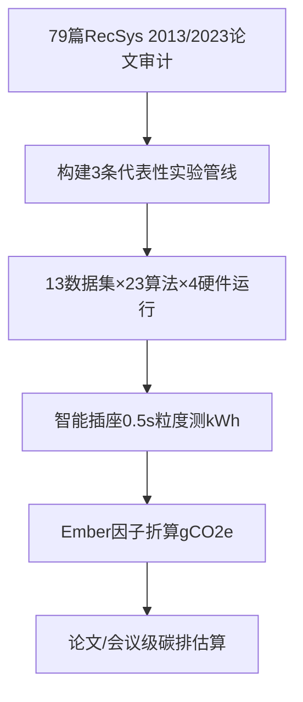
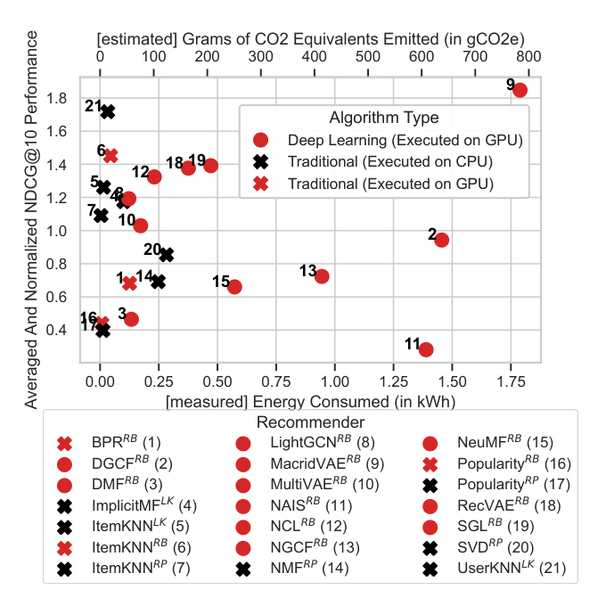

# From Clicks to Carbon: The Environmental Toll of Recommender Systems (从点击到碳排：推荐系统的环境代价)

- **会议/期刊**: RecSys 2024（Reproducibility Track）
- **作者与机构**: Tobias Vente、Lukas Wegmeth、Alan Said、Joeran Beel；University of Siegen / University of Gothenburg
- **推荐链路定位**: 实验评测/可复现性（非召回/排序模型）
- **研究方向**: 去偏公平、可信隐私与工业架构（绿色推荐/评测基准）
- **论文原文**: [https://arxiv.org/abs/2408.08203v2](https://arxiv.org/abs/2408.08203v2)
- **开源代码**: [https://github.com/ISG-Siegen/recsys-carbon-footprint](https://github.com/ISG-Siegen/recsys-carbon-footprint)

## TL;DR (1分钟核心速览)

针对推荐系统实验能耗与碳排少被披露的问题，本文复现 RecSys 2013/2023 共79篇论文的典型管线，用硬件功率计测13个数据集、23种算法、4类硬件的能耗并折算CO2e。结果显示2023年深度学习论文约排放3297 kg CO2e，较2013传统管线高约42倍，而精度未同步提升。

## Background & Motivation (背景与核心矛盾)

- **主流范式**: 2023年RecSys论文已转向top-N排序、PyTorch/GPU与Amazon-2018等大数据集；2013年则以评分预测、传统CF/CPU为主。
- **前人局限**: 仅Spillo等2023年工作用软件估算讨论“性能—碳排”权衡，缺少硬件级测量；且68%的2023全文未报告硬件、几乎无人披露能耗与实验地点，无法做十年可比。
- **核心洞察 (Key Insight)**: 硬件能效提升与清洁电力不足以抵消深度学习+大数据集带来的能耗增长；更高能耗并不必然换来更高nDCG。
- **本文切入点**: 以论文审计构造代表性管线，结合智能插座实测与区域碳强度，量化“算法—数据—硬件—地理”四层因素。

## Method (核心方法设计)

### 1. 整体框架 (Overall Architecture)

作者先人工审读79篇RecSys全文，提取硬件、库、划分、指标、开源与数据集习惯，构造2013评分预测、2013 top-N、2023 top-N三条代表性管线；随后在4台跨年代机器上运行13数据集×23算法，用智能插座以0.5秒粒度记录整机kWh，再按Ember因子折算gCO2e，最后外推论文级与会议级碳排。

### 2. 关键设计拆解 (Key Designs)

1. **年代分层代表性管线**：痛点是不复现单篇论文而复现“典型论文”。按2013/2023的算法与任务差异分层，并以每篇7算法×3数据集×16组网格搜索×0.51 kWh估算管线能耗，再乘40倍前期/调试开销：$E_{\text{pipeline}} = 7 \times 3 \times 16 \times 0.51 = 171.36\,\text{kWh}$，$E_{\text{paper}} = 40 \times E_{\text{pipeline}} \approx 6{,}854.4\,\text{kWh}$。有效性在于把论文中隐性的试错成本显性化。
2. **硬件级计量与碳强度折算**：不依赖软件估算，智能插座覆盖CPU/GPU/内存/电源/散热整机；按 $\mathrm{CO_2e} = E_{\text{kWh}} \times 481\,\text{g/kWh}$（2023全球均值）折算，并替换瑞典45、亚洲535等区域因子做敏感性分析，从而分离“用电量”与“电网清洁度”。
3. **低开销评测协议**：为测“典型”而非“最优”，统一5-core、随机60/20/20划分、默认超参、无交叉验证/重复实验，深度学习训练200 epochs、每5轮验证早停。无统一负采样调优，BPR等沿用库默认；推理开销即训练+预测+评估的总实测能耗。

## Experimental Setup & Evaluation Protocol (实验设置与评估协议)

- **数据集与预处理**: 13个数据集均做5-core剪枝；评分数据按常见实践转为top-N交互。统计如下：

| 数据集 | #Users | #Items | #Interactions | 密度 | 场景 |
| :--- | ---: | ---: | ---: | ---: | :--- |
| Amazon2018-Books | 105,436 | 151,802 | 1,724,703 | 0.0108 | 图书 |
| Amazon2018-CDs | 71,943 | 107,546 | 1,377,008 | 0.0178 | 音乐 |
| Amazon2018-Electronics | 62,617 | 187,288 | 1,476,535 | 0.0126 | 电子 |
| Amazon2018-Sports | 69,781 | 185,024 | 1,498,609 | 0.0116 | 户外 |
| Amazon2018-Toys | 75,856 | 192,326 | 1,686,250 | 0.0116 | 玩具 |
| Gowalla | 64,115 | 164,532 | 2,018,421 | 0.0191 | LBS |
| Hetrec-LastFM | 1,090 | 3,646 | 52,551 | 1.3223 | 音乐 |
| MovieLens-100K | 943 | 1,349 | 99,287 | 7.8049 | 电影 |
| MovieLens-1M | 6,040 | 3,416 | 999,611 | 4.8448 | 电影 |
| MovieLens-Latest-Small | 610 | 3,650 | 90,274 | 4.0545 | 电影 |
| Netflix | 11,927 | 11,934 | 5,850,559 | 4.1103 | 电影 |
| Retailrocket | 22,178 | 17,803 | 240,938 | 0.0610 | 电商 |
| Yelp-2018 | 213,170 | 94,304 | 3,277,931 | 0.0163 | 本地 |

- **数据划分与防穿越**: 随机`60%/20%/20%`训练/验证/测试，非`Leave-One-Out`、非全局时间切分；为省能耗不重复、不做交叉验证。
- **排名评测协议**: top-N用`nDCG@10`，评分预测用`RMSE`；未显式报告采样负例比，依赖RecBole/LensKit/RecPack默认排序评估，应理解为“库默认协议”，而非严格声明的Full-Ranking。
- **对比基线与超参设置**: 23种算法，传统含Popularity、ItemKNN、UserKNN、ImplicitMF、NMF、SVD、BiasedMF、FunkSVD、BPR；深度含DGCF、DMF、LightGCN、MacridVAE、MultiVAE、NAIS、NCL、NeuMF、NGCF、RecVAE、SGL。RecBole在GPU、LensKit/RecPack在CPU；默认超参、无网格搜索；未报告显著性检验。

## Key Experimental Results (实验关键数据)

### 1. 主实验对比 (Main Results)

| 算法 | 类型/平台 | 单次能耗(kWh) | 归一化nDCG@10 | 能耗/传统均值 |
| :--- | :--- | ---: | ---: | ---: |
| Popularity | 传统/CPU | **0.007** | — | 0.08×（-92%） |
| ItemKNN | 传统/CPU | 0.04 | — | 0.44×（-56%） |
| UserKNN | 传统/CPU | 0.03 | 1.7 | 0.33×（-67%） |
| LightGCN | DL/GPU | 0.12 | — | 1.33×（+33%） |
| DMF | DL/GPU | 0.13 | — | 1.44×（+44%） |
| DGCF | DL/GPU | 1.45 | — | 16.1×（+1511%） |
| MacridVAE | DL/GPU | 1.79 | **1.8** | 19.9×（+1889%） |
| 传统均值 | — | 0.09 | — | 1.0× |
| DL均值 | — | 0.68 | — | 7.6×（+656%） |

DL均值相对传统均值约8倍能耗；MacridVAE比UserKNN高约60倍，而nDCG仅1.8 vs 1.7。

<figure class="paper-figure" markdown="span">
  <figcaption>图2：总能耗（kWh）与平均、归一化的 nDCG@10 性能对比。蓝色数据点表示在 CPU 上运行的算法，红色表示在 GPU 上运行的算法。叉号表示传统算法，圆点表示深度学习算法。nDCG@10 在每个数据集内归一化以确保影响一致，并在所有十二个纳入数据集中取平均。上方 x 轴显示 gCO2e 排放量，按 2023 年全球平均值计算。</figcaption>
</figure>

### 2. 消融实验 (Ablation Study)

| 因素 | 设置对比 | 能耗/碳排变化 | 结论 |
| :--- | :--- | :--- | :--- |
| 算法类型 | DL vs 传统单次 | 0.68 vs 0.09 kWh | 约7.6–8× |
| 年代碳排 | 2013 vs 2023单次 | 7.09 vs 294.9 gCO2e | 约42× |
| 数据集规模 | Hetrec-LastFM vs Yelp-2018 | 0.001 vs 1.56 kWh | 约1560× |
| 硬件 | M1 MacBook vs 现代工作站 | 0.03 vs 0.33 kWh | 约10×；CO2e 14.4 vs 163.5 g |
| 地理 | 瑞典 vs 亚洲 | 45 vs 535 g/kWh | 约12× |
| 论文开销 | 单管线 vs 论文 | 171.36 vs 6854.4 kWh | 40× |

### 3. 关键实验发现 (Key Findings)

1. **论文级碳排极高**：2023年单篇论文约6,854.4 kWh，按全球均值481 g/kWh折合约3,297 kg CO2e；269篇投稿的实验合计约886.9 tCO2e，相当于384次纽约—墨尔本航班。
2. **能耗—精度严重脱钩**：DL算法未取得更高平均归一化nDCG@10却耗能约8倍；MacridVAE与UserKNN精度接近，能耗却高约60倍，说明“堆深度模型”在基准实验中未必划算。
3. **基础设施因素可主导结果**：kWh→gCO2e因子瑞典45 vs 亚洲535，差约12倍；同实验换硬件可差约10倍。若2023全部实验移至瑞典，估算碳排可降约90%。

## Highlights & Limitations (亮点、对比与审稿批判)

- **与代表作对比 (vs. Prior Work)**: 相比Spillo等仅做软件估算与单点性能—碳排分析，本文用硬件功率计、跨十年79篇论文、13数据集/23算法/4硬件做系统对照；相比一般绿色ML指南，本文把RecSys管线与会议级碳排估算落到可操作数字。
- **可迁移亮点**: 论文应强制报告硬件、实验地点、运行时长与能耗；在时间不敏感场景优先用低功耗CPU/Apple Silicon；基准测试可用默认超参+早停替代大规模网格搜索，以测“典型能耗”而非“刷榜能耗”。
- **审稿级局限批判**: 采用单次随机划分、无重复/无调参，精度结论稳健性有限且未做显著性检验；2013旧代码不可得，用现代库重实现可能偏离原始能耗；论文级40倍开销来自访谈中位数，会议级碳排按269篇投稿外推，均含估计不确定性。

## Rating (四维评分)

- **方法创新性 (Novelty)**: ⭐⭐⭐⭐ （首个RecSys十年硬件级碳排对照，但核心是测量与复现方法学，非新推荐算法）
- **评估协议与实验扎实度 (Protocol & Experiments)**: ⭐⭐⭐⭐ （79篇论文审计+13数据集+23算法+4硬件很全面，但单次划分、无重复与显著性检验）
- **写作与数学规范度 (Clarity & Rigor)**: ⭐⭐⭐⭐ （能耗公式、折算因子与外推链条清晰，个别区域估算口径可更统一）
- **工业落地与复现价值 (Industrial & Practical Value)**: ⭐⭐⭐⭐ （代码开源、报告清单可直接用于实验平台节能与绿色评测，但外推假设需按场景校准）

