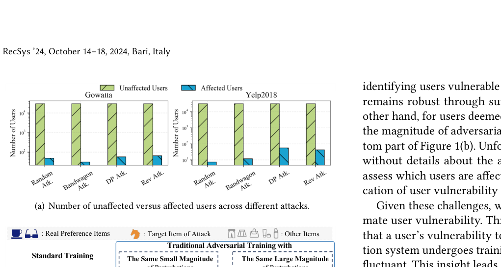
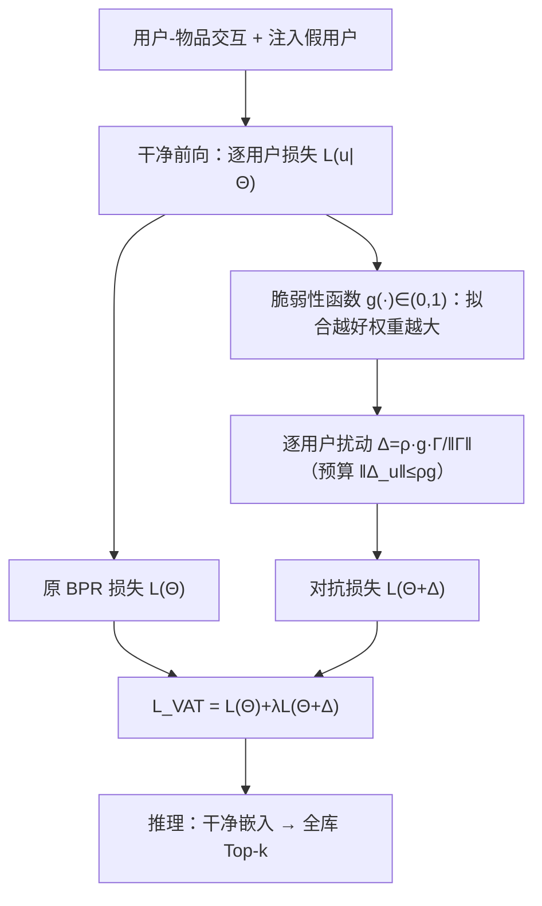
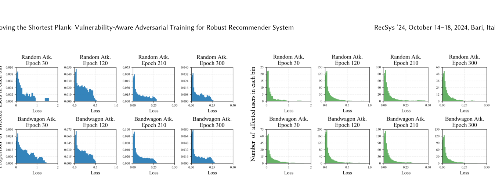

# Improving the Shortest Plank: Vulnerability-Aware Adversarial Training for Robust Recommender System (补最短的那块板：面向鲁棒推荐的脆弱性感知对抗训练)

- **会议/期刊**: RecSys 2024
- **作者与机构**: Kaike Zhang, Qi Cao, Yunfan Wu, Fei Sun, Huawei Shen, Xueqi Cheng（中科院计算所 AI 安全重点实验室 / UCAS）
- **推荐链路定位**: 召回/表征训练阶段（MF、LightGCN 的嵌入级鲁棒训练）
- **研究方向**: 去偏公平、可信隐私与工业架构 / 协同过滤
- **论文原文**: [https://arxiv.org/abs/2409.17476v1](https://arxiv.org/abs/2409.17476v1)
- **开源代码**: [https://github.com/Kaike-Zhang/VAT](https://github.com/Kaike-Zhang/VAT)

## TL;DR (1分钟核心速览)

针对投毒攻击下"等幅对抗扰动"的两难：攻击只命中少数脆弱用户，等幅大扰动会损伤未受害用户的推荐质量，等幅小扰动又保护不足。作者实证发现脆弱性随训练波动，且**系统拟合越好（用户损失越低）的用户越易被攻击**——因为投毒构造的高阶关联正是被其精确拟合的部分。据此提出 VAT，用损失相对偏离构造有界脆弱性函数，逐用户分配扰动半径 $\rho g(\cdot)$。在 Gowalla/Yelp2018/MIND、MF/LightGCN 骨干、全库排序协议下，T-HR@50 平均降 21.53%，NDCG@20 相对骨干平均升 12.36%。

## Background & Motivation (背景与核心矛盾)

- **主流范式**: 两条路线——检测剔除假用户（GraphRfi、LLM4Dec，依赖攻击假设或监督标签）；或参数/嵌入级对抗训练（APR、SharpCF），以 min-max 形式对所有用户注入同一 $\epsilon$ 的扰动。
- **前人局限**: ①同一 $\epsilon$覆盖全部用户，与"攻击仅影响少数用户"的现实不匹配（图 1a）；②大$\epsilon$牺牲未受害用户的体验，小$\epsilon$ 保护不足，鲁棒性与精度被迫折中（图 1b）；且防御方无攻击者目标信息，无法直接判定谁脆弱。
- **核心洞察 (Key Insight)**: 脆弱性是**波动**的——300 epoch 内采样 10 次，几乎无人持续受害，而多数受害用户状态反复变化（图 2）；按损失分桶后，损失越小受害比例越高（图 3）；T-SNE 案例中拟合良好用户与目标物品余弦相似度 0.7570，欠拟合用户仅 0.5309，前者正通过三阶关联"学会"了投毒模式（图 4）。
- **本文切入点**: 用"当前拟合度"作脆弱性的可观测代理，把扰动幅度从全局常数变为逐用户变量。

<figure class="paper-figure" markdown="span">
  <figcaption>图 1：(a) 表明给定攻击仅影响少数用户。(b) 表明施加相同幅度的扰动可能导致不易受攻击用户的性能下降，或未能有效保护易受攻击用户。</figcaption>
</figure>

## Method (核心方法设计)

### 1. 整体框架 (Overall Architecture)

VAT 沿用 APR 的 min-max 范式，唯一改动是扰动预算的分配方式。每步先做一次干净前向，得到各用户损失 $\mathcal{L}(u|\Theta)$，代入脆弱性函数$g$得到$(0,1)$权重；再对每个交互$(u,i)$沿损失梯度方向$\Gamma_{u,i}$ 施加与该权重成正比的扰动，与原 BPR 损失加权联合更新。推理阶段扰动全部丢弃，仅用干净嵌入做内积全库排序。相较 APR 仅多一次按用户聚合损失的标量运算与逐用户反传，推理开销完全同阶。

### 2. 关键设计拆解 (Key Designs)

1. **脆弱性函数 $g$（把"拟合过度"翻译成扰动预算）**：绝对损失会被用户活跃度与学习难度混淆，故取相对偏离的倒数再经 Sigmoid 压到有界区间：$g(\mathcal{L}(u|\Theta))=\sigma\Big(-\big(\tfrac{\mathcal{L}(u|\Theta)-\bar{\mathcal{L}}}{\bar{\mathcal{L}}}\big)^{-1}\Big)\in(0,1)$。直觉：损失远低于均值者被过度拟合，其梯度已含投毒模式，$g\to 1$给足扰动；高损失者$g\to 0$ 近似关闭扰动以免二次伤害。

2. **用户自适应扰动半径（预算重分配而非预算放大）**：$\Delta^{VAT}_{u,i}=\rho\,g(\mathcal{L}(u|\Theta))\,\frac{\Gamma_{u,i}}{\|\Gamma_{u,i}\|}$，约束为$\|\Delta_{u,*}\|\le\rho g(\mathcal{L}(u|\Theta))$，其中$\Gamma_{u,i}=\partial\mathcal{L}((u,i)|\Theta+\Delta)/\partial\Delta_{u,i}$。总扰动预算甚至更小，但集中在脆弱用户上，同时降低攻击成功率并保留干净用户的排序质量。

3. **训练目标、负采样与推理效率**：$\mathcal{L}_{VAT}(\Theta)=\mathcal{L}(\Theta)+\lambda\mathcal{L}(\Theta+\Delta^{VAT})$，负采样沿用 BPR 单负样本、无硬负采样；$\lambda=1.0$、$\rho=0.6$。因增量仅为逐用户标量权重，训练成本接近 APR，推理与骨干模型完全一致。

<figure class="paper-figure" markdown="span">
  <figcaption>图 3：与损失较高的用户相比，损失较低的用户更容易受到攻击影响。</figcaption>
</figure>

## Experimental Setup & Evaluation Protocol (实验设置与评估协议)

| 数据集 | #Users | #Items | #Interactions | 平均交互 / 稀疏度 | 场景说明 |
| :--- | :---: | :---: | :---: | :---: | :--- |
| Gowalla | 29,858 | 40,981 | 1,027,370 | 34.4 / 99.92% | 签到 POI |
| Yelp2018 | 31,668 | 38,048 | 1,561,406 | 49.3 / 99.88% | 本地商户 |
| MIND | 141,920 | 36,214 | 20,693,122 | 145.8 / 99.60% | 新闻推荐（按原文采样用户子集） |

- **数据划分与防穿越**: 沿用 LightGCN 的 `10-core` 过滤，每用户交互按 `比例划分` 80% 训练 / 20% 测试，训练集内再随机 10% 作验证；非全局时间戳切分，无冷启动设定。
- **排名评测协议**: 采用无偏 `Full-Ranking`（全库未交互物品排序），不使用采样负例评估。推荐质量用 HR@20 / NDCG@20；攻击成功率用目标物品侧 T-HR@50 / T-NDCG@50（式 6），目标物品在干净数据上 T-HR@50 = 0.000（极端冷门物品），保证增益可测。
- **对比基线与超参**: 基线含检测类 GraphRfi、LLM4Dec（仅 MIND）、对抗训练 APR 与 SharpCF（仅 MF，迁移 LightGCN 时训练不稳）、去噪类 StDenoise；骨干为 MF 与 LightGCN。攻击为黑盒，注入 1% 假用户、5 个目标物品，涵盖 Random/Bandwagon/DP/Rev 及热门物品推广、自适应 DP。学习率与 weight decay 网格搜索，$\rho\in\{0.1..1.0\}$、$\lambda\in\{0.2..2.0\}$；报告多次运行均值 ± 标准差（未报告显著性检验$p$ 值）。

## Key Experimental Results (实验关键数据)

### 1. 主实验对比 (Main Results)

鲁棒性（T-HR@50，↓ 越低越好）：

| 骨干 / 数据集（攻击） | 无防御 | StDenoise | GraphRfi | APR | SharpCF | VAT | 相对最佳基线↓ |
| :--- | :---: | :---: | :---: | :---: | :---: | :---: | :---: |
| Gowalla-MF (Bandwagon) | 0.120 | 0.165 | 0.154 | 0.184 | 0.169 | **0.101** | 15.86% |
| Gowalla-MF (Rev) | 0.246 | 0.355 | 0.206 | 0.261 | 0.350 | **0.103** | 49.87% |
| Gowalla-LGCN (Bandwagon) | 0.639 | 0.334 | 0.710 | 0.332 | — | **0.259** | 22.01% |
| Gowalla-LGCN (Rev) | 0.718 | 1.304 | 0.564 | 0.655 | — | **0.456** | 19.17% |
| Yelp-MF (Bandwagon) | 0.073 | 0.181 | 0.058 | 0.057 | 0.072 | **0.040** | 30.70% |
| Yelp-LGCN (Bandwagon) | 1.286 | 1.609 | 0.958 | 1.052 | — | **0.694** | 27.56% |
| MIND-MF (DP) | 0.023 | 0.010 | 0.020 | 0.008 | — | **0.002** | 75.36% |
| MIND-LGCN (Bandwagon) | 0.149 | 0.164 | 0.093 | 0.091 | — | **0.065** | 28.50% |

推荐性能（MF 骨干，NDCG@20）：

| 数据集 | MF（干净） | +APR | +SharpCF | +VAT | vs 最佳基线 | vs MF |
| :--- | :---: | :---: | :---: | :---: | :---: | :---: |
| Gowalla | 7.158 | 10.646 | 10.020 | **10.864** | +2.05% | +51.77% |
| Yelp2018 | 2.974 | 3.202 | 3.108 | **3.234** | +1.00% | +8.74% |
| MIND | 0.676 | 0.682 | — | **0.710** | +4.11% | +4.98% |

### 2. 消融与变体对比 (Ablation / Variants)

| 配置（Gowalla-MF，Rev 攻击） | T-HR@50↓ | 说明 |
| :--- | :---: | :--- |
| 无防御 | 0.246 | 原始脆弱性 |
| 等幅扰动 APR（固定 $\epsilon$） | 0.261 | 反而更差：全局大扰动伤及未受害用户 |
| SharpCF（锐度感知 + 等幅） | 0.350 | 只改优化几何，未解决"扰动给谁" |
| **VAT（逐用户自适应）** | **0.103** | 削减 49.87%，且 NDCG@20 同步提升 |
| 自适应 DP 攻击（MF） | 0.201 → TopBaseline 0.049 → **VAT 0.033** | 面对自适应攻击仍降 32.72% |

### 3. 关键实验发现 (Key Findings)

1. **等幅对抗训练并非单调增益**：MF/Gowalla 上 APR 把 Rev 攻击的 T-HR@50 从 0.246 抬到 0.261，说明"同等保护所有人"会扩大攻击面；同一设置下 VAT 降到 0.103，鲁棒性的瓶颈是脆弱用户定位而非扰动强度。
2. **鲁棒与精度不必然此消彼长**：VAT 在全部骨干-数据集组合上同时提升 NDCG@20，Gowalla-MF 由 7.158 升至 10.864（+51.77%），源于对大损失用户收缩扰动、对低损失过拟合用户保留扰动充当正则，案例研究（图 7、图 8）也显示未受害的过拟合用户排序被纠正。
3. **图骨干上增益更明显**：LightGCN 上 Bandwagon/Rev 成功率降 22.01%/19.17%（Yelp 上 27.56%），MIND 的 DP 攻击由 0.023 压到 0.002（75.36%），印证图卷积放大的高阶关联正是投毒传播通道，也正是脆弱性函数瞄准的对象。

## Highlights & Limitations (亮点、对比与审稿批判)

- **与代表作对比**: APR 与 SharpCF 把扰动半径当作全局超参，VAT 保留 min-max 框架而把半径变成用户的函数，是**预算重分配**而非预算放大；相对 GraphRfi/LLM4Dec，不依赖假用户监督标签与攻击模式假设，因此跨攻击类型稳定（检测类仅在与其训练分布一致的 Random 攻击上强）；相对 StDenoise，无需区分真假交互，而去噪在非随机攻击下甚至放大成功率（LGCN/Gowalla Rev：0.718→1.304）。
- **可迁移亮点**: ①用"每用户损失的相对偏离"构造有界 $(0,1)$ 权重，可直接迁移到多场景/时空推荐的鲁棒训练与长尾用户正则强度调节；②以拟合度作隐蔽属性（脆弱性、噪声敏感度）代理的思路，可用于标签噪声与假阳性反馈的加权。
- **审稿级局限批判**: ①缺乏显著性检验与置信区间，仅给 ±std；②$g$ 依赖批内损失均值，batch 组成会影响权重稳定性，且需逐用户反传，训练成本高于普通训练；③评估限于 MF/LightGCN 与静态比例划分，缺少时间切分、序列/LLM 骨干与线上 A/B；④T-HR@50 只刻画"目标是否进 top-50"，无法反映攻击者更细的排序操控收益。

## Rating (四维评分)

- **方法创新性 (Novelty)**: ⭐⭐⭐⭐ （把对抗训练从"统一 $\epsilon$"改写为"逐用户预算"，并以拟合度作脆弱性代理，机制简洁但切中真实失效模式）
- **评估协议与实验扎实度 (Protocol & Experiments)**: ⭐⭐⭐⭐ （3 数据集 × 2 骨干 × 4+ 攻击，含自适应攻击与热门物品推广，全库排序协议严谨；缺显著性检验与线上验证）
- **写作与数学规范度 (Clarity & Rigor)**: ⭐⭐⭐⭐ （脆弱性函数的动机-公式-案例链条完整，$g$有界性论证清晰；公式排版略粗糙，$g$ 的单调性需读者自行推导）
- **工业落地与复现价值 (Industrial & Practical Value)**: ⭐⭐⭐⭐ （代码已开源，推理零额外开销、可插拔于现有 MF/LightGCN 训练管线；但训练需逐用户反传，超参 $\rho,\lambda$ 对收敛仍有敏感度）

