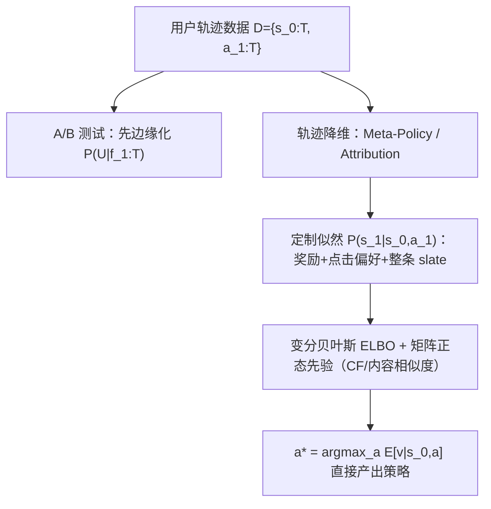

# Position Paper: Why the Shooting in the Dark Method Dominates Recommender Systems Practice; A Call to Abandon Anti-Utopian Thinking (立场论文：为何「盲射法」统治推荐系统实践——兼论放弃反乌托邦思维)

- **会议/期刊**: RecSys 2024 (Position Paper, 11 pages)
- **作者与机构**: David Rohde（独立作者，因果推断 / 贝叶斯决策论方向）
- **推荐链路定位**: 精排 / 策略学习（端到端奖励优化）
- **研究方向**: 去偏公平、可信隐私与工业架构 / 强化学习与动态探索推荐
- **论文原文**: [arXiv:2402.02152v2](https://arxiv.org/abs/2402.02152v2)
- **开源代码**: 暂未开源

## TL;DR (1分钟核心速览)

本文是一篇**方法论批判 + 建设性提案**的立场论文，不含数据集实验。它指出：工业界先用协同过滤/内容相似度等**离线代理指标**优化一个伪效用，再靠 A/B 测试碰运气验证，这套「盲射法（shooting in the dark）」之所以统治实践，是因为真正直接优化奖励的贝叶斯决策问题在推理与决策两步上都极其困难。作者论证：A/B 测试本质是「先边缘化、后条件化」的贝叶斯原罪；把轨迹强制降维成上下文 Bandit 后，准确估计所有 context-action 对需要天文数字样本（其玩具推演：1000×1000 场景下均匀日志需 $10^8$条记录，$\epsilon$-greedy 需$10^{10}$ 条）。破局点不是「把模型做深」，而是借用深度学习**工程栈**：定制似然（Probabilistic Rank & Reward）+ 变分贝叶斯 + 矩阵正态先验，把代理信号从「优化目标」降级为「先验」，从而首次具备直接瞄准 A/B 表现的条件。

## Background & Motivation (背景与核心矛盾)

- **主流范式**: A/B 测试是衡量线上性能的「金标准」，其统计学协议（随机分流、效应差估计）非常严谨；但「如何提出一个值得测试的 B」这一步，业界统一做法是优化一个与真实收益仅松散相关的代理（user-item / item-item 距离、BPR 偏好序），再用人脑启发式把「距离」翻译成可上线的推荐器。
- **前人局限 1（无可证伪性）**: 代理指标与线上指标的相关性**没有任何离线判据**可以比较优劣，新方案是否有效完全取决于这一次 A/B 是否恰好相关成立，故称「盲射」。
- **前人局限 2（A/B 测试自身的假设脆弱）**: 除平稳性外还依赖 SUTVA，而推荐场景中同人多账号、A 组用户受推荐影响后与 B 组用户社交传播都会破坏该假设，通常导致效应被**低估**。
- **核心洞察 (Key Insight)**: A/B 测试只观测 $P(U(s_{0:T})\mid f_{1:T}(\cdot))$，等价于「把整条用户轨迹的联合分布先边缘化到效用、再做条件化」，主动丢弃了全部过程信息；而贝叶斯决策论下**因果推断就是推断本身**，无需 do-calculus、SCM 或 IPS 等外挂装置。
- **本文切入点**: 承认全轨迹贝叶斯推理（似然在绝大多数参数空间平坦、序列越深条件集基数越爆炸）在实践中从未被真正尝试，但论证只要正确使用深度学习工具栈（而非加深网络），即可把「盲射」所用的弱信号转化为强先验，从而直接攻击奖励优化目标。

## Method (核心方法设计)

### 1. 整体框架 (Overall Architecture)

论文的逻辑闭环是「诊断 → 降维 → 重建」：先从第一性原理给出全轨迹的贝叶斯决策论形式（联合似然 + 后验 + 效用期望最大化），指出其不可实施性；再把 $T$步轨迹用两种手段强制投影为$T=1$的上下文 Bandit（Meta-Policy 或 Attribution），使学习退化为一个回归问题；随后证明该回归在真实动作空间下**样本复杂度不可承受**，且 MLE 点估计无法概括平坦后验；最终提案用定制似然纳入奖励之外的偏好与 slate 信息、用变分贝叶斯与矩阵正态先验补足似然的空白区，直接输出$\arg\max$ 策略。

### 2. 关键设计拆解 (Key Designs)

1. **A/B 测试的「先边缘化后条件化」定位（诊断）**：痛点是把 A/B 当黑箱，无法判断两个代理谁更优。论文给出决策论目标 $f^{*}_{1:T}(\cdot)=\arg\max_{f_{1:T}(\cdot)}\int U(s_{0:T})P(S_{0:T}=s_{0:T}\mid A_{1:T}=f_{1:T}(\cdot),\mathcal{D})\,\mathrm{d}s_{0}\cdots \mathrm{d}s_{T}$，并指出联合分布应对**策略**而非具体动作条件化（式 1），后验才对已投递动作条件化（式 2）——这一区分正是「同策略数据也能为异策略提供信息」的理论依据。物理直觉：A/B 只保留了效用的边缘分布，因而丢掉了可用于评估任意策略的全部粒度信息。

2. **两种把轨迹压成上下文 Bandit 的强制手段（降维）**：*Meta-Policy* 把「策略」当作动作、对初始状态 $s_0$条件化，A/B 之后可按$s_0$分桶派发不同策略，鲁棒性与 A/B 同级，但动作空间巨大、个性化仅限$s_0$；*Attribution* 假定$U(s_{0},\dots,s_{T})=\sum_{i}v(s_{i})$且$P(S_r=s_r\mid A_{1:r},S_{0:r-1})=P(S_r=s_r\mid A_r,S_0)$，从而每条轨迹贡献$T_u$条 bandit 样本、数据量放大$T_u$倍。作者对后者给出尖锐批判（引 Pauli 语「not even wrong」）：点击尚可归因，但销量、观看时长等真实指标并不「属于」某个决策点，不存在正确的归因公理化；且这种条件独立假设等价于「兴趣全在$s_0$、后续状态只含对推荐的响应」。

3. **提案：定制似然 + 变分贝叶斯（重建）**：痛点在于生产工具只做 MLE，而全交叉参数的似然在未尝试过的 context-action 组合上**完全平坦**，业界只好用特征工程压缩参数空间、裁剪候选集——这才是「直接法有偏」指控的真正来源。提案改用 Probabilistic Rank & Reward 类模型，使 $s_1$同时携带奖励与「点了哪些 / 没点哪些」的偏好信息、$a_1$承载整条 slate、$s_0$承载兴趣与参与度；训练目标由 MLE 换为 ELBO：$\log p(\mathcal{D})\ge\mathbb{E}_{q(\theta)}[\log p(\mathcal{D}\mid\theta)]-\mathrm{KL}(q(\theta)\,\|\,p(\theta))$，其中先验取矩阵正态$p(\theta)=\mathcal{MN}(M,U,V)$，$U,V$由协同过滤/内容相似度构造，从而把「盲射法」的弱信号变成结构化先验，使其在似然有信息时让位、在似然空白处接管。推理时无需负采样（似然本身即全 slate 建模），单次前向 +$\arg\max$ 即可解码策略。

## Experimental Setup & Evaluation Protocol (实验设置与评估协议)

- **数据集与预处理**: 本文为立场论文，**不含真实数据集实验**，故无 `5-core` 过滤、无用户/物品统计表；其论证依赖一个可解析的玩具推演（1000 个兴趣主题 × 1000 个候选动作、最优动作 CTR $0.9\%$、其余$0.1\%$、目标把最优与次优之差的标准误压到$\pm 0.1\%$）。
- **数据划分与防穿越**: 不适用；论文只讨论「日志策略 $\pi_0(a_1\mid s_0)$」在离线估计中的作用。
- **排名评测协议**: 不适用（无 Full-Ranking / Sampled Ranking）。文中批评现有 off-policy 工作普遍只在 `supervised-to-bandit` 人造变换上评测——动作集极小、treatment effect 巨大，因而「很容易做得好」，与真实推荐任务相关性低。
- **对比基线与超参**: 无超参与显著性检验；比较对象是**方法论**：A/B 测试、上下文 Bandit + MLE、上下文 Bandit + 变分贝叶斯、IPS/Horvitz-Thompson 类估计器、Meta-Policy、Attribution、RL（on-line / off-line）。

### 表 1：三种范式的方法论对比（本文核心「主表」）

| 维度 | 仅 A/B 测试 | 盲射法（代理 + BPR） | 本文提案（Bandit + Bayes） |
| :--- | :--- | :--- | :--- |
| 优化目标 | 无（仅测量） | 伪效用 $\tilde{U}(f_{1:T})$，常来自无关数据 | 真实效用期望$\mathbb{E}[v\mid s_0,a]$ |
| 数据使用 | 仅用边缘化后的效用 | 常用 CF/内容数据，可完全不用奖励 | 奖励 + 偏好 + slate + 先验全覆盖 |
| 因果正确性 | 依赖 SUTVA | 无因果语义 | 回归即得后门调整，无需额外装置 |
| 离线可判优 | **不可** | **不可**（无相关性判据） | 可（同一后验下比较策略值 $V(f)$） |
| 主要代价 | 每次试探都在线上付费 | 长期停滞、无法累积知识 | 需定制似然 + 变分推断工程化 |

### 表 2：玩具场景的样本复杂度推演（对应「消融/敏感性」分析）

| 日志策略 | 每个 context-action 对所需样本 | 总记录数需求 | 相对增幅 |
| :--- | :---: | :---: | :---: |
| 均匀随机 $\pi_0$|$1\times10^{5}$|$1\times10^{8}$ | — |
| $\epsilon$-greedy（99% 利用 / 1% 探索） |$1\times10^{5}$|$1\times10^{10}$|$\times 100$ |
| 真实 slate 场景（组合爆炸） | 同上 | 远超 $10^{10}$ | 数个数量级 |

### 3. 关键实验发现 (Key Findings)

1. **纯奖励信号逐对估计是死路**：连 1000×1000 的玩具问题都需要 $10^8$（均匀日志）到$10^{10}$（$\epsilon$-greedy）条记录，而真实系统动作空间因 slate 组合爆炸远大于此——这从数量级上解释了为何学界「直接法」提案在工业界无法落地，也解释了代理指标的统治地位并非懒惰而是被迫。
2. **因果不是新增学科，而是工程纪律问题**：在后门调整下因果效应由普通回归免费获得；unobserved confounding 只在两种**自伤**情形出现——(a) 训练时丢掉日志策略曾使用的特征，(b) 多团队各自做特征工程导致点击模型用 $s_0'$、购买模型用$s_0''$ 的嵌套失配。补救不是 SCM，而是「层级内所有模型共享同一信息集，或干脆端到端单模型」。
3. **IPS/HT 的改进方向被误置**：$\hat{V}(f)=\frac{1}{N}\sum_{n}U(s_{1n})\frac{\mathbb{I}\{a_{1n}=f(s_{0n})\}}{\pi_0(a_{1n}\mid s_{0n})}$虽无偏但方差极大，现有裁剪/自归一化权重本质上让新策略向旧策略靠拢（「反正旧策略是合理的」），因而收益被高估；更根本地，使用倾向得分$\pi_0$ 本身违反 conditionality 原则。

## Highlights & Limitations (亮点、对比与审稿批判)

- **与代表作对比**: 相对 Gao 等「推荐必须引入因果推断」的号召与 Saito/Joachims、Sachdeva 等基于 item 相似度改良 IPS 的路线，本文认为二者都在错误的抽象层上加工具；相对 Chen/Ie 等的 RL4Rec（直接跑线上流量或用粗糙 off-policy 估计），本文指出其要么退化为 A/B 变体，要么在更简单场景下就会灾难性失效。相较 Rendle 的 BPR、Chuklin 的 cascade 模型，本文的差异是把它们各自的偏好建模思路纳入一个**统一似然 + 后验**框架。
- **可迁移亮点**: ① 「代理信号 → 先验」的降级操作可迁移到任何无法获取稠密奖励的推荐任务（冷启动、长尾、跨域），用矩阵正态先验编码 item-item 相似度即可；② 「奖励 + 偏好 + slate 同似然」的思路可直接改造成精排模型的输出头（同时预测点击位置集合与效用），替代纯 CTR 点估计。
- **审稿级局限批判**: ① 全文最强的主张（变分贝叶斯 + PRR 似然可工程化上线）**没有任何实验或复杂度/延迟测算支撑**，PRR 关于「推荐之间不复杂交互」的假设在 slate 精排中恰恰最可疑；② 对 attribution 的全盘否定偏激——点击类指标在归因下已被工业界长期验证有效，作者未给出替代方案在 click 场景的量化对照；③ 未讨论变分后验在千亿级物品库上的在线推理成本与 amortized inference 方案，落地可行性仍停留在「工具栈已就绪」的断言层面。

## Rating (四维评分)

- **方法创新性 (Novelty)**: ⭐⭐⭐⭐ （以贝叶斯决策论重新统一定义 A/B 测试与代理指标的地位，「代理降级为先验」是真正新颖且可操作的视角，但核心组件 PRR、矩阵正态先验均引自既有工作）
- **评估协议与实验扎实度 (Protocol & Experiments)**: ⭐⭐ （无任何真实数据实验与显著性检验，仅靠一个玩具样本复杂度推演与文献批判支撑全部主张，立场论文定位决定了其论证强度上限）
- **写作与数学规范度 (Clarity & Rigor)**: ⭐⭐⭐⭐ （式 1 与式 2 对「策略条件化 vs 动作条件化」的区分严谨且关键，各节论证链条清晰；但部分断言如「attribution is not even wrong」缺少形式化证明）
- **工业落地与复现价值 (Industrial & Practical Value)**: ⭐⭐⭐ （对工业实践痛点诊断极准，「共享同一信息集以消除自造混淆」是零成本即可落地的工程建议；但提案侧无开源、无延迟分析，短期内难以复现）

