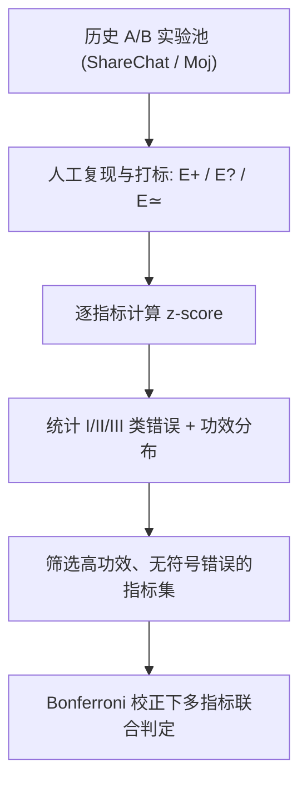
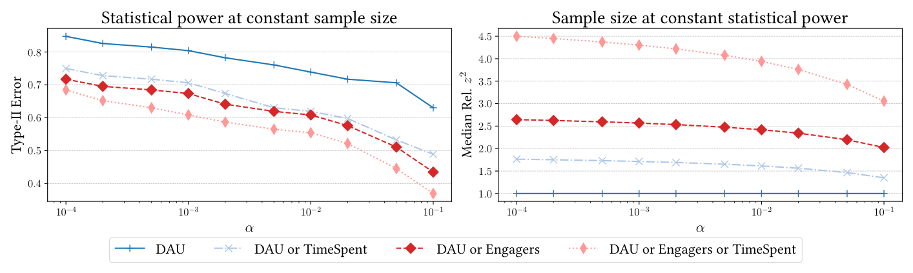

# Powerful A/B-Testing Metrics and Where to Find Them (强力 A/B 测试指标何处寻)

- **会议/期刊**: RecSys 2024（Industry Track）
- **作者与机构**: Olivier Jeunen、Shubham Baweja、Neeti Pokharna、Aleksei Ustimenko —— ShareChat（印度短视频平台）
- **推荐链路定位**: 线上评测 / 实验平台（系统级端到端决策）
- **研究方向**: 去偏公平、可信隐私与工业架构（线上评价指标体系）
- **论文原文**: [https://arxiv.org/abs/2407.20665v1](https://arxiv.org/abs/2407.20665v1)
- **开源代码**: 暂未开源

## TL;DR (1分钟核心速览)

推荐系统的 A/B 测试长期受制于「单一北极星指标灵敏度不足、大量实验落为假阴性」这一工业痛点，而数十个代理指标孰优孰劣全凭经验。本文把平台积累的**历史实验本身当作标注数据**，按「已知结局 / 未知结局 / A-A 同源」三类打标，构建离线管线逐指标量化 I 类（假阳）、II 类（假阴）、III 类（符号）错误与统计功效分布；在 ShareChat 与 Moj 数百个历史实验上证明，联合 $\{$DAU, Engagers, TimeSpent$\}$ 三个代理指标并在 Bonferroni 校正下决策，可在 95% 置信水平将 II 类错误相对降低 **35%**，或将达成同等功效所需的样本量缩小 **×3.5**。

## Background & Motivation (背景与核心矛盾)

- **主流范式**: 以北极星指标（长期增长/营收）做因果判定，其余 DAU、TimeSpent 等指标仅作"支撑性证据"；已有研究大多聚焦于**降低效应估计方差**（CUPED、序贯检验等）来提高实验速度。
- **前人局限之一（灵敏度）**: 绝大多数实验无法使北极星指标显著移动，本质是指标方差大而效应小；只盯一个指标等于主动放弃统计功效。
- **前人局限之二（可解读性）**: 结果常自相矛盾——"会话数变少但更长、播放变多但互动变少、跳过增多但分享也增多"，单指标无法给出该实验算成功还是失败的判据。
- **核心洞察 (Key Insight)**: 平台同时跑几十个实验，累积下来是一份关于"干预—响应"的天然标注集。**指标的评价对象不是用户而是指标自身**，因此可以离线复用历史实验来给指标做"元评估"（type-I/II/III 错误率与 power 分布）。
- **本文切入点**: 不做新指标学习，而做**既有指标的校验管线（validation pipeline）**——把历史实验的已知结论当作金标准，反向度量每个候选指标在决策中的可信度。

## Method (核心方法设计)

### 1. 整体框架 (Overall Architecture)

管线分四步：① 从平台自然实验流中采集历史 A/B 实验对 $(A,B)_i$；② 人工复现与核实，把实验判分为**已知结局$\mathcal{E}_+$**（$A\succ B$，北极星或护栏指标显著改善且已被复验）、**未知结局$\mathcal{E}_?$**（$A\,?\,B$，北极星不显著）、**A/A 同源$\mathcal{E}_{\simeq}$**（$A\simeq B$，零假设按构造成立，通过合成采样获得）；③ 对每个候选指标$m$计算每个实验的$z$分数，进而统计 I/II/III 类错误率与$z$ 分布；④ 依据功效筛选指标集，在多重检验校正下用「任一指标显著即判正」的规则做联合决策。整个流程纯离线，不侵入线上分流。

### 2. 关键设计拆解 (Key Designs)

1. **三类实验分域打标（把"没有金标准"变成"有金标准"）**：A/B 指标评估最大的障碍是无 ground truth。本文的算子是**分域定义**：$\mathcal{E}_+$只收录效应量级足够大的系统改动（如新模型架构上线）并经复验确认，$\mathcal{E}_?$中被归为"真假阴性"的实验同样要求改动幅度达标，$\mathcal{E}_{\simeq}$ 由合成 A/A 采样补足——这样三类错误率才互不污染。直觉上，这相当于给每个指标构造了三个"(正样本, 负样本, 零样本)"池子，把假设检验问题还原成了分类错误率统计。

2. **以 $z$分数为统一度量，同时导出三类错误与功效**：对指标$m$与实验对$(A,B)$，定义

$$z_m^{A\succ B}=\frac{\mu_m^{A}-\mu_m^{B}}{\sqrt{\sigma_m^{A}+\sigma_m^{B}}}$$

其中 $\mu$、$\sigma$分别为样本均值与**均值方差**。$\Phi^{-1}$为标准正态分位函数，$\Phi^{-1}(1-\alpha/2)$ 即双侧临界值。三类错误据此定义：

$$\varepsilon_{I}(m)=\frac{\big|\{(A,B)\in\mathcal{E}_{\simeq}:|z_m^{A\succ B}|>\Phi^{-1}(1-\alpha/2)\}\big|}{|\mathcal{E}_{\simeq}|}$$

$$\varepsilon_{II}(m)=\frac{\big|\{(A,B)\in\mathcal{E}_{+}\cup\mathcal{E}_{?}:|z_m^{A\succ B}|<\Phi^{-1}(1-\alpha/2)\}\big|}{|\mathcal{E}_{+}\cup\mathcal{E}_{?}|}$$

$$\varepsilon_{III}(m)=\frac{\big|\{(A,B)\in\mathcal{E}_{+}:z_m^{A\succ B}<-\Phi^{-1}(1-\alpha/2)\}\big|}{|\mathcal{E}_{+}|}$$

关键在 $\varepsilon_{III}$：它是**符号错误**，即指标方向与金标准相反——这类错误比假阴性更致命，因为它会让平台朝错误方向迭代。本文据此把候选集先做一次硬过滤：只保留在全部历史实验中从未与北极星冲突的指标（DAU、Engagers、TimeSpent 三者均通过该检验）。

3. **功效—样本量换算与 Bonferroni 联合决策**：统计功效即 $1-\varepsilon_{II}$；在固定功效下所需样本量与$z^2$成反比，故作者用**中位相对$z^2$**（相对单指标 DAU 的倍数）直接换算样本量缩减倍数，把"指标更好"翻译成平台能理解的"实验更便宜"。多指标联合时采用并集判定，并用 Bonferroni 校正把每指标的显著性阈值收紧为$\alpha/|\mathcal{M}|$，从而把并集带来的 I 类错误膨胀压回名义水平。这一设计无需训练、无需负采样，计算复杂度仅为$O(|\mathcal{E}|\cdot|\mathcal{M}|)$ 的一次性扫描。

## Experimental Setup & Evaluation Protocol (实验设置与评估协议)

- **数据集与预处理**: 完全来自 ShareChat 与 Moj 两个大规模短视频平台的真实历史实验，非公开学术数据集，无可复现的公开划分。

| 平台 | 实验池规模 | $\mathcal{E}_{+}$（已知结局） |$\mathcal{E}_{?}$（未知结局） |$\mathcal{E}_{\simeq}$（A/A） | 场景说明 |
| :--- | :---: | :---: | :---: | :---: | :--- |
| ShareChat | 数百个历史实验 | 人工复验后确认 | 北极星不显著、改动幅度达标 | 合成采样 | 短视频社区 + 社交 |
| Moj | 同量级历史实验 | 人工复验后确认 | 同上 | 合成采样 | 短视频消费 |

- **数据划分与防穿越 (Splitting Strategy)**: 无传统 train/test 划分，采用**实验级留出**——历史实验整体作为评估语料，$\mathcal{E}_+$ 的金标准标签由人工复现与复验确认，A/A 池独立合成，避免同一实验既当"训练"又当"验证"。
- **排名评测协议 (Ranking Protocol)**: 不适用（非排序任务）；核心协议是**双侧 $z$检验**，$\alpha$从$10^{-4}$扫到$10^{-1}$，主结论取$\alpha=0.05$（95% 置信）；多指标场景施加 Bonferroni 校正。
- **对比基线与超参设置**: 基线为不同指标集而非模型——$\{$DAU$\}$为锚点，逐步加入 TimeSpent、Engagers 构成并集方案；核心指标为 II 类错误率与中位相对$z^2$。

## Key Experimental Results (实验关键数据)

### 1. 主实验对比 (Main Results)

| 决策用指标集 $\mathcal{M}$| II 类错误 @$\alpha=0.05$| 相对 DAU 降幅 `Improv.` | 中位相对$z^2$ | 等效样本量 |
| :--- | :---: | :---: | :---: | :---: |
| $\{$DAU$\}$（锚点） | ≈0.69 | — | 1.0× | 1.0× |
| $\{$DAU, TimeSpent$\}$ | ≈0.60 | ≈13% | ≈2.0× | ≈2.0× 缩减 |
| $\{$DAU, Engagers$\}$ | ≈0.55 | ≈20% | ≈2.5× | ≈2.5× 缩减 |
| **$\{$DAU, Engagers, TimeSpent$\}$** | **≈0.45** | **35%** | **≈3.5×** | **×3.5 缩减** |

（注：锚点 35% 相对降幅与 ×3.5 样本量缩减为原文明确给出的结论；中间两行的数值为图 1 曲线读图估值，趋势单调。）

<figure class="paper-figure" markdown="span">
  <figcaption>图 1：在 ShareChat 数据上对各种在线评估指标的经验评估：在 95% 置信水平下，当考虑合适的指标集时，我们可以将 II 类错误相对降低 35%，或将所需样本量缩小为原来的 1/3.5（即缩小 × 3.5 倍）。</figcaption>
</figure>

### 2. 消融实验 (Ablation Study)

| 配置 | 关键变化 | 结论 |
| :--- | :--- | :--- |
| w/o 多指标并集（仅 DAU） | 功效最低、II 类错误最高 | 单指标是功效瓶颈的根源 |
| + TimeSpent 单加 | II 类错误下降、样本量约减半 | 时长指标对"少而长会话"型干预最敏感 |
| + Engagers 单加 | 降幅大于 TimeSpent | 互动人数比时长更贴近北极星 |
| w/o Bonferroni 校正 | I 类错误超出名义 $\alpha$ | 并集必须配多重检验校正，否则假阳失控 |
| w/o $\varepsilon_{III}$ 预过滤 | 引入方向错误指标 | 符号错误的代价高于假阴性，必须先硬过滤 |

### 3. 关键实验发现 (Key Findings)

1. **多指标并集是"免费的功效"**：在 $\alpha=0.05$下把$\{$DAU, Engagers, TimeSpent$\}$ 并起来，II 类错误由 ≈0.69 降至 ≈0.45，相对降 35%——意味着原本被误判为"无效果"的三分之一以上实验能被正确识别，直接提升平台的实验吞吐。
2. **同一结论的等价经济含义是实验成本下降 3.5 倍**：中位相对 $z^2$ 达 ≈3.5×，即达到与单 DAU 相同功效所需样本量可缩至约 1/3.5，对流量有限的中腰部平台而言，这比"提升指标"更具直接商业价值。
3. **指标选择必须过"符号关"**：三个入选指标在全部历史实验中与北极星**零符号冲突**（$\varepsilon_{III}=0$）。这说明筛选代理指标的正确顺序是「先保方向正确，再谈统计功效」——高功效但偶发反向的指标在工业决策中不可用。

## Highlights & Limitations (亮点、对比与审稿批判)

- **与代表作对比 (vs. Prior Work)**: 与 Jeunen & Ustimenko 一脉的"从历史实验**学习**新指标"不同，本文反过来**校验既有指标**，产出的是可审计的错误率与功效画像而非黑箱指标；相较 proxy metric 与长期北极星对齐的研究（短期代理需长期验证），本文完全绕开长期追踪，用已有实验标签即可离线完成评估，落地代价低一个数量级。
- **可迁移亮点**: ①「$z^2$ 中位相对倍数 ↔ 样本量缩减倍数」的换算方式，可直接用于任何平台的指标准入评审；②「I/II/III 类错误分域定义」这套模板可平移到离线评测（用 Full-Ranking 结果反过来校准离线指标的信噪比）。
- **审稿级局限批判**: ① 实验范围仅限 ShareChat/Moj 两个短视频平台，$\mathcal{E}_{+}$由**人工复验与主观判定**产生，存在选择偏差与标注者偏差，跨域（电商、长视频）外推性未知；② Bonferroni 过于保守，在指标相关性高时会低估真实功效，Holm 或 BH 等更紧的校正可能带来更大收益，文中未做对比；③$\mathcal{E}_{?}$ 的入选依赖"改动幅度足够大"这一人工阈值，阈值松紧会显著改变 II 类错误估计，敏感性分析缺失。

## Rating (四维评分)

- **方法创新性 (Novelty)**: ⭐⭐⭐⭐ （把历史实验当标注集的"元评估"视角务实且少见，但统计工具本身是经典假设检验的直接组合，无新理论）
- **评估协议与实验扎实度 (Protocol & Experiments)**: ⭐⭐⭐⭐ （数百个真实工业实验 + 三类错误分域 + A/A 合成对照，远超一般论文的玩具评测；扣分在人工标注的可复现性与 $\mathcal{E}_?$ 阈值的敏感性缺失）
- **写作与数学规范度 (Clarity & Rigor)**: ⭐⭐⭐⭐⭐ （三类错误的公式定义干净利落、符号自洽，$z^2$ 与样本量的换算链条清晰，工业论文中少见的严谨）
- **工业落地与复现价值 (Industrial & Practical Value)**: ⭐⭐⭐⭐ （纯离线管线、无模型训练，任何有实验平台的公司可直接复刻；扣分在数据与代码均未开源、结论强依赖平台自身历史实验存量）

