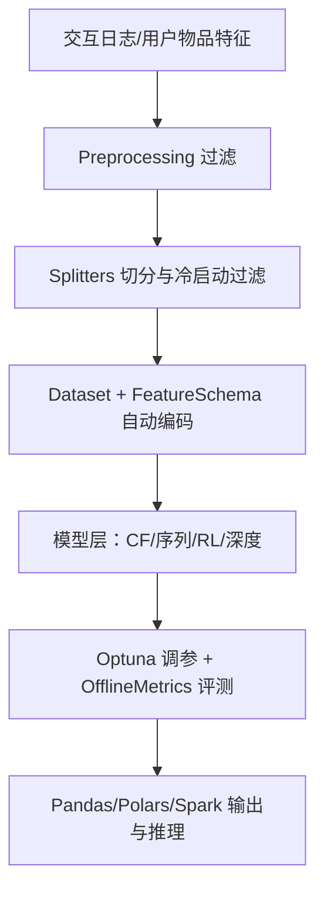
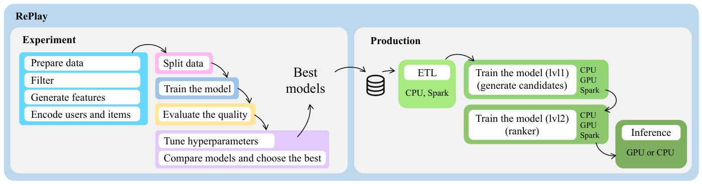

# RePlay: a Recommendation Framework for Experimentation and Production Use (面向实验与生产落地的 RePlay 推荐框架)

- **会议/期刊**: RecSys 2024
- **作者与机构**: Alexey Vasilev, Anna Volodkevich, Denis Kulandin, Tatiana Bysheva, Anton Klenitskiy；Sber AI Lab / Sber
- **推荐链路定位**: 端到端（数据预处理→切分→召回/排序模型训练→调参→离线评测→推理）
- **研究方向**: 工业级推荐系统架构与评测基准
- **论文原文**: [https://arxiv.org/abs/2409.07272v3](https://arxiv.org/abs/2409.07272v3)
- **开源代码**: [https://github.com/sb-ai-lab/RePlay](https://github.com/sb-ai-lab/RePlay)

## TL;DR (1分钟核心速览)

本文针对推荐算法“研究代码难复现、难上生产”的工程痛点，提出开源框架 RePlay：用统一的 `Dataset`/`FeatureSchema` 封装交互与特征，提供过滤器、多种切分器、20 余种模型、Optuna 调参与离线指标，并在 Pandas/Polars/Spark 三种数据框、CPU/GPU/集群三类硬件间切换。原文以 MovieLens 1M 上的 `LastNSplitter` + SASRec 演示全流程，但**未报告任何基线对比数值**，价值主要在工程接口统一而非算法精度提升。

## Background & Motivation (背景与核心矛盾)

- **主流范式**: 近年出现多款推荐研究框架，试图统一算法实现、数据切分与指标计算，降低复现成本。
- **前人局限**: 多数框架以研究为导向，面对大规模数据需要重写；且不同库的切分、候选集构造、指标实现不一致，导致“同模型不同分数”的对比失真。
- **核心洞察 (Key Insight)**: 推荐系统从实验到生产的瓶颈往往不在单个模型，而在数据编码、冷启动过滤、评测协议与部署接口这层“胶水代码”被反复重写。
- **本文切入点**: 用一套统一接口覆盖实验与生产两条流水线，并允许每个阶段独立选择 Pandas、Polars 或 Spark 执行栈。

## Method (核心方法设计)

### 1. 整体框架 (Overall Architecture)

RePlay 将 top-N 推荐拆成可组合模块：`Preprocessing` 负责次数、评分、时间窗等过滤；`Splitters` 负责随机、按用户、按时间、末 N 次及新用户切分；`Dataset` 与 `FeatureSchema` 统一承载交互、用户/物品特征并自动编码；模型层覆盖热度、CF、深度序列与 RL；`OfflineMetrics`/`Experiment` 负责多指标批量计算与多轮实验对比；`optimize` 接口调用 Optuna 搜索超参。训练侧深度模型基于 PyTorch/PyTorch Lightning，传统模型多由 PySpark 实现，最终推荐结果可按 Pandas、Polars、Spark DataFrame 或 Tensor 输出。

<figure class="paper-figure" markdown="span">
  <figcaption>图 1：RePlay 流水线。使用 RePlay 框架，可实现实验与生产流水线。</figcaption>
</figure>

### 2. 关键设计拆解 (Key Designs)

1. **FeatureSchema + DatasetLabelEncoder 自动编码**：痛点是把原始 ID 转成连续整数时，容易因训练/测试编码不一致产生泄漏或越界。RePlay 用 schema 声明列名、类型、来源表、基数及 `user_id/item_id/timestamp/rating` 语义，再统一学习双射
$e:\mathcal{U}\cup\mathcal{I}\to\{0,\ldots,n-1\}$，
并保存逆映射用于结果还原。其有效性来自“编码规则由数据模式驱动”，减少手工配置与线上线下不一致。

2. **带冷启动过滤的切分器族**：推荐离线评估常因测试集出现训练未见用户/物品而虚高或失真。以末 N 次切分为例，对用户序列
$S_u=(i_{u,1},\ldots,i_{u,n_u})$，
取 $\mathcal{D}_{\text{test}}=\{(u,i_{u,n_u})\}$、$\mathcal{D}_{\text{train}}=\mathcal{D}\setminus\mathcal{D}_{\text{test}}$，并可执行
$\mathcal{D}_{\text{test}}\leftarrow\{(u,i)\in\mathcal{D}_{\text{test}}\mid u\in\mathcal{U}_{\text{train}}, i\in\mathcal{I}_{\text{train}}\}$。
该过滤把“严格冷启动”与“常规离线评估”解耦，避免评估口径混淆。

3. **训练目标、负采样与推理效率**：框架不定义统一损失，序列模型可选交叉熵或二元交叉熵，并支持多种负采样策略；深度模型由 PyTorch Lightning 管理训练与推理，传统模型依托 Spark 分布式计算。推理可离线批量产出，也可用于在线服务，但原文未给出吞吐、延迟或内存数据。

## Experimental Setup & Evaluation Protocol (实验设置与评估协议)

- **数据集与预处理**: 原文 demo 仅使用 MovieLens 1M，未报告自有工业数据。

| 数据集 | #Users | #Items | #Interactions | 稀疏度/密度 | 特征/场景说明 |
| :--- | :---: | :---: | :---: | :---: | :--- |
| MovieLens 1M | 6,040 | ≈3,706 | 1,000,209 | 密度约 4.47% | 标准公开统计；仅用于流程演示，无特征工程细节 |

- **数据划分与防穿越 (Splitting Strategy)**: 使用 `LastNSplitter` 做 leave-one-out 式末次交互切分，切分器提供丢弃测试集中冷用户/冷物品的选项；demo 未说明是否启用了该过滤。
- **排名评测协议 (Ranking Protocol)**: 仅报告 MAP、NDCG、Recall，未说明是 `Full-Ranking` 全库排序还是 `Sampled Ranking` 采样排序，也未给出负样本比例与候选集规模。
- **对比基线与超参设置**: demo 只训练 SASRec，**未报告任何对比基线、Embedding 维度、调参搜索空间或显著性检验**。因此本文不能被视作算法效果论文，而是框架能力与接口演示。

## Key Experimental Results (实验关键数据)

### 1. 主实验对比 (Main Results)

原文为 4 页 demo，未提供主实验数值表；以下列出可核验的官方 demo 配置，避免伪造指标。

| 评测环节 | 原文配置 | 可复现性判断 |
| :--- | :--- | :--- |
| 数据切分 | `LastNSplitter`，末次交互为测试 | 可复现，但 N 与冷过滤开关未明示 |
| 模型 | SASRec | 仅单模型演示，无基线 |
| 指标 | MAP、NDCG、Recall | 指标名明确，K 值与候选集未说明 |
| 调参 | `optimize` + Optuna | 接口存在，demo 未给搜索空间 |
| 输出 | Pandas/Polars/Spark/PyTorch Tensor | 多后端输出是核心卖点 |
| 显著性 | 未报告 | 无法判断差异是否显著 |

### 2. 消融实验 (Ablation Study)

原文没有消融实验。可替代的是模块覆盖矩阵，用“覆盖数量”而非虚构精度衡量工程完备度：

| 模块 | 覆盖情况 | 关键点 |
| :--- | :--- | :--- |
| 预过滤 | MinCount、LowRating、TimePeriod、LastN 等 | 统一交互过滤入口 |
| 切分器 | Random、ColdUser、Time、LastN、NewUsers 共 5 类 | 覆盖常规与冷启动评估 |
| 模型族 | 热度、ItemKNN/ALS/SLIM、Word2Vec、聚类、关联规则、LightFM/implicit 包装、NeuroMF、MultVAE、Bandit/RL、SASRec/BERT4Rec | 传统模型偏 Spark，深度模型偏 PyTorch |
| 指标 | Precision/Recall/MAP/MRR/NDCG/HR/AUC + 多样性、覆盖率、新颖性、惊讶度、意外性 | 准确度与非准确度指标并列 |
| 执行栈 | 3 种数据框 × CPU/GPU/集群 | 分阶段选栈，降低重写 |

### 3. 关键实验发现 (Key Findings)

- **统一接口的收益是“减少重实现”，而非精度增益**：3 种数据框后端、3 类硬件与 5 类切分器被收进同一 API，使实验代码迁移到 Spark 集群时无需改模型调用；但原文没有给出迁移前后的耗时或吞吐数字。
- **评测口径被产品化**：7 类准确度指标与 5 类非准确度指标由 `OfflineMetrics` 批量计算，理论上可减少“各库指标实现不同”导致的对比偏差；不过 demo 未展示同模型跨库对比，因此该收益仍是设计层面的。
- **“生产可用”目前是架构主张，不是实证结论**：论文用 4 页、单数据集、单模型演示流程，缺少基线、延迟、内存与线上 A/B，无法量化“production ready”的实际收益。

## Highlights & Limitations (亮点、对比与审稿批判)

- **与代表作对比 (vs. Prior Work)**: 与 Recommenders 相比，RePlay 除 Spark/Pandas 外还支持 Polars，并强调实验与生产同接口；与 implicit、LightFM 等算法库相比，它提供的是端到端流水线而非单点模型；与研究型框架相比，其核心包刻意缩减依赖，并区分稳定核心包与 `rc0` 实验包。
- **可迁移亮点**: `FeatureSchema` 驱动的自动编码可迁移到任意推荐流水线，减少 ID 对齐错误；带冷启动过滤的切分器设计可统一离线评估口径，尤其适合召回/排序模型的公平对比。
- **审稿级局限批判**: 其一，缺少任何定量主实验、消融、延迟/吞吐与线上验证，“production ready”缺乏硬证据；其二，评测协议关键信息缺失（全库排序还是采样排序、负样本比例、K 值、冷过滤开关），复现者仍需自行约定，框架的可比性优势被打折；其三，Spark/PyTorch 双栈带来部署复杂度，实验包 API 稳定性与长期维护成本也需观察。

## Rating (四维评分)

- **方法创新性 (Novelty)**: ⭐⭐ （核心贡献是工程整合与接口设计，缺少新算法机制或理论分析）
- **评估协议与实验扎实度 (Protocol & Experiments)**: ⭐⭐ （仅 MovieLens 1M + SASRec 流程演示，无基线、无消融、无显著性检验，候选集协议未明示）
- **写作与数学规范度 (Clarity & Rigor)**: ⭐⭐⭐⭐ （模块划分、安装方式与 demo 步骤清楚，作为 4 页 demo 已足够；但公式与复杂度分析基本缺失）
- **工业落地与复现价值 (Industrial & Practical Value)**: ⭐⭐⭐⭐⭐ （开源、多后端、多硬件、核心包依赖克制，对需要从 Pandas 实验平滑迁移到 Spark 集群的团队有直接价值）

