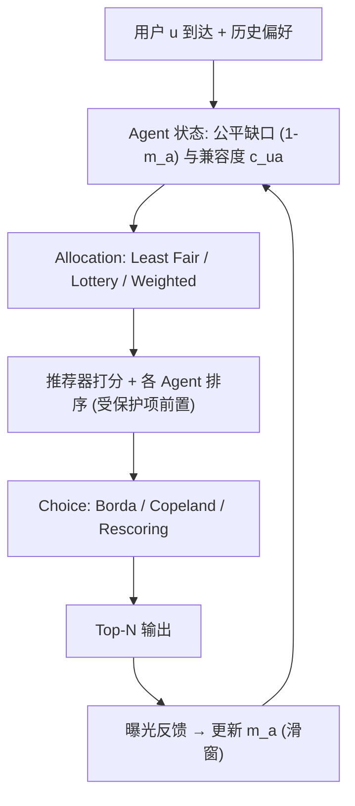

# Social Choice for Heterogeneous Fairness in Recommendation (推荐系统中的异构公平性社会选择)

- **会议/期刊**: RecSys 2024 (18th ACM Conference on Recommender Systems, Bari, Italy)
- **作者与机构**: Amanda Aird, Cassidy All, Amy Voida, Robin Burke (University of Colorado Boulder); Elena Ștefancová, Martin Homola (Comenius University Bratislava); Nicholas Mattei (Tulane University)
- **推荐链路定位**: 重排 (Post-processing / Fair Re-ranking)
- **研究方向**: 去偏公平与可信推荐 / 多任务与列表级重排
- **论文原文**: [https://arxiv.org/abs/2410.04551v1](https://arxiv.org/abs/2410.04551v1)
- **开源代码**: [whalrus (社会选择投票规则库)](https://github.com/francois-durand/whalrus) （SCRUF-D 主体代码暂未开源）

## TL;DR (1分钟核心速览)

现有公平推荐几乎都绑定**单一公平性定义**，且至多在多个受保护群体上"同构"地复制同一度量，无法适配真实场景中多方利益相关者的**异质公平诉求**。本文把推荐公平性重构为**计算社会选择问题**：将每个公平诉求实例化为一个 Agent（各自拥有独立的 fairness / compatibility / ranking 函数），先由 Allocation 阶段按"不公平度 × 用户兼容度"分配 Agent 权重，再由 Choice 阶段用 Borda / Copeland / Rescoring 聚合多份排序。在 MovieLens-1M 与 Microlending-2017 的 5 折交叉验证上，Rescoring 使三 Agent 的 $l_{1/2}$ 公平性范数升至 **>0.9**，nDCG 相对未重排基线几乎无损。

## Background & Motivation (背景与核心矛盾)

- **主流范式**: 公平推荐分两路——(a) 在训练损失中加公平正则（in-processing），(b) 对已生成列表做后处理重排（re-ranking）。后者因不改动主干模型、支持动态变更定义而被本文采用。
- **前人局限一（不可多重）**: 除极少数工作外，系统只处理**一个**受保护群体、**一个**公平维度；即便考虑多群体，也是对每个群体套用**完全相同**的公平定义。
- **前人局限二（不可异构）**: 把公平定义硬编码进算法或优化目标，导致更换度量就必须**全量重训**，工程上无法适配不同利益方的差异化诉求。
- **核心洞察 (Key Insight)**: 公平性本质是"多方偏好聚合"问题，与社会选择理论中的**投票机制**同构——若把不同公平定义看成不同"选民"，则分配（谁参与投票）与聚合（如何计票）可以解耦，从而在同一框架内兼容异质度量。
- **本文切入点**: 扩展前作 SCRUF-D 架构，从"2 个同构 Agent"推进到"**3 个异构 Agent**"（三类不同公平度量），系统化比较 3 种分配机制 × 3 种聚合机制的 9 种组合在两个域上的公平—精度权衡。

## Method (核心方法设计)

### 1. 整体框架 (Overall Architecture)

SCRUF-D 是一个**免训练、模型无关**的插件式重排层。用户 $u$到达后，系统读取每个 Agent$a$的两类状态：一是其在滑动窗口内的公平性得分$m_a$（离目标越远越"饥饿"），二是其对当前用户的兼容度$c_{u,a}$（该用户历史偏好与该受保护特征的重合频率）。Allocation 机制据此产出 Agent 的分配权重$w_a$；同时主干推荐器给出物品打分$\hat{r}_{ui}$，每个被分配 Agent 也输出自己的物品排序（受保护物品前置的无并列全序）。最终 Choice 机制把"1 份推荐器列表 + 若干份 Agent 列表"聚合为唯一的 Top-N 列表，曝光后回写更新各 Agent 的$m_a$，形成闭环。

### 2. 关键设计拆解 (Key Designs)

1. **三算子异构公平性度量（一个 Agent 一种"公平观"）**：前人用单一度量导致不同诉求被强行同化。本文并置三类可绑定受保护群体的度量：比例公平（只看是否出现、不看位置）、效用公平（按 $\log_2$ 排名折损并按组规模归一）、以及 MRR 公平（只看列表中最高排名受保护项）。三者分别写成
$m_{GPF}=\min\!\big(1,\ \tfrac{1}{\tau}\cdot\tfrac{\#\{i\in L,\ i\in g\}}{\#\{i\in L\}}\big)$、
$m_{GUF}=\tfrac{1}{\tau}\cdot\tfrac{\sum_{L}\sum_{i\in L\cap g}1/\log_2(\mathrm{rank}_L(i)+1)\,/\,|g|}{\sum_{L}\sum_{i\in L\cap \bar{g}}1/\log_2(\mathrm{rank}_L(i)+1)\,/\,|\bar{g}|}$、
$m_{MRR}=\min\!\big(1,\ \tfrac{1}{\tau_{MRR}}\cdot\tfrac{1}{|L|}\sum_{L}1/\mathrm{rank}_L(i_L^{*})\big)$。
直觉上，$m_{GPF}$约束"露面"，$m_{GUF}$约束"位置价值"，$m_{MRR}$ 约束"至少有一件挤进头部"，三者目标函数形状互不相容，恰好构成异构性压力测试。

2. **Lottery 分配：把"公平缺口 × 用户偏好"写进概率**：Least Fair 只挑最不公平的 Agent，公平最优但**完全无视用户偏好**，是精度崩塌的根源。Lottery 改为非确定性分配，概率为
$P(a)=\frac{(1-m_a)\,c_{u,a}^{\,2}}{\sum_{a'}(1-m_{a'})\,c_{u,a'}^{\,2}}$，
其中兼容度 $c_{u,f}=p_{u,f}/\bar{p}_f$按特征在用户喜欢物品中的出现频率计并归一化。指数 2 的刻意降权使公平缺口主导、偏好做修正，实现"该补偿谁"与"谁来补"的软耦合；Weighted 沿用同一分布但不抽样，把所有$m_a<1$的 Agent 按$w_a=P(a)$ 全部送入聚合。

3. **选择阶段的序数 vs 基数聚合与开销**：Borda 用加权位次求和（推荐器权重 0.6，为 Agent 总权重的 1.5 倍），Copeland 做两两胜负计分，二者只用**序数**信息；Rescoring 则直接用实值打分
$s_i=\hat{r}_{ui}+\tfrac{1}{w_{rec}}\sum_{a}w_a\,\delta\,\mathbb{I}[i\in g_a]$，
$\delta=0.5$为受保护项加成。基数的 Rescoring 能在同一分数量纲上精细换取公平，因而通常在公平—精度曲线上占优。**无训练损失、免负采样**；复杂度上分配为$O(n)$（$n$为窗口长度）、Borda/Rescoring 为$O(n)$、Copeland 为$O(n^2)$（$n$ 为列表长度），均为轻量后处理开销。

## Experimental Setup & Evaluation Protocol (实验设置与评估协议)

| 数据集 | #Users | #Items | #Interactions | 稀疏度 | 三个异构 Agent 的受保护属性 |
| :--- | :---: | :---: | :---: | :---: | :--- |
| MovieLens-1M | 6,040 | 3,900 | ~1,000,000 | ~4.2% | 女性编剧/导演；非英语剧本；1990 前老片 |
| Microlending-2017 | 4,005 | 2,673 (pseudo-items) | 110,371 | ~1.03% | 低获资国家；低获资行业；贷款额 >$5,000 |

- **Agent 与度量绑定**: MovieLens 上依次绑定 $m_{MRR}$（女性影片进 Top-1/2，$\tau_{MRR}=0.5$）、$m_{GUF}$（非英语片效用对等）、$m_{GPF}$（老片占比 20%）；Microlending 上依次为大额贷款（$m_{MRR}$）、低获资国家（$m_{GUF}$）、低获资行业（$m_{GPF}$，20%）。Agent 偏好采用**级联排序**（受保护项前置、其余继承推荐器序）以消除并列。
- **数据划分**: **5 折交叉验证**（5 train/test folds 结果平均），非 Leave-One-Out 也非全局时间切分；存在轻度未来信息穿越风险（后处理阶段使用了全局历史统计来估计 $m_a$）。
- **排名评测协议**: 精度为 held-out 测试集上的 **nDCG**（Top-N 重排后计算）；论文**未声明** Full-Ranking 还是 Sampled Ranking，也未给出负采样比例，属协议披露不完整。
- **公平性汇总**: 用各 Agent 得分的 $l_{1/2}$范数聚合，值在**所有 Agent 得分相等时取最大且等于均值**，越不均衡越低，归一化到$[0,1]$——这使"异构公平同时达标"成为一个可单值比较的目标。
- **基线**: 仅与**未重排的原始推荐列表**对比；唯一能支持异构定义的 OFair 未复现，作者援引前作结论称其不具竞争力。95% 置信区间由 5 折给出。

## Key Experimental Results (实验关键数据)

### 1. 主实验对比 (Main Results)

> 说明：原文为 6 页短文，结果以**散点图（图 1）**呈现，**未给出数值表格**。下表为依据图 1 位置关系整理的**定性对照**（↑/↓/→ 表示相对基线或相对同组其他组合的方向），非精确数值。

| 分配 × 聚合 | Microlending $l_{1/2}$公平性 | Microlending nDCG | Movies$l_{1/2}$ 公平性 | Movies nDCG |
| :--- | :---: | :---: | :---: | :---: |
| 基线（无重排） | 低 | **最高** | 低 | **最高** |
| Least Fair × Borda | 高 | ↓↓ | 高 | ↓↓ |
| Least Fair × Copeland | 高 | ↓↓ | 高 | ↓↓ |
| Least Fair × Rescoring | **很高** | ↓↓ | **很高** | ↓↓ |
| Lottery × Borda | 中 | → | 中 | → |
| Lottery × Copeland | 较高 | ↓ | 较高 | ↓ |
| Lottery × Rescoring | **>0.9** | → | 高 | → |
| Weighted × Borda | 中 | → | 中 | → |
| Weighted × Copeland | 较高 | ↓ | 高 | ↓ |
| Weighted × Rescoring | **>0.9** | → | **最高（近满目标）** | → |

### 2. 消融实验 (Ablation Study)

原文未设传统"w/o 模块"消融，但其 **9 种机制组合**等价于对分配算子与聚合算子做因子替换实验：

| 被替换组件 | 对照 | 公平性变化 | 精度变化 | 结论 |
| :--- | :--- | :--- | :--- | :--- |
| 分配：Least Fair → Lottery | 同聚合下 | 略降 | **显著回升** | 兼容度对精度不可或缺 |
| 分配：Lottery → Weighted | Rescoring 下 | 持平（CI 重叠） | 持平（Microlending） | 单 Agent 分配够用 |
| 分配：Lottery → Weighted | Rescoring 下 | 上升 | **下降更明显**（Movies） | 单 Agent 分配有域依赖代价 |
| 聚合：Rescoring → Borda | 同分配下 | 明显下降 | 略升 | 序数聚合牺牲公平换精度 |
| 聚合：Copeland → Rescoring | 同分配下 | 上升 | 持平 | 基数打分支配两两投票 |

### 3. 关键实验发现 (Key Findings)

1. **基数聚合胜过序数聚合**：Rescoring 在两个数据集上均把 $l_{1/2}$推至 **>0.9** 而 nDCG 无可见损失；Borda 则稳定落在"公平提升最小、精度保持最好"的角落，说明丢弃$\hat{r}_{ui}$ 的实值信息是公平性上不去的主因。
2. **忽略兼容度是最贵的错误**：Least Fair 在三种聚合下公平性都很强，但 nDCG 显著下滑，定量印证"公平最优 ≠ 用户可接受"，也证明 Allocation 阶段引入 $c_{u,a}$ 是把公平转化为可用精度的关键阀门。
3. **分配机制的可压缩性依域而异**：Microlending 上 Lottery 与 Weighted 的 95% CI 重叠，可只把 1 个 Agent 送进聚合以换取效率；但 Movies 上 Lottery 的精度代价明显更大，说明"单 Agent 分配"的收益并非普适，需按域调参。

## Highlights & Limitations (亮点、对比与审稿批判)

- **与代表作对比 (vs. Prior Work)**: 相较 Töscher 式公平正则化（[23, 32, 33]）把公平焊进损失、换度量即重训，SCRUF-D 是**免重训的插件层**；相较 OFair [31]（同样支持异构定义），本文在同等数据上（前作结论）公平性更优，且首次系统对比了 3×3 的分配/聚合机制空间；相较原始 SCRUF-D [2] 的"2 同构 Agent"，本文的增量在于**异构度量共存**这一更强设定。
- **可迁移亮点**: (i) 把"公平缺口 × 兼容度"做成抽样概率的软分配思路，可直接迁移到多目标精排的加权融合与多任务门控；(ii) 用 $l_{1/2}$ 范数把多个不可比公平度量压成单值，适合做线上多公平指标的联合监控看板。
- **审稿级局限批判**: (i) **证据呈现代价**——仅 6 页短文，主结果全部落在散点图上，缺少数值表、显著性检验与方差报告，"Rescoring 支配"的结论难以被严格复核；(ii) **评估面窄且不可比**——只与未重排基线比，唯一对手 OFair 未复现，且仅覆盖提供方群体公平，消费者侧与个体公平完全未触及；(iii) **规模与超参**——Agent 数固定为 3、$\delta=0.5$/ 概率指数 2 / Borda 权重 0.6 均沿用前作经验值，缺少敏感性分析，Agent 数量扩展性与 Copeland 的$O(n^2)$ 在长列表下的实际时延未测。

## Rating (四维评分)

- **方法创新性 (Novelty)**: ⭐⭐⭐⭐ （把公平重排重构为"多 Agent 投票"的社会选择问题，异构公平定义的并置在思路上确有增量，但主体架构承接前作 SCRUF-D，属工程化扩展而非全新范式）
- **评估协议与实验扎实度 (Protocol & Experiments)**: ⭐⭐⭐ （双域 5 折交叉验证与 9 种机制组合的因子式对比设计合理，但仅有散点图无数值表、无显著性检验、未复现唯一异构对手、排名协议未披露采样方式）
- **写作与数学规范度 (Clarity & Rigor)**: ⭐⭐⭐⭐ （三类公平度量的定义差异、分配概率与 Rescoring 打分式均表述清晰，复杂度分析齐备，但决策阈值的选取理由多为援引前作，略欠推导）
- **工业落地与复现价值 (Industrial & Practical Value)**: ⭐⭐⭐ （免重训插件层 + $O(n)$ 分配/聚合对线上极友好，且复用成熟投票库 Whalrus；但 SCRUF-D 主体代码未开源、Agent 数量与超参敏感性未知，阻碍直接复现与规模化）

