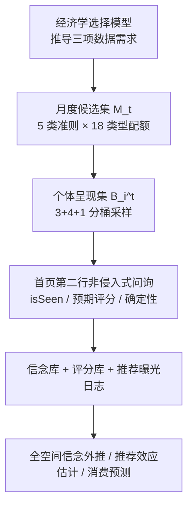

# The MovieLens Beliefs Dataset: Collecting Pre-Choice Data for Online Recommender Systems (MovieLens 信念数据集：为在线推荐系统采集"选择前"数据)

- **会议/期刊**: RecSys 2024
- **作者与机构**: Guy Aridor (Northwestern Kellogg)、Duarte Gonçalves (UCL)、Ruoyan Kong / Daniel Kluver / Joseph A. Konstan (University of Minnesota, GroupLens)
- **推荐链路定位**: 数据采集与离线评测基准（服务于召回/重排的价值评估与反事实分析，不改变线上排序逻辑）
- **研究方向**: 去偏公平、可信隐私与工业架构 / 用户选择建模与推荐因果效应评估
- **论文原文**: [https://arxiv.org/abs/2405.11053v3](https://arxiv.org/abs/2405.11053v3)
- **开源代码**: 暂未开源（数据集发布于 [https://grouplens.org/datasets/movielens/ml_belief_2024/](https://grouplens.org/datasets/movielens/ml_belief_2024/)）

## TL;DR (1分钟核心速览)

传统推荐只建模"用户对已消费物品的评分 $u_{i,j}$"，而真正决定推荐价值的是"推荐如何改变用户对**未体验**物品的信念$p_i$"。本文给出一个可直接部署于线上平台的信念采集流程（分月构造候选集$\mathcal{M}_t$ + 按推荐位分桶采样），在 MovieLens 上线 15 个月，产出 3,199 用户、28,457 条信念、7,518 部影片并附 172 万条历史评分与完整推荐曝光日志；同时诚实量化了两大缺陷——响应率中位数仅 0.031、推荐-信念重叠率仅 5.9%。

## Background & Motivation (背景与核心矛盾)

- **主流范式**: 推荐系统以拟合历史评分为目标，衍生出 serendipity、novelty、calibration 等辅助准则，但都未显式建模"用户选择问题"与"推荐起作用的中介机制"。
- **前人局限**: (i) 信念数据不是平台使用的自然副产品，必须主动**问**，而问卷式采集（如 [3] 的独立 survey）长期执行会带来严重自我选择；(ii) 评分缺失非随机，平台只能看到"看过的人怎么想"，无法区分"因不确定而不看"与"知道不喜欢而不看"。
- **核心洞察 (Key Insight)**: 信念 $p_i$ 是选择的先行预测变量，且 [3] 的 MovieLens 实验已证实"推荐对信念有因果效应、信念可预测消费"——因此只要**把问信念嵌进日常交互**，就能在低打扰下累积高价值反事实数据。
- **本文切入点**: 用极简经济学选择模型反推"该采集哪些变化"，再设计一套可在任意在线平台复用的采样算子。

## Method (核心方法设计)

### 1. 整体框架 (Overall Architecture)

论文的"方法"是**数据生成过程（DGP）**而非模型：先以期望效用模型刻画推荐如何通过后验信念改变选择，由此推出三项数据需求（刻画全空间先验信念、信念→消费映射、推荐→信念漂移）；再据此设计两层采样——月度全站共享候选集 $\mathcal{M}_t$（保证产品空间覆盖、可外推），日度个体级呈现集$B_i^t$（保证与推荐位重叠、可识别因果）；最后把呈现集以"首页第二行"形式嵌入 MovieLens，用户对未见影片打"预期评分 + 确定性"并写入日志。

### 2. 关键设计拆解 (Key Designs)

1. **经济学选择模型（定义"值得采集什么"）**：将推荐的价值从"预测准确"改写为"信念偏移"，把 serendipity 形式化为"用户事前不期待、事后却喜欢"的信息。选择算子为
$c_i^{\text{NREC}}=\arg\max_n \mathbb{E}_{p_i}[u_i(x_{i,n})]$，$c_i^{\text{REC}}(r_{i,t})=\arg\max_n \mathbb{E}_{p_i}[u_i(x_{i,n})\mid r_{i,t}]$，平台目标是$r_{i,t}^{\text{OPT}}=\arg\max_{r_{i,t}} u_i^{*,\text{REC}}(r_{i,t})$。直觉：若$c_i^{\text{NREC}}=c_i^{\text{REC}}$，则推荐对福利零贡献——这直接解释了 [14]"最准的推荐未必最有用"。
2. **候选集 $\mathcal{M}_t$的类型配额采样（解决产品空间覆盖）**：若纯随机抽片，长尾与热门都无法稳定覆盖、月度新片也抽不到。对每个类型$g$令$s_g=|\mathcal{M}_g|/|\mathcal{M}|$，按$\lceil s_g\cdot k y\rceil$配额分配五类准则——全期热度$50y$、评分最高$25y$、近期热度$10y$、趋势新片$10y$、纯随机$5y$，合计$|\mathcal{M}_t|\approx 100y$（初始$y=100$，2023 年 7 月按实测响应率下调至$y=11$）。这样既保留随机成分（小众片非零概率），又显式跟踪片库漂移。
3. **个体呈现集 $B_i^t$的三段式采样与训练/推理开销**：仅在用户未评分集合$\mathcal{M}_i^t$内采样，且每条请求固定 8 部：3 部均匀随机（广覆盖）、4 部从推荐 top-$n$（$n=100$）中随机（制造"推荐位 × 信念"交叉变化）、1 部最新上映（捕捉时序）。追加"3 个月内被问过 2 次则跳过"的去重复约束，避免重复打扰。**无模型训练、无负采样、无推理开销**，单次请求仅 8 个条目的读写，工程成本可忽略；采集侧唯一代价是首页一次额外渲染。

<figure class="paper-figure" markdown="span">
  <figcaption>图1：数据采集界面</figcaption>
</figure>

## Experimental Setup & Evaluation Protocol (实验设置与评估协议)

- **数据集与预处理**: 本文本身产出数据集，无 5-core 过滤、无评分阈值裁剪，保留全部原始请求日志（含未响应）以支持选择偏差分析。

| 数据集 | #Users | #Items | #Interactions | 稀疏度 | 特征/场景说明 |
| :--- | :---: | :---: | :---: | :---: | :--- |
| Beliefs（本文） | 3,199 | 7,518 | 28,457 | 0.118% | 预期评分 0.5–5（步长 0.5）+ 确定性 1–5 |
| Elicitation Log（请求） | 22,381 | 7,518 | 3,004,020 | — | 含 19,182 名从未响应用户，可测选择偏差 |
| Ratings（附赠） | 3,199 | 未披露 | 1,723,753 | — | 用户全历史评分，规模与 ML-1M 相当 |

- **数据划分与防穿越**: 不设训练/测试划分；时间为**线上自然流式采集**（2023-03 至 2024-05），信念记录与推荐曝光均带时间戳，可在离线实验中自行按全局时间戳切分。
- **排名评测协议**: 本文**不做 Top-N 排名评测**，亦无 Full-Ranking / Sampled Ranking 之分；其定位是提供可支撑排名评测（尤其 serendipity、反事实效用）的**原始标注层**。
- **对比基线与超参设置**: 无 SOTA 基线对比；"超参"仅有候选集规模 $y$（$100\to11$）、呈现集配比$3/4/1$、推荐池$n=100$、$recent\_threshold=6$月、$num\_rating\_threshold=100$；显著性统一采用回归$p$值（$p<0.001$/$p<0.05$）。

## Key Experimental Results (实验关键数据)

### 1. 主实验对比 (Main Results)

原文不含 SOTA 主实验表（数据集论文），故以**内部一致性复现实验**（对照 [3] 的问卷式采集结论）代替，检验信念数据是否"真"：

| 检验目标 | 因变量 | 自变量 | 系数 | 显著性 | 结论 |
| :--- | :--- | :--- | :---: | :---: | :--- |
| 确定性是否随热度上升 | userCertainty | $\log$(#ratings) | **−0.011** |$p<0.001$ | 热门片更"心里有数" |
| 信念是否驱动消费 | 是否观看 | 预期质量 | **0.028** | $p<0.001$ | 预期越喜欢越看 |
| 不确定性抑制消费 | 是否观看 | userCertainty | **−0.134** | $p<0.001$ | 越不确定越不碰 |
| 影片级选择偏差 | 响应率 | 流行度 | −0.0002 | $p>0.1$ | 无显著影片级选择 |
| 影片级选择偏差 | 响应率 | 评分方差 | 0.0001 | $p>0.1$|$R^2\approx 0$ |

### 2. 消融实验 (Ablation Study)

无神经网络组件可消融，改以**采集流程诊断表**替代（等价于"去掉某设计后数据会损失什么"）：

| 流程设计 / 数据维度 | 观测值 | 缺失后果（归因） |
| :--- | :---: | :--- |
| 用户级响应率（均值/中位数） | 0.078 / 0.031 | 若改为独立问卷，选择偏差会进一步放大 |
| 人均信念条数 | 8.52 | 稠密度过低，须靠 CF/内容外推补全 |
| 请求-推荐重叠率（均值用户） | 5.9% | 因果识别功效弱，是三项挑战中最弱项 |
| 已记录信念落入推荐位比例 | 9.5% | 可做小样本推荐-信念因果分析 |
| 每月候选取样规模 $y$|$100\to11$ | 覆盖 vs 密度的权衡被实测响应率强行拉低 |

### 3. 关键实验发现 (Key Findings)

1. **"问信念"比"等评分"贵得多但可行**：300 万次请求只换回 28,457 条信念（整体响应率约 0.95%，用户级中位数 0.031），但影片级响应率与流行度、评分方差均无显著相关（$p>0.1$，$R^2\approx0$），说明主要偏差在**用户层而非物品层**——这为后续做用户加权去偏指明了方向。
2. **信念确实携带评分之外的信息**：预期质量对观看概率的系数 $+0.028$、确定性$-0.134$（均$p<0.001$），与独立问卷研究 [3] 定量一致，证明嵌入首页的非侵入式采集没有把数据"问坏"，可支撑"因不确定而不看"与"因不喜欢而不看"的区分。
3. **推荐→信念的因果识别是当前瓶颈**：仅 5.9% 的请求影片后来出现在推荐位、9.5% 的已记录信念落到推荐位，作者据此坦承第三项挑战（推荐如何移动信念）在本数据上功效不足，需扩大部署或按 [3] 的实验设计主动注入随机推荐。

## Highlights & Limitations (亮点、对比与审稿批判)

- **与代表作对比 (vs. Prior Work)**: 相对 [3] 的独立问卷 survey，本文把采集嵌入首页第二行，牺牲单次信息量换取长期、低打扰、可持续的流式数据；相对经典 MovieLens 评分集 [10]，本文新增的是**未消费物品的事前分布**，可用于 serendipity/calibration 的度量（如"意外度 = 推荐相对先验信念的偏移"），这是评分矩阵在原理上无法提供的；相对常规缺失非随机（MNAR）去偏工作 [16,19]，本文不靠统计假设纠正偏差，而是直接**补采缺失机制本身**。
- **可迁移亮点**: (i)"按类型配额 + 随机兜底"的月度候选集构造，可直接搬去做跨域/多场景实验的**分层曝光池**；(ii)"3 部随机 + 4 部出自推荐 top-$n$ + 1 部新片"的分桶采样，是任何想在线上做推荐因果效应实验的通用模板（保证处理组与对照组都有支撑）。
- **审稿级局限批判**: (i) **规模与代表性**：仅 3,199 名响应者（22,381 人中），且 MovieLens 用户本身是高活跃度自选择人群，外推到工业级短视频/电商场景的证据链薄弱；(ii) **因果功效不足**：5.9%/9.5% 的重叠率意味着几乎无法在观测数据上稳定估计"推荐→信念"效应，作者也未给出任何模拟实验或下游算法原型结果来证明该数据"能提升指标"，全文停在描述性统计，缺少端到端价值验证。

## Rating (四维评分)

- **方法创新性 (Novelty)**: ⭐⭐⭐⭐ （把"选择前信念"这一经济学构念工程化为可部署的采样协议，问题定义本身新颖，但技术算子相对朴素）
- **评估协议与实验扎实度 (Protocol & Experiments)**: ⭐⭐⭐ （诚实披露响应率与覆盖率并做了复现性回归，但无 SOTA 对比、无下游任务实证、无显著性多重校正）
- **写作与数学规范度 (Clarity & Rigor)**: ⭐⭐⭐⭐ （经济学模型—数据需求—采样算子的推导链条清晰，符号统一，公式克制而无冗余）
- **工业落地与复现价值 (Industrial & Practical Value)**: ⭐⭐⭐⭐ （数据集与流程完全开源、零模型开销、可直接嵌入任意平台首页，但信念数据密度低、需依赖 CF 外推才能实用）

