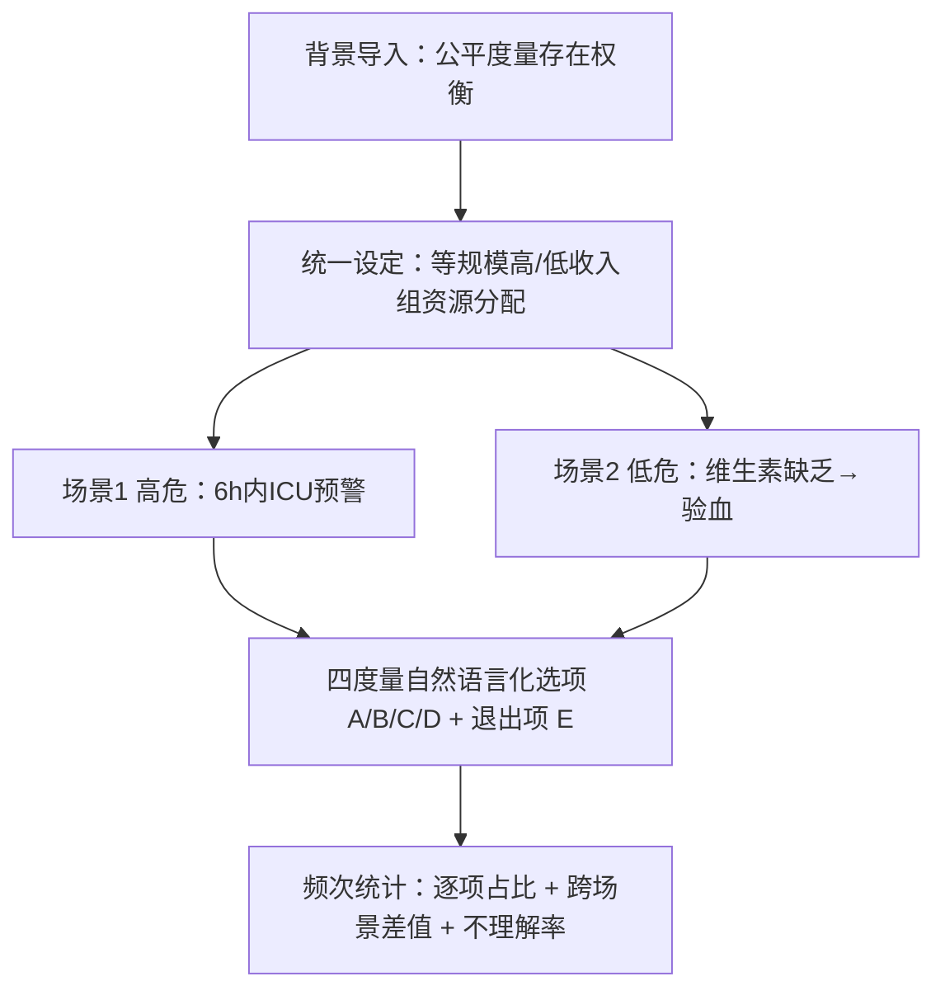
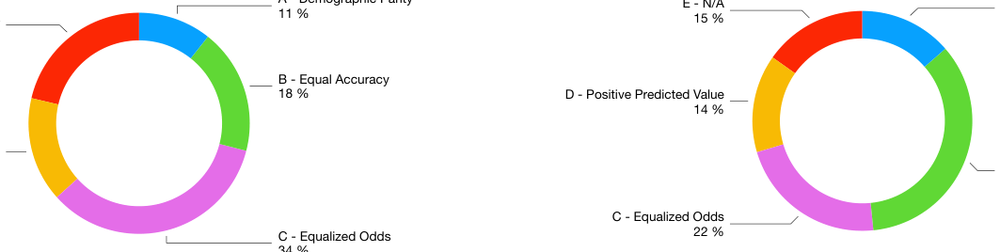

# Understanding Fairness in Recommender Systems: A Healthcare Perspective (从医疗视角理解推荐系统中的公平性)

- **会议/期刊**: RecSys 2024 (18th ACM Conference on Recommender Systems, 短文/6页)
- **作者与机构**: Veronica Kecki, Alan Said (University of Gothenburg, Sweden)
- **推荐链路定位**: 决策支持层（非模型层）——医疗资源分配推荐的度量选择与治理
- **研究方向**: 去偏公平、可信隐私与工业架构 / 用户研究（Human-Centered Fairness）
- **论文原文**: [https://arxiv.org/abs/2409.03893v2](https://arxiv.org/abs/2409.03893v2)
- **开源代码**: 暂未开源（问卷原文与数据均未公开）

## TL;DR (1分钟核心速览)

本文不谈模型，而问一个更前置的问题：**谁能定义“公平”？** 作者设计一份在线问卷，让 131 名受访者在“高危（6 小时内需转入 ICU 预警）”与“低危（维生素缺乏→建议验血）”两个医疗推荐场景中，从 Demographic Parity、Equal Accuracy、Equalized Odds、Positive Predictive Value 四种度量中择一，并额外提供“我不理解”退出项。结果显示：高危场景偏好 Equalized Odds（34%），低危场景偏好 Equal Accuracy（35%）；四度量合计仍有 **21% / 15%** 的人坦言看不懂；equity 族始终压过 equality 族（67% vs 11%、71% vs 14%），说明“一刀切公平”在医疗推荐中不可行。

## Background & Motivation (背景与核心矛盾)

- **主流范式**: 推荐公平性研究已积累 20+ 种度量（DP / EOdds / PPV / Accuracy Parity 等），工程上普遍做法是**选一个度量做约束优化**，并默认该度量能被用户与利益相关方理解、接受。
- **前人局限**: 其一，文献大量讨论算法侧如何优化公平，却极少验证**终端用户是否读得懂**这些度量；其二，已有偏好研究（Li et al.、Srivastava et al.）多在社会经济或非强对比情境下做，**stakes（利害轻重）未被显式对照**，导致“偏好结论”可能是场景伪影。
- **核心洞察 (Key Insight)**: 公平度量之间存在**竞争性权衡 (competing notions)**——任何模型缓解一个条件必然恶化另一个，因此“哪个更公平”本质是**价值判断而非数学命题**，必须由情境与人来回答。
- **本文切入点**: 固定度量集合、改变利害情境（high-stake vs low-stake），观察同一批人的选择是否漂移；用“不理解”选项作为**公众理解度的量化探针**。

## Method (核心方法设计)

### 1. 整体框架 (Overall Architecture)

研究不做模型训练，其“系统”是问卷设计本身：先以背景段落引入公平度量间的权衡，再给出统一的资源分配设定（AI 在**等规模的高收入 / 低收入两组**间分配医疗资源），随后呈现两个除“利害强度”外描述完全对齐的场景，四个选项均以**去术语化的自然语言后果描述**呈现（例如 A：两组被转入 ICU 的比例相同，但算法精度可能对某一组低得多），最后附加选项 E“我不理解这些选项”以防强迫作答。全程用同一组选项对照两场景，从而把偏好差异归因于情境而非措辞。

### 2. 关键设计拆解 (Key Designs)

1. **利害强度单变量对照（Stakes as the Only Manipulation）**：前人偏好研究混杂了金额、语境、人群等多重变量，无法判断偏好漂移的成因。本文令两场景仅 stakes 不同（生死级 vs “可有可无”级），并沿用 Rajkomar 等的高危原句以保持外部可比。其判定逻辑即“同一度量在两场景的偏好份额差 $\Delta_k = p_k^{(1)} - p_k^{(2)}$”，若$\Delta_k$ 显著非零，则说明公众公平观是**情境依赖**而非稳定偏好。直觉上，高风险下“该救的人必须被救到”压过“结果配额均等”，低风险下“别浪费资源”压过“机会均等”。
2. **度量选项的“后果化”转译与不理解探针**：普通用户无法理解 $\mathbb{I}$形式的约束式，本文把每个度量改写为“代价 + 收益”的双面描述（如 C：两组中真正符合条件者获得转诊的百分比相同，但某组整体获配比例可能远低）。形式上四者可统一写作组间条件分布对齐的不同切片：$P(\hat{Y}{=}1\mid G{=}h)=P(\hat{Y}{=}1\mid G{=}l)$（DP）、$P(\hat{Y}{=}Y\mid G{=}h)=P(\hat{Y}{=}Y\mid G{=}l)$（Equal Accuracy）、$P(\hat{Y}{=}1\mid Y{=}1,G{=}h)=P(\hat{Y}{=}1\mid Y{=}1,G{=}l)$（EOdds）、$P(Y{=}1\mid \hat{Y}{=}1,G{=}h)=P(Y{=}1\mid \hat{Y}{=}1,G{=}l)$（PPV）。选项 E 的作用是让“认知失败”成为可测量信号而非噪声。
3. **分析口径与（缺失的）统计检验**：本文无损失函数、无负采样、无推理——其“训练”环节不存在；分析仅做描述性频次 $p_k^{(s)} = n_k^{(s)} / N$，并把 A 归为 equality 族、B/C/D 归为 equity 族做聚合对比。**缺陷在于全文未报告置信区间与显著性检验**，131 样本下单场景约 14–45 人的选项频次，跨场景 12–17 个百分点的差值是否稳健缺乏统计支撑。

## Experimental Setup & Evaluation Protocol (实验设置与评估协议)

- **数据集与预处理**: 无交互数据集，代之以问卷样本统计：

| 样本维度 | 数值 | 说明 |
| :--- | :---: | :--- |
| 有效回收 | 131 份 | Google Forms 在线问卷 |
| 年龄 | 19–59（均值 32，中位 30） | 覆盖青年至中年 |
| 性别 | 男略多于半，女近半，少数 non-binary/未答 | 大致均衡 |
| 职业 | >60% 全职，近 40% 学生 | 高等教育相关圈层为主 |
| 地域 | 瑞典 76%，EU 19%，其他 5% | 滚雪球扩散，非概率抽样 |

- **数据划分与防穿越 (Splitting Strategy)**: 不适用（无训练/测试划分）；采用**被试内设计**——同一受访者依次回答两个场景，形成配对对照。
- **排名评测协议 (Ranking Protocol)**: 不适用。**全文无 Full-Ranking / Sampled Ranking、无 Recall@K / NDCG@K 等离线指标**，评测对象是“人的偏好分布”，而非推荐列表质量。
- **对比基线与超参设置**: 无模型基线；对照对象为四种度量（相当于四个“理论基线”）与两档 stakes。度量定义与选项措辞参照 Rajkomar et al.（高危条件原句复用），低危条件为作者改写，以保证选项可比。未报告显著性标准（建议补做 $\chi^2$或配对比例检验，$p<0.05$）。

## Key Experimental Results (实验关键数据)

### 1. 主实验对比 (Main Results)

<figure class="paper-figure" markdown="span">
  <figcaption>图1：受访者在场景1和场景2中偏好的公平性指标百分比</figcaption>
</figure>

| 选项 | 度量族 | 场景1 高危 (ICU 预警) | 场景2 低危 (验血建议) | Δ (高危−低危) |
| :--- | :---: | :---: | :---: | :---: |
| A Demographic Parity | equality | 11% | 14% | +3 pt |
| B Equal Accuracy | equity | 18% | **35%** | +17 pt |
| C Equalized Odds | equity | **34%** | 22% | −12 pt |
| D Positive Predictive Value | equity | 15% | 14% | −1 pt |
| E 不理解选项 | — | 21% | 15% | −6 pt |

（图 1 为原文场景 1/2 的选项占比环形图，正位于上表数据来源处。）

### 2. 消融实验 (Ablation Study)

原文无组件消融，此处按“度量族聚合 + 情境切换”做等价敏感性分析：

| 分析口径 | 场景1 高危 | 场景2 低危 | 变化 |
| :--- | :---: | :---: | :---: |
| equality 族 (A) | 11% | 14% | +3 pt |
| equity 族 (B+C+D) | 67% | 71% | +4 pt |
| 认知不确定 (E) | 21% | 15% | −6 pt |
| 最高单项 | C 34% | B 35% | 度量翻转 |
| 无多数共识度 (1 − max) | 66% | 65% | 基本不变 |

### 3. 关键实验发现 (Key Findings)

1. **公众系统性偏好 accuracy 型（equity）度量而非配额型（equality）度量**：两场景中 DP 仅获 11% / 14%，而 B+C+D 合计 67% / 71%，即便在“仅是建议验血”的低危场景也未见 equality 回流，说明**医疗语境本身就把决策抬升为“准高危”**。
2. **偏好随 stakes 发生度量级翻转，且翻转方向可解释**：高危时 EOdds 领先（34% vs 18%，+16 pt），低危时 Equal Accuracy 反超（35% vs 22%，+13 pt），与“重症要保证应救尽救、轻症要保证少误判”的直觉一致，直接证伪 one-size-fits-all 的公平部署策略。
3. **理解赤字是最硬的约束**：高危场景有 21%（约 27 人）选择“我不理解”，低危降至 15%；即在最需要审慎判断的生死场景中，超过五分之一的人**无法在四个度量间做出知情选择**，提示任何“问用户要哪个公平度量”的产品化做法都必须先配套解释性教育，否则收集到的是噪声。

## Highlights & Limitations (亮点、对比与审稿批判)

- **与代表作对比 (vs. Prior Work)**: 相较 Li et al. 与 Srivastava et al.（跨情境比较不同被试群体、stakes 未强对比），本文用**被试内 + 单变量 stakes 操纵**把“情境依赖”从相关性提升为可对照的因果线索；相较 Rajkomar et al. 的算法侧去偏方案，本文反向指出**度量合法性本身需要公众背书**。
- **可迁移亮点**: ①“后果化转译 + 不理解退出项”可直接搬到推荐系统的用户侧公平感知调研、可解释性 A/B 问卷；②按 equality/equity 族聚合再报告，比逐项报告更能揭示稳定的价值取向趋势。
- **审稿级局限批判**: ①**样本与推断薄弱**——131 人、76% 来自瑞典高等教育圈层、滚雪球抽样，且**无置信区间与显著性检验**，跨场景 12–17 pt 的差值可能落在抽样误差内；②**生态效度不足**——场景为想象性单次判断，无真实推荐列表、无患者群体差异（如种族/年龄交叉）、无度量功效的定量权衡展示，结论只能作为设计假设而非部署依据。

## Rating (四维评分)

- **方法创新性 (Novelty)**: ⭐⭐⭐ （以 stakes 单变量对照 + 不理解探针切入公平度量合法性问题，视角有价值，但本质是问卷设计而非方法创新）
- **评估协议与实验扎实度 (Protocol & Experiments)**: ⭐⭐ （被试内设计合理，但 131 人非概率样本、无显著性检验、无分组交叉分析，定量说服力有限）
- **写作与数学规范度 (Clarity & Rigor)**: ⭐⭐⭐⭐ （四度量以自然语言双面描述清晰呈现，术语与情境界定干净；但形式化程度低，仅停留在文字定义）
- **工业落地与复现价值 (Industrial & Practical Value)**: ⭐⭐ （给出“情境敏感 + 加强解释”的明确产品指引，但无代码、无数据、无可复用度量实现，落地需二次设计）

