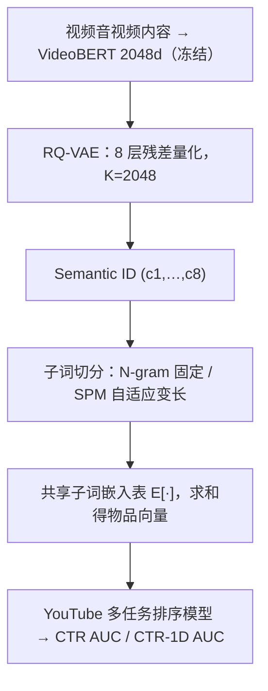
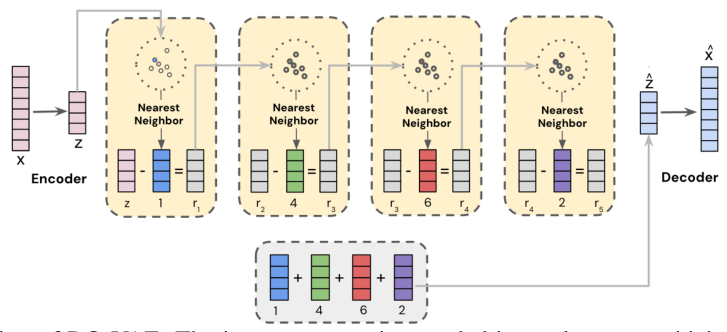

# Better Generalization with Semantic IDs: A Case Study in Ranking for Recommendations (以语义 ID 换取更好泛化：YouTube 排序模型案例研究)

- **会议/期刊**: RecSys 2024（arXiv:2306.08121v2, 2024-05）
- **作者与机构**: Anima Singh, Trung Vu, Nikhil Mehta, Raghunandan Keshavan, Maheswaran Sathiamoorthy, Yilin Zheng, Lichan Hong, Lukasz Heldt, Li Wei, Devansh Tandon, Ed H. Chi, Xinyang Yi（Google DeepMind / Google）
- **推荐链路定位**: 精排（生产级多任务排序模型）
- **研究方向**: 生成式推荐与离散语义 ID / 冷启动与长尾推荐
- **论文原文**: [https://arxiv.org/abs/2306.08121v2](https://arxiv.org/abs/2306.08121v2)
- **开源代码**: 暂未开源

## TL;DR (1分钟核心速览)

工业排序模型靠随机哈希视频 ID 获得强记忆，但哈希碰撞无语义，新片与长尾片嵌入学不动、无法跨相似物品泛化。本文用冻结的 2048 维多模态内容向量经 RQ-VAE（8 层、码本 2048）量化为层次化 Semantic ID，并提出 N-gram 与 SentencePiece 两种"子词哈希"适配法把 ID 序列映射回可学习嵌入。在 YouTube 生产多任务排序模型上（按天序列训练、次日数据评估、AUC 指标），大嵌入表下 SPM-SID 在整体 CTR 与冷启 CTR/1D 切片上均超随机哈希基线，且不牺牲整体质量。

## Background & Motivation (背景与核心矛盾)

- **主流范式**: 工业排序用 $O(10)$M 桶的随机哈希把$O(100)$M 视频 ID 压进巨型嵌入表，再以用户观看历史序列做个性化打分（Cheng/Zhao 等多任务排序体系）。
- **前人局限 1**: 随机哈希的碰撞是"无语义"的，torso/tail 与冷启物品的嵌入更新极其稀疏，导致相似视频之间零知识迁移，数据分布随时间漂移时尤甚。
- **前人局限 2**: 直接换成稠密内容向量会丢失"物品级记忆"（本文实测质量下降）；而 VideoRec/TransRec 这类端到端视频编码方案训练算力为 ID 基线的 10–50×，延迟敏感的在线排序无法承受。
- **核心洞察 (Key Insight)**: 既然哈希不可避免要碰撞，就应该让碰撞"有意义"——用离散、层次、紧凑的 Semantic ID（SID）替代随机键，使语义相近物品自然共享嵌入行；同时"泛化 vs 记忆"的权衡可通过码本层数与前缀粒度连续调节。
- **本文切入点**: 把 TIGER 的 SID 从"生成式检索的输入 token"改造为"排序模型的特征哈希键"，关键是子词切分策略。

## Method (核心方法设计)

### 1. 整体框架 (Overall Architecture)

两阶段解耦：Stage-1 用冻结的视频内容编码器（VideoBERT 主干，音视频输入，输出 2048 维主题性向量）为全库视频生成稠密向量，再用 RQ-VAE 训练一次并**冻结**，为每视频产出 $L=8$个整数码$(c^v_1,\dots,c^v_8)$；Stage-2 把这 8 个码经子词切分器（N-gram 或 SPM）切成若干子词，各子词共享一张嵌入表，求和得物品表征，作为观看历史 / 当前视频 / 候选视频三处特征的 ID 替代品送入多任务排序模型。SID 离线生成并随特征存储，在线只多几次查表，不引入新的实时编码开销。

<figure class="paper-figure" markdown="span">
  <figcaption>图1：RQ-VAE 示意图：输入向量 x 被编码为潜在变量 z，随后通过在每个层级查找残差最近的码本向量来进行递归量化。在该图中，由 x 表示的物品以 (1, 4, 6, 2) 作为其 Semantic ID。</figcaption>
</figure>

### 2. 关键设计拆解 (Key Designs)

1. **RQ-VAE 残差量化语义 ID（把内容向量压成概念层级）**：单层 VQ 码本容量有限、码本坍缩严重；RQ-VAE 在每层只量化"残差"，使前层捕获粗概念、后层细化。设第 $l$层残差$r_l = z - \sum_{i<l} e_{c_i}$，量化算子为$e_{c_l} = \arg\min_{e\in\mathcal{C}_l}\|r_l - e\|_2^2$，损失为
   $\mathcal{L}=\|x-\hat{x}\|_2^2+\sum_{l=1}^{L}\left(\beta\|r_l-\mathrm{sg}[e_{c_l}]\|_2^2+\|\mathrm{sg}[r_l]-e_{c_l}\|_2^2\right)$，
   配合"未被使用码本按 batch 内随机视频向量重置"缓解坍缩。直觉：SID 等价于一棵 trie，前缀即概念粒度——共享前缀长度 1/2/3 的平均余弦相似度为 0.41/0.68/0.91，子树规模从 15 万–45 万骤降到 1–5，验证了"前缀 = 语义层级"。
2. **SPM 子词哈希（把 SID 序列变回可学习嵌入）**：N-gram 把码按固定长度分组，第 $N$组表有$K^N$行（Unigram$8\times K$、Bigram$4\times K^2$），随$N$指数膨胀且分组与内容分布无关；SPM 则按曝光分布学变长子词词表，高频共现码自动合并、稀有组合退回 unigram，全部映射进**同一张定长表**。物品表征为子词嵌入之和$e_v=\sum_{s\in \mathrm{Seg}(\mathrm{SID}_v)}E[s]$。直觉：定长表预算下，SPM 自动把"记忆容量"分配给头部组合、把"泛化容量"留给长尾组合，且头部视频查表次数被动态压缩（图 4）。
3. **训练目标、负采样与推理效率**：Stage-2 完全沿用生产排序模型的多任务损失（CTR/观看时长等多目标加权），从曝光日志样本流学习，**无额外负采样设计**；RQ-VAE 冻结训练使 SID 生成与排序训练解耦。推理开销 ≈ 每物品表征从 1 次 ID 查表变为 $L$ 次（N-gram，固定 8 或 4 次）或自适应更少次（SPM）查表 + 求和，无额外稠密前向；作者还用相隔 6 个月训练的两个 RQ-VAE 版本验证 SID 空间稳定（性能可比），说明无需频繁重训量化器。

## Experimental Setup & Evaluation Protocol (实验设置与评估协议)

- **数据集与预处理**（生产日志，非公开学术数据集，统计量为原文口径）：

| 数据集 | #Users | #Items | #Interactions | 稀疏度/密度 | 特征/场景说明 |
| :--- | :---: | :---: | :---: | :---: | :--- |
| YouTube 排序日志 | 未披露 | $O(100)$M 视频 | 按天曝光日志流（未披露） | 幂律长尾、动态新增 | 随机哈希表$O(10)$M 桶；内容向量 2048d（VideoBERT）；RQ-VAE$L{=}8$,$K{=}2048$；码本坍缩用 batch 内重置 |

- **数据划分与防穿越 (Splitting Strategy)**: **按天序列训练**（第 $1..N$天日志逐日续训），在$(N+1)$天的日志上评估，天然构成时间分布漂移测试；`CTR/1D AUC` 进一步切片为"仅$(N+1)$ 天新出现视频"，即严格的冷启/新片切片。
- **排名评测协议 (Ranking Protocol)**: 生产曝光样本上的 **AUC（CTR 与 CTR/1D）** 点估计，属线上日志打分评估，**非** Full-Ranking 全库排序亦非负采样排序；作者声明 CTR AUC 变化 0.1% 即视为显著（未报告置信区间与显著性检验）。
- **对比基线与超参设置**: Random Hashing（8K 表参考点）、Dense Input（原始内容向量直接作特征，并加 1.5×/2× 层深对照）、Unigram-SID、Bigram-SID、SPM-SID；嵌入表规模从 $8\times K$量级扫到远大于$4\times K^2$，并固定"每物品查表预算"做公平比较。

## Key Experimental Results (实验关键数据)

> 说明：原文主结果以**相对随机哈希基线（8K 表）的百分比柱状图**（图 2、图 3）与查表数曲线（图 4）呈现，未给绝对 AUC 数值表；下表以方向与相对幅度标注，避免杜撰具体数字。

### 1. 主实验对比 (Main Results)

| 物品表征 | 嵌入表规模 | 用观看历史? | 整体 CTR AUC | 冷启 CTR/1D AUC |
| :--- | :---: | :---: | :---: | :---: |
| Random Hashing（ID 基线） | 8K 参考 | 两者皆测 | 0（基准） | 0（基准） |
| Dense Input（内容向量） | 无表 | 否 | ↓（低于基线） | ↓（低于基线） |
| Dense Input + 1.5×/2× 层 | 无表 | 否 | ↑（2× > 1.5× > 基线） | ↑（层数越多越好） |
| Unigram-SID（$N{=}1$） |$8\times K$ | 否 | ↓ | ↓ |
| Bigram-SID（$N{=}2$） |$4\times K^2$ | 否 | ↓ | ↓ |
| Unigram-SID | $8\times K$ | 是 | ↑ | ↑ |
| Bigram-SID | $4\times K^2$ | 是 | ↑（优于 Unigram） | ↑↑ |
| **SPM-SID（大表）** | 大表 | 是 | **↑↑（最优）** | **↑↑（最优，泛化最强）** |
| SPM-SID（小表 $8{\times}K$ 级） | 小表 | 是 | ≈ 略逊 N-gram | ≈ 略逊 N-gram |

### 2. 消融/变体对比 (Ablation Study)

| 变体 | 移除/替换的组件 | 结论方向 |
| :--- | :--- | :--- |
| Dense Input | 移除 ID 表与记忆能力 | 整体与冷启均下降，证明记忆不可省 |
| Dense Input + 2× 层 | 用深度换记忆 | 反超基线，但服务成本大增（不可取的替代路径） |
| w/o 观看历史 + Unigram/Bigram | 去掉历史特征 | 均低于随机哈希（嵌入表使用极度不均） |
| 有历史 + Unigram/Bigram | 恢复历史特征 | 均超随机哈希（内容多样性抬升表利用率） |
| SPM vs N-gram（同查表预算） | 固定分组 → 自适应分组 | 大表 SPM 胜，小表 N-gram 略胜 |
| RQ-VAE v0 vs v1（相隔 6 个月） | 量化器稳定性 | 两者排序性能可比，SID 空间稳定 |

### 3. 关键实验发现 (Key Findings)

1. **"记忆"是替换 ID 的硬门槛**：直接用内容向量会掉点，需叠加 1.5×–2× 层深才能反超基线且层数越多越好——作者据此把结论定位为"SID 提供记忆（可学习子词表）+ 泛化（语义碰撞）"的双通道，而非单纯换特征。
2. **观看历史特征是 N-gram SID 生效的开关**：无历史时 Unigram/Bigram 均劣于随机哈希（训练内容偏斜导致子词表使用稀疏），加入历史后显著反超——因为历史覆盖的内容更分散、表利用率被拉平；这解释了 SPM 在头部视频上"按需减少查表"（图 4）却仍不损质量。
3. **SPM 的优势集中在大表与冷启切片**：同一查表预算下 SPM 的 CTR/1D 提升最明显，说明变长子词把记忆容量自动导向高频组合、把泛化留给稀有组合；但表极小时其子词词表过小、反被固定 Bigram 反超，因此"先给足表预算再上 SPM"是工程前提。

## Highlights & Limitations (亮点、对比与审稿批判)

- **与代表作对比 (vs. Prior Work)**: ① vs **TIGER**：同样用 RQ-VAE SID，但 TIGER 把 SID 当生成式检索的 token（效率非首要），本文把 SID 当**哈希键**，核心创新是子词切分 + 查表预算约束；② vs **VideoRec/TransRec**：同样引入内容信号，但端到端编码使训练算力涨 10–50×，本文冻结内容编码器，只付一次离线量化成本；③ vs **PinnerFormer/DropoutNet**：那类内容表征面向离线/冷启特化，本文要求在实时排序同一点上不劣于 ID 基线。
- **可迁移亮点**: (a) "前缀即概念粒度 + 相似度分层"（0.41→0.68→0.91）可直接用于任何需要**可解释多粒度类目**的场景（类目召回、广告定向、跨域映射）；(b) 用 SPM 在定长嵌入表内做"记忆/泛化"预算分配，可直接迁移到超长尾物品 ID、查询词 ID、创作者 ID 等大基数类别特征。
- **审稿级局限批判**: ① **评估不可复现且单薄**：仅单一产品日志、单一 AUC 指标、无绝对数值与方差/显著性检验，"0.1% 即显著"缺统计支撑，学术侧无法复现；② **SPM 词表强依赖曝光分布**：头部偏置会固化在哈希粒度中，且变长合并破坏前缀层级，牺牲了 SID 的可解释性与前缀检索能力；③ 量化器冻结后新概念漂移仅用两个版本对比佐证，缺少对快速演化内容（如热点事件）的失效分析。

## Rating (四维评分)

- **方法创新性 (Novelty)**: ⭐⭐⭐⭐ （把生成式检索的 SID 重定位为排序侧"语义哈希键"，并用 SPM 子词切分解决定长表预算下的记忆/泛化权衡，思路清晰且工程原创性强）
- **评估协议与实验扎实度 (Protocol & Experiments)**: ⭐⭐⭐ （真实生产规模与冷启切片设计很有说服力，但只有相对百分比柱状图、无公开数据/方差/显著性检验，学术可复现性弱）
- **写作与数学规范度 (Clarity & Rigor)**: ⭐⭐⭐⭐ （RQ-VAE 损失、N-gram 表规模 $K^N$ 与前缀层级统计交代干净，SID 稳定性与相似度分析补足直觉；缺复杂度与查表成本的量化对比）
- **工业落地与复现价值 (Industrial & Practical Value)**: ⭐⭐⭐⭐⭐ （无需端到端编码、仅 8 次查表、SID 可离线预计算并跨 6 个月稳定，是少数已在十亿级视频库上替换 ID 特征并成功的落地范式）

