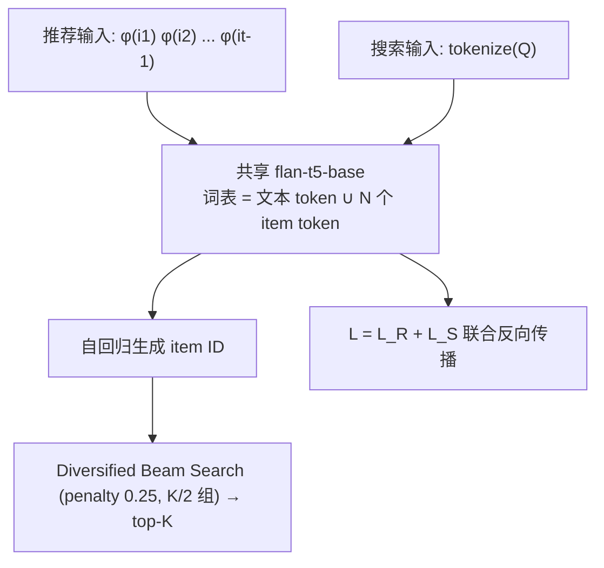

# Bridging Search and Recommendation in Generative Retrieval: Does One Task Help the Other?（生成式检索中打通搜索与推荐：一个任务真的能帮到另一个吗？）

- **会议/期刊**: RecSys 2024（18th ACM Conference on Recommender Systems）
- **作者与机构**: Gustavo Penha, Ali Vardasbi, Enrico Palumbo, Marco de Nadai, Hugues Bouchard（Spotify）
- **推荐链路定位**: 召回（端到端生成式检索）
- **研究方向**: 生成式推荐与离散语义 ID / 多任务学习与联合建模
- **论文原文**: [https://arxiv.org/abs/2410.16823v1](https://arxiv.org/abs/2410.16823v1)
- **开源代码**: 暂未开源（仅公开仿真数据集匿名仓库）

## TL;DR (1分钟核心速览)

工业平台（Spotify/YouTube/Netflix）上搜索与推荐长期各训一个专用模型，而生成式检索把 item ID 直接当作 LLM 的输出词表，天然具备"一模型多任务"的潜力，但联合训练究竟何时有益、为何有益尚无定论。本文提出两条可检验假设：[H1] 联合训练正则化 item 流行度估计，[H2] 联合训练正则化 item 隐表征（搜索补内容侧、推荐补协同侧）。作者先用三个可控仿真数据集隔离变量验证假设，再在 ML / MPD / Podcasts 上以全库 beam search 生成式检索（无负采样）验证：联合模型 Gen$_{R+S}$ 在推荐与搜索两侧平均 R@30 提升 **16%**，机制主要来自 [H2]。

## Background & Motivation (背景与核心矛盾)

- **主流范式**: 生成式检索（DSI 系）让 LM 自回归地"吐出"文档/物品 ID，免去外部索引与 ANN 近邻搜索；推荐侧则以 T5/P5 类模型从用户历史 ID 序列直接生成下一物品 ID。
- **前人局限**: ① 生成式推荐学到的 item ID 表征强偏流行度——图 1 中 t-SNE 上颜色深浅（流行度）呈现清晰梯度，说明 ID embedding 把"热度"编码进了语义空间；② 搜索数据只含内容语义、推荐数据只含协同共现，单一任务下的 item 表征天然不完整，且工业上搜索/推荐双模型重复训练成本高。
- **核心洞察 (Key Insight)**: 联合训练不是简单的数据量叠加，而是对 item 的**流行度先验**与**隐空间几何**同时施加正则——只要两任务的流行度分布"相关但不相同"（KL 散度小）且共现结构对齐，正则就会把各自有偏的估计拉向更稳健的解。
- **本文切入点**: 不做"更强的生成式模型"，而是做**受控归因**——用三个可调旋钮的仿真数据集把 [H1]/[H2] 剥离开，再用三个真实数据集交叉验证。

<figure class="paper-figure" markdown="span">
  ![图1：ML数据集上生成式推荐器（左）与生成式搜索（右）潜在表示的t-SNE \[55\]投影。每个物品的流行度（若该物品在相应推荐和搜索数据集中出现越频繁，则颜色越深）编码在两个生成式检索模型所学物品ID的嵌入中。](../../../../assets/papers/2410.16823v1/figure_1.png)<figcaption>图1：ML数据集上生成式推荐器（左）与生成式搜索（右）潜在表示的t-SNE [55]投影。每个物品的流行度（若该物品在相应推荐和搜索数据集中出现越频繁，则颜色越深）编码在两个生成式检索模型所学物品ID的嵌入中。</figcaption>
</figure>

## Method (核心方法设计)

### 1. 整体框架 (Overall Architecture)

模型采用 flan-t5-base 单一骨干，词表由自然语言 token 与 $|\mathcal{I}|$个 item 专属 token 拼接而成，映射$\phi:\mathcal{I}\to\mathcal{V}_{\text{item}}$ 为**原子 ID**（一物品恰一个 token，而非多 token 语义 ID），使搜索与推荐共享同一套 LM head 权重。推荐的输入是把用户历史 ID 用空格拼成序列、输出是目标 ID；搜索的输入是 query 的分词文本、输出是相关 ID。两任务的训练样本混入同一 batch、以等权交叉熵共同优化，推理统一走 diversified beam search。

### 2. 关键设计拆解 (Key Designs)

1. **原子 ID + 共享词表：把两任务焊在同一组参数上**：若用多 token 语义 ID，item 表征由一棵码本树分摊，跨任务正则只能间接作用；本文让每个 item 只占 1 个 token，其 embedding 与输出投影行同时被搜索与推荐梯度更新，$p_\theta(\phi(i)\mid \cdot)$ 的 logit 即为两任务共同"投票"的结果——这是 [H2] 得以成立的物理载体。
2. **联合自回归损失：搜索与推荐互为辅助任务**：搜索样本展开为 query–相关物品的多个 pair，推荐样本为 history–target 的单 pair，总目标为
$\mathcal{L}=\underbrace{-\sum_{(Q,i)\in \mathcal{D}_S}\log p_\theta(\phi(i)\mid Q)}_{\mathcal{L}_S}+\underbrace{-\sum_{(H,i_t)\in \mathcal{D}_R}\log p_\theta(\phi(i_t)\mid \phi(i_1)\cdots\phi(i_{t-1}))}_{\mathcal{L}_R}$搜索的"内容相似"会把共享 query 的物品在隐空间拉近，补偿推荐数据里从未共现过的$\{i_3,i_1\}$；反之推荐的共现链会把语义相关但从未被同一 query 命中的物品拉近。
3. **训练目标、负采样与推理效率**：生成式检索在 item 词表上做全词表 softmax，**不使用任何负采样**（这是相对双塔+InfoNCE 的天然优势，避免假阴性）；推理用 diversity penalty 为 0.25、分组数为 $K/2$ 的 diversified beam search，一次前向即可给出 top-K，无 ANN 索引与向量存储开销，但规模受限于"item token 必须训练期见过"（closed-set）。

## Experimental Setup & Evaluation Protocol (实验设置与评估协议)

- **数据集与预处理**: 三个真实数据集统计如下（Gini 越高表示流行度越集中；KLD 为两任务流行度分布差异）：

| 数据集 | #Users | #Items (R/S) | #Interactions / #Queries | 稀疏度·密度 | 场景说明 |
| :--- | :---: | :---: | :---: | :---: | :--- |
| ML (MovieLens 25M) | 163k | 20k / 20k | — / 55k queries | 密度 0.00750 | 电影；genre/tag/genome-tag 作 query，avg rel 6.86 |
| MPD (Million Playlist) | 85k | 21k / 21k | — / 28k queries | 密度 0.00055 | 歌单；歌单标题作 query，avg rel 36.44 |
| Podcasts (Spotify 2023.07–10) | 211k | 43k / 15k | 真实日志采样 | 密度 0.00030 | 播客节目；真实 log query，avg rel 10.27 |

- **数据划分与防穿越 (Splitting Strategy)**: 推荐侧为 **Leave-Last-Out 时序切分**——测试用前 $t-1$次交互预测第$t$项，验证预测第$t-1$项，训练用至$t-3$ 的滚动前缀构造多条样本（训练阶段看不到最后两次交互）；搜索侧 train/val/test 的 query 集合完全不重叠。二者共享物品集合并强制 **test 中所有 item 均在训练集出现过**（closed-set，规避无法生成新 ID 的问题）。
- **排名评测协议 (Ranking Protocol)**: 无偏 **Full-Ranking**——在全部 item token 上做 beam search 生成 $K$ 个候选，不使用采样负例；仿真集用 R@10（实体数 <100），真实集用 R@30。显著性检验为 paired Student's t-test（95% 置信区间，5 次重复取均值）。
- **对比基线与超参设置**: 生成式侧为 Gen$_R$/ Gen$_S$/ Gen$_{R+S}$；参照基线包括 Pop$_R$、Pop$_S$、SASRec、BERT4Rec、DiffRec（推荐）与 BM25、Bi-encoder（all-mpnet-base-v2，搜索）。flan-t5-base，5 epochs，lr=0.002，batch=128，AdamW（weight decay 0.01）。

## Key Experimental Results (实验关键数据)

### 1. 主实验对比 (Main Results)

| 任务 | 方法 | ML All | ML Torso | MPD All | Podcasts All | Podcasts Torso |
| :--- | :--- | :---: | :---: | :---: | :---: | :---: |
| Rec | Gen$_R$ | 0.103 | 0.057 | 0.067 | 0.112 | 0.018 |
| Rec | **Gen$_{R+S}$** | **0.119** (+16%) | **0.066** (+16%) | 0.055 (−18%) | **0.149** (+33%) | **0.067** (+262%) |
| Rec | Pop$_R$ | 0.069 | 0.000 | 0.028 | 0.073 | 0.000 |
| Rec | SASRec | 0.207 | 0.164 | 0.231 | 0.256 | 0.134 |
| Rec | BERT4Rec | 0.247 | 0.203 | 0.151 | 0.260 | 0.151 |
| Rec | DiffRec | 0.211 | 0.121 | 0.215 | 0.280 | 0.212 |
| Search | Gen$_S$ | 0.020 | 0.000 | 0.028 | 0.080 | 0.004 |
| Search | **Gen$_{R+S}$** | **0.023** (+16%) | 0.001 | **0.033** (+18%) | **0.106** (+33%) | **0.034** (+855%) |
| Search | BM25 | 0.091 | 0.109 | 0.032 | 0.304 | 0.383 |
| Search | Bi-encoder | 0.081 | 0.092 | 0.032 | 0.269 | 0.336 |

### 2. 消融与归因分析 (Ablation & Attribution)

| 分析维度 | 指标 | ML | MPD | Podcasts |
| :--- | :--- | :---: | :---: | :---: |
| [H1] 推荐侧预测流行度变化 $\Delta Pop_S$(Gen$_R\to$Gen$_{R+S}$) | % | −2.72 | +0.92 | −17.46 |
| [H1] 搜索侧预测流行度变化 $\Delta Pop_R$(Gen$_S\to$Gen$_{R+S}$) | % | +33.23 | −7.36 | −13.33 |
| [H2] 推荐：命中"历史→目标"共现 query 数增量 | % | +183.1 | +210.1 | +170.9 |
| [H2] 搜索：相关物品对在推荐共现中的增量 | % | +136.5 | +213.0 | +314.2 |
| [H2] Podcasts 冗余对 vs. 非冗余对（推荐侧提升） | % | — | — | +31.8 vs 0.0 |
| 仿真 SIM1：KL 散度增大时 Gen$_{R+S}$ 收益 | R@30 | 单调衰减（低 KL 处最优） | — | — |
| 仿真 SIM2：% q. match 100%（65% 采样） | R@10 | 0.717 → **0.897** | — | — |
| 仿真 SIM3：% pairs in qrels 100% | R@10 | 0.580 → **0.640** | — | — |

### 3. 关键实验发现 (Key Findings)

1. **收益主要来自 [H2] 而非 [H1]**：真实数据上 Gen$_{R+S}$的预测并未系统性地向新增任务的流行度偏移（$\Delta Pop$ 三个数据集符号不一致，Podcasts 甚至 −17.46%），但凡是联合模型与单任务模型预测不同的样本，其"跨任务共现证据"都暴增 171%–314%，说明提升来自隐空间几何被重塑，而非热门度先验被修正。图 3 的 t-SNE 亦直观显示联合模型把同簇物品收得更紧。
2. **[H1] 的收益是有条件的**：仿真 SIM1 显示只有当两任务流行度分布的 KL 散度较小时联合才划算；Podcasts 上人为限制"每物品训练样本数"抹掉流行度偏差后收益随之下降，反向印证流行度正则确有其贡献但幅度小于 [H2]。
3. **共现结构对齐度决定成败，冗余与新关系两侧都能受益**：SIM2 中 % q. match 从 0% 升到 100%，Gen$_{R+S}$由劣于 Gen$_R$（0.842 vs 0.907）翻转为显著优于（0.985）；MPD 是唯一"全量 −18%"的例外，其 KSdist=0.22/KLD≈0.14 虽小但 Gini 差异大，且非冗余对极少；MPD 头部物品仍 +24%，说明损失集中在长尾。Podcasts 推荐侧冗余对 +31.8%、非冗余对 0%（仅 56 对），而搜索侧非冗余对 +86.8% —— 搜索更能"借"推荐填补缺失共现。

## Highlights & Limitations (亮点、对比与审稿批判)

- **与代表作对比 (vs. Prior Work)**: 相较 DSI/GENRE 只做单一检索任务、P5 只在推荐内部做多任务，本文首次把**搜索与推荐两个异构任务**纳入同一生成式检索器并对收益做机理归因；相较 SASRec/BERT4Rec 等 ID-only 序列模型，本文模型可直接消费自然语言 query，因而具备跨任务迁移能力（但也因此在绝对指标上落后，R@30 仅 0.119 vs BERT4Rec 0.247）。
- **可迁移亮点**: ① "原子 ID + 共享 LM head"是让两任务正则落到同一参数上的最廉价做法，可直接迁移到广告/内容双场景的一体化召回；② 用 KL 散度、共现重叠率等**可调旋钮构造仿真数据做假设检验**，是评估多任务/跨域收益来源的优秀方法论模板。
- **审稿级局限批判**: ① 严格 closed-set 设定要求测试物品必须出现在训练集，无法评估冷启动 item，也未与时序/新物品场景接轨；② 绝对效果被简单非生成基线大幅超越（搜索侧 BM25 在 Podcasts 上 0.304 vs 生成式 0.106），三倍以上差距下"+33%"的说服力有限，且原子 ID 方案在百万级物料上不可扩展（词表爆炸、无索引、beam search 成本随 item 数线性增长）；③ 未报告方差、训练/推理成本与超参（diversity penalty、任务配比）敏感性。

## Rating (四维评分)

- **方法创新性 (Novelty)**: ⭐⭐⭐ （联合生成式检索并不新，真正的增量是 [H1]/[H2] 两条可检验假设与仿真数据受控归因范式；无理论/谱分析支撑）
- **评估协议与实验扎实度 (Protocol & Experiments)**: ⭐⭐⭐⭐ （Full-Ranking + paired t-test + 3 仿真 3 真实数据集三重验证扎实，但 closed-set 限制与缺失方差报告扣分）
- **写作与数学规范度 (Clarity & Rigor)**: ⭐⭐⭐⭐ （假设—仿真—真实验证的叙事链条清晰，公式极简但足够；对 SIM1 无 train/test 偏移等设定局限有自陈）
- **工业落地与复现价值 (Industrial & Practical Value)**: ⭐⭐⭐ （来自 Spotify 真实日志、结论对工业多场景团队有直接指导；但代码未开源、原子 ID 在大规模物料上不可行、绝对指标落后于轻量基线）

