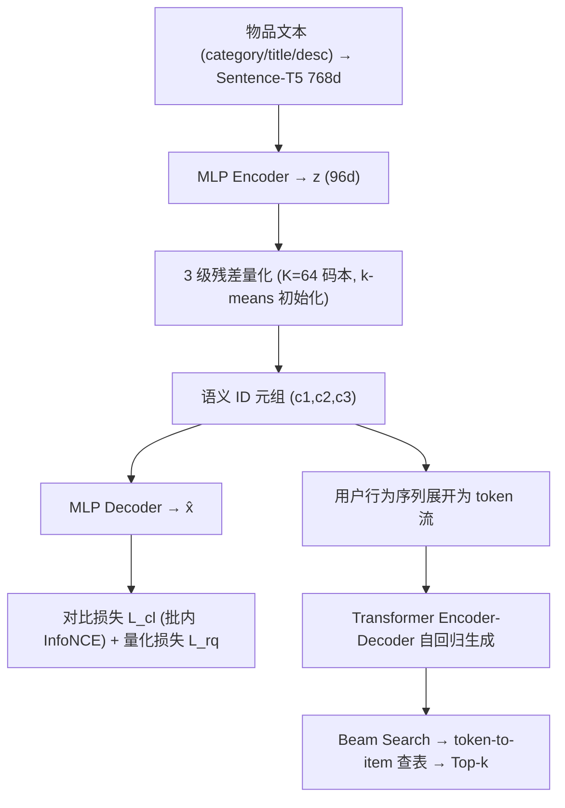
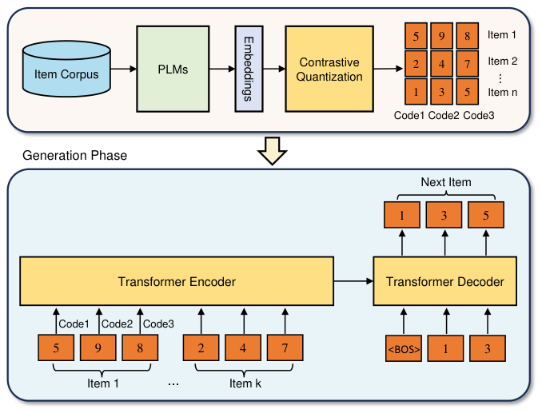
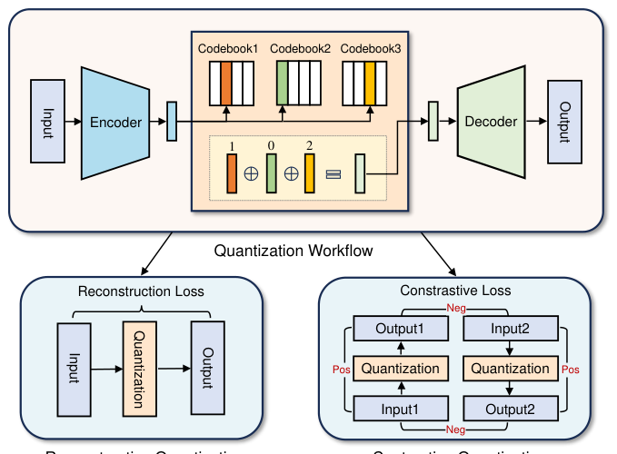

# CoST: Contrastive Quantization based Semantic Tokenization for Generative Recommendation (基于对比量化的生成式推荐语义词元化)

- **会议/期刊**: RecSys 2024（18th ACM Conference on Recommender Systems, Bari, Italy, 6 pages）
- **作者与机构**: Jieming Zhu、Zhenhua Dong（华为诺亚方舟实验室）；Mengqun Jin、Xiu Li（清华深研院）；Qijiong Liu（港理工）；Zexuan Qiu（港中文）
- **推荐链路定位**: 生成式端到端召回（语义 ID 构建 + 自回归生成式检索）
- **研究方向**: 生成式推荐与离散语义 ID / 自监督对比学习
- **论文原文**: [https://arxiv.org/abs/2404.14774v2](https://arxiv.org/abs/2404.14774v2)
- **开源代码**: 暂未开源

## TL;DR (1分钟核心速览)

生成式推荐（TIGER 范式）先用 RQ-VAE 把物品压成离散语义 ID，但重建损失逐物品独立优化、只求"像自己"，在长尾密集区常给多个物品分配完全相同的码元组，无法区分近邻物品。CoST 把重建损失换成批内对比损失 $\mathcal{L}_{cl}$：要求输入向量与自身重构的相似度高于它与同批其他物品重构的相似度，仅保留量化损失$\mathcal{L}_{rq}$ 维持码本学习。在 MIND / Amazon-Office 上按 Leave-One-Out 全库排序评估，MIND 上 Recall@5 相对 RQ-VAE 提升 43.3%、NDCG@5 提升 43.8%。

## Background & Motivation (背景与核心矛盾)

- **主流范式**: 生成式检索把物品召回改写为序列生成——先用 Sentence-T5 编码物品文本得到 768 维语义向量，再用 RQ-VAE / 层次 k-means 离散化为 $M$ 元语义 ID，最后用 encoder-decoder Transformer 自回归生成目标物品的 ID 元组，beam search 后查表还原物品，彻底绕开 ANN 索引与点积内积约束。
- **前人局限**: ① RQ-VAE 的重建损失对每个物品**独立**做像素级/向量级精确还原，码本分配只受本物品驱动，缺乏物品间相对关系的约束；② 推荐数据长尾稠密，码本容量（$K^M=64^3=262\text{K}$ 远大于 MIND 的 12,251 个物品）并不缺，但量化误差使稠密区大量物品落入同一 Voronoi 单元，生成模型输出同 ID 时无法分辨候选。
- **核心洞察 (Key Insight)**: 生成式检索与图像生成不同——下游不需要"像素级解码"，只需要**物品间可区分**。因此重建保真度是错位的优化目标，物品邻域的相对相似结构才是关键。
- **本文切入点**: 保留 RQ-VAE 的编码-残差量化-解码骨架，只把 $\mathcal{L}_{mse}$ 换成批内 InfoNCE，让量化后空间"自对比"而非"自重建"。

## Method (核心方法设计)

### 1. 整体框架 (Overall Architecture)

两阶段闭环：**Tokenization 阶段**用预训练文本编码器（Sentence-T5，768 维）从 "category / title / description" 拼接 prompt 中抽取物品语义向量 $\mathbf{x}$，经 3 层 MLP 编码器投影到 96 维隐空间$\mathbf{z}$，再由$M=3$级残差量化器逐级最近邻查码本得到元组$(c_1,c_2,c_3)$，解码器重构$\hat{\mathbf{x}}$并计算对比 + 量化联合损失训练码本。**Generation 阶段**把用户历史物品序列展开为长度$N\times M$的 token 流，用与 TIGER 同构的 encoder-decoder 做 seq2seq 自回归预测，推理时 beam search 生成 token 元组并经 token-to-item 表映射为 top-k 物品，词表由万级物品 ID 压缩到$3\times 64$ 个码字。

<figure class="paper-figure" markdown="span">
  <figcaption>图1：生成式推荐框架，包括词元化阶段与生成阶段。</figcaption>
</figure>

### 2. 关键设计拆解 (Key Designs)

1. **残差量化语义 ID 构建（骨架不变，负责语义保真）**：编码得 $\mathbf{z}$后迭代量化残差，$c_i=\arg\min_k\|\mathbf{r}_{i-1}-\mathbf{e}^k_i\|_2$、$\mathbf{r}_i=\mathbf{r}_{i-1}-\mathbf{e}^{c_i}_i$、$\hat{\mathbf{x}}=\mathrm{Dec}(\sum_{i=1}^{M}\mathbf{e}^{c_i}_i)$。为避免码本坍缩（码字利用率过低），首个训练 batch 用 k-means 质心初始化码本——这是让后续对比损失能真正"有码可分"的前提。

2. **对比量化损失（本文核心 delta）**：痛点是把每个物品当独立样本做 MSE，等价于优化每个点的绝对位置；CoST 改成优化批内相对序：同批 $K$ 个物品的重构向量互为负样本，只要求自身重构在余弦相似度上排第一，
$$\mathcal{L}_{cl}=-\log\frac{\exp(\langle\mathbf{x}_0,\hat{\mathbf{x}}_0\rangle/\tau)}{\sum_{i=0}^{K}\exp(\langle\mathbf{x}_0,\hat{\mathbf{x}}_i\rangle/\tau)}$$
物理直觉：该损失最大化批内 top-1 概率，等价于把"物品 A 更像 A 而非 B"这一**排序性邻域约束**注入码本；精确重建被松弛后，码字不再被稠密区长尾物品挤占同一单元，语义 ID 空间获得判别力。与图像 VQ 需保留像素细节不同，这里损失保真换判别是严格正收益。

3. **训练目标、负采样与推理效率**：总损失 $\mathcal{L}_{co}=\alpha\mathcal{L}_{cl}+\mathcal{L}_{rq}$，其中$\mathcal{L}_{rq}=\sum_{i=1}^{M}\|\mathrm{sg}(\mathbf{r}_{i-1})-\mathbf{e}^{c_i}_i\|_2^2+\beta\|\mathbf{r}_{i-1}-\mathrm{sg}(\mathbf{e}^{c_i}_i)\|_2^2$，$\alpha=0.1,\beta=0.25,\tau=0.1$。**免显式负采样**：负样本即同 batch（256）内其他物品的重构，零额外采样开销；量化阶段 Adam lr=1e-4，生成阶段 batch=512、lr=1e-3。推理端以 beam search 直接在 token 空间解码，无 ANN 检索、无向量库，延迟由生成长度$3M$ 决定。

<figure class="paper-figure" markdown="span">
  <figcaption>图2：通过重建式量化与对比量化训练的向量量化流程。</figcaption>
</figure>

## Experimental Setup & Evaluation Protocol (实验设置与评估协议)

- **数据集与预处理**: MIND 按 [5] 预处理，保留交互数 ≥15 的用户、序列截断至 70；Amazon-Office 过滤交互 <5 的用户，并按物品规模切成 S/L 两版以考察物品数量影响。

| 数据集 | #Users | #Items | #Interactions | 序列长度 [min,max] / 均值 / 中位数 | 特征/场景说明 |
| :--- | :---: | :---: | :---: | :---: | :--- |
| MIND | 29,207 | 12,251 | 未报告（序列均值 25.06） | [15, 70] / 25.06 / 22 | 新闻推荐；category、sub-category、title |
| Office (S) | 2,868 | 14,618 | 未报告（序列均值 13.21） | [10, 20] / 13.21 / 12 | 亚马逊办公用品；type、brand、title、category |
| Office (L) | 16,696 | 37,347 | 未报告（序列均值 8.38） | [5, 50] / 8.38 / 12 | 同上，物品池扩大约 2.6 倍 |

- **数据划分与防穿越 (Splitting Strategy)**: 标准 `Leave-One-Out`——每个用户最后一条交互作测试、倒数第二条作验证、其余训练，无时间戳泄露风险但存在"未来信息"隐式穿越（用户后段行为已知）。
- **排名评测协议 (Ranking Protocol)**: 采用**全库排序**（生成式解码后在完整物品集上取 top-k 并计算 Recall/NDCG，未做负采样候选集截断）；MIND 报告 $k\in\{5,10,20,40\}$，Office 报告$k\in\{10,20\}$。需注意原文未给出 beam size，全库解码成本不可精确复算。
- **对比基线与超参设置**: 基线全部是**同一 TIGER 生成器下的不同 tokenization 方案**——Random hashing、$\mathcal{L}_{re}$（RQ-VAE，即 TIGER 原配）、$\mathcal{L}_{co}$（CoST）、$\mathcal{L}_{re}+\mathcal{L}_{co}$。隐空间维度$d=96$、码本数$M=3$、码本大小$K=64$，编码器隐层 [512,256,128] + ReLU。原文**未报告显著性检验**，亦未对比 EAGER、LC-Rec 等其他生成式召回 SOTA。

## Key Experimental Results (实验关键数据)

### 1. 主实验对比 (Main Results)

MIND 数据集（加粗为最优，`Improv.` 为 CoST 相对 RQ-VAE 基线 $\mathcal{L}_{re}$ 的相对提升）：

| 方法 (tokenizer) | NDCG@5 | NDCG@10 | NDCG@20 | NDCG@40 | Recall@5 | Recall@10 | Recall@20 | Recall@40 |
| :--- | :---: | :---: | :---: | :---: | :---: | :---: | :---: | :---: |
| Random | 0.0201 | 0.0265 | 0.0327 | 0.0390 | 0.0319 | 0.0519 | 0.0766 | 0.1075 |
| $\mathcal{L}_{re}$ (RQ-VAE / TIGER) | 0.0363 | 0.0474 | 0.0594 | 0.0727 | 0.0560 | 0.0905 | 0.1384 | 0.2031 |
| $\mathcal{L}_{re}+\mathcal{L}_{co}$ | 0.0444 | 0.0574 | 0.0710 | 0.0865 | 0.0677 | 0.1081 | 0.1621 | 0.2376 |
| **CoST ($\mathcal{L}_{co}$)** | **0.0522** | **0.0663** | **0.0817** | **0.0975** | **0.0803** | **0.1241** | **0.1855** | **0.2625** |
| `Improv.` (NDCG / Recall) | +43.8% / +43.3% | +39.9% / +37.2% | +37.5% / +34.1% | +34.1% / +29.2% | | | | |

Office 数据集（小样本短序列 vs 大物品池）：

| 方法 | Office(S) NDCG@10 | Office(S) NDCG@20 | Office(S) R@10 | Office(S) R@20 | Office(L) NDCG@10 | Office(L) NDCG@20 | Office(L) R@10 | Office(L) R@20 |
| :--- | :---: | :---: | :---: | :---: | :---: | :---: | :---: | :---: |
| $\mathcal{L}_{re}$ | 0.0024 | 0.0032 | 0.0037 | 0.0068 | 0.0041 | 0.0053 | 0.0075 | 0.0123 |
| $\mathcal{L}_{re}+\mathcal{L}_{co}$ | **0.0035** | 0.0042 | **0.0066** | **0.0096** | 0.0042 | 0.0052 | **0.0079** | 0.0119 |
| **CoST ($\mathcal{L}_{co}$)** | 0.0034 | **0.0043** | 0.0060 | 0.0094 | **0.0047** | **0.0059** | **0.0079** | **0.0125** |
| `Improv.` (最优 vs $\mathcal{L}_{re}$) | +43.8% | +31.1% | +81.0% | +41.0% | +15.1% | +10.5% | +5.4% | +1.5% |

### 2. 消融实验 (Ablation Study)

原文的"消融"即损失项组合实验（同一生成器、同一码本超参）：

| 配置 | 关键项 | MIND NDCG@10 | MIND R@10 | Office(S) NDCG@20 | Office(L) NDCG@20 | 结论 |
| :--- | :--- | :---: | :---: | :---: | :---: | :--- |
| w/o 对比项（$\mathcal{L}_{re}$ 独用） | 重建 + 量化 | 0.0474 | 0.0905 | 0.0032 | 0.0053 | 判别力最弱 |
| w/o 重建项（$\mathcal{L}_{co}$ 独用） | 对比 + 量化 | **0.0663** | **0.1241** | 0.0043 | **0.0059** | 大样本/长序列最优 |
| 双项并用（$\mathcal{L}_{re}+\mathcal{L}_{co}$） | 重建 + 对比 + 量化 | 0.0574 | 0.1081 | 0.0042 | 0.0052 | 目标冲突，全面劣于纯对比 |
| w/o k-means 初始化 | — | 原文未做该消融 | — | — | — | 码本坍缩风险未量化 |

### 3. 关键实验发现 (Key Findings)

1. **tokenization 质量是生成式召回的瓶颈，且增益集中在头部**：仅替换量化损失就让 NDCG@5 从 0.0363 跳到 0.0522（+43.8%），但增益随 $k$ 单调衰减（@40 仅 +34.1%），说明对比量化主要修复了稠密区头部候选的"同码不可分"，对长尾尾部物品的语义 ID 冲突改善有限。
2. **重建与对比两项并用是负收益**：MIND 上 $\mathcal{L}_{re}+\mathcal{L}_{co}$的 NDCG@5（0.0444）显著低于纯$\mathcal{L}_{co}$（0.0522），且 Recall@5 也落后 12.6 个百分点相对值；但 Office(S) 这种千级用户、短序列（均值 13.21）场景下组合项在 4 项指标中 3 项微超纯对比（R@20 0.0096 vs 0.0094），表明样本稀疏时重建项可充当正则，数据充足时则是优化的负担。
3. **物品池扩大显著稀释收益**：从 Office(S)（14,618 物品）到 Office(L)（37,347 物品），NDCG@10 提升由 +43.8% 降至 +15.1%，Recall@10 由 +81.0% 塌缩至 +5.4%；结合码本敏感性分析（$K$从 32→128、$M$从 3→4 时 NDCG 单调上升，$d$=96 最优而 256 过拟合），说明**固定$K^M$ 码本容量在物品规模增大后会成为新瓶颈**，"增大码本/码本数"与"引入对比"是两条互不替代的扩容路径。

## Highlights & Limitations (亮点、对比与审稿批判)

- **与代表作对比 (vs. Prior Work)**: ① vs **TIGER (RQ-VAE)**：两者共享完全相同的残差量化骨架与 seq2seq 生成器，唯一差异是 $\mathcal{L}_{mse}\to\mathcal{L}_{cl}$，是干净的"单变量"对照，归因可信；② vs **EAGER / Recforest（层次 k-means）**：后者同样只用语义聚类，未引入物品邻域判别，且聚类不可端到端训练；③ vs **LC-Rec / LETTER（语义+协同 ID）**：本文坚持纯语义侧改进，未利用协同信号，因此与协同增强型 tokenization 是正交可叠加的。
- **可迁移亮点**: ① "把逐样本重建损失替换为批内 InfoNCE"这一操作可平移到任何 VQ 类离散化模块（多模态量化、向量量化召回索引、扩散生成推荐的码本）；② 用 k-means 初始化码本规避码本坍缩，是 RQ-VAE 系列低成本高回报的工程 trick。
- **审稿级局限批判**: ① **评测面窄且对照单薄**：全文只有 4 个 tokenization 变体，无任何外部生成式召回 SOTA（EAGER、LC-Rec）对比，也无显著性检验，+43% 的结论缺乏跨方法说服力；② **复现与成本不透明**：未开源、未给出 beam size 与全库解码耗时、未报告 $\mathcal{L}_{co}$对$\tau$的敏感性呈非单调（$\tau$=0.1 与 1.0 在不同 epoch 下最优），且$K^M$容量随物品规模扩展的代价（码本显存、token 序列变长导致解码步数$3M$ 增长）未被讨论。

## Rating (四维评分)

- **方法创新性 (Novelty)**: ⭐⭐⭐ （把 InfoNCE 嫁接到 RQ-VAE 属"轻量但精准"的改造，无理论/谱分析支撑，胜在问题定位准——"生成式检索不需要精确重建"这一洞察本身比公式更有价值）
- **评估协议与实验扎实度 (Protocol & Experiments)**: ⭐⭐⭐ （Leave-One-Out + 全库排序协议规范、3 个数据集覆盖不同物品规模，但基线仅 4 个内部变体、无外部 SOTA、无显著性检验，说服力打折）
- **写作与数学规范度 (Clarity & Rigor)**: ⭐⭐⭐⭐ （6 页短文把 tokenization/生成两阶段讲得极清楚，公式定义紧凑无冗余；扣分在于 $\mathcal{L}_{rq}$ 中 stop-gradient 位置与 k-means 初始化时机未给伪代码）
- **工业落地与复现价值 (Industrial & Practical Value)**: ⭐⭐⭐ （改动仅是损失函数一行替换，可在现有 TIGER 类系统上零架构成本上线，语义 ID 消除了 ANN 索引维护；但未开源、码本容量随物品规模扩展的存储/解码成本未量化，复现与容量规划需自行试错）

