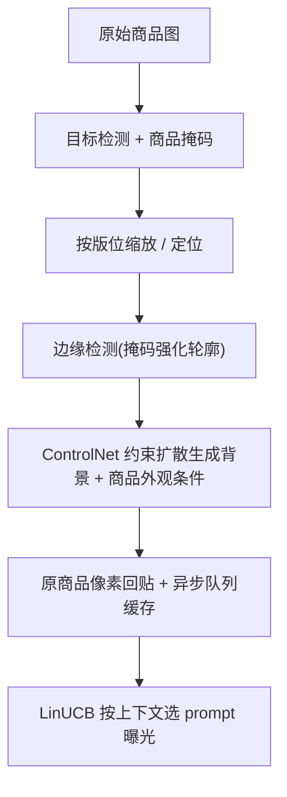
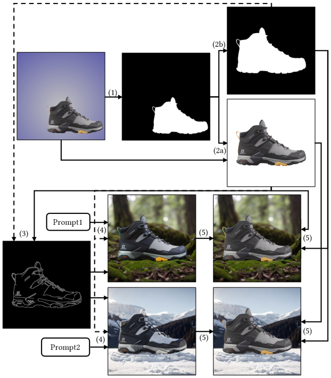
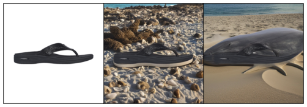

# Dynamic Product Image Generation and Recommendation at Scale for Personalized E-commerce (面向个性化电商的规模化动态商品图像生成与推荐)

- **会议/期刊**: RecSys 2024（Industry Track，3 页短文）
- **作者与机构**: Ádám Tibor Czapp, Mátyás Jani, Bálint Domián, Balázs Hidasi（Taboola Budapest）
- **推荐链路定位**: 精排后的**呈现层/创意生成**（不改变候选与排序模型，只改变被展示商品的图片）
- **研究方向**: 生成式推荐与离散语义ID / 强化学习与动态探索推荐
- **论文原文**: [https://arxiv.org/abs/2408.12392v1](https://arxiv.org/abs/2408.12392v1)
- **开源代码**: [huggingface/diffusers](https://github.com/huggingface/diffusers)（仅依赖的生成库开源，业务管线未开源）

## TL;DR (1分钟核心速览)

动态商品广告（DPA/重定向）无法为每个 `item × 版位 × 宽高比` 定制创意，只能直接投放商家原始商品图。本文将 Stable Diffusion 背景生成与 LinUCB 上下文老虎机串联：用商品边缘图作为 ControlNet 约束、在商品掩码下采样背景，再把**原商品像素原样贴回**，从而彻底规避 inpainting 的"虚拟部件"伪影；随后按用户/商品/版位特征从品类级 prompt 池中选择背景。线上三阶段 A/B（CTR 为唯一主指标，均 $p<0.05$）显示：仅做位次自适应缩放定位$+5\%$，生成背景约$+15\%$，改进管线后相对原图$+4\%\!\sim\!40\%$（商家相关），prompt 个性化再$+5\%$。

## Background & Motivation (背景与核心矛盾)

- **主流范式**: 商品级广告创意 = 原始商品图 + 模板化设计元素，按版位裁切；创意设计高度依赖人工，无法随商品目录（数千至数万 SKU）线性扩展。
- **前人局限 1（保真性）**: 朴素做法是在商品掩码外做 inpainting 外推背景，但扩散模型倾向于把商品"补全"为更大物体，产生向外延伸的**虚拟部件**与"悬浮商品"伪影——在电商场景中这属于结构性命中率事故，不可接受。
- **前人局限 2（稀疏性）**: 用户–商品–版位三元组样本极稀疏，逐三元组训练个性化生成模型在数据与推理成本上均不可行。
- **核心洞察 (Key Insight)**: 广告位用户注意力不在创意上，对**轻微瑕疵高度容忍**，但对**商品本体像素被篡改零容忍**。因此正确策略是"主体绝对保真 + 不确定性全部推给背景"。
- **本文切入点**: 把生成任务从"边界像素外推"重构为"形状一致下的背景合成"，再用轻量 bandit 承担个性化，而非训练用户条件生成模型。

## Method (核心方法设计)

### 1. 整体框架 (Overall Architecture)

输入单张商家商品图，管线五步闭环：(1) 目标检测得到商品掩码；(2) 按目标版位缩放与定位（可选去掉原背景）；(3) 边缘检测，并用掩码强化轮廓；(4) 以边缘图 + 商品外观双条件驱动 Stable Diffusion 生成背景与"代理物体"；(5) 将原始商品像素贴回生成图上覆盖代理区域。生成结果以 `(image, prompt, size)` 三元组为键异步缓存，首请求只入队并降级返回原图，生成完成后回调写缓存。个性化环节在曝光时由 LinUCB 依上下文从该品类预定义 prompt 池中选背景，缓存命中后即为该用户返回对应变体。

<figure class="paper-figure" markdown="span">
  <figcaption>图3：背景生成流程的主要步骤。</figcaption>
</figure>

### 2. 关键设计拆解 (Key Designs)

1. **边缘约束生成替代 inpainting（保真核心）**：inpainting 在掩码边界做像素外推，模型必然"续写"商品轮廓外延产生伪影。本文改为在掩码下方也生成一个**代理物体**，由 Canny 边缘条件约束其形状与落点，随后用真实商品像素替换。形式上是 ControlNet 的零初始化残差注入
 $\mathbf{h}=\mathcal{F}(\mathbf{z}_t)+\mathcal{Z}\big(\mathcal{E}(\mathbf{c}_{\text{edge}})\big),\quad \mathcal{Z}\ \text{零初始化}$
 直觉：把"像素级外推"降级为"形状级复制"，模型无需保证边界像素连续，伪影与悬浮感随之消失。

<figure class="paper-figure" markdown="span">
  <figcaption>图1：图像修复产生的轻微与严重伪影。</figcaption>
</figure>

2. **商品外观条件化（去轮廓线）**：仅用边缘约束会在商品与背景交界留下可见轮廓线、且背景色板与商品割裂。本文将商品图作为外观条件一并注入，使背景色调与构图在**不改 prompt** 的前提下自动向商品色系靠拢（图2 展示同 prompt 下的颜色变化）。这相当于用商品自身统计量替代 prompt 工程，避免为每种颜色单独维护模板。

3. **LinUCB prompt 选择与训练/推理开销**：对每个 prompt 臂 $a$ 维护岭回归解与置信上界，在线闭式更新，无需离线训练、无负采样：
 $\hat{\boldsymbol{\theta}}_a=(\mathbf{D}_a^{\top}\mathbf{D}_a+\lambda\mathbf{I})^{-1}\mathbf{D}_a^{\top}\mathbf{r}_a,\quad a_t=\arg\max_a\Big[\hat{\boldsymbol{\theta}}_a^{\top}\mathbf{x}_t+\alpha\sqrt{\mathbf{x}_t^{\top}(\mathbf{D}_a^{\top}\mathbf{D}_a+\lambda\mathbf{I})^{-1}\mathbf{x}_t}\Big]$扩散模型直接复用预训练权重（噪声回归目标$\mathcal{L}=\mathbb{E}_{t,\boldsymbol{\epsilon}}\|\boldsymbol{\epsilon}-\boldsymbol{\epsilon}_\theta(\mathbf{z}_t,t,\mathbf{c})\|_2^2$，无领域微调），bandit 部分为毫秒级矩阵运算。瓶颈在生成：单图秒级，远超 RT 预算，故采用队列 + 掩码缓存 + 相似宽高比归组 + 人工干预兜底来控制时延与成本。

## Experimental Setup & Evaluation Protocol (实验设置与评估协议)

- **场景与数据**: Taboola 线上重定向广告；单个商品目录规模数百至数万 SKU，以服饰类目（服装、鞋、配饰）为主；多商家、多版位、多宽高比。
- **数据集统计**: 本文为工业短文，**未发布离线数据集、未报告交互量统计**，全部验证来自线上流量。
- **划分与防穿越**: 采用**线上随机分流 A/B**（control / treatment 同源流量并发），Phase I 覆盖 2023-09 至 2024-02，Phase II、Phase III 为后续独立时段实验；无 `Leave-One-Out` 或时间戳离线切分。
- **评测协议**: 主指标 CTR（创意只直接影响点击），辅以 conversions、CPA 作为间接收益观察。**非** Full-Ranking 或 Sampled Ranking 协议（任务不是排序），也**未**做离线召回/排序基准对比。
- **对照与显著性**: Phase I 三臂（原始图 / 仅定位缩放 / 生成背景）；Phase II 为旧管线 vs 改进管线 vs 原始图；Phase III 为 LinUCB 选 prompt vs 随机选 prompt（每品类仅 3 个候选 prompt）。全部 CTR 增益在 $p<0.05$ 下显著。

## Key Experimental Results (实验关键数据)

### 1. 主实验对比 (Main Results)

| 阶段 | 对照组 (Control) | 处理组 (Treatment) | 相对 CTR 提升 | 显著性 |
| :--- | :--- | :--- | :---: | :---: |
| Phase I | 原始商品图 | 仅位次自适应缩放/定位 | **≈ +5%** | $p<0.05$ |
| Phase I | 原始商品图 | 生成背景（首版管线） | **≈ +15%** | $p<0.05$ |
| Phase II | 首版管线 | 改进管线（边缘约束 + 外观条件） | 正增益（图4 右上，量级 ≤15%） | $p<0.05$ |
| Phase II | 原始商品图 | 改进管线生成图 | **+4% ~ +40%**（商家/版位/素材相关） | $p<0.05$ |
| Phase III | 随机 prompt 背景 | LinUCB 个性化 prompt 背景 | **≈ +5%** | $p<0.05$ |

### 2. 消融实验 (Ablation Study，以阶段式增量拆解代替)

| 累积配置 | 相对原始图 CTR | 移除该组件的影响 |
| :--- | :---: | :--- |
| 原始商品图（baseline） | 0% | — |
| + 位次自适应缩放/定位 | ≈ +5% | 几何规范化本身即有效，非生成效应 |
| + 生成背景（inpainting 版） | ≈ +15% | 增益存在但受伪影拖累 |
| + ControlNet 边缘约束替代 inpainting | 正增益（vs 首版管线） | 消除虚拟部件/悬浮伪影 |
| + 商品外观条件化 | 定性改善（图2） | 减少可见轮廓线、色板自适应 |
| + LinUCB prompt 个性化 | 再 **+5%** | 换回随机 prompt 即回退到 Phase II 水平 |

### 3. 关键实验发现 (Key Findings)

1. **"呈现"是与相关性并列的一阶因子，且几何项近乎免费**：不做任何生成、仅按版位重排商品位置与缩放就拿到 $\approx 5\%$CTR，与整套 prompt 个性化（$+5\%$）同量级，说明工业链路上存在大量被忽视的低成本视觉规范化收益。
2. **结构性伪影是生成图的唯一硬约束**：把 inpainting 换成"边缘约束 + 代理物体 + 原图像素回贴"后，相对原始图的增益才稳定扩展到 $+4\%\!\sim\!40\%$，且失败案例从"商品变形"退化为可容忍的背景瑕疵——保真度而非美感决定了这套方案能否上生产。
3. **收益高度商家相关，个性化收益已接近上限**：同一管线在商家维度差异可达一个数量级（图4 左下），说明技术本质是"素材质量放大器"；Phase III 仅 $+5\%$ 且每品类只 3 个候选 prompt，提示瓶颈在候选背景多样性而非选择算法。

## Highlights & Limitations (亮点、对比与审稿批判)

- **与代表作对比**: 相比工业界 DCO/创意优选工作（仅在既有素材池上做选择，如本文引用的 bandit 选创意方案 [1]），本文把**生成模型放进在线链路**，把候选空间从有限素材扩展到连续背景空间；相比通用 ControlNet/inpainting 应用，其本质区别是提出"主体像素零改动"的硬工程约束与异步降级架构。
- **可迁移亮点**: (i) "生成代理物体再回贴真实主体"可用于任何需要主体保真的合成任务（虚拟试穿、家具摆放、UGC 图美化）；(ii) `(输入, 条件, 尺寸)` 三元组异步缓存 + 首请求降级，是把秒级生成模型接入毫秒级推荐系统的通用范式。
- **审稿级局限批判**: (i) 全文仅 3 页，缺少每个商家/版位的绝对值表、置信区间与流量规模，除 $p<0.05$ 外无效应量统计，online-only 评估也无法排除新奇效应（novelty effect）随时间衰减；(ii) 生成延迟秒级导致首曝光必然退化、冷启动 SKU 预热成本未量化，且 prompt 池极小（3 个/品类）、AI 生成图的版权合规与失败兜底仍依赖人工介入。

## Rating (四维评分)

- **方法创新性 (Novelty)**: ⭐⭐⭐ （边缘约束 + 代理物体回贴是对现有扩散工具链的巧妙工程重构，bandit 部分为成熟 LinUCB，无新理论但组合方式有实用巧思）
- **评估协议与实验扎实度 (Protocol & Experiments)**: ⭐⭐⭐ （三阶段线上随机 A/B、含随机 prompt 对照组且报告显著性，但无离线基准、无逐商家数值表、缺效应量与流量规模）
- **写作与数学规范度 (Clarity & Rigor)**: ⭐⭐⭐⭐ （三页篇幅内把动机、五步管线、生产约束讲得清楚，图示到位；但仅给出 LinUCB 概念性描述，无超参 $\alpha,\lambda$ 与收敛讨论）
- **工业落地与复现价值 (Industrial & Practical Value)**: ⭐⭐⭐⭐ （异步队列 + 三级缓存 + 相似宽高比归组的部署方案可直接复用；但业务管线未开源，复现需自建检测/掩码/审核链路）

