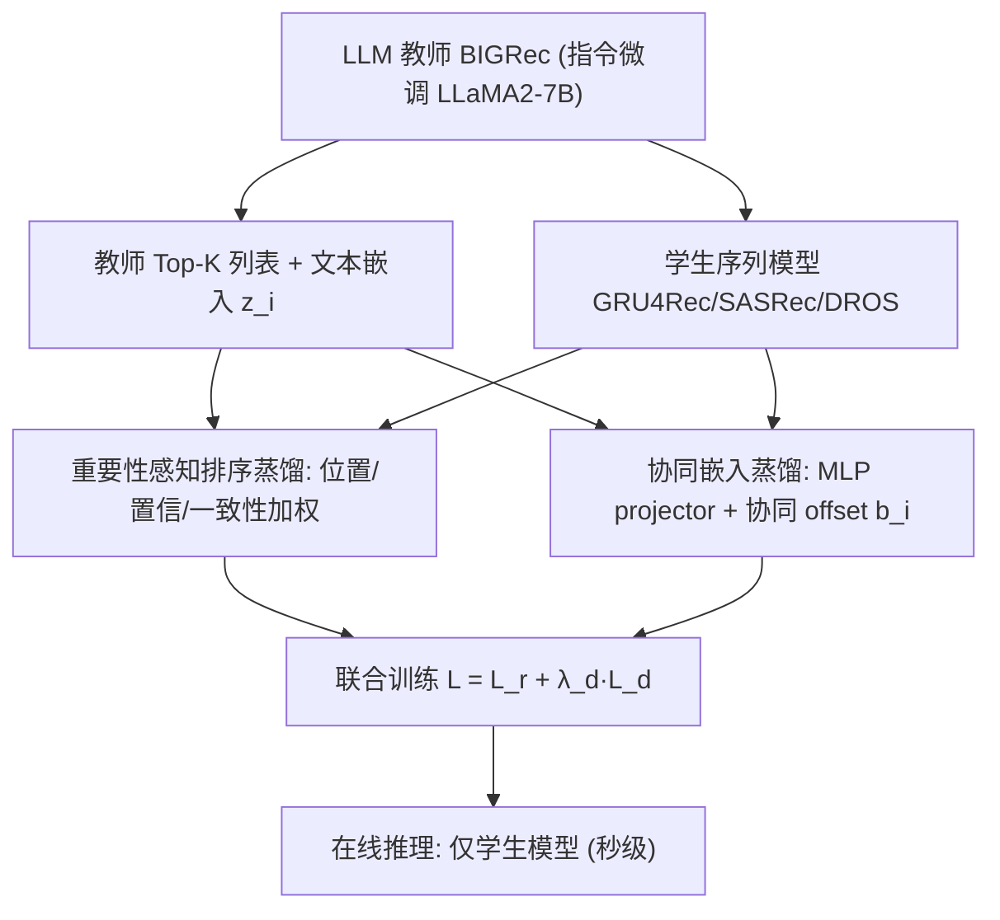
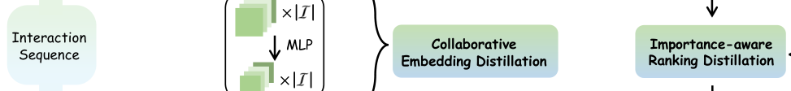

# Distillation Matters: Empowering Sequential Recommenders to Match the Performance of Large Language Model（蒸馏很重要：让序列推荐器追平大语言模型性能）

- **会议/期刊**: RecSys 2024
- **作者与机构**: Yu Cui, Jiawei Chen (浙江大学)；Feng Liu, Yi Wan, Jun Wang (OPPO研究院)；Pengbo Wang (UESTC)；Bohao Wang, Heng Tang (ZJU)
- **推荐链路定位**: 精排（训练期离线蒸馏，在线仅部署学生模型）
- **研究方向**: 大语言模型推荐 (LLM4Rec) / 序列与会话推荐
- **论文原文**: [https://arxiv.org/abs/2405.00338v3](https://arxiv.org/abs/2405.00338v3)
- **开源代码**: [https://github.com/istarryn/DLLM2Rec](https://github.com/istarryn/DLLM2Rec)

## TL;DR (1分钟核心速览)

LLM 推荐器（BIGRec/LLaMA2-7B）精度高但单次推理需 $10^4$ 秒量级、无法上线；本文把它的知识蒸馏进轻量序列模型：用「位置+置信度+师生一致性」三重权重过滤不可靠且学生易吸收的排序知识，用「MLP projector + 自由协同 offset」替代盲目嵌入对齐。在 Games/MovieLens/Toys 三数据集、GRU4Rec/SASRec/DROS 三种学生上平均提升 **47.97%**，推理降至 1.7–1.8s，部分指标反超教师。

## Background & Motivation (背景与核心矛盾)

- **主流范式**: LLM 直接作推荐器（BIGRec 指令微调 + 生成 item 描述后 grounding 排序），精度显著优于 DROS 等序列模型（Games +12.47% HR@20）。
- **前人局限**: (1) 推理成本爆炸——BIGRec 单轮全库推理需 $2.3\times10^4$ s（4×A800），比 DROS 的 1.8s 慢 6 个数量级；(2) 常规 KD 方法移植失败——Hint/HTD 直接对齐嵌入甚至低于「不蒸馏」。
- **核心洞察 (Key Insight)**: 作者实测发现 (a) 教师并非处处更强——在 Games/MovieLens/Toys 上分别有 **46.1%/59.1%/33.3%** 的 case BIGRec 不如 DROS；(b) 师生 Top-20 推荐重叠率仅 **3.99%/4.06%/1.05%**，机制差异巨大；(c) 重叠项命中率显著高于单侧项（Toys：3.74% vs 0.17%/0.08%），说明「共识即可靠」。
- **本文切入点**: 把蒸馏目标从「复制教师」改为「筛选教师中可靠且学生吃得下的部分」，并用 offset 保住学生自身的协同信号。

## Method (核心方法设计)

### 1. 整体框架 (Overall Architecture)

教师侧用指令微调后的 LLaMA2-7B（BIGRec）输出 Top-K 推荐列表与 item 文本嵌入；学生侧为 GRU4Rec/SASRec/DROS 等序列模型。训练时同时施加两路蒸馏：排序侧以三重重要性权重对教师 Top-K 的正项做加权 BCE；嵌入侧先用 MLP projector 把教师文本嵌入投到学生空间，再叠加可学协同 offset 生成“增强 item 嵌入”参与打分。总目标 $\mathcal{L}=\mathcal{L}_r+\lambda_d\mathcal{L}_d$，LLM 只在离线训练期调用一次，在线推理零额外开销。

<figure class="paper-figure" markdown="span">
  <figcaption>图1：所提出的 DLLM2Rec 示意图，其将基于 LLM 的推荐器的知识蒸馏到传统推荐器，并利用重要性感知的排序蒸馏和协同嵌入蒸馏。</figcaption>
</figure>

### 2. 关键设计拆解 (Key Designs)

1. **重要性感知排序蒸馏 (Importance-aware Ranking Distillation)**：针对教师幻觉与不可靠 Top-K，不再对教师列表“照单全收”，而是逐样本加权：
$w_{si}=\gamma_p w^p_{si}+\gamma_c w^c_{si}+\gamma_o w^o_{si}$，其中位置项$w^p_{si}\propto\exp(-r_i/\beta)$、置信项$w^c_{si}\propto\exp(-d_{si^*}/\beta)$（$d_{si^*}=\lVert z^g_s-z_{i^*}\rVert_2$衡量生成描述与真值 item 描述的语义距离，越大越像幻觉）、一致性项$w^o_{si}=\mathbb{I}[i\in O^T\cap O^S]$。蒸馏损失$\mathcal{L}_d=-\sum_{s\in\Gamma}\sum_{i\in O^T}w_{si}\log\sigma(\hat{y}_{si})$。梯度$\partial\mathcal{L}_d/\partial\hat{y}_{si}=w_{si}\sigma(-\hat{y}_{si})$ 揭示：学生已排高的项梯度小、易吸收，故上抬共识项可降低学习难度——这与 RD/DCD 类“差异越大越加权”的策略恰好相反。

2. **协同嵌入蒸馏 (Collaborative Embedding Distillation)**：针对文本语义空间与协同 ID 空间的鸿沟，先投影 $z^p_i=g(z_i)$（MLP），但不直接对齐$e_i\leftrightarrow z^p_i$，而是构造$e^{new}_i=f(z^p_i,b_i)=z^p_i+b_i$：$b_i$ 为每 item 自由可学的 offset，专门吸收行为共现信号。物理直觉是“教师给语义底座、数据补协同修正”，避免强行对齐破坏学生原有协同表征。

3. **训练目标、负采样与推理效率**：学生沿用原序列模型的 BCE + 采样负样本 $\mathcal{L}_r$，加蒸馏项得$\mathcal{L}=\mathcal{L}_r+\lambda_d\mathcal{L}_d$，$\lambda_d\in\{0.1,\dots,1.0\}$网格搜索；$\beta=1.0,\gamma_p=0.3,\gamma_c=0.5,\gamma_o=0.1$，嵌入维度$d=64$。无需额外负采样设计；推理阶段完全不触 LLM。

## Experimental Setup & Evaluation Protocol (实验设置与评估协议)

- **数据集与预处理**: 沿用 BIGRec/DROS 的预处理；MovieLens-10M 因序列过多，采样 10 万训练序列 + 1 万测试序列。

| 数据集 | #Users | #Items | #Interactions | 稀疏度/密度 | 特征/场景说明 |
| :--- | :---: | :---: | :---: | :---: | :--- |
| Games | 55,223 | 17,408 | 497,577 | 0.0518% | Amazon 游戏，含标题文本 |
| MovieLens-10M | 69,878 | 10,681 | 1,320,000 | 0.1769% | 采样 10w/1w 序列 |
| Toys | 19,412 | 11,924 | 167,597 | 0.0724% | Amazon 玩具，含标题文本 |

- **数据划分与防穿越 (Splitting Strategy)**: 按时间戳升序的 `8:1:1 比例划分`（每条序列切 train/valid/test），无跨用户泄漏。
- **排名评测协议 (Ranking Protocol)**: 报告 HR@20 / NDCG@20；教师侧重排（grounding）是对**全库 item 描述做 L2 距离排序**，属全库排序；学生侧训练用采样负样本，测试沿用各 backbone 的原始评测实现（原文未明示候选集规模与正负比，存在师生打分协议不完全对齐的隐忧）。
- **对比基线与超参设置**: 基线含嵌入蒸馏 (Hint, HTD)、排序蒸馏 (RD, CD, RRD, DCD, UnKD)、LLM 增强 (KAR, LLM-CF) 与三种 backbone 原模型；教师固定 BIGRec(LLaMA2-7B)；Adam, lr=1e-3, batch=256, dropout=0.1；提升幅度未做显著性检验说明。

## Key Experimental Results (实验关键数据)

### 1. 主实验对比 (Main Results)

| 模型 (backbone) | Games HR@20 | Games NDCG@20 | ML HR@20 | ML NDCG@20 | Toys HR@20 | Toys NDCG@20 |
| :--- | :---: | :---: | :---: | :---: | :---: | :---: |
| BIGRec（教师, LLaMA2-7B） | 0.0532 | 0.0341 | 0.0541 | 0.0370 | 0.0420 | 0.0207 |
| SASRec + None | 0.0346 | 0.0190 | 0.0626 | 0.0228 | 0.0207 | 0.0130 |
| SASRec + Hint | 0.0358 | 0.0151 | 0.0576 | 0.0216 | 0.0242 | 0.0103 |
| SASRec + RD | 0.0513 | 0.0225 | 0.0778 | 0.0310 | 0.0397 | 0.0164 |
| SASRec + UnKD | 0.0447 | 0.0219 | 0.0667 | 0.0247 | 0.0335 | 0.0174 |
| SASRec + LLM-CF | 0.0559 | 0.0251 | 0.0837 | 0.0295 | 0.0335 | 0.0152 |
| **SASRec + DLLM2Rec** | **0.0600** | **0.0262** | **0.0840** | **0.0323** | **0.0409** | **0.0177** |
| DROS + None | 0.0473 | 0.0267 | 0.0852 | 0.0363 | 0.0231 | 0.0144 |
| DROS + RD | 0.0585 | 0.0310 | 0.0950 | 0.0383 | 0.0424 | 0.0220 |
| **DROS + DLLM2Rec** | **0.0751** | **0.0331** | **0.1063** | **0.0437** | **0.0463** | **0.0225** |
| `Improv.` (SASRec / DROS vs 学生原模型) | +73.6% / +58.8% | +38.3% / +23.9% | +34.2% / +24.8% | +41.9% / +20.4% | +97.7% / +100.4% | +36.4% / +56.4% |

三 backbone 平均提升 **47.97%**；相对最佳 KD 基线提升 +0.36%~+18.27%。效率侧：DROS+DLLM2Rec 推理 1.8s，BIGRec 为 $2.3\times10^4$ s。

### 2. 消融实验 (Ablation Study)

学生 backbone 为 DROS，指标 NDCG@20（HR@20 见原文表 8/9）：

| 变体 | Games | MovieLens | Toys |
| :--- | :---: | :---: | :---: |
| w/o all ranking distillation | 0.0301 | 0.0364 | 0.0177 |
| w/o 位置权重 $w^p$ | 0.0301 | 0.0429 | 0.0200 |
| w/o 置信权重 $w^c$ | 0.0300 | 0.0398 | 0.0205 |
| w/o 一致性权重 $w^o$ | 0.0311 | 0.0430 | 0.0208 |
| w/o all embedding distillation | 0.0323 | 0.0420 | 0.0194 |
| w/o 协同 offset $b_i$ | 0.0298 | 0.0425 | 0.0195 |
| 换 Hint / HTD 嵌入蒸馏 | 0.0244 / 0.0246 | 0.0344 / 0.0341 | 0.0159 / 0.0157 |
| **DLLM2Rec 完整版** | **0.0331** | **0.0437** | **0.0225** |

### 3. 关键实验发现 (Key Findings)

1. **学生可反超教师，且提升主要来自召回广度而非头部精度**：MovieLens 上 DROS+DLLM2Rec 的 HR@20 达 0.1063（教师 0.0541，+96.5%），Toys NDCG +8.70%；但 Games 上 NDCG@20 仍落后教师 2.99%，说明 LLM 在头部强相关项上的排序能力未被完全继承。
2. **嵌入蒸馏的“语义鸿沟”是首要风险源**：Hint/HTD 在 SASRec-Games 上 NDCG 仅 0.0151/0.0164，明显低于不蒸馏的 0.0190；加回 offset 后 DROS-Games 由 0.0298 回升至 0.0331（+11.1%），证实自由 offset 是保住协同信号的必需品而非装饰项。
3. **一致性权重比位置、置信权重更关键**：去掉 $w^o$ 使 DROS-Games HR@20 从 0.0751 掉到 0.0568（−24.4%），跌幅甚至超过整块排序蒸馏移除（0.0661）；蒸馏后师生 Top-20 重叠率由 3.99%/4.06%/1.05% 升至 10.88%/10.15%/14.56%，表明学生确实吸收了教师知识而非退化为原模型。

## Highlights & Limitations (亮点、对比与审稿批判)

- **与代表作对比 (vs. Prior Work)**: 与 RD/DCD/UnKD 等排序蒸馏的本质区别在于**加权方向相反**——后者按师生分歧加权、本文按师生共识与教师自信度加权；与 LLM-CF、KAR 相比，本文不在推理期使用 CoT 或外部知识检索，而是把能力一次性压进学生参数，在线开销为零；与 RLMRec 类“强对齐嵌入”相比，本文用 projector+offset 保留协同自由度的做法更适配异构教师。
- **可迁移亮点**: (1)「师生共识作为知识可靠性门控」可直接迁移到多教师、跨域教师蒸馏；(2)「投影后加自由 offset」是任何异构表征蒸馏（图教师→序列学生、多模态教师→ID 学生）的通用补丁。
- **审稿级局限批判**: (1) 仅验证单一教师 BIGRec(LLaMA2-7B)，未检验 GPT 系/更大教师或多教师投票，泛化性证据不足；(2) 评估协议存在不完全对齐——教师为全库 grounding 排序，学生训练用采样负样本，且原文未报告候选集规模与正负比，可能放大/压缩部分增益；(3) Toys 上 SASRec 相对最佳基线仅 +3.02%/+1.19%，小数据下收益不稳，且 $\gamma_p,\gamma_c,\gamma_o,\lambda_d$ 四参数需逐数据集网格搜索，工程调参成本偏高。

## Rating (四维评分)

- **方法创新性 (Novelty)**: ⭐⭐⭐⭐ （反向加权 + 共识门控与 offset 嵌入蒸馏组合新颖，且给出梯度视角的可吸收性解释，但组件本身均为 KD 经典范式的重构）
- **评估协议与实验扎实度 (Protocol & Experiments)**: ⭐⭐⭐ （3 数据集 × 3 backbone × 9 基线较完整，消融到位；但师生打分协议未对齐、无显著性检验、单教师设定削弱说服力）
- **写作与数学规范度 (Clarity & Rigor)**: ⭐⭐⭐⭐ （三大 challenge 与三大权重一一对应，公式简洁可复现；缺少复杂度分析与权重梯度推导的严格论证）
- **工业落地与复现价值 (Industrial & Practical Value)**: ⭐⭐⭐⭐⭐ （代码开源、学生模型零推理增量、6 个数量级延迟收益，是 LLM4Rec 真正可上线的工程路径）

