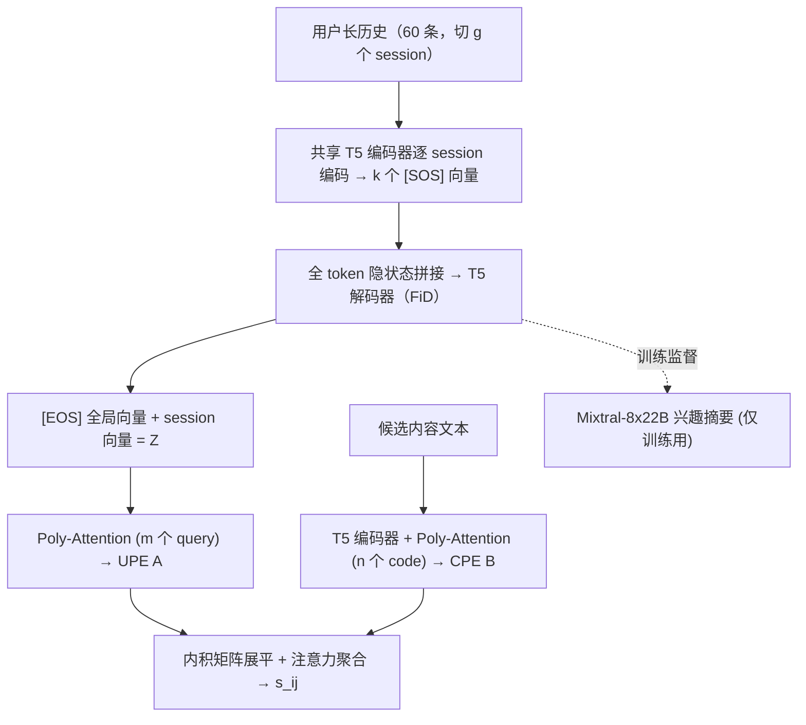
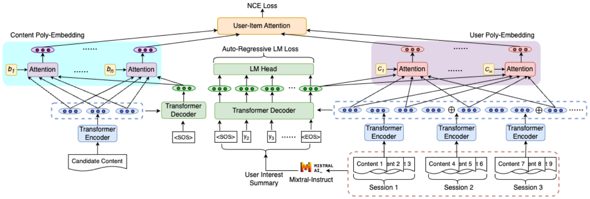

# EmbSum: Leveraging the Summarization Capabilities of Large Language Models for Content-Based Recommendations (借 LLM 摘要能力做内容推荐的双塔多向量表征)

- **会议/期刊**: RecSys 2024
- **作者与机构**: Chiyu Zhang, Yifei Sun, Minghao Wu, Jun Chen, Jie Lei, M. Abdul-Mageed, Rong Jin, Angli Liu, Ji Zhu, Sem Park, Ning Yao, Bo Long（UBC / Meta AI / Monash University / MBZUAI）
- **推荐链路定位**: 召回（双塔离线预计算 + 内积/ANN 检索）
- **研究方向**: 大语言模型推荐 (LLM4Rec) / 协同过滤与双塔召回
- **论文原文**: [https://arxiv.org/abs/2405.11441v2](https://arxiv.org/abs/2405.11441v2)
- **开源代码**: [https://github.com/reczoo/RecZoo](https://github.com/reczoo/RecZoo)（仅含 UNBERT 等基线复现，EmbSum 主体暂未开源）

## TL;DR (1分钟核心速览)

针对内容推荐中「长历史无法进 Transformer、候选若与用户实时交叉编码就无法离线预计算」两大痛点，EmbSum 用 T5 编码器按 session 独立编码长浏览历史、再用解码器以 Mixtral-8x22B 生成的用户兴趣摘要为监督信号做跨 session 融合，配 Poly-Attention 产出用户/内容多向量表征做内积打分。在 MIND-small 与 Goodreads 上以 61M 参数（UNBERT 的不到一半）取得 AUC 71.95 / 61.64，全面超越 125M 级 BERT 基线（AUC 相对 +0.31% / +0.39%，MRR +1.26% / +0.94%）。

## Background & Motivation (背景与核心矛盾)

- **主流范式**: PLM 内容推荐通常逐条编码历史文章后用注意力池化聚合（NAML/NRMS），或引入层级 local/global attention（UniTRec 用 BART 解码器困惑度打分）。
- **前人局限**: ① 注意力显存墙迫使 UniTRec 把历史截断到 1K token，长历史信息被浪费；② CAUM/MINER 类方法把候选内容直接塞进用户建模（candidate-aware attention），单塔实时交叉编码导致**无法离线预计算**用户向量，线上无法上 ANN 检索。
- **核心洞察 (Key Insight)**: 单纯把各 session 向量拼接/平均，无法刻画跨 session 的长程兴趣演化；而「用户兴趣的自然语言摘要」恰好是这种跨 session 交互信息的低熵压缩形式，LLM 已经能免费造出这种"软标签"。
- **本文切入点**: 让解码器以"生成 LLM 摘要"为训练任务，把跨 session 交互逼进隐状态，同时保持用户与内容完全解耦、可离线算向量。

## Method (核心方法设计)

### 1. 整体框架 (Overall Architecture)

用户侧：把最近 60 条交互按时间切成 $g$个 session，每个 session 用共享 T5-small 编码器独立编码，取每条内容首 token `[SOS]` 的隐状态得$k$个内容向量；再把所有 session 的**全部 token 隐状态拼接**（FiD 式融合）送入 T5 解码器，一边生成用户兴趣摘要（训练时由 Mixtral-8x22B 摘要监督），一边取其 `[EOS]` 隐状态作全局表征，与$k$个 session 向量拼成$Z\in\mathbb{R}^{(k+1)\times d}$，经 Poly-Attention 得用户多向量$A$。内容侧独立编码后用码本 Poly-Attention 得内容多向量$B$。两侧向量离线算好，线上仅做矩阵内积与注意力加权聚合打分。

<figure class="paper-figure" markdown="span">
  <figcaption>图1：我们的 EmbSum 框架概览。注意，LLMs 生成的用户摘要仅在训练中使用。</figcaption>
</figure>

### 2. 关键设计拆解 (Key Designs)

1. **Session 分组编码 + 摘要监督的跨 session 融合**：痛点是把 7000+ token 历史喂进注意力不现实、而简单聚合丢失 session 间关联。做法是 session 内独立编码，解码器以 $p(y\mid E)$自回归重建 LLM 摘要：$\mathcal{L}_{sum}=-\sum_{j=1}^{|y_{u_i}|}\log p(y_{u_i,j}\mid E, y_{u_i,<j})$。直觉上，要让 76 token 的摘要覆盖 60 条新闻的共性兴趣，解码器隐状态必须完成"跨 session 语义归并"，这比池化强硬得多；同时该摘要只在训练出现，推理零额外开销。
2. **User / Content Poly-Embedding（多向量码本）**：单向量无法容纳多兴趣、也无法表达内容的多侧面。用 $m$个（内容侧$n$个）可学习 query 做注意力抽取：$\alpha_a=\mathrm{softmax}[c_a\tanh(ZW_f)^{\top}]Z$，堆成$A\in\mathbb{R}^{m\times d}$（UPE 码本 32）与$B\in\mathbb{R}^{n\times d}$（CPE 码本 4）。不同 query 经 softmax 竞争性聚焦不同兴趣簇，等价于可学习的多原型聚类；消融显示 CPE 是最大增益源（去掉 AUC 掉 3.78）。
3. **匹配打分、损失与推理效率**：不像常规只取首 token 内积，而是先算全配对矩阵 $K_{ij}=\mathrm{flatten}(A_i^{\top}B_j)\in\mathbb{R}^{mn}$，再用内容侧注意力定权：$W_p=\mathrm{softmax}(\mathrm{flatten}(A\cdot \mathrm{gelu}(BW_s)^{\top}))$，$s_{ij}=W_p\cdot K_{ij}$，即"哪一对兴趣-侧面匹配更可信"由模型自选。总损失$\mathcal{L}=\mathcal{L}_{NCE}+\lambda\mathcal{L}_{sum}$，$\lambda=0.05$（验证集调）；$\mathcal{L}_{NCE}$为 softmax 对比损失，MIND 负采样比 4、Goodreads 为 2。线上用户向量与候选向量全部离线预算，打分退化为一次$m\times n$ 内积，可直接接 ANN。

## Experimental Setup & Evaluation Protocol (实验设置与评估协议)

- **数据集与预处理**: 新闻 MIND-small 与图书 Goodreads（评分 >3 为正、<3 为负），内容统一模板化为 `Title + Abstract + Category`，标题截 32/24 token、摘要截 72/85 token。

| 数据集 | #Users (train/dev/test) | #Items | #Interactions (正/负, test) | 稀疏度/密度 | 特征/场景说明 |
| :--- | :---: | :---: | :---: | :---: | :--- |
| MIND-small | 50,000 / 6,679 / 46,549 | 65K 新闻 | 100,608 正 / 2,380,008 负 | 极稀疏，test 负正比 ≈23.7:1 | 新闻标题+摘要+类目，18 类；test 中 41,020 为训练未见新用户 |
| Goodreads | 21,450 / 16,339 / 17,967 | 330K 图书 | 93,156 正 / 154,016 负 | 负正比 ≈1.65:1 | 书名+简介，11 类；test 中 3,199 为新用户 |

- **数据划分与防穿越 (Splitting Strategy)**: 官方 **比例划分**（Train/Dev/Test 用户不重叠），历史仅取目标交互之前的最近 60 条，严格时间序，无未来泄漏；Dev 上按 AUC 选模型后报 Test。
- **排名评测协议 (Ranking Protocol)**: 并非小比例采样，指标在**测试集全部标注正负样本**上计算（MIND test 含 238 万负样本），接近 `Full-Ranking` 语义；训练阶段才施加 4:1 / 2:1 负采样。
- **对比基线与超参设置**: 从零训练组 NAML/NRMS/Fastformer/CAUM/MINS，PLM 组 NAML-PLM/UNBERT/MINER（RoBERTa-base 125M）与 UniTRec（BART 139M）；EmbSum 主干仅 T5-small 61M，$d$取 T5-small 隐维度 512，lr$5e^{-4}$、batch 128、10 epoch；★ 注：原文未报告显著性检验（无$p$ 值），提升幅度普遍 <1%。

## Key Experimental Results (实验关键数据)

### 1. 主实验对比 (Main Results)

| Dataset | Model | AUC | MRR | nDCG@5 | nDCG@10 |
| :--- | :--- | :---: | :---: | :---: | :---: |
| MIND | NAML | 66.10 | 34.65 | 32.80 | 39.14 |
| MIND | NRMS | 63.28 | 33.10 | 31.50 | 37.68 |
| MIND | CAUM | 62.56 | 34.40 | 32.88 | 38.90 |
| MIND | NAML-PLM | 67.01 | 35.67 | 34.10 | 40.32 |
| MIND | UNBERT | 71.73 | 38.06 | 36.67 | 42.92 |
| MIND | MINER | 70.20 | 38.10 | 36.35 | 42.63 |
| MIND | UniTRec | 69.38 | 37.62 | 36.01 | 42.20 |
| MIND | **EmbSum** | **71.95** | **38.58** | **36.75** | **42.97** |
| MIND | Improv. vs best baseline | +0.31% | +1.26% | +0.22% | +0.12% |
| Goodreads | NAML | 59.35 | 72.16 | 53.49 | 67.81 |
| Goodreads | NRMS | 60.51 | 72.15 | 53.69 | 68.03 |
| Goodreads | CAUM | 55.13 | 73.06 | **54.97** | 69.02 |
| Goodreads | NAML-PLM | 59.57 | 72.54 | 53.98 | 68.41 |
| Goodreads | UNBERT | 61.40 | 73.34 | 54.67 | 68.71 |
| Goodreads | MINER | 60.72 | 72.72 | 54.17 | 68.42 |
| Goodreads | UniTRec | 60.00 | 72.60 | 53.73 | 67.96 |
| Goodreads | **EmbSum** | **61.64** | **73.75** | 54.86 | **69.08** |
| Goodreads | Improv. vs best baseline | +0.39% | +0.94% | −0.20% | +0.09% |

### 2. 消融实验 (Ablation Study)

| 变体 | MIND AUC | ΔAUC | Goodreads AUC | ΔAUC |
| :--- | :---: | :---: | :---: | :---: |
| EmbSum 完整 | **71.95** | — | **61.64** | — |
| w/o CPE（内容只用 `[SOS]` 单向量） | 68.17 | −3.78 | 60.97 | −0.67 |
| w/o session grouping（逐条编码） | 71.34 | −0.61 | 61.39 | −0.25 |
| w/o UPE（用户码本降为 1 向量） | 71.41 | −0.54 | 61.35 | −0.29 |
| w/o $\mathcal{L}_{sum}$（解码器只喂 `[SOS]`） | 71.43 | −0.52 | 61.50 | −0.14 |

### 3. 关键实验发现 (Key Findings)

1. **内容侧多向量远比用户侧重要**：去掉 CPE 在 MIND 上掉 3.78 AUC，是其余任一组件（≤0.61）的 6 倍以上；说明在"一用户对一候选"的打分场景里，候选的多侧面表达决定匹配分辨率上限，用户侧码本 32 已接近饱和（16/32/48 → 70.46/70.76/70.58）。
2. **摘要监督是"廉价但真实"的增益**：去掉 $\mathcal{L}_{sum}$ 掉 0.52 AUC（MIND），与去掉用户码本的 0.54 几乎等价，却完全不增加推理开销——等价于把一次昂贵的 LLM 前向蒸馏进 61M 编码器的隐空间；自生成摘要对 LLM 参考的 ROUGE-L 达 39.12（MIND）/28.16（Goodreads），GPT-4 盲评 492/500 判为 A/B 级。
3. **小模型 + 解耦结构打赢大模型单塔**：61M 的 EmbSum 在 MIND 全面超过 125M 的 UNBERT/MINER 与 139M 的 UniTRec，说明长历史的"session 化 + 摘要融合"比单纯堆 PLM 参数更有效；但 Goodreads nDCG@5 仍输给 CAUM（54.86 vs 54.97），表明图书域兴趣更集中、candidate-aware 单塔在该域仍有残值。

## Highlights & Limitations (亮点、对比与审稿批判)

- **与代表作对比 (vs. Prior Work)**: 与 MINER 都用 Poly-Attention，但 MINER 仅有单层多向量用户表征、无 session 结构与摘要监督；与 UniTRec 同为编码器-解码器，但 UniTRec 用解码困惑度打分、无法产出独立用户/内容向量，EmbSum 则能双塔离线预算；与 CAUM 的本质差别是彻底放弃 candidate-aware 实时交叉，换取可上线 ANN 的工程性。
- **可迁移亮点**: ① 用大模型生成的"用户画像文本"作隐空间对齐的辅助监督（teacher forcing 到 `[EOS]`），任何双塔模型都能零推理成本地加装；② session 化编码 + 全 token 隐状态拼接（FiD）是无损绕过注意力显存墙的通用套路。
- **审稿级局限批判**: ① 增益极薄且无显著性检验：MIND AUC +0.22、nDCG@10 +0.05，很难说服工程方承担 Mixtral-8x22B 对 94K 用户 × 60 条历史的标注成本（论文亦未讨论该成本的摊销）；② 评测仍属"标注负样本池内排序"，缺少严格全库 ANN 召回率与线上延迟/吞吐数据，且 Goodreads 上部分指标未达最优，泛化性证据偏弱。

## Rating (四维评分)

- **方法创新性 (Novelty)**: ⭐⭐⭐⭐ （"LLM 摘要作为隐空间监督信号"这一思路干净新颖，Poly-Embedding 组合虽源自 Set Transformer/MINER，但 session+摘要的融合方式有实质增量）
- **评估协议与实验扎实度 (Protocol & Experiments)**: ⭐⭐⭐ （两域交叉验证、消融齐全、含生成质量与超参敏感性分析，但测试用户大量为训练未见新用户却未单独报告冷启动分桶，且缺显著性检验）
- **写作与数学规范度 (Clarity & Rigor)**: ⭐⭐⭐⭐ （公式推导与模块职责清晰，$K_{ij}$ 展平与注意力加权聚合定义完整；负采样细节、评分聚合的复杂度分析略简）
- **工业落地与复现价值 (Industrial & Practical Value)**: ⭐⭐⭐⭐⭐ （彻底解耦的双塔 + 离线预计算 + 61M 轻量主干，天然适配 ANN 召回，是少数"能直接上线"的 LLM4Rec 方案；但训练期 LLM 标注成本与代码未完整开源是落地门槛）

