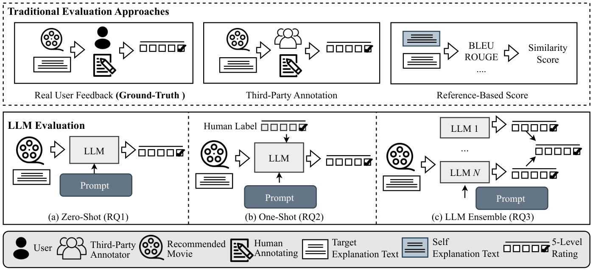
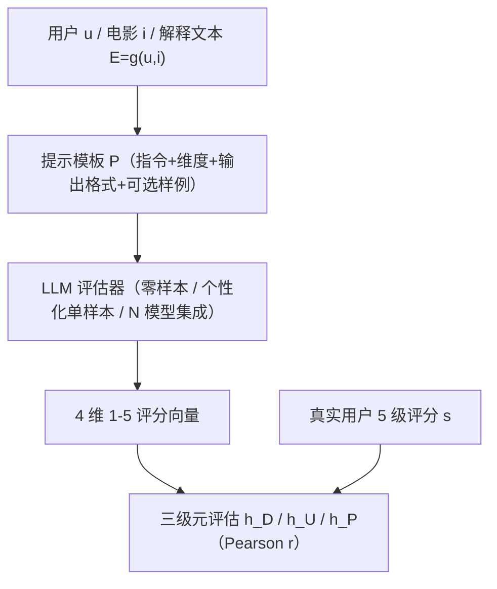
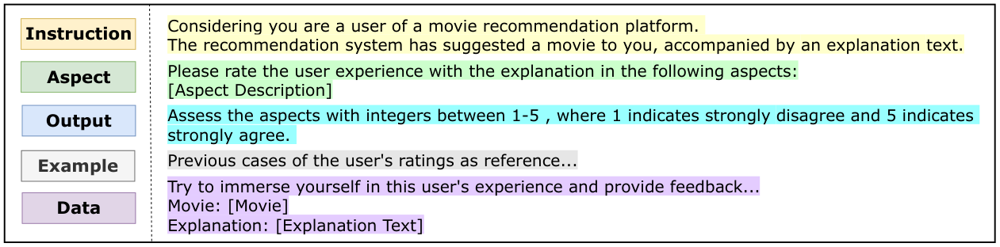

# Large Language Models as Evaluators for Recommendation Explanations (大语言模型作为推荐解释的评估器)

- **会议/期刊**: RecSys 2024
- **作者与机构**: Xiaoyu Zhang, Yishan Li, Jiayin Wang, Bowen Sun, Weizhi Ma, Peijie Sun, Min Zhang（清华大学）
- **推荐链路定位**: 离线评测（生成式解释文本的质量评估，不涉及在线排序链路）
- **研究方向**: 大语言模型推荐 / 对话与可解释推荐
- **论文原文**: [https://arxiv.org/abs/2406.03248v2](https://arxiv.org/abs/2406.03248v2)
- **开源代码**: [https://github.com/Xiaoyu-SZ/LLMasEvaluator](https://github.com/Xiaoyu-SZ/LLMasEvaluator)

## TL;DR (1分钟核心速览)

推荐解释文本的评测长期困在三难：真实用户调研最准但难获取、第三方标注可及但昂贵且主观维度失准、BLEU/ROUGE 无需标注但与人类感知脱节。本文以 39 名真实用户对 4 个维度（说服力/透明性/准确性/满意度）的 5 级评分为真值，构造 **3 级元评估协议**（Dataset / User / Pair-Level Pearson 相关）系统检验 LLM 能否充当评估器。结果显示 GPT-4（多方面提示）三级平均相关达 **21.07/21.90/23.63%**，超过第三方标注均值 18.65/18.42/17.10% 与 ROUGE-1-F 的 11.89/13.34/15.27%，相对提升约 **+13.0%（Dataset）/ +38.2%（Pair）**，而单条四维评测成本仅 \$0.0256，为人工标注 \$0.111 的 1/4。

## Background & Motivation (背景与核心矛盾)

- **主流范式**: 可解释推荐以模板化文本（如 "N% 与你口味相似的用户喜欢该片"）为主要形态，评测手段分为在线用户调研、第三方标注（众包/专家）与基于参考文本的 BLEU/ROUGE 相似度。
- **前人局限**: ① 用户真实反馈几乎不可能在公开数据集上批量获取，而第三方标注成本高、且对"准确性/满意度"这类强主观维度一致性差；② BLEU/ROUGE 强依赖参考文本（常用用户自写评论顶替），其 n-gram 共现度量与用户感知无因果关联。
- **核心洞察 (Key Insight)**: 解释质量是**主观且因人而异**的，同一评测器在"跨用户比较"与"同一用户-物品下比较不同生成器"两种粒度上表现可能完全相反（BLEU-4 在 Dataset-Level 甚至负相关 -2.16，Pair-Level 却有 11.21），因此单一级别的元评估会掩盖评测器真实能力。
- **本文切入点**: 不训练任何模型，直接用零样本/单样本/集成的 LLM 充当 `LLM-as-a-Judge`，并用三级分组相关拆解其能力边界。

<figure class="paper-figure" markdown="span">
  <figcaption>图1：传统评估方法与利用 LLMs 进行评估的对比。</figcaption>
</figure>

## Method (核心方法设计)

### 1. 整体框架 (Overall Architecture)

给定用户 $u$、物品$i$与生成器$g$产出的解释文本$E=g(u,i)$，评估器读取电影名、解释文本与英文提示模板$\mathcal{P}$，输出 4 维 1–5 整数评分向量；再以用户真值$s(u,i,E)$ 为基准，按 Dataset/User/Pair 三种粒度计算 Pearson 相关作为"评估准确率"。论文不涉及训练，全部为推理侧提示工程，三条支线分别为：零样本直接打分（RQ1）、把人类标签塞进提示做单样本上下文学习（RQ2，分个性化/非个性化）、以及多异构 LLM 打分求均值集成（RQ3）。真值来自 Lu et al. 的 39 用户电影推荐平台数据，另补两名第三方标注者与 BLEU/ROUGE 作为对照基线。

### 2. 关键设计拆解 (Key Designs)

1. **三级元评估协议 (3-Level Meta-Evaluation)**：此前 NLG 元评估只分 Dataset/Sample 两级，无法区分"能否捕捉用户打分偏置"与"能否在同组内排序"。本文按数据粒度分组后组内求相关再平均：
$$h_D(s,\hat{s})=r\big(\mathbf{s}_{1:|\mathcal{D}|},\hat{\mathbf{s}}_{1:|\mathcal{D}|}\big),\quad h_U=\frac{1}{|\mathcal{U}|}\sum_{u}r\big(\mathbf{s}_{\mathcal{D}_u},\hat{\mathbf{s}}_{\mathcal{D}_u}\big),\quad h_P=\frac{1}{|\mathcal{U}||\mathcal{I}_u|}\sum_{u,i\in\mathcal{I}_u}r\big(\mathbf{s}_{g_1..g_{|G|}},\hat{\mathbf{s}}_{g_1..g_{|G|}}\big)$$
直觉：$h_P$衡量"同一用户-物品下比较不同解释生成器"的能力（对应生成方法选型），$h_U$/$h_D$ 才暴露评估器能否学到"某用户整体打分偏高"这类个体偏置。

2. **个性化 vs. 非个性化单样本提示**：仅给一个样例时，样例选取方式决定 LLM 学到的是任务格式还是用户偏置。个性化设置取同一用户 $u$、同一生成器$g$在随机物品$i_0$上的真实评分$s_0^g$作为示例；非个性化则从随机$(u_0,i_0)$ 取。核心假设是前者让模型对齐用户打分偏置，从而抬升 Dataset/User-Level 相关，而后者只教格式。

3. **训练目标、负采样与推理开销**：本文**无训练目标、无负采样**（零样本/上下文学习，不使用微调）。提示采用多方面（4 维同时打分）版本，作者解释其相当于隐式 Chain-of-Thought；单条四维评测成本 GPT-4 多方面 \$0.0256，比单方面 \$0.0652 便宜约 2.5 倍，比人工 \$0.111 便宜约 4.3 倍。

<figure class="paper-figure" markdown="span">
  <figcaption>图2：本研究采用的评估提示模板概要。</figcaption>
</figure>

## Experimental Setup & Evaluation Protocol (实验设置与评估协议)

- **数据集与预处理**:

| 数据集 | #Users | #Items | #Explanations | 稀疏度/密度 | 特征/场景说明 |
| :--- | :---: | :---: | :---: | :---: | :--- |
| Movielens Latest (经 BiasedMF top-8 推荐) | 39 | 8/用户（共 312 对） | ≈2,500 | 每对约 8 条解释 | 中文模板解释（user-based / item-based / peer-explanation 等）+ 用户自写解释 |

- **数据划分与防穿越 (Splitting Strategy)**: 无训练/测试划分（零样本推理），不涉及防穿越；单样本提示中的示例从**同用户其他物品**采样（个性化）或**随机其他用户-物品对**采样（非个性化），与目标样本不重叠。
- **排名评测协议 (Ranking Protocol)**: **非排序任务**，不存在 Full-Ranking 或 Sampled Ranking；协议为"评估器评分 vs. 真实用户 5 级 Likert 评分"的 **3 级 Pearson 相关（Dataset / User / Pair-Level）**，四维分别为 Persuasiveness、Transparency、Accuracy、Satisfaction。用户标签缺失填 3（中性），LLM 解析失败填 0（施加惩罚）。
- **对比基线与超参设置**: 基线含 Random、BLEU-1/4、ROUGE-1-F/L-F、两名第三方标注者；LLM 评估器含 Llama2-7B/13B、Qwen1.5-7B/14B、GPT-3.5-Turbo、GPT-4，温度统一设为 0，输出解析为 1–5 整数。

## Key Experimental Results (实验关键数据)

### 1. 主实验对比 (Main Results)

三级 Pearson 相关（Dataset / User / Pair，%）：

| 评估器（提示） | Persuasiveness | Transparency | Accuracy | Satisfaction | **Average** |
| :--- | :---: | :---: | :---: | :---: | :---: |
| Random | -0.55/0.52/1.81 | 0.65/-0.43/-2.58 | -0.41/4.12/3.98 | 0.36/-2.26/5.88 | 0.01/0.49/2.27 |
| BLEU-1 | 11.68/15.84/17.07 | 10.06/12.69/14.44 | 6.43/10.71/12.18 | 11.36/12.91/15.79 | 9.88/13.04/14.87 |
| BLEU-4 | -1.17/7.68/13.53 | -3.47/4.13/10.24 | -4.63/4.80/8.96 | 0.61/6.86/12.09 | -2.16/5.86/11.21 |
| ROUGE-1-F | 14.16/16.39/17.56 | 11.93/12.74/14.45 | 8.61/11.02/12.83 | 12.87/13.20/16.23 | 11.89/13.34/15.27 |
| Annotator-1 | 19.88/18.31/16.72 | **15.66/16.18/11.31** | 10.16/9.78/9.77 | 14.93/13.28/12.69 | 15.16/14.39/12.62 |
| Annotator-2 | 21.40/21.17/20.90 | **25.97/26.42/27.84** | 10.96/10.96/9.32 | 8.86/9.72/9.43 | 16.80/17.07/16.87 |
| Annotator-Avg | 23.33/22.25/20.93 | 24.53/25.36/23.12 | 12.83/12.52/11.19 | 13.90/13.54/13.16 | 18.65/18.42/17.10 |
| Llama2-13B (M) | 17.04/17.33/18.56 | 4.26/3.41/10.25 | 3.59/2.10/2.24 | 17.93/16.82/18.52 | 10.71/9.92/12.39 |
| Qwen1.5-14B (S) | 7.13/6.92/7.01 | 22.61/22.75/22.33 | 28.65/30.71/35.11 | 13.88/13.68/13.94 | 18.07/18.52/19.60 |
| Qwen1.5-14B (M) | 25.85/26.53/32.28 | 18.16/18.45/22.03 | 12.25/11.32/15.26 | 15.82/14.83/18.26 | 18.02/17.78/21.96 |
| GPT-3.5 (S) | 26.81/26.36/29.58 | 20.62/21.22/25.01 | 16.33/15.56/17.93 | 9.95/7.75/6.33 | 18.43/17.72/19.71 |
| GPT-3.5 (M) | 26.41/26.36/28.20 | 11.16/9.86/11.38 | 12.09/10.63/11.15 | 20.93/19.56/20.78 | 17.65/16.61/17.88 |
| **GPT-4 (M)** | **27.26/28.25/28.99** | 12.68/12.17/13.26 | 20.30/22.04/24.93 | **24.05/25.12/27.35** | **21.07/21.90/23.63** |
| GPT-4 (S) | 18.36/19.78/22.03 | 20.17/21.57/23.62 | 14.46/15.61/14.33 | 7.49/5.92/3.17 | 15.12/15.72/15.79 |

**Improv.（GPT-4(M) vs. 最强传统基线）**：Dataset-Level 相对 Annotator-Avg **+13.0%**（21.07 vs 18.65）、相对 ROUGE-1-F **+77.2%**；Pair-Level 相对 Annotator-Avg **+38.2%**（23.63 vs 17.10）。

### 2. 消融实验 (Ablation Study)

提示粒度（Single-Aspect vs. Multiple-Aspect）消融，Average 列，%：

| 评估器 | Single (D/U/P) | Multiple (D/U/P) | Δ(Dataset) | 关键维度变化 |
| :--- | :---: | :---: | :---: | :--- |
| Llama2-7B | -1.48/-1.35/-2.14 | -1.27/-2.67/-9.44 | +0.21 | 全面失效，小模型不可用 |
| Llama2-13B | 3.60/4.44/5.39 | **10.71/9.92/12.39** | +7.11 | Satisfaction 17.93 vs -0.18 |
| Qwen1.5-7B | 3.90/4.51/4.89 | **8.65/8.49/10.87** | +4.75 | Satisfaction 10.63 vs -1.97 |
| Qwen1.5-14B | 18.07/18.52/19.60 | 18.02/17.78/21.96 | -0.05 | Accuracy 28.65→12.25（单方面更优） |
| GPT-3.5 | 18.43/17.72/19.71 | 17.65/16.61/17.88 | -0.78 | Satisfaction 9.95→20.93 |
| GPT-4 | 15.12/15.72/15.79 | **21.07/21.90/23.63** | +5.95 | Satisfaction 7.49→24.05，Transparency 20.17→12.68 |

另一组消融为上下文学习策略（GPT-4(M)）：零样本 → 非个性化单样本 → 个性化单样本，在 Persuasiveness 三维上整体单调抬升，个性化版本在**全部 12 个 (4 维 × 3 级) 组合**上均不劣于零样本，并首次使 $h_D$追平甚至超过$h_P$；而 Qwen1.5-14B(M) 上**非个性化单样本反而退化**，仅个性化单样本在 Accuracy/Satisfaction 上有增益。

### 3. 关键实验发现 (Key Findings)

1. **能力与成本双赢但维度分化**：GPT-4(M) 在最具主观性的 Satisfaction 上拿到 24.05/25.12/27.35（比第三方标注 13.54 高约 78%），却在客观的 Transparency 上仅 12.68/12.17/13.26，远低于标注者 24.53/25.36/23.12——说明 LLM 擅长贴合个体主观感受、不擅长判断"读者是否真懂推荐理由"，因此**不可单一指标整体替换人工**，需按维度分工。
2. **多方面提示即隐式 CoT，但会牺牲独立性**：GPT-4 由单方面切到多方面，Satisfaction 从 7.49/5.92/3.17 飙升至 24.05/25.12/27.35（Dataset 级 +17 点），而 Transparency 反向跌 7.5 点；这与"满意度是复合判断、透明性相对独立"的解释一致，也解释了多数模型在多方面设置下平均更优且交互次数更省。
3. **集成提升期望与下界，但对强主观维度有上限**：随 $N$从 1 增至 5，集成结果相关均值与下界在全部 12 个格子内单调上升，可修复 Qwen1.5-7B 在 Accuracy 上的崩坏；但在 Accuracy 上$N\ge 3$后上界开始回落（Llama2-13B、Qwen1.5-7B 在该维度本就偏弱，拖累均值），故推荐$N\approx3$ 的异构集成而非无限堆叠。

## Highlights & Limitations (亮点、对比与审稿批判)

- **与代表作对比 (vs. Prior Work)**: 与 RecExplainer（用 LLM 做推荐模型**可解释性对齐**）不同，本文评估的是**解释文本本身对用户的可用性**；与 ExpScore（训练模型从人类标签拟合评估函数）不同，本文完全免训练、可零样本迁移到新数据集；与 G-Eval 等通用 NLG 评估相比，本文首次指出推荐解释的多目标、强主观特性使评测器能力呈**维度依赖**，需三级粒度拆解。
- **可迁移亮点**: ① 三级分组相关协议可直接搬到任何"个性化文本生成"评测（评论生成、对话回复、推荐理由），用以分离"组内排序能力"与"个体打分偏置拟合能力"；② "多维度同时打分 = 隐式 CoT、省交互又提分"这一提示设计可作为 LLM-as-a-Judge 的默认范式。
- **审稿级局限批判**: ① 样本规模仅 39 用户 / 312 用户-物品对 / 约 2.5k 条中文文本，且解释以模板生成为主，缺乏跨语言、跨领域（电商/短视频）与自由生成解释的泛化验证，也未报告置信区间或显著性检验；② 以 Pearson 处理 5 级 Likert 序数标签存在方法论争议（未报 Spearman/Kendall），且 GPT-4 版本漂移使"可复现"主张打折；③ 单轮逐条打分，未考察列表级/成对比较（pairwise）评估与位置偏置，成本估算亦未纳入集成所需的 $N$ 倍调用。

## Rating (四维评分)

- **方法创新性 (Novelty)**: ⭐⭐⭐⭐ （首个针对推荐解释的 LLM 元评估研究，三级分组协议与个性化单样本设计具有方法论增量，但核心仍是提示工程而非新模型）
- **评估协议与实验扎实度 (Protocol & Experiments)**: ⭐⭐⭐⭐ （真值来自真实用户、四维 × 三级 × 6 个 LLM + 2 名标注者 + 4 个参考指标的对照相当完整，可惜样本量小且缺显著性检验）
- **写作与数学规范度 (Clarity & Rigor)**: ⭐⭐⭐⭐ （三级元评估的形式化定义清晰、RQ 与实验一一对应，成本表与提示模板附录透明；但部分结论仅以趋势图呈现，缺精确数值表）
- **工业落地与复现价值 (Industrial & Practical Value)**: ⭐⭐⭐⭐ （代码开源、无需训练、单条评测成本仅为人工 1/4，可即插即用于解释生成模块的 A/B 前置筛选；短板是闭源模型依赖与提示敏感性）

