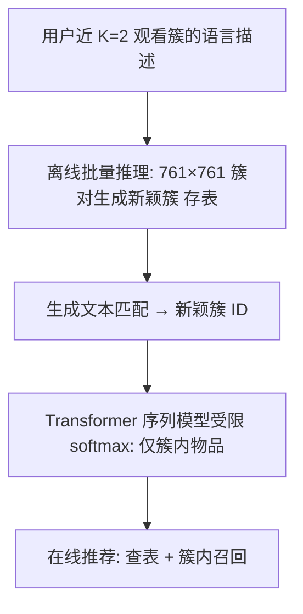

# LLMs for User Interest Exploration in Large-scale Recommendation Systems (面向大规模推荐系统用户兴趣探索的 LLM 方法)

- **会议/期刊**: RecSys 2024
- **作者与机构**: Jianling Wang*, Haokai Lu*, Yifan Liu, He Ma, Yueqi Wang, Yang Gu, Shuzhou Zhang, Ningren Han, Shuchao Bi, Lexi Baugher, Ed H. Chi, Minmin Chen（Google / Google DeepMind）
- **推荐链路定位**: 召回（兴趣簇级探索 → 物品级受限检索）
- **研究方向**: 大语言模型推荐 (LLM4Rec) / 强化学习与动态探索推荐
- **论文原文**: [https://arxiv.org/abs/2405.16363v2](https://arxiv.org/abs/2405.16363v2)
- **开源代码**: 暂未开源

## TL;DR (1分钟核心速览)

传统序列推荐从历史交互中学习，形成强反馈回路，用户被困在既有兴趣里产生内容疲劳；而直接用 LLM 做物品级推荐又会撞上"物品语料分钟级膨胀 + 缺协同信号 + 逐请求推理延迟不可接受"三堵墙。本文提出**混合分层规划**：高层由微调 LLM 在 761 个 level-2 兴趣簇空间内做**受控生成**，预测用户下一个"新颖兴趣簇"；低层把该簇作为约束，收紧 Transformer 序列模型的物品级 softmax。关键工程技巧是把 761² = 579,121 个簇对的 LLM 推理全部**离线批量算完存表**，线上退化为 O(1) 查表。十亿级用户短视频平台的活体实验显示：新颖曝光比例与正反馈率同时高于分层 Contextual Bandit 等全部基线，UCI@N 与总观看时长、活跃用户数均显著增长。

## Background & Motivation (背景与核心矛盾)

- **主流范式**: 以双塔 / Transformer 序列模型从用户历史正反馈中推断 next item，本质是"在系统已见过的内容分布内做插值"。
- **前人局限**: (1) PIE、Hierarchical Contextual Bandit 等探索方法虽引入新颖性标签或树状 LinUCB，但训练信号仍来自平台内部交互日志，探索空间被系统自身知识封闭；(2) 直接把 LLM 当推荐器，则面临物品库（每分钟数百小时上传）超出 LLM 世界知识、缺乏协同过滤信号、以及单请求 LLM 推理无法满足 $\mathcal{O}(100\text{ms})$ 时延与生产 QPS 的三重不可行。
- **核心洞察 (Key Insight)**: 物品级规划不可行，但**兴趣簇级规划是可枚举的**——level-2 仅 761 个簇，任意两个簇的历史组合只有 579,121 种，几小时即可用 LLM 批量穷举完毕。于是"昂贵推理"被搬到离线，"线上个性化"由域内序列模型承担。
- **本文切入点**: 用语言描述簇、用 SFT 让 LLM "说簇的语言"实现受控生成，再用簇 ID 约束经典推荐模型的 softmax 支撑域。

## Method (核心方法设计)

### 1. 整体框架 (Overall Architecture)

物品先由 256 维多模态 embedding（标题/话题标签/帧/音频）建图并做流量均衡聚类，递归 4 次得到 4 层兴趣树（$M_4>M_3>M_2>M_1$），取 level-2 共 761 簇以平衡粒度与规划空间。用户被表示为最近$K=2$ 个**唯一簇的关键词描述**而非物品序列，喂给微调后的 Gemini-Pro 生成"下一个新颖簇"；生成文本经匹配映射回簇 ID，再把 Transformer 序列推荐器的物品级 softmax 限制在该簇内做个性化检索。离线侧穷举全部簇对生成转移表，线上仅需采样 2 条高质观看历史→查表→受限检索，LLM 零在线开销。

### 2. 关键设计拆解 (Key Designs)

1. **簇级对象表示 + 离线穷举转移表（把 LLM 从在线链路摘出去）**：若以物品序列为输入，LLM 调用次数随物品数爆炸且长度不可控。本文改用簇描述压缩历史，并以"表"替代"推理"：$\mathcal{T}[(C_1,C_2)] = C^{\star},\ \forall (C_1,C_2)\in\mathcal{C}\times\mathcal{C}$，其中$|\mathcal{C}|=761$。$K=2$是有意为之的折中——既保留兴趣转移的判别力，又让枚举量落在几小时可算完的量级；未来增大$K$ 只需换稀疏表。物理直觉：用户兴趣的"跃迁"在粗粒度话题空间里是低频、可穷举的，细粒度个性化则交给 ID 类模型。
2. **多样化数据策划的 SFT 实现受控生成与行为对齐**：LLM 原始输出是自由文本，无法匹配预定义簇；且直接用日志样本微调会放大的长尾标签偏置。作者先从日志取约 250K 条"成功新颖转移"样本，再**按标签分组、每个标签只保留最高频的 10 个上下文簇对**，得到 $\mathcal{D}=\bigcup_{C_L}\mathrm{Top10}(C_L)$，$|\mathcal{D}|=761\times 10=7{,}610$，使各簇标签近乎均匀覆盖：
$$\mathcal{L}_{\mathrm{SFT}}=-\sum_{(C_1,C_2,C_L)\in\mathcal{D}}\log p_\theta\!\left(C_L \mid \mathrm{prompt}(C_1,C_2)\right)$$
多样化后，图 3 中"少数簇被高频生成"的 Region B 支配现象消失、低频簇（Region A）比例下降，相当于在生成端做了一次标签级去偏。
3. **低层受限物品策略与训练目标**：生成簇若直接走搜索引擎检索会丧失个性化（兴趣描述仍偏宽泛）。本文复用域内序列模型打分 $s_\phi(u,i)$，仅把归一化范围收窄到目标簇：
$$p(i\mid u,C^{\star})=\frac{\exp\!\left(s_\phi(u,i)\right)\cdot\mathbb{I}\!\left[c(i)=C^{\star}\right]}{\sum_{j}\exp\!\left(s_\phi(u,j)\right)\cdot\mathbb{I}\!\left[c(j)=C^{\star}\right]}$$
训练沿用原生产模型的下一物品正样本目标（无额外负采样改动），因此不引入新的训练成本；推理开销为"一次哈希查表 + 簇内受限 softmax"，与在线时延要求兼容。

## Experimental Setup & Evaluation Protocol (实验设置与评估协议)

- **数据集与预处理**: 本文不含公开数据集，全部来自某十亿级用户短视频商用平台的真实日志；论文未披露用户/物品规模与稀疏度，仅给出兴趣树与 SFT 数据统计：

| 资源/数据集 | 规模 | 构造与过滤方式 | 说明 |
| :--- | :---: | :--- | :--- |
| 物品兴趣树 | 4 层，level-2 共 761 簇 | 256 维元数据+内容 embedding 建图，流量均衡聚类递归 4 次 | 每物品在每层唯一归属，簇附关键词描述 |
| 历史转移日志 | ≈250K 条 $[(C_1,C_2),C_L]$| 仅保留"高质量交互"且$C_L$ 新颖的成功转移 | 采样近 30 天观看历史 |
| SFT 训练集 | 7,610 条 | 每标签取 Top-10 高频上下文簇对，标签均衡 | 多样性版本 vs 随机 7,610 条低多样性版本 |
| 穷举推理集 | 579,121 簇对 | $761\times761$ 全枚举，数小时批量推理 | 落表供线上查询 |

- **数据划分与防穿越 (Splitting Strategy)**: 采用**时间切分**——SFT 集外另留独立 test set 的转移样本；线上 A/B 为同期实验组 vs 对照组（对照不含本系统），避免未来信息泄漏。
- **排名评测协议 (Ranking Protocol)**: 不做离线全库 Full-Ranking 或采样排序评分，改以**在线活体指标**评估：新颖曝光比例（novel impressions，仅统计用户从未交互过的兴趣簇曝光占比）、正反馈率、UCI@N（7 天内消费过 ≥N 个不同簇的用户数，$N\in[20,200]$）、总观看时长与"观看 ≥10 分钟"活跃用户数。
- **对比基线与超参设置**: 探索导向——Novelty-enhanced 序列推荐、分层 Contextual Bandit（树状 LinUCB，作为相对提升的 0 参考）；利用导向——双塔模型、Transformer 序列模型。LLM 侧用 Gemini-Pro，$K=2$，batch size 16，微调 3,000 步；匹配率 >99% 后即可稳定映射簇 ID。

## Key Experimental Results (实验关键数据)

### 1. 主实验对比 (Main Results)

原文以图 4(b)(c) 与图 5 呈现相对提升百分比，具体数值已脱敏，故下表按**相对参考模型（Hierarchical Contextual Bandit = 0%）的定性排序**记录，"↑↑/↑/—" 表示相对强弱：

| 模型 | 类型 | 新颖曝光比例 ↑ | 正反馈率 ↑ | UCI@N (N=20–200) ↑ |
| :--- | :--- | :---: | :---: | :---: |
| Two-tower | 利用导向 | 最低 | 高 | 偏低 |
| Transformer 序列 | 利用导向 | 低 | **高（对标）** | 偏低 |
| Novelty-enhanced 序列 | 探索导向 | 中 | 明显下降 | 中 |
| Hierarchical Contextual Bandit | 探索导向（参考 0%） | 中 | 中 | 0（基准） |
| **本文 (LLM 混合分层)** | 探索导向 | **↑↑ 最优** | **↑↑ 接近利用导向** | **↑↑ 全 N 段显著** |

要点：本文是唯一在"新颖性 vs 质量"平面上同时向右（更新颖）和向上（正反馈不低于甚至接近纯利用模型）移动的方法，突破了此前"探索必牺牲满意度"的帕累托权衡（图 4b）。

### 2. 消融实验 (Ablation Study)

| 配置 | 生成匹配率 | 微调集 Recall | 测试集 Recall | 生成标签分布 |
| :--- | :---: | :---: | :---: | :--- |
| 低多样性 SFT 数据 | 高 | 高 | 较低 | 少数簇高频集中（Region B 主导） |
| **多样化 + 标签均衡（本文）** | **>99%** | **峰值** | **峰值 ≈0.026** | 长尾显著收敛 |
| 微调 ≈2,000 步 | ≈99% | 形成期 | 上升中 | 已掌握"簇语言"格式 |
| **微调 ≈3,000 步（采用）** | >99% | 对齐充分 | **最高** | — |
| 微调 >3,000 步 | >99% | 继续升高 | **开始下降（过拟合）** | — |

### 3. 关键实验发现 (Key Findings)

1. **格式学习先于行为对齐，存在明确的步数甜点**：匹配率在约 2,000 步即饱和（>99%），而测试集 recall 要到约 3,000 步才达峰（≈0.026）随后回落——说明"学会说簇的语言"与"学会用户的兴趣转移"是两个可分阶段，过量微调只会让模型背诵日志、丢弃世界知识。
2. **数据多样性而非数据量决定探索效率**：同样 7,610 条样本，按标签均衡挑选后高频簇垄断消失、低频簇比例下降，直接对应线上新颖曝光的更均衡覆盖；随机挑选的低多样性版本会放大反馈回路，抵消 LLM 本应带来的去偏能力。
3. **粗粒度枚举把 LLM 变成"可缓存的策略函数"**：761² ≈ 58 万簇对只需数小时离线批算，线上零 LLM 调用即获得新颖兴趣转移，因此该方法在保持 O(100ms) 级时延的同时，把 UCI@N 在 20–200 全区间显著推高，并带来总观看时长与"≥10 分钟活跃用户数"的持续正增长。

## Highlights & Limitations (亮点、对比与审稿批判)

- **与代表作对比 (vs. Prior Work)**: 相较 PIE / Hierarchical Contextual Bandit，本文的探索信号来自 LLM 的世界知识而非平台内部日志，因此能跳出闭环；相较"LLM 直接生成推荐"（如 GPT4Rec 类）或"LLM 做特征增强"（如 LLM-augmented 训练），本文既不承担在线 LLM 推理成本，也不只影响训练侧，而是直接在服务链路上改变候选簇分布。
- **可迁移亮点**: (1) "**枚举粗粒度空间 + 离线缓存策略表**"这一模式可迁移到任何低延迟要求下的 LLM 决策场景（如 next-POI 的区域级探索、冷启动类目探索）；(2) **按标签均衡的 SFT 数据策划**（每标签取 Top-10 上下文）是一种通用、廉价、无需重训即可缓解 LLM 生成长尾偏置的手段。
- **审稿级局限批判**: (1) **可复现性薄弱**——无公开数据集、无开源代码、结果仅以脱敏相对百分比呈现，缺少置信区间与显著性检验描述，学界难以验证；(2) **$K=2$的表达力与扩展性存疑**：仅用最近两个簇代表用户兴趣，长尾/多峰兴趣用户可能被过度简化，且查表规模随$K$指数增长（$761^K$），论文对$K>2$ 的可行性与延迟未做实测；(3) 缺少对"短期新颖性 vs 长期留存"的权衡建模，探索预算未做用户级控制，存在长期新颖性过度消耗的风险。

## Rating (四维评分)

- **方法创新性 (Novelty)**: ⭐⭐⭐⭐ （"簇级语言策略 + 物品级受限 softmax"的混合分层规划视角清晰，把 LLM 决策转成可穷举缓存是真正有工程洞察的抽象；但各组件本身均非全新）
- **评估协议与实验扎实度 (Protocol & Experiments)**: ⭐⭐⭐⭐ （十亿级平台活体 A/B、UCI@N 与用户增长双向验证很有说服力，反观离线可复现性与显著性统计几乎空白）
- **写作与数学规范度 (Clarity & Rigor)**: ⭐⭐⭐⭐ （框架图与受限 softmax、SFT 目标表述干净，受控生成的可实现性交代到位；但形式化推导较浅，$K$ 的复杂度分析缺失）
- **工业落地与复现价值 (Industrial & Practical Value)**: ⭐⭐⭐⭐⭐ （离线查表 + 簇内受限召回的方案直接解决时延与 QPS 两大落地死结，可直接复制到其他大规模探索场景；扣分项是未开源）

