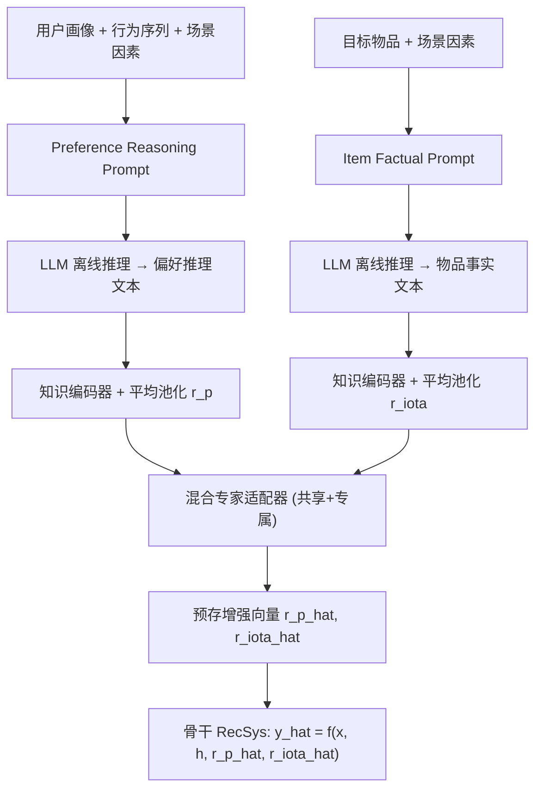

# Towards Open-World Recommendation with Knowledge Augmentation from Large Language Models (面向开放世界推荐的 LLM 知识增强框架)

- **会议/期刊**: RecSys 2024
- **作者与机构**: Yunjia Xi, Weiwen Liu, Jianghao Lin, Weinan Zhang, Yong Yu 等（上海交通大学 + 华为诺亚方舟实验室 / 华为消费者 BG）
- **推荐链路定位**: 精排（CTR 预估）与重排（Re-ranking），端到端离线知识预处理 + 在线轻推理
- **研究方向**: 大语言模型推荐 / CTR 预估与特征交叉
- **论文原文**: [https://arxiv.org/abs/2306.10933v4](https://arxiv.org/abs/2306.10933v4)
- **开源代码**: [https://github.com/YunjiaXi/Open-World-Knowledge-Augmented-Recommendation](https://github.com/YunjiaXi/Open-World-Knowledge-Augmented-Recommendation)

## TL;DR (1分钟核心速览)

现有推荐系统是"封闭系统"：训练数据只覆盖单一业务域，无法获取外部世界知识。本文提出 KAR，从 LLM 中抽取两类开放世界知识——**用户偏好推理知识**（由因子化提示诱导）与**物品事实知识**，再经混合专家适配器（共享专家 + 专属专家）压缩到推荐空间，作为额外特征域拼进任意 CTR/重排骨干。LLM 调用全离线预处理并预存，在线推理仅查表。在 MovieLens-1M 与 Amazon-Books 上以 AUC/LogLoss 评估，9 种骨干模型 AUC 普遍提升 1%–1.5%（FiBiNet 上 +1.49%，LogLoss −2.27%），重排任务 MAP@7 最高 +5.71%，华为新闻/音乐线上 A/B 分别 +7% 召回与 +1.7% 播放量。

## Background & Motivation (背景与核心矛盾)

- **主流范式**: 一类工作把 PLM/LLM 直接当推荐器（P5、TALLRec、ChatRec），把用户历史转成 prompt 让其输出推荐或评分；另一类把 PLM 当特征编码器（U-BERT、UniSRec、VQ-Rec），用文本 embedding 补强表征。前者依赖协同信号缺失的 LLM，后者只用百 M 级小模型，语义增益有限。
- **前人局限**: (1) **预测精度**——LLM 未经推荐域训练，零样本排序普遍不如经典推荐模型；(2) **推理延迟**——数十亿参数无法满足 100ms 级在线要求；(3) **组合性鸿沟 (compositional gap)**——LLM 能答对所有子问题却答不对组合问题，"一步到位出推荐"不现实。同时，知识图谱类增强只覆盖人工标注的物品侧事实，缺乏高动态的用户侧推理知识。
- **核心洞察 (Key Insight)**: 用户点击由多维因素驱动，因此可仿照 FM 把偏好"因子化"成若干场景因素（题材、导演、情绪、口碑…），将组合推理拆成单因素子问题，从而绕开组合性鸿沟；且推理/事实知识作为**静态预存向量**使用，完全规避在线 LLM 推理。
- **本文切入点**: LLM 只做一次离线的"知识生成器"，推荐模型仍负责协同信号建模——两者解耦，优势互补。

## Method (核心方法设计)

### 1. 整体框架 (Overall Architecture)

KAR 分三阶段闭环：(i) **知识推理与生成**——先由 LLM 与人工专家共同确定场景因素（电影：题材/导演/演员/主题/情绪/制作水准/口碑；新闻：话题/来源/地域/风格/时效…），再把用户画像 + 行为序列 + 因素列表填入 *preference reasoning prompt*，让 LLM 输出带证据的偏好推理；把目标物品 + 同一因素列表填入 *item factual prompt*，让 LLM 补齐数据集缺失的事实（如《罗马假日》"轻快俏皮的基调"）。(ii) **知识适配**——BERT/ChatGLM 编码文本并做平均池化得 $r_p, r_\iota$，再由混合专家适配器降到 32 维推荐空间。(iii) **知识利用**——两向量作为额外特征域与原始特征交叉，与骨干模型联合端到端训练；推理时仅查预存向量库。

### 2. 关键设计拆解 (Key Designs)

1. **因子化提示 (Factorization Prompting)**：直接问 LLM "该用户喜欢什么电影"会触发组合性鸿沟，且生成的宽泛事实与用户偏好错位。作者把偏好显式分解为场景因素集合，使每个子问题只需单步推理；物品提示复用同一因素集合，保证用户侧与物品侧知识在同一语义坐标下对齐。有效直觉：因素 = FM 中的隐向量维度，既降推理难度又建立可匹配的知识通道。
2. **混合专家适配器 (Hybrid-expert Adaptor)**：痛点有二——LLM 语义空间维度高（$m$约 4096）与推荐空间不匹配，且生成文本有幻觉噪声。设共享专家集$S_s$（抽取推理与事实的共性模式）与专属专家集$S_p, S_\iota$，门控软加权后降维：
$$\alpha_{p,i}=\mathrm{Softmax}(g_p(r_{p,i})),\quad \hat{r}_{p,i}=\sum_{e\in S_s}\alpha_{p,i,e}\,e(r_{p,i})+\sum_{e\in S_p}\alpha_{p,i,e}\,e(r_{p,i})$$
其中每个专家 $e(\cdot)$ 为 MLP（隐层 [128, 32]）。多专家集成既完成空间变换，又以类似模型平均的方式稀释单条幻觉知识，提升知识"可用性与可靠性"。
3. **训练目标、负采样与推理效率**：任务定义为多域类别特征上的二分类，损失即标准交叉熵，**不做负采样**（全量曝光样本训练，与 BPR/采样排序范式不同）。总目标为 $\mathcal{L}=-\frac{1}{N}\sum_i [y_i\log\hat{y}_i+(1-y_i)\log(1-\hat{y}_i)]$，其中$\hat{y}_i=f(x_i,h_i,\hat{r}_{p,i},\hat{r}_{\iota,i};\theta)$，仅改输入层因此与骨干损失无关。关键工程点：预存$r$或进一步预存$\hat{r}$（32 维），使推理复杂度从$O(f(n+2,m))$退化为$O(f(n,m))$；新用户/新物品先用默认向量，事后离线补生成。

## Experimental Setup & Evaluation Protocol (实验设置与评估协议)

- **数据集与预处理**:

| 数据集 | #Users | #Items | #Interactions | 稀疏度/密度 | 特征/场景说明 |
| :--- | :---: | :---: | :---: | :---: | :--- |
| MovieLens-1M | 6,040 | 3,706 | 1,000,209 | 密度 ≈ 4.5% | 用户年龄/性别/职业 + 物品 ID/类别 + 行为序列；评分 4–5 记正样本 |
| Amazon-Books | 11,906 | 17,332 | 1,406,582 | 密度 ≈ 0.68% | 无用户侧特征；评分 5 记正样本，过滤低频用户/物品 |

- **数据划分与防穿越 (Splitting Strategy)**: `比例划分`——**按 user ID 随机 90%/10% 切分训练/测试**（DIN 式处理），非全局时间戳切分，因此存在轻微"未来行为入训"风险；重排实验在 Amazon-Books 上做列表级评估。
- **排名评测协议 (Ranking Protocol)**: CTR 侧采用 `Pointwise 全样本 AUC / LogLoss`（非全库排序、非采样排序）；重排侧用 `MAP@K / NDCG@K`（K=3,7）对候选列表整体打分。作者援引前人结论：AUC 提升 0.001 即视为显著，并附 $t$-test（$p<0.05$，表中 `*`）。
- **对比基线与超参设置**: 骨干含 9 个 CTR 模型（DIN/DIEN/DCNv1/DCNv2/DeepFM/xDeepFM/FiBiNet/FiGNN/AutoInt）与 4 个重排模型（DLCM/PRM/SetRank/MIR）；语言模型基线为 P5(T5-223M)、UniSRec/VQ-Rec(BERT-110M)、LLM2DIN(ChatGLM-6B)、TALLRec(LLaMA2-7B-chat)。骨干 embedding 维度 32，适配器输出 32 维，共享专家 2–5 个、专属专家 2–6 个，学习率/批大小网格搜索。

## Key Experimental Results (实验关键数据)

### 1. 主实验对比 (Main Results)

**表 1：与语言模型增强基线对比（CTR 任务，DIN 为骨干）**

| Model | PLM | ML-1M AUC | ML-1M LogLoss | Amazon AUC | Amazon LogLoss |
| :--- | :--- | :---: | :---: | :---: | :---: |
| UniSRec | BERT-110M | 0.7702 | 0.5641 | 0.8196 | 0.5063 |
| VQ-Rec | BERT-110M | 0.7707 | 0.5641 | 0.8226 | 0.5025 |
| P5 | T5-223M | 0.7790 | 0.5543 | 0.8333 | 0.4908 |
| LLM2DIN | ChatGLM-6B | 0.7874 | 0.5473 | 0.8307 | 0.4930 |
| TALLRec | LLaMA2-7B | 0.7892 | 0.5451 | 0.8342 | 0.4862 |
| base (DIN) | — | 0.7863 | 0.5486 | 0.8304 | 0.4937 |
| **KAR (DIN)** | ChatGLM-6B | **0.7961\*** (+0.87%) | **0.5370\*** (−2.11%) | **0.8418\*** (+0.91%) | **0.4801\*** (−1.26%) |

**表 2：KAR 对 5 个代表骨干的提升（AUC / LogLoss）**

| Backbone | ML-1M base | ML-1M KAR | Improv. | Amazon base | Amazon KAR | Improv. |
| :--- | :---: | :---: | :---: | :---: | :---: | :---: |
| FiBiNet | 0.7820 / 0.5531 | **0.7936 / 0.5405** | +1.49% / −2.27% | 0.8269 / 0.4973 | **0.8351 / 0.4870** | +0.99% / −2.07% |
| AutoInt | 0.7821 / 0.5520 | **0.7931 / 0.5430** | +1.40% / −1.62% | 0.8262 / 0.4981 | **0.8357 / 0.4863** | +1.16% / −2.37% |
| DCNv2 | 0.7830 / 0.5516 | **0.7935 / 0.5410** | +1.34% / −1.92% | 0.8269 / 0.4973 | **0.8350 / 0.4865** | +0.98% / −2.17% |
| DeepFM | 0.7824 / 0.5518 | **0.7919 / 0.5432** | +1.22% / −1.56% | 0.8269 / 0.4969 | **0.8347 / 0.4873** | +0.94% / −1.93% |
| DIN | 0.7863 / 0.5486 | **0.7961 / 0.5370** | +1.24% / −2.10% | 0.8304 / 0.4937 | **0.8418 / 0.4801** | +1.38% / −2.77% |

**重排任务（Amazon-Books）**：PRM 骨干 MAP@3 0.6488→0.6877（**+6.00%**）、MAP@7 0.6359→0.6722（**+5.71%**）、NDCG@3 0.5909→0.6379（**+7.95%**）；MIR 增益最小（MAP@7 +0.96%），因 MIR 自身已建模历史-候选交互。

### 2. 消融实验 (Ablation Study)

**表 3：知识编码器与适配器结构消融（DIN 骨干）**

| Variant | ML-1M (BERT) | ML-1M (ChatGLM) | Amazon (BERT) | Amazon (ChatGLM) |
| :--- | :---: | :---: | :---: | :---: |
| base DIN | 0.7863 / 0.5486 | 0.7863 / 0.5486 | 0.8304 / 0.4937 | 0.8304 / 0.4937 |
| KAR(LR)：仅线性层预测 | 0.7589 / 0.5811 | 0.7720 / 0.5674 | 0.7375 / 0.5861 | 0.7560 / 0.5718 |
| KAR(MLP)：仅 MLP 预测 | 0.7754 / 0.5588 | 0.7816 / 0.5559 | 0.7424 / 0.5834 | 0.7571 / 0.5763 |
| KAR-MLP（替换适配器） | 0.7934 / 0.5411 | **0.7939 / 0.5401** | 0.8357 / 0.4880 | 0.8370 / 0.4843 |
| KAR-MoE（标准 MoE） | 0.7946 / 0.5391 | 0.7950 / 0.5394 | 0.8371 / 0.4841 | 0.8388 / 0.4823 |
| **KAR（完整）** | **0.7947 / 0.5402** | **0.7961 / 0.5370** | **0.8374 / 0.4843** | **0.8418 / 0.4801** |

另：以图 4 的 KG vs LLM 对比（DCNv1/DeepFM/DIN @ ML-1M）显示 LLM 知识增益显著大于知识图谱知识，且 "KG+LLM" 相对 "LLM" 几无增益；图 5 在 Amazon-Books 上显示 `Reas`（仅推理）> `Fact`（仅事实），`Both` 优于任一单独使用。

### 3. 关键实验发现 (Key Findings)

1. **推理性知识是主要增益来源，且与事实知识协同**：仅用偏好推理已优于仅用物品事实，二者合用出现 $1+1>2$ 的互补效应——因为推理知识中的外部信息只有在被"对齐的事实知识"匹配到具体候选物品后才能落地，这也解释了重排任务上 PRM（自身不建模历史）获得 +5.71% MAP@7 的最大涨幅。
2. **适配器复杂度与编码器容量需匹配**：ChatGLM 编码下 KAR 比 KAR-MLP 高 0.0022 AUC、比标准 MoE 高 0.0011，说明语义→推荐空间变换需要共享+专属专家结构；但换成 BERT 时 MoE 与 MLP 几乎持平（0.7946 vs 0.7934），印证小编码器信息量不足，复杂适配器无益。且 KAR(LR) 直接预测的 AUC 低至 0.7589，大幅落后，说明"知识可用但需与协同信号联合建模"。
3. **预存策略把 LLM 延迟从不可用降到可忽略**：单样本推理耗时 LLM API 5.54s、TALLRec 0.763s、KAR 带适配器 0.0808s、KAR 脱适配器 0.00664s，与 base DIN 的 0.00642s 基本持平（约 830 倍加速）；线上华为新闻召回 +7%，音乐播放量 +1.7%、播放设备数 +1.64%、总时长 +1.57%。

## Highlights & Limitations (亮点、对比与审稿批判)

- **与代表作对比 (vs. Prior Work)**: 与 TALLRec/LLM2DIN 这类"让 LLM 进推荐模型参数"的路线本质不同——KAR **不微调、不改 LLM**，只取文本知识并离线预存，因而免去推理延迟与隐私回传风险；与 UniSRec/VQ-Rec 这类小 PLM 编码器相比，KAR 用的是 LLM 的**生成式推理**而非单纯语义编码，且用 MoE 适配器解决 4096 维语义空间与 32 维推荐空间的错配；与 KG 增强相比，KAR 补齐了 KG 难以覆盖的**用户侧动态偏好推理**。
- **可迁移亮点**: (1) "因子化提示 + 双提示对齐"可作为任意 LLM 特征抽取任务的通用模板（同一因素集合同时约束用户侧与物品侧，天然可匹配）；(2) "离线预存 + 输入层注入"是把重模型能力接入低延迟推荐链路的低成本范式，适配器可训练后剥离。
- **审稿级局限批判**: (1) 场景因素依赖 LLM 生成 + 人工确认，虽称"每场景一次"，但在长尾业务/快速迭代场景下仍是不可忽视的人工与调参成本，且因素质量对最终增益敏感，论文未给出因素数量/质量的敏感性分析；(2) 评估层面存在两处薄弱：CTR 仅用 pointwise AUC/LogLoss 而未做全库排序或采样排序评测，数据按 user ID 随机 90/10 划分而非时间切分，存在行为穿越隐忧；离线仅覆盖 CTR 与重排，未验证召回/序列推荐场景；(3) 用户侧知识靠长期行为预存，短期兴趣漂移与冷启动物品只能先用默认向量兜底，热更新路径缺失。

## Rating (四维评分)

- **方法创新性 (Novelty)**: ⭐⭐⭐⭐ （"因子化提示解组合性鸿沟 + 混合专家适配器做语义→推荐空间变换"两个机制均有清晰动机支撑，但整体是工程化组合创新，理论新意有限）
- **评估协议与实验扎实度 (Protocol & Experiments)**: ⭐⭐⭐⭐ （13 个骨干模型 + 5 个 LLM 基线 + 双数据集 + 显著性检验 + 线上 A/B 覆盖充分，扣分在随机按用户划分与缺乏排序式评测）
- **写作与数学规范度 (Clarity & Rigor)**: ⭐⭐⭐⭐ （三阶段结构清晰、提示示例完整可复现，公式简洁但适配器门控与专家维度等细节偏少，复杂度分析仅给渐近结论）
- **工业落地与复现价值 (Industrial & Practical Value)**: ⭐⭐⭐⭐⭐ （代码与生成知识均已开源，预存向量使推理开销与骨干持平，并已在华为新闻/音乐双场景上线验证，落地证据罕见地扎实）

