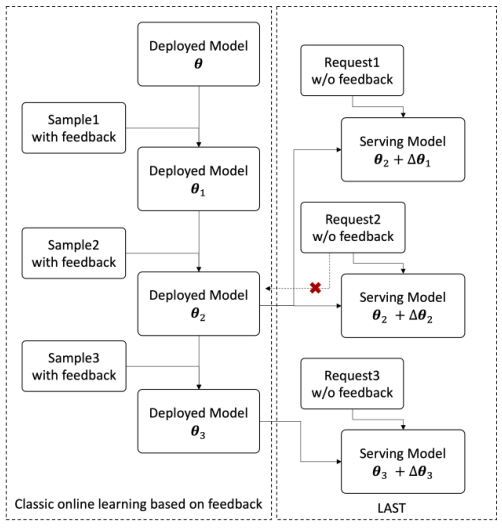
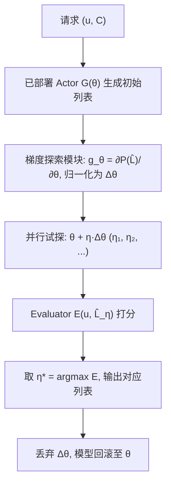
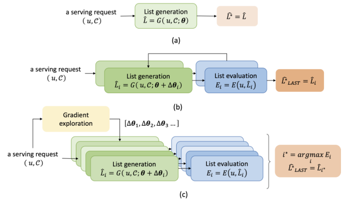

# Do Not Wait: Learning Re-Ranking Model Without User Feedback At Serving Time in E-Commerce (无需等待：电商场景下在服务时刻学习重排模型)

- **会议/期刊**: RecSys 2024
- **作者与机构**: Yuan Wang, Zhiyu Li, Quan Lin (阿里巴巴) ; Changshuo Zhang, Sirui Chen, Xiao Zhang, Jun Xu (中国人民大学高瓴人工智能学院/信息学院)
- **推荐链路定位**: 重排（Re-ranking，列表级生成）
- **研究方向**: 多任务学习与列表级重排 / 强化学习与动态探索推荐
- **论文原文**: [https://arxiv.org/abs/2406.14004v1](https://arxiv.org/abs/2406.14004v1)
- **开源代码**: [https://github.com/LibRerank-Community/LibRerank](https://github.com/LibRerank-Community/LibRerank)

## TL;DR (1分钟核心速览)

重排模型的在线学习长期受制于"反馈延迟"——购买信号可能滞后数小时乃至数天，且所有请求共享同一个静态模型实例。本文提出 LAST：在收到请求 $(u,\mathcal{C})$的那一刻，借助 Actor-Evaluator 框架中的代理评估器$E(\cdot)$现场求解一个**请求级、用完即弃**的参数增量$\Delta\boldsymbol{\theta}$，从而在无真实反馈的前提下完成模型自适应。在 LibRerank 基准（Ad2 数据集）的全库排序协议下，LAST 将 NDCG@10 从 0.7370 提升至 0.7418（+0.65%），线上淘宝"订阅"场景 A/B 测试中人均购买数 +2.08%、点击数 +0.08%。

## Background & Motivation (背景与核心矛盾)

- **主流范式**: 工业重排普遍采用 Actor-Evaluator 框架（CMR/EGR），先离线训练代理评估器拟合列表级奖励，再让生成器（Actor）最大化评估分数，以避免"列表排列爆炸"带来的标注难题；部署后靠在线学习用最新样本持续更新模型。
- **前人局限**: 其一，在线学习必须等真实反馈回流，购买标签滞后使得模型在流量高峰期一直"陈旧"；其二，任意时刻系统对所有请求都使用同一份固定参数，无法适配秒级内数万个请求各自的上下文差异。
- **核心洞察 (Key Insight)**: 评估器 $E(\cdot)$ 本身就在训练中学会了"预测用户反馈"，它是一个**不依赖真实标签的即时监督源**；既然评估器可随时调用，模型改进就不必等用户，可以直接在服务时刻完成。
- **本文切入点**: 把"在线学习"从持久化的参数积累，改造为对每个请求施加一次**瞬态参数扰动**——算完就丢，既捕捉请求上下文，又阻断评估器误差在时间轴上的传播。

<figure class="paper-figure" markdown="span">
  <figcaption>图 1：经典在线学习方法与我们的新方案 LAST。𝜽 表示模型参数。经典方法依赖真实用户反馈，提供持久的、非请求特定的更新。LAST 借助代理评估模型提供瞬时的、请求特定的更新。二者可协同工作，构建更具适应性和响应性的在线服务系统。</figcaption>
</figure>

## Method (核心方法设计)

### 1. 整体框架 (Overall Architecture)

收到请求后，已部署的 Actor $G(\cdot;\boldsymbol{\theta})$先生成初始列表$\hat{L}$；独立的**梯度探索模块**依据列表生成概率$P(L)$对参数$\boldsymbol{\theta}$的梯度构造候选修正方向$\Delta\boldsymbol{\theta}$，并配一组步长$\{\eta_1,\eta_2,\dots\}$并行生成多份、"试探性"参数副本$\boldsymbol{\theta}+\eta\Delta\boldsymbol{\theta}$；每份副本各产出一个候选列表，由评估器$E(u,\hat{L}_\eta)$打分，取得分最高者返回给用户。请求结束后$\Delta\boldsymbol{\theta}$被丢弃，线上模型回滚到原始$\boldsymbol{\theta}$。该设计与反馈驱动的经典在线学习完全正交，可叠加共存。

<figure class="paper-figure" markdown="span">
  <figcaption>图 2：重排序模型的在线服务过程。(a) 传统重排序模型。模型基于其固定策略生成推荐列表，并直接将列表呈现给用户。(b) LAST 的级联版本。执行器与评估器迭代交互，以改进其列表生成策略，从而获得更高评价。最后一次迭代生成的列表呈现给用户。(c) LAST 的并行版本。一个独立的梯度探索模块提出潜在的模型修改建议。执行器尝试这些建议，评估器进行估计。</figcaption>
</figure>

### 2. 关键设计拆解 (Key Designs)

1. **请求级瞬态修正算子 (Transient Request-Specific Modification)**：为破除"反馈滞后 + 全局单模型"双瓶颈，把学习目标从"更新部署参数"改为"在请求点邻域内搜索参数"：
$\Delta\boldsymbol{\theta}^{*}(u,\mathcal{C}) = \arg\max_{\Delta\boldsymbol{\theta}} E\big(u, G(u,\mathcal{C};\boldsymbol{\theta}+\Delta\boldsymbol{\theta})\big),\quad \hat{L}^{*}_{LAST}=G(u,\mathcal{C};\boldsymbol{\theta}+\Delta\boldsymbol{\theta}^{*})$。
直觉上这是一次"以评估器为目标的单样本微调"，而用完即弃保证了即便评估器在此请求上有偏，误差也不会被写回模型。

2. **双向列表概率梯度的并行探索 (Parallel Gradient Exploration)**：直接对 $E$求$\partial E/\partial\boldsymbol{\theta}$往往不存在（$E$未必是$\boldsymbol{\theta}$ 的函数），且回传整套亿级参数不现实。作者改而只沿两个特殊方向探索——提高当前列表生成概率的正向与反向：
$\boldsymbol{g}_{\boldsymbol{\theta}}=\frac{\partial P(\hat{L})}{\partial\boldsymbol{\theta}},\quad \Delta\boldsymbol{\theta}=\alpha\frac{|\boldsymbol{\theta}|}{|\boldsymbol{g}_{\boldsymbol{\theta}}|}\boldsymbol{g}_{\boldsymbol{\theta}},\quad \eta^{*}=\arg\max_{\eta}E(u,\hat{L}_{\eta})$。
$E$只用于校准幅度而非决定方向（与离线训练"奖励高则提概率"同构）。按$|\boldsymbol{\theta}|/|\boldsymbol{g}_{\boldsymbol{\theta}}|$ 归一化使不同层共享同一相对步长，避免深层网络梯度尺度失衡；同时只修改关键子集参数以控制延迟。

3. **训练目标、监督信号与推理开销**：离线阶段评估器以 $\min_{\phi}\mathbb{E}[\,diff(E(u,L;\phi),R(u,L,y_L))\,]$拟合列表奖励，Actor 以$\max_{\boldsymbol{\theta}}\mathbb{E}_{u,\mathcal{C}}[E(u,G(u,\mathcal{C};\boldsymbol{\theta}))]$训练，**全程不依赖真实列表标签**。服务时无需负采样，仅需$1+|\{\eta\}|$ 次前向（并行版），代价是固定倍数的推理放大；级联版反复"预测—评估—更新"至收敛，精度更高但响应时间显著上升。

## Experimental Setup & Evaluation Protocol (实验设置与评估协议)

- **数据集与预处理**: 离线实验基于 LibRerank 基准的公开数据集 Ad2（阿里妈妈展示广告）；论文正文将统计细节放入 Auxiliary Materials，未在正文披露过滤阈值，故下表仅标注可得信息：

| 数据集 | #Users | #Items | #Interactions | 稀疏度/密度 | 特征/场景说明 |
| :--- | :---: | :---: | :---: | :---: | :--- |
| Ad2 (LibRerank 默认配置) | 正文未披露 | 正文未披露 | 正文未披露 | 正文未披露 | 电商展示/点击日志，候选池 $M$内取长度$N$ 的列表，日志含点击反馈 |
| Taobao "Subscribe" 线上 | 线上真实流量 | 电商商品池 | 实时请求流 | — | 手机淘宝订阅场景，A/B 实验 |

- **数据划分与防穿越 (Splitting Strategy)**: 沿用 LibRerank 默认的请求级切分（训练/验证/测试按请求划分，同一请求的候选集与列表不跨集合），评估器与 Actor 分阶段训练以避免信息穿越。
- **排名评测协议 (Ranking Protocol)**: 组内**全候选排序**（每个请求在 $M$个候选上生成完整长度$N$ 的列表），指标为 map@5/10 与 ndcg@5/10；第二组实验改用连续型 `evaluator@5/@10`（前 N 项平均点击概率），以规避离散指标的"悬崖效应"。
- **对比基线与超参设置**: 非 AE 基线 GSF、DLCM、SetRank、PRM；AE 基线 EGR、CMR(Greedy)、CMR(Sampling)。AE 类模型在表 1 中以 NDCG 为评估函数、在表 2 中以预训练点击率评估器为评估函数。显著性检验为 $p<0.05$；核心超参为归一化因子$\alpha$（最优 1%）与步长列表长度。

## Key Experimental Results (实验关键数据)

### 1. 主实验对比 (Main Results)

| 方法 | map@5 | map@10 | ndcg@5 | ndcg@10 | evaluator@5 | evaluator@10 |
| :--- | :---: | :---: | :---: | :---: | :---: | :---: |
| GSF | 0.6038 | 0.6074 | 0.6838 | 0.6984 | — | — |
| DLCM | 0.6169 | 0.6201 | 0.6948 | 0.7080 | — | — |
| SetRank | 0.6084 | 0.6122 | 0.6878 | 0.7020 | — | — |
| PRM | 0.6176 | 0.6209 | 0.6950 | 0.7087 | — | — |
| EGR | 0.6010 | 0.6047 | 0.6822 | 0.6964 | 0.3215 | 0.3086 |
| CMR(Greedy) | 0.6032 | 0.6067 | 0.6838 | 0.6979 | 0.3259 | 0.3131 |
| CMR(Sampling) | 0.6559 | 0.6587 | 0.7243 | 0.7370 | 0.3395 | 0.3267 |
| **LAST** | **0.6623** | **0.6652** | **0.7289** | **0.7418** | **0.3438** | **0.3310** |
| Improv. vs 最优基线 | +0.98% | +0.99% | +0.64% | +0.65% | +1.27% | +1.32% |

线上 A/B（基线 CMR(Sampling)）：人均点击数 **+0.08%**，人均购买数 **+2.08%**。

### 2. 消融实验 (Ablation Study)

论文未设"逐组件删除"式消融，其等价证据来自**列表试探策略**与**修正幅度/步长**的受控对比：

| 配置 | ndcg@10 | evaluator@10 | 说明 |
| :--- | :---: | :---: | :--- |
| 单列表策略（CMR Greedy） | 0.6979 | 0.3131 | 仅取每步最大概率项，无试探 |
| 多列表采样（CMR Sampling） | 0.7370 | 0.3267 | 引入多次列表采样 |
| LAST，$\alpha$ 过小 | 低于峰值 | 低于峰值 | 修正力度不足，列表无法被改变 |
| LAST，$\alpha$ 过大 | 低于峰值 | 低于峰值 | 局部梯度方向不可靠 |
| **LAST，$\alpha=1\%$ 且步长列表充分** | **0.7418** | **0.3310** | 双向梯度 + 尺度归一化 + 多步长择优 |

### 3. 关键实验发现 (Key Findings)

1. **收益主要来自"多试探"，LAST 的增量来自"试探的定向化"**：从 CMR(Greedy) 到 CMR(Sampling)，ndcg@10 由 0.6979 跃至 0.7370（+5.60%）；LAST 在此高基线上再取 +0.65%，说明盲目采样已吃掉大部分红利，而梯度引导把剩余的采样预算用在有效方向上。
2. **离散指标会夸大差距，连续评估更贴近线上**：NDCG 对"完美列表 1,0,0,0,0（1.0）"与"近似列表 0,1,0,0,0（0.63）"相差近 59%，因此表 1 的巨大差距需打折看待；改用 evaluator@N 后 LAST 的 +1.27%/+1.32% 与线上 +2.08% 购买提升量级一致，可信度更高。
3. **AE 框架内的"排序先验缺失"是隐藏暗礁**：所有单列表 AE 模型（EGR 0.6964、CMR-Greedy 0.6979）反而输给非 AE 的 PRM（0.7087），原因是"按预估点击率降序"是极强先验，RL 搜索未利用它而陷入较差局部解；只有引入多列表试探才反超，提示 AE 类方法必须配套足够采样。

## Highlights & Limitations (亮点、对比与审稿批判)

- **与代表作对比 (vs. Prior Work)**: 与 CMR/EGR 等同属 AE 框架，但 CMR 只在离线训练阶段调用评估器，LAST 把评估器搬到**服务时刻**当作即时监督源；与传统 online learning（如 FTRL/增量更新）相比，LAST 的更新是请求级瞬态的，不写回模型，因而无误差累积；与纯 RL 搜索相比，LAST 不重训策略，只做局部参数邻域搜索，工程上可作为普通模型模块接入。
- **可迁移亮点**: (i) "以评估器打分为目标的瞬态参数扰动 + 多步长择优"可直接套用到任何具备 scorer 的列表生成任务（如多样性重排、广告 pacing）；(ii) 按 $|\boldsymbol{\theta}|/|\boldsymbol{g}_{\boldsymbol{\theta}}|$ 的相对梯度归一化，是跨层共享步长的廉价替代方案，可迁移到小样本在线适配。
- **审稿级局限批判**: 其一，级联版需多次前向，响应时间随迭代线性增长，在万级 QPS 场景下并行版的 $1+|\{\eta\}|$倍推理开销仍是硬成本，论文未给出延迟实测；其二，评估器偏差是唯一监督源，理论上仅靠"瞬态性"兜底，缺少对评估器失准（如分布漂移下$E$ 排序错误）的敏感性实验，且离线仅 Ad2 一个数据集、提升幅度仅 0.6%–1.3%，统计显著但效应量偏小，泛化性有待更多场景验证。

## Rating (四维评分)

- **方法创新性 (Novelty)**: ⭐⭐⭐⭐ （把在线学习从"持久参数积累"翻转为"请求级瞬态扰动"，视角新颖且与既有在线学习天然正交可叠加）
- **评估协议与实验扎实度 (Protocol & Experiments)**: ⭐⭐⭐ （离线全库排序 + 连续 evaluator 双协议互补，并有真实线上 A/B 与 $p<0.05$ 检验，但仅单数据集、缺延迟与评估器敏感性分析）
- **写作与数学规范度 (Clarity & Rigor)**: ⭐⭐⭐⭐ （问题定义与 AE 框架铺垫清晰，算法伪代码完整可复现；梯度方向"不取 $\partial E/\partial\boldsymbol{\theta}$"的论证略简，缺复杂度分析）
- **工业落地与复现价值 (Industrial & Practical Value)**: ⭐⭐⭐⭐⭐ （基于 LibRerank 开源、可作为普通模型模块零改造接入，线上购买 +2.08% 的实证极具工程说服力）

