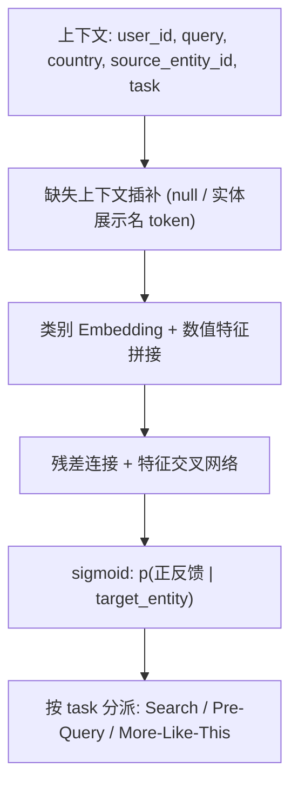
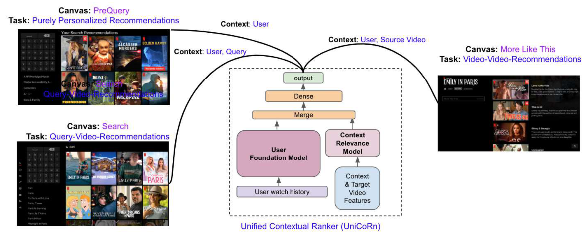

# Joint Modeling of Search and Recommendations Via an Unified Contextual Recommender (UniCoRn)（统一上下文推荐器：搜索与推荐的联合建模）

- **会议/期刊**: RecSys 2024（Industry Track，3 页短文/Talk）
- **作者与机构**: Moumita Bhattacharya, Vito Ostuni, Sudarshan Lamkhede（Netflix Research）
- **推荐链路定位**: 精排（Search Ranking & Recommendation Ranking 共用同一打分器）
- **研究方向**: 多任务学习与列表级重排 / CTR 预估与特征交叉
- **论文原文**: [https://arxiv.org/abs/2408.10394v1](https://arxiv.org/abs/2408.10394v1)
- **开源代码**: 暂未开源

## TL;DR (1分钟核心速览)

Netflix 产品中 Query-Video（搜索）、Video-Video（More Like This）、Profile-Video（Pre-Query 预搜索）等场景长期各自维护专用模型，技术债高且无法互相借用信号。本文提出 UniCoRn：用一个深度排序器，把「上下文」统一抽象为 $\{$user id, query, country, source entity id, task$\}$，对每个任务缺失的上下文做插补（搜索缺失 source entity 填 null，视频到视频缺失 query 则用实体展示名 token 填充），再以残差 + 特征交叉的 MLP 输出「用户对 target entity 正反馈」的概率，用 BCE 在所有任务样本并集上联合训练。同一模型即可按 task 上下文分派不同业务排序；在其上叠加由用户聚类 → 推荐模型输出作特征 → 端到端预训练表征微调的三级个性化后，相对无个性化 UniCoRn，搜索与推荐离线指标分别提升 **7%** 与 **10%**。

## Background & Motivation (背景与核心矛盾)

- **主流范式**: 工业界为搜索（显式 query 驱动）与推荐（user/源物品驱动）分别建模型，Netflix 内部一度并存 Query-Video、Video-Video、Profile-Video 三套独立排序模型。
- **前人局限**: ① 多模型带来维护复杂度与隐性技术债，长期成本高、可靠性下降；② 各任务数据割裂，搜索的稀疏 query 日志与推荐的海量曝光日志无法互相补充，小任务难以获得足够信号。
- **核心洞察 (Key Insight)**: 搜索与推荐是「同一枚硬币的两面」——本质都是「给定某种上下文，预测用户对候选实体的正反馈概率」，差别只在上下文种类不同；因此可用**更宽的上下文定义**把两类任务写成同一个条件概率估计问题。
- **本文切入点**: 不做多塔多专家，而是把 task 本身与缺失上下文一并作为特征输入单塔模型，用「上下文插补 + 特征交叉」换取跨任务知识共享。

## Method (核心方法设计)

### 1. 整体框架 (Overall Architecture)

输入层接收 5 类上下文字段与 target entity id 的交叉特征，所有类别特征过 Embedding，数值特征（如 query 长度、某 query 下 target 的历史点击数）直接拼接；主干为带残差连接与显式特征交叉的深层网络，输出单一 sigmoid 概率；训练时把三个任务的样本混在一个数据集上，仅靠 task 上下文区分任务分布；推理时同一份权重按请求携带的 task 字段分派，返回 Search canvas、Pre-Query canvas 或 More Like This 的排序列表。

<figure class="paper-figure" markdown="span">
  <figcaption>图1：统一上下文排序器（UniCoRn）支撑多种不同的搜索与推荐任务</figcaption>
</figure>

### 2. 关键设计拆解 (Key Designs)

1. **共享上下文模式与缺失上下文插补 (Context Schema Unification + Imputation)**：痛点是各任务可用上下文不一致，直接拼接会造成大量空位、阻断跨任务学习。作者固定字段集合 $\{u,q,c,s,t\}$，按任务做确定性插补：搜索侧无源实体则$s=\varnothing$；Video-Video / Entity-Video 无 query 则用源实体展示名的分词结果构造伪查询$\tilde{q}=\text{tokens}(\text{display\_name}(s))$。直觉：把「结构化缺失」转化为「语义可用的弱信号」，使同一套 embedding 在各任务间共享覆盖率显著上升。
2. **任务类型作为上下文 + 特征交叉 (Task-as-Context & Feature Crossing)**：痛点是单塔共享参数易被大流量任务主导、淹没小任务特性。做法是把 task id 当作普通类别特征参与主干计算，并依赖交叉项显式建模「上下文 × 目标实体」的二阶关系统，例如
   $\hat{y}=\sigma\big(\mathrm{MLP}_{\text{res}}\big([\mathbf{e}_u;\mathbf{e}_q;\mathbf{e}_c;\mathbf{e}_s;\mathbf{e}_t;\mathbf{e}_e]\big)\oplus \mathrm{Cross}(\mathbf{e}_q,\mathbf{e}_e,\mathbf{e}_s)\big)\big)$其中$\oplus$表示与残差支路融合、$\mathrm{Cross}(\cdot)$ 生成 query–entity、source–entity 的交互向量。直觉：交互项让模型学会按 task 自适应地调整各上下文字段的权重，从而在共享中保留任务专有偏好。
3. **训练目标、样本构造与推理开销**：损失为跨任务混合样本上的二值交叉熵
   $\mathcal{L}=-\frac{1}{N}\sum_{i=1}^{N}\big[y_i\log\hat{y}_i+(1-y_i)\log(1-\hat{y}_i)\big]$，优化器 Adam；标签为「正反馈（点击/播放）vs 负样本」的隐式反馈，正负样本来自真实曝光日志（论文未披露负采样比例）。推理侧因搜索是逐键击的 instant results，延迟约束严格，故工程上先以用户聚类特征换取可缓存的半个性化，再推进全个性化。

## Experimental Setup & Evaluation Protocol (实验设置与评估协议)

- **数据集与预处理**: 论文为 3 页工业实践短文，**未公布任何数据集统计量、过滤规则（无 5-core 之类）或样本规模**，仅说明训练集为「所有任务的正/负反馈日志并集」，属 Netflix 生产日志，不可公开复现。

| 场景/任务 | 可用上下文 | 缺失上下文的插补方式 | 产出 |
| :--- | :--- | :--- | :--- |
| Search（Query-Video） | user id, query, country, task | source entity = null | 键入查询后的视频结果 |
| Pre-Query（Profile-Video） | user id, country, task | query = null | 个性化预搜索画布 |
| More Like This（Video-Video） | user id, country, source entity, task | query ← 源视频展示名 token | 相似视频列表 |

- **数据划分与防穿越 (Splitting Strategy)**: **未披露**（无 Leave-One-Out / 时间戳切分说明），仅能从「离线指标提升」推断采用历史日志训练、后续时间窗评估的常规工业做法。
- **排名评测协议 (Ranking Protocol)**: **未披露**是否 Full-Ranking 或采样排序，也未给出具体指标名称（仅以相对 lift 汇报），这是本文最大的评估透明度短板。
- **对比基线与超参设置**: 基线即「各任务各自的专用生产模型」与「无个性化 UniCoRn」，未报告 Embedding 维度 $d$、网络层数、显著性检验；个性化增益以相对百分比形式给出。

## Key Experimental Results (实验关键数据)

### 1. 主实验对比 (Main Results)

| 任务 | 对比基线 | 基线设置 | UniCoRn 设置 | 离线指标相对提升 |
| :--- | :--- | :--- | :--- | :---: |
| Search（Query-Video） | 无个性化 UniCoRn | 仅上下文特征 | + 全个性化（预训练 user/item 表征微调） | **+7%** |
| Recommendations（Pre-Query / Video-Video） | 无个性化 UniCoRn | 仅上下文特征 | + 全个性化（同上） | **+10%** |
| 其余承接任务 | 各自专用生产模型 | 单任务独立训练 | 同一 UniCoRn 权重 | 达到 lift 或 **parity（不低于）** |

### 2. 消融实验 (Ablation Study)

原文**未提供数值型消融表**，仅给出定性归因的三个使能因素，此处如实罗列：

| 配置 | 移除后的预期后果（原文定性描述） | 是否给出数值 |
| :--- | :--- | :---: |
| w/o task-as-context | 模型难以学习任务间权衡，无法在同一塔内区分场景偏好 | 否 |
| w/o 缺失上下文插补 | 上下文覆盖率下降，跨应用（cross-application）学习失效 | 否 |
| w/o 特征交叉 | 跨任务共享收益减弱，上下文 × 目标实体交互无法显式建模 | 否 |

### 3. 关键实验发现 (Key Findings)

1. **统一建模不是「折中」而是「增益」**：单模型在承接的三个任务上均取得 lift 或 parity，且从无个性化到全个性化，推荐侧收益（+10%）明显高于搜索侧（+7%），说明推荐任务更能吃下用户表征带来的个性化红利，而搜索仍以 query 相关性为主。
2. **个性化必须被「约束」**：作者明确指出盲目把推荐式个性化搬进搜索，会让个性化压过 query 相关性（personalization 压过 relevance），因此收益上限受相关性约束，这也是搜索侧增益低于推荐侧的关键原因。
3. **工程约束反向塑造了模型演进路径**：逐键击 instant search 的严格延迟要求，使团队先走「用户聚类作上下文特征」的半个性化（可缓存）路线，再过渡到端到端表征微调；即模型架构选择被 serving 缓存与延迟直接决定，而非纯离线指标驱动。

## Highlights & Limitations (亮点、对比与审稿批判)

- **与代表作对比 (vs. Prior Work)**: 相较 MMoE/PLE 一类「共享底层 + 多专家门控」的多任务精排范式，UniCoRn 的共享粒度更粗（单塔 + task 作为特征），但由于任务异构性体现在**输入上下文不同**而非仅标签不同，其核心贡献在于上下文模式的统一与插补，而非专家路由；相较 Netflix 自身的 Pre-Query 预搜索工作 [1] 与 instant search 系统 [2]，本文是把它们收敛进同一权重的系统级整合。
- **可迁移亮点**: ① 「缺失上下文用实体展示名 token 构造伪 query」是一种极低成本、无需额外模型的跨域特征对齐技巧，可迁移到跨域/多场景推荐的字段对齐；② 用用户聚类作为可缓存的个性化中间态，是延迟敏感场景下兼顾个性化与 QPS 的务实折衷。
- **审稿级局限批判**: ① 评估极不透明——无数据集规模、无划分方式、无 Full-Ranking / 采样协议、无显著性检验、无基线数值，仅给两个相对 lift，学术可验证性近乎为零；② 模型本身缺乏方法学新意（单塔 MLP + 特征交叉 + BCE 已是工业标准件），且未讨论负样本构造、多任务损失加权、任务间负迁移（negative transfer）风险与推理延迟的量化数据。

## Rating (四维评分)

- **方法创新性 (Novelty)**: ⭐⭐ （核心是上下文模式统一与缺失插补的工程抽象，网络结构为常规残差 + 特征交叉，无新算子或理论支撑）
- **评估协议与实验扎实度 (Protocol & Experiments)**: ⭐ （无数据集统计、无划分与打分协议、无基线数值表、无消融数字与显著性检验，仅两个聚合 lift）
- **写作与数学规范度 (Clarity & Rigor)**: ⭐⭐⭐ （3 页短文叙事清晰、任务与插补规则交代明确，但公式与超参几乎缺失，仅给 BCE 与优化器）
- **工业落地与复现价值 (Industrial & Practical Value)**: ⭐⭐⭐⭐ （来自 Netflix 生产系统的真实统一替换经验，对「多模型收敛为单模型」的技术债治理与延迟/缓存权衡极具参考价值，可惜无开源代码）

