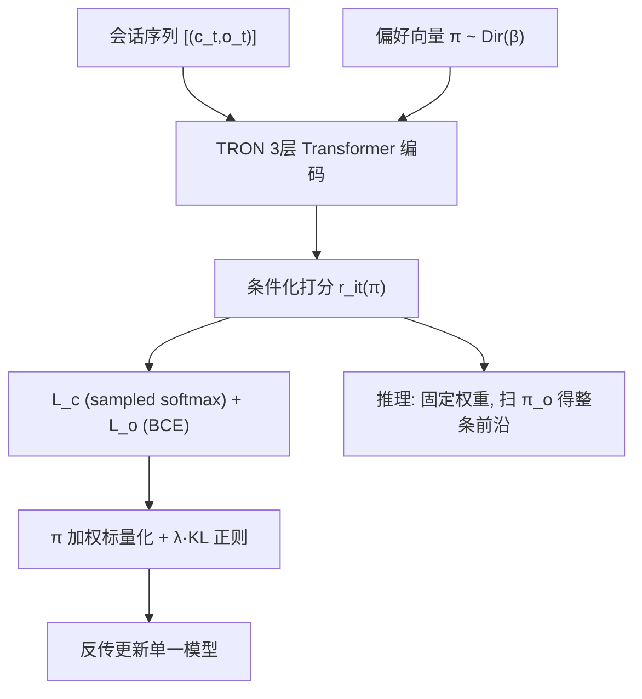
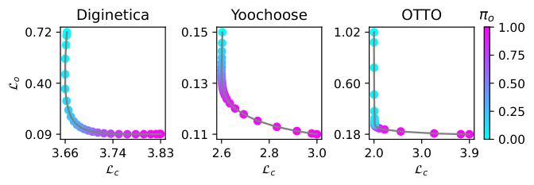

# Pareto Front Approximation for Multi-Objective Session-Based Recommender Systems (面向多目标会话推荐系统的帕累托前沿近似)

- **会议/期刊**: RecSys 2024 (18th ACM Conference on Recommender Systems, Bari, Italy)
- **作者与机构**: Timo Wilm, Philipp Normann, Felix Stepprath（OTTO (GmbH & Co KG), Hamburg）
- **推荐链路定位**: 召回（会话 Next-Item 预测）/ 端到端多目标打分
- **研究方向**: 多任务学习与列表级重排 / 序列与会话推荐
- **论文原文**: [https://arxiv.org/abs/2407.16828v3](https://arxiv.org/abs/2407.16828v3)
- **开源代码**: [https://github.com/otto-de/MultiTRON](https://github.com/otto-de/MultiTRON)

## TL;DR (1分钟核心速览)

电商平台需同时优化赞助广告的点击收益与自然推荐的转化收益，传统多目标方案（固定标量化、Pareto 超网络 PHN、EPO 搜索）要么为前沿上每个点训练一个模型，要么在百万级 item 参数下不可扩展、每步前向都要解线性规划。本文 MultiTRON 把偏好向量 $\pi\sim\mathrm{Dir}(\beta)$直接作为输入特征注入 TRON 会话 Transformer，并引入免 LP 的 KL 非均匀性正则防止前沿塌缩。单模型在 Diginetica / Yoochoose / OTTO 上取得最优 Hypervolume，$\lambda$ 消融与线上四组 A/B 均证实离线前沿可真实翻译为 CTR–CVR 权衡。

## Background & Motivation (背景与核心矛盾)

- **主流范式**: 多目标推荐普遍采用损失标量化 $\pi_c\mathcal{L}_c+\pi_o\mathcal{L}_o$ 训练多个模型，或用 PHN 超网络按偏好向量生成参数、用 EPO Search 保证精确 Pareto 最优。
- **前人局限**: ①固定 $\pi$ 的方案每个前沿点独立训练+独立部署，训练与推理成本随目标粒度线性膨胀；②PHN 依赖生成整网参数，在百万级 item 嵌入的推荐骨干上显存与算力不可承受；③EPO 每次前向需解一次线性规划，训练速度显著下降。
- **核心洞察 (Key Insight)**: 若模型在训练时见过的每个 $\pi$上都近似最小化标量化损失，则由 [Dosovitskiy & Djolonga] 的结论，它几乎必然最小化任意固定$\pi$ 的目标——单模型即可覆盖整条前沿；但纯条件化标量化会产生"窄前沿"，需额外约束解在各目标间的分布。
- **本文切入点**: 抛弃超网络与 LP，把 $\pi$ 降级为最廉价的"额外输入特征"，并用一项 KL 正则替代 EPO 的线性规划来撑开前沿覆盖。

## Method (核心方法设计)

### 1. 整体框架 (Overall Architecture)

Session 表示为 $s=[(c_1,o_1),\dots,(c_{T-1},o_{T-1})]$，$c_t$为点击 item、$o_t$标记该 item 是否已下单。多目标模型$\mathcal{R}(\cdot,\pi)$以 TRON 会话 Transformer（3 层）为骨干，将采样得到的偏好向量$\pi=[\pi_c,\pi_o]$作为额外输入特征与序列表征共同条件化，输出 item 打分$r_{it}$，同时接受点击损失$\mathcal{L}_c$与下单损失$\mathcal{L}_o$的加权监督。训练时每个 batch 重新采样$\pi$，模型由此见到一整族标量化目标；推理时冻结参数、仅改$\pi$ 一个标量比值，即可在 CTR 与 CVR 之间连续滑动，无需重训或切换模型。

### 2. 关键设计拆解 (Key Designs)

1. **偏好条件化标量化 (Preference-Conditioned Scalarization)**：痛点是把前沿离散成 K 个模型。本文让 $\pi$ 在训练中随机化，优化期望损失
$\mathbb{E}_{\pi}\mathcal{L}=\mathbb{E}_{\pi}\big[\pi_c\mathcal{L}_c(c_t,\mathcal{R}_t(\cdot,\pi))+\pi_o\mathcal{L}_o(o_t,\mathcal{R}_t(\cdot,\pi))\big]$，
理论上只需 $\mathcal{R}^{*}$最小化该期望即可几乎必然最小化任意固定$\pi$的标量化损失。物理直觉：$\pi$ 充当"目标旋钮"，共享全部 item 嵌入与序列编码，跨目标的知识互相正则，因此不仅省模型数，还避免小目标（下单）数据稀疏导致的过拟合。

2. **KL 非均匀性覆盖正则 (Non-uniformity Regularization)**：纯条件化训练的解容易堆在前沿中段、两端塌缩。本文定义归一化损失占比 $\hat{\pi}_k=\dfrac{\pi_k\mathcal{L}_k}{\pi_c\mathcal{L}_c+\pi_o\mathcal{L}_o}$，并约束它贴近均匀分布：
$\mathcal{L}_{reg}(\pi)=\mathrm{KL}\big(g(\hat{\pi})\,\|\,\tfrac{1}{2}\big),\quad g=\mathrm{softmax}$。
直觉：若某目标被过度压低，$\hat{\pi}$偏离$(1/2,1/2)$，KL 立即惩罚，迫使解沿前沿向两端铺开；用它替代 EPO 的线性规划后训练速度不受影响。$g$ 选 softmax 而非恒等，是因为其梯度更小、收敛更稳。

3. **训练目标、负采样与推理效率**：总损失
$\mathbb{E}_{\pi}\mathcal{L}(\cdot,\pi,\lambda)=\mathbb{E}_{\pi}\Big[\sum_{k\in\{c,o\}}\pi_k\mathcal{L}_k+\lambda\mathcal{L}_{reg}(\pi)\Big]$。
$\mathcal{L}_c$采用 sampled softmax（负采样），$\mathcal{L}_o$用二元交叉熵；$\beta=[\tfrac{1}{2},\tfrac{1}{2}]$固定，$\lambda$逐数据集在$[0.02,1]$调。推理开销与单目标 TRON 完全相同：一次前向得到一个$\pi$对应的点，扫 26 个$\pi_o$ 才需 26 次前向，且不需重载模型。

## Experimental Setup & Evaluation Protocol (实验设置与评估协议)

| 数据集 | #Train Sessions | #Train Clicks | #Train Orders | #Test Sessions | #Items |
| :--- | :---: | :---: | :---: | :---: | :---: |
| Diginetica | 187k | 906k | 12k | 18k | 43k |
| Yoochoose | 7.9M | 31.6M | 1.12M | 15k | 37k |
| OTTO | 12.9M | 194.7M | 5.1M | 1.6M | 1.8M |

- **数据过滤**: 沿用 `5-core` 式预处理——item 最小支持度 5、session 至少 2 次点击。
- **数据划分 (Splitting Strategy)**: `全局时间戳切分`（防穿越）：Yoochoose 取最后 1 天、Diginetica 与 OTTO 取最后 1 周为测试集，其余训练。
- **评估协议 (Ranking Protocol)**: 离线不做传统 Top-N 全库排序，而采用**多目标 Hypervolume (HV) 指标**，参考点为各数据集 nadir 点（$r_D=[3.86,1.12]$,$r_Y=[4.03,0.17]$,$r_O=[3.91,1.02]$），在 26 个递增$\pi_o$上测量前沿覆盖面积；同时以$\pi=[1,0]$的 `Full-Ranking Recall@20` 校验点击能力不与单目标模型冲突。线上采用真实流量 A/B（4 组不同$\pi$）。
- **实现与超参**: NVIDIA V100、batch 256、3 层 Transformer、lr $10^{-4}$、$g=\mathrm{softmax}$、$\beta=[\tfrac{1}{2},\tfrac{1}{2}]$，训练 10–20 epoch。

## Key Experimental Results (实验关键数据)

### 1. 主实验对比 (Main Results)

| 模型 / 设定 | Diginetica | Yoochoose | OTTO | 说明 |
| :--- | :---: | :---: | :---: | :--- |
| TRON（单目标点击，Recall@20） | **0.541** | **0.732** | 0.472 | 同骨干、仅 $\mathcal{L}_c$ |
| MultiTRON $\pi=[1,0]$（Recall@20） | 0.529 | 0.724 | **0.485** | 相对 TRON$\Delta$: −2.2% / −1.1% / **+2.8%** |
| MultiTRON 最优 HV（$\lambda^*$） | **0.20609** ($\lambda{=}0.02$) | **0.0838** ($\lambda{=}0.5$) | **1.546** ($\lambda{=}1$) | 26 点前沿面积 |
| HV @ $\lambda{=}0.2$ | 0.20012 | 0.0776 | 1.537 | — |
| HV @ $\lambda{=}1$ | 0.19296 | 0.0831 | 1.546 | Diginetica 明显退化 |

### 2. 消融实验 (Ablation Study)

| 配置（覆盖正则强度 $\lambda$） | Diginetica HV | Yoochoose HV | OTTO HV | 结论 |
| :--- | :---: | :---: | :---: | :--- |
| $\lambda=0.02$（近无正则） | **0.20609** | 0.0806 | 1.524 | 小数据上正则过强反而伤覆盖 |
| $\lambda=0.2$ | 0.20012 | 0.0776 | 1.537 | — |
| $\lambda=0.5$ | 0.20605 | **0.0838** | 1.544 | 中等规模最优 |
| $\lambda=1.0$（强正则） | 0.19296 | 0.0831 | **1.546** | 大规模/复杂 item 空间需要强正则 |

### 3. 关键实验发现 (Key Findings)

1. **加入 $\pi$ 几乎零成本**：参数量与 epoch 数均与单目标 TRON 持平，点击 Recall@20 仅变动 −2.2%~+2.8%，其中 1.8M item 的 OTTO 上反而**提升 2.8%**——多目标联合训练对稀疏的下单信号起到正则作用。
2. **正则强度与数据复杂度正相关**：Diginetica（43k item）在 $\lambda=0.02$最优而$\lambda=1$崩塌到 0.19296（−6.4%）；OTTO（1.8M item）恰好相反，$\lambda$从 0.02→1 单调升至 1.524→1.546。说明前沿塌缩风险主要由 item 空间规模与目标稀疏度驱动，需按场景调$\lambda$。
3. **离线前沿可翻译为线上收益**：OTTO 私有数据上线 A/B 中，四组 $\pi_o$ 递增带来 **CTR uplift 0→9.9%** 与 **CVR uplift 0→6.8%** 的可控权衡曲线，验证了"一个模型 + 一个旋钮"的工业可用性。

<figure class="paper-figure" markdown="span">
  <figcaption>图1：全部三个数据集离线评估中表现最佳的 Pareto 前沿，展示 L𝑐 与 L𝑜 在 26 个递增 π𝑜 值下的权衡。</figcaption>
</figure>

## Highlights & Limitations (亮点、对比与审稿批判)

- **与代表作对比 (vs. Prior Work)**: 相较 **PHN / EPO Search**（需生成整网参数或每步解 LP），MultiTRON 把偏好向量退化为输入特征，训练效率与单目标基线持平；相较 **TRON**（单目标会话 Transformer），它以极小代价（点击指标持平）换来整条前沿；相较传统**固定标量化多模型**方案，部署模型数从 K 降到 1。
- **可迁移亮点**: ①"$\pi$ 当输入特征"这一廉价条件化范式可直接搬到 MMoE/PLE 或双塔召回，用单模型替代多套权重；②KL 非均匀性正则是不解 LP 也能撑开前沿覆盖的通用技巧，可迁移到多目标排序与生成式推荐的 reward 权衡。
- **审稿级局限批判**: ①论文仅 4 页，**缺少与 PHN/EPO 在同数据同骨干上的定量对比表**，多目标优势主要靠 HV 与自建单目标基线支撑，说服力受限；②$\pi$的具体注入方式（与 item 嵌入拼接还是与序列表征拼接）描述模糊，复现依赖开源实现；③$\lambda$ 呈数据相关的最优区间且最强/最弱设置在两个数据集上结论相反，缺乏自动选取策略；④线上 A/B 仅一组一周实验，未报告统计显著性与长期留存影响。

## Rating (四维评分)

- **方法创新性 (Novelty)**: ⭐⭐⭐ （本质是把已有多目标 PFA 范式移植到会话 Transformer，KL 正则沿用 EPO 的非均匀性项并简化为免 LP 版本，属"精巧适配"而非原理性突破）
- **评估协议与实验扎实度 (Protocol & Experiments)**: ⭐⭐⭐⭐ （三数据集 + 26 点 HV 前沿 + 真实线上四组 A/B 的双轨验证少见且有力，但缺 SOTA 多目标基线的正面对比与显著性检验）
- **写作与数学规范度 (Clarity & Rigor)**: ⭐⭐⭐⭐ （四公式链条清晰、$\hat{\pi}$与 KL 正则定义严谨，但$\pi$注入位置与$g$ 选择理由仅一两句带过，篇幅所限略欠推导）
- **工业落地与复现价值 (Industrial & Practical Value)**: ⭐⭐⭐⭐⭐ （OTTO 真实电商场景 + 线上 A/B + 单模型单旋钮 + 全量开源代码与 Transformer 骨干，工程可移植性极高）

