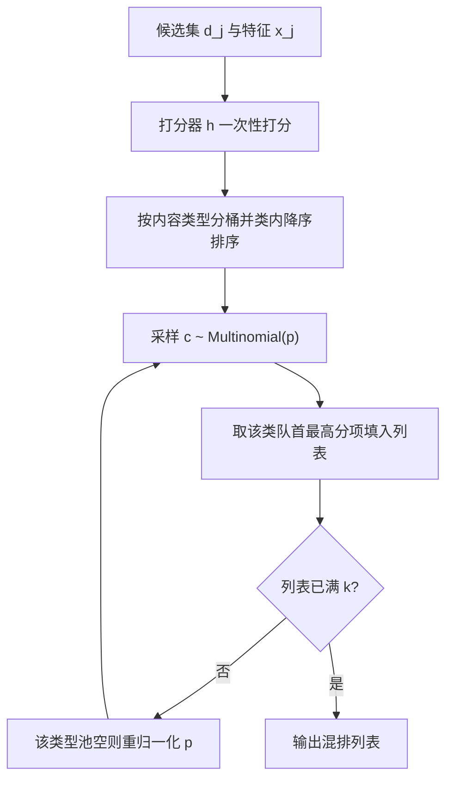
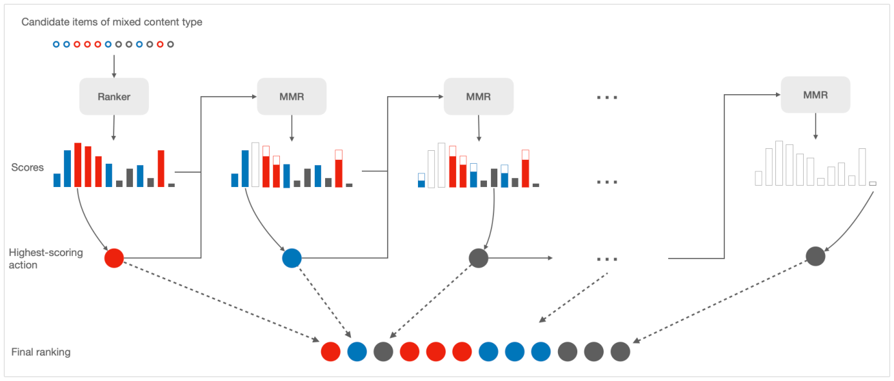

# Ranking Across Different Content Types: The Robust Beauty of Multinomial Blending (跨内容类型排序：多项式混合的稳健之美)

- **会议/期刊**: RecSys 2024 (18th ACM Conference on Recommender Systems, Bari, Italy；Applied/Industry Track，5 页短文)
- **作者与机构**: Jan Malte Lichtenberg, Giuseppe Di Benedetto (Amazon Music)；Matteo Ruffini (Albatross AI，工作完成于 Amazon Music)
- **推荐链路定位**: 重排（post-ranking / slate 组装），下游接在精排打分器 $h$ 之后
- **研究方向**: 多任务学习与列表级重排 / 去偏公平与工业架构
- **论文原文**: [https://arxiv.org/abs/2408.09168v1](https://arxiv.org/abs/2408.09168v1)
- **开源代码**: 暂未开源

## TL;DR (1分钟核心速览)

多内容类型（音乐 / 播客 / 商品 / 视频）混排时，用点击类短期奖励直接训练的 LTR 排序器会系统性压制"慢内容类型"，而改损失函数、奖励塑形或人工置顶等方案存在曝光不可控、超参不可解释、重训即漂移三大痛点。本文提出多项式混合 MB：先对全候选打分一次，再按业务给定概率 $\boldsymbol{p}$逐位采样内容类型并取该类最高分候选，使期望曝光份额严格等于$p_c$。Amazon Music 线上 A/B 中播客收听时长 +18.82%、整体互动 +2.23%（帕累托改进），且仅需单一配置即可跨市场复用，最终全量上线。

## Background & Motivation (背景与核心矛盾)

- **主流范式**: 工业首页普遍走"多路召回（每类内容各一路）+ 单塔 LTR 精排（如 Deep PropDCG）+ 重排"链路，跨类型差异全靠打分器隐式吸收。
- **前人局限**: 其一，慢内容（播客单集长、复听率低）平均互动远低于音乐，短期点击目标下曝光被持续挤压，形成"曝光少→数据更少→打分更低"的恶性循环，长期用户满意度与创作者生态受损。其二，现有纠偏手段均不满足工业要求：改损失加多样性正则（SGL/MMR 类思想）**无曝光保证**且多样性超参难解释、重训须重调；奖励塑形需先估计跨类型奖励相对权重，其对实际曝光的影响几乎不可预测；人工置顶则完全不个性化，还会污染反事实 OPE 的倾向性估计。
- **核心洞察 (Key Insight)**: 曝光分配本质上是一个**可控的随机化预算问题**，而非排序模型的学习问题——只要把"类型选择"从打分函数中剥离出来做显式采样，曝光份额就与打分器解耦，天然具备可解释性与重训稳定性。
- **本文切入点**: 用一次多项式采样 + 类内保序的极简算子替代一切"间接控制曝光"的复杂机制。

## Method (核心方法设计)

### 1. 整体框架 (Overall Architecture)

输入为 $n$个候选$d_j$及其特征$\boldsymbol{x}_j$（每项只属于单一类型$c(d_j)\in\{1,\dots,C\}$）与目标列表长度$k$。模型先用既有打分器$h:\mathbb{R}^p\to\mathbb{R}$**只打分一次**，随后在每个类型内部按分数降序排成$C$个队列；接着进入$k$步循环：每步按概率$\boldsymbol{p}$采样一个类型，弹出该类型队首（即剩余最高分项）填入列表；若某类型队列耗尽则对其余类型概率重新归一化。打分器可随时重训、行为可随环境漂移，而曝光预算$\boldsymbol{p}$ 保持不变——这正是它在工业上"稳健"的来源。

<figure class="paper-figure" markdown="span">
  ![图1：针对 𝐶=3 个内容类型（红、蓝、灰）且排序大小为 𝑘=4 的多项式混合（MB）。每一步中，混合器根据采样概率 𝒑=\[𝑝1, 𝑝2, 𝑝3\] 采样一个内容类型，然后选择剩余候选中得分最高者。在此示例中，第三次迭代后（子图 c），红色内容类型的候选池为空，导致对剩余内容类型的采样概率进行重新归一化。](../../../../assets/papers/2408.09168v1/figure_1.png)<figcaption>图1：针对 𝐶=3 个内容类型（红、蓝、灰）且排序大小为 𝑘=4 的多项式混合（MB）。每一步中，混合器根据采样概率 𝒑=[𝑝1, 𝑝2, 𝑝3] 采样一个内容类型，然后选择剩余候选中得分最高者。在此示例中，第三次迭代后（子图 c），红色内容类型的候选池为空，导致对剩余内容类型的采样概率进行重新归一化。</figcaption>
</figure>

### 2. 关键设计拆解 (Key Designs)

1. **多项式混合算子（MB）**：解决"曝光预算不可控"。第 $t$步执行$c_t \sim \mathrm{Multinomial}(\boldsymbol{p}^{(t)})$，再取$d_t=\arg\max_{d\in \mathcal{C}_{c_t}} h(\boldsymbol{x}_d)$，其中$\mathcal{C}_{c}$为类型$c$的剩余候选集；空池时$p_c^{(t)}=p_c/\sum_{c'\in\mathcal{A}_t}p_{c'}$（$\mathcal{A}_t$为仍有候选的类型集合）。因此$\mathbb{E}[\text{share}_c]\approx p_c$，即"$p_c$就是类型$c$在列表中的期望占比"，业务方可用一个百分比参数直接下达曝光 KPI，无需反推损失权重。类内仍按$h$ 排序，故个性化信息零损失。
2. **对比基线 MMR 的失效机理**：MMR 类重排按 $d_{t}=\arg\max_{d}\big[\lambda h(\boldsymbol{x}_d)-(1-\lambda)\max_{d'\in S_t}\mathrm{sim}(c(d),c(d'))\big]$逐位贪心，需要**每步重算**全部剩余候选分数；且$\lambda$ 与目标曝光的映射依赖当前分数分布，故换市场、换模型版本（分布漂移）就必须重调，甚至需反事实数据做 OPE 寻参。图 2 的示意正说明其"相似度惩罚"是隐式的，无法给出曝光承诺。
3. **训练目标与推理开销**：本文无新损失、无负采样、无训练阶段改动——MB 是纯推理期插件，等价于对类型标签做一次随机化的分层采样。复杂度为 $O(n\log n)$的一次排序加$O(k)$采样，远低于 MMR 的$O(kn)$ 逐步重算；且因采样分布显式已知，**倾向性矩阵可闭式写出**，天然适配逆倾向加权式离线 OPE，不引入人工置顶造成的倾向偏差。

<figure class="paper-figure" markdown="span">
  <figcaption>图2：用于跨内容类型排序且 𝐶=3 个内容类型（红、蓝、灰）的 MMR 选择。每次动作选择后，剩余候选项的得分会根据其与已排序项的内容类型相似度受到惩罚。</figcaption>
</figure>

## Experimental Setup & Evaluation Protocol (实验设置与评估协议)

- **数据集与预处理**: 本文为工业应用短文，**不含公开数据集与离线统计**，评估完全依赖 Amazon Music 首页真实流量的线上 A/B。候选为音乐容器与播客容器两类（$C=2$），列表长度$k$ 未披露。

| 数据集 | #Users | #Items | #Interactions | 稀疏度/密度 | 特征/场景说明 |
| :--- | :---: | :---: | :---: | :---: | :--- |
| Amazon Music 线上 A/B | 未披露（按用户随机分流） | 全站音乐+播客容器 | 未披露 | 未披露 | 首页混排；控制组含人工播客置顶规则 |
| 公开离线基准 | — | — | — | — | 无（作者明确不在静态学术数据上评测） |

- **数据划分与防穿越 (Splitting Strategy)**: 非离线划分，而是**线上随机分流 A/B**（control / MMR / MB 三组并行），指标窗口期未披露；无监督信号泄漏风险，但存在实验期内用户学习效应与季节性混淆的可能。
- **排名评测协议 (Ranking Protocol)**: 不使用 NDCG/Recall@k 等离线全库排序指标，直接采用线上业务指标：播客收听时长（慢类型培育）与整体互动（平台健康度）双目标，要求形成帕累托改进；无采样排序、无负采样设置。
- **对比基线与超参设置**: 基线为控制组（生产 Deep PropDCG + 人工播客置顶），对照为同一打分器分别叠加 MMR 与 MB。MB 的 $\boldsymbol{p}$由业务定义且**跨市场统一单一取值**（数值未披露）；MMR 的$\lambda$ 需逐市场离线调优以匹配同一播客曝光目标。

## Key Experimental Results (实验关键数据)

### 1. 主实验对比 (Main Results)

| 方法（同一 Deep PropDCG 打分器） | 播客收听时长 Lift | 整体互动 Lift | 参数配置 | 是否帕累托改进 |
| :--- | :---: | :---: | :--- | :---: |
| Control（人工置顶规则） | 0.00% | 0.00% | 逐位置人工维护 | — |
| MMR 多样性重排 | +13.57% | +2.76% | 每市场需独立 $\lambda$，随模型重启漂移 | 是 |
| **MB 多项式混合** | **+18.82%** | **+2.23%** | 全市场共享单一 $\boldsymbol{p}$ | 是 |
| Improv. (MB vs MMR) | +5.25pp | −0.53pp | — | — |

### 2. 消融实验 (Ablation Study)

论文未设模块级消融，以下为其"机制替换/运维维度"的对照结论整理：

| 移除或替换的组件 | 播客曝光可控性 | 重训后稳定性 | 计算开销 | 结果 |
| :--- | :---: | :---: | :---: | :--- |
| w/o 显式采样（改损失/奖励塑形） | 无保证 | 需重调多样性超参 | 训练期成本高 | 未在本文实测，定性否定 |
| w/o MB（人工置顶，即 Control） | 位置级、非个性化 | 依赖人工生命周期管理 | 低但人力重 | 基准，两组均优于它 |
| MB → MMR | 隐式、需 OPE 寻参 | 分数分布漂移即失效 | $O(kn)$ 逐步重算 | 时长 Lift 低 5.25pp |
| MB 去掉重归一化（空池即停） | 列表长度不可保证 | — | 略降 | 附录以"下界曝光"启发式替代等量保证 |

### 3. 关键实验发现 (Key Findings)

1. **显式采样优于隐式惩罚**：在完全相同的打分器下，MB 的播客时长提升 +18.82% 高于 MMR 的 +13.57%（相对高出约 39%），说明直接控制曝光份额比"相似度惩罚调参"更能把预算真正兑现到用户面前。
2. **用户级保证带来增量获客**：MB 在"首次播客播放用户数"类拉新指标上显著优于 MMR，原因是 MMR 因惩罚机制对不感兴趣用户几乎不推播客，而 MB 在用户粒度上强制兑现 $p_c$ 曝光——这解释了为何时长增益更大而整体互动仅让利 0.53pp。
3. **运维稳定性可量化变现**：MMR 需按市场分别调 $\lambda$、且模型重启引起分数分布变化即改变多样性行为；MB 仅一个$\boldsymbol{p}$ 全市场复用，是其在两者线上均为帕累托改进的前提下仍被选为**全量上线方案**的决定性因素。

## Highlights & Limitations (亮点、对比与审稿批判)

- **与代表作对比 (vs. Prior Work)**: 相比多样性损失类工作（如 Cofirank/DPP 系）与 MMR 重排，本文不追求"个性化多样性"而是主动牺牲它，换取 (i) 与打分器解耦的曝光保证、(ii) 业务可读的百分比参数、(iii) 重训零重调；相比奖励塑形，它把不可观测的权重估计问题转化为可观测的份额分配问题。
- **可迁移亮点**: ①"类型采样 + 类内保序"可直接迁移到多业务场景混排（如电商首页多品类、信息流多形态素材），一个 $p_c$ 即一条业务 KPI；②因采样分布显式，倾向性矩阵有闭式解，可直接接入 OPE 做离线评估，避免人工干预引发的倾向偏差。
- **审稿级局限批判**: ①**评估强度偏弱**：无离线基准、无数据集统计、无显著性检验与置信区间，只有一组三臂 A/B 且未披露实验时长与样本量，+2.23% vs +2.76% 的差异是否显著无法判断；②**完全放弃类型级个性化**，固定 $p_c$ 对"只想听音乐"的重度用户是体验损失，长期留存/LTV 影响未评估，且曝光与点击的反馈回路可能带来新的流行度偏置。

## Rating (四维评分)

- **方法创新性 (Novelty)**: ⭐⭐ （算子极简近乎"分层随机采样"，理论贡献有限，胜在把工业痛点抽象成曝光预算问题）
- **评估协议与实验扎实度 (Protocol & Experiments)**: ⭐⭐ （仅有单组线上 A/B 三项指标，无离线基准、无消融、无显著性检验，且超参与样本量多处未披露）
- **写作与数学规范度 (Clarity & Rigor)**: ⭐⭐⭐⭐ （符号干净、算法伪码化清晰，图 1/图 2 的对比图示把 MB 与 MMR 的机理差异讲得非常直观）
- **工业落地与复现价值 (Industrial & Practical Value)**: ⭐⭐⭐⭐⭐ （零训练改动、$O(k)$ 推理、单一参数跨市场复用，已全量上线并经 A/B 验证，工程性价比极高，虽无开源代码但实现门槛极低）

