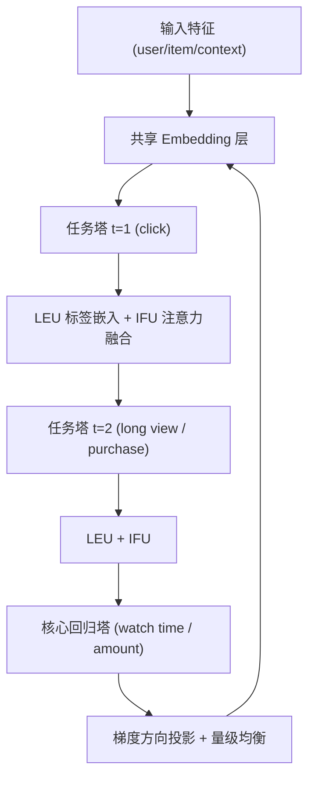
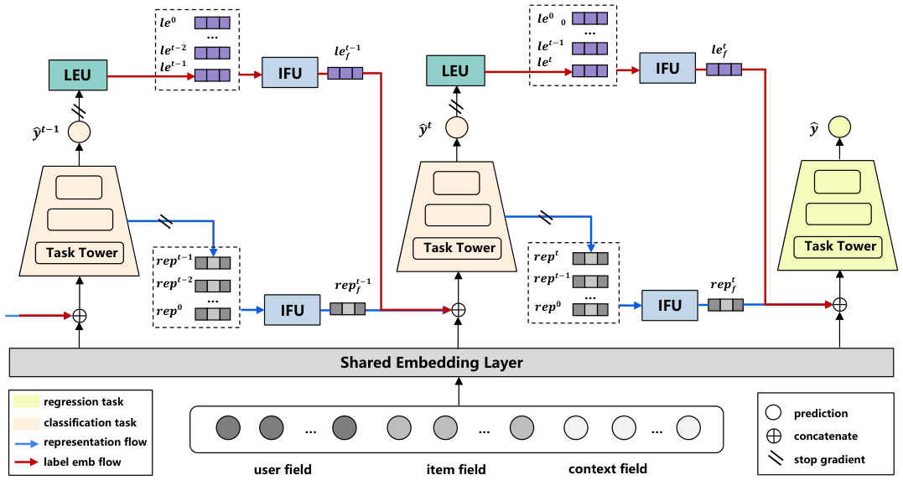

# Touch the Core: Exploring Task Dependence Among Hybrid Targets for Recommendation (触达核心：探索推荐中混合目标间的任务依赖)

- **会议/期刊**: RecSys 2024
- **作者与机构**: Xing Tang, Yang Qiao, Fuyuan Lyu, Dugang Liu, Xiuqiang He（腾讯 FiT、McGill/MILA、深圳鹏城实验室）
- **推荐链路定位**: 精排（多目标预估）
- **研究方向**: 多任务学习与列表级重排 / CTR 特征交叉
- **论文原文**: [https://arxiv.org/abs/2403.17442v2](https://arxiv.org/abs/2403.17442v2)
- **开源代码**: [https://github.com/fuyuanlyu/HTLNet](https://github.com/fuyuanlyu/HTLNet)

## TL;DR (1分钟核心速览)

线上平台真正的核心指标（观看时长、投资金额）是**连续回归目标**，而它依赖前面一串**离散转化行为**（曝光→点击→购买），现有 MTL 与 SDMTL 范式都只建模离散任务链，且回归损失的梯度量级/方向会碾压分类任务。本文提出 HTLNet：用 Gumbel-Softmax 标签嵌入显式传递前序标签信息，用注意力融合单元汇聚前序表征，并对共享层梯度做方向投影 + 量级均衡。三数据集全指标领先，线上 14 天累计 CTR +0.54%、CVR +1.4%、购买金额 +2.69%。

## Background & Motivation (背景与核心矛盾)

- **主流范式**: 推荐精排普遍用 Shared-Bottom / MMoE / PLE / AdaTT 等隐式专家-门控结构共享知识；CVR 类工作用 ESMM、AITM、TAFE 等 SDMTL 范式建模离散转化链 $p_{CTCVR}=p_{CTR}\times p_{CVR}$。
- **前人局限**: (1) 隐式 MMoE 类结构不区分任务相关性，负迁移不可控，缺失任务依赖先验；(2) SDMTL 假设 $\hat{y}_k-\hat{y}_{k-1}=P(t_k=0,t_{k-1}=1)$，一旦$y_k$ 变成连续值该式不再成立——**高点击率并不蕴含高客单价**。
- **核心洞察 (Key Insight)**: 混合目标问题中，回归任务的 MSE 梯度量级天然远大于 BCE，梯度方向也与分类任务冲突，直接联合优化会让核心任务"绑架"共享表征，训练震荡（图 5a 可见 watch time 梯度范数持续发散）。
- **本文切入点**: 把"标签"本身当作可学习、可微、可传递的信息载体，再配一套专为回归-分类混合场景定制的梯度调节律。

## Method (核心方法设计)

### 1. 整体框架 (Overall Architecture)

所有任务共享底层 Embedding 与特征拼接；任务按序列 $1\to\cdots\to T\to core$递进排列，第$t$个任务的塔输入为前序任务的**隐式塔表征**$rep_{t-1}^f$、**显式标签嵌入**$le_{t-1}^f$与共享嵌入$e_i$的三路拼接$h^t_{input,i}=concat(rep_{t-1}^f,le_{t-1}^f,e_i)$。前序任务输出分类概率（BCE），末位核心任务输出连续值（MSE）。LEU 与 IFU 在每一跳上自适应筛选信息，训练时配合梯度投影-均衡策略回传共享层，推理时仅需一次前向、无额外延迟放大。

<figure class="paper-figure" markdown="span">
  <figcaption>图2：HTLNet 的整体框架。LEU 表示 Latent Embedding Unit，其编码标签信息；Information Fusion Unit 自适应融合所有先前任务。</figcaption>
</figure>

### 2. 关键设计拆解 (Key Designs)

1. **Label Embedding Unit (LEU)：把离散标签变成可微向量**：前人把前序标签直接塞进损失约束（AITM/TAFE），连续核心任务因此拿不到标签信息。本文为每个分类任务设 $E_t\in\mathbb{R}^{2\times L_d}$，用 Gumbel-Softmax 对预测分布重参数化采样，避免训练/测试标签不一致与级联误差：
$$p_t=\frac{\exp(\log(\hat{y}_t)/\tau)}{\exp(\log(\hat{y}_t)/\tau)+\exp(\log(1-\hat{y}_t)/\tau)},\quad le_t=[p_t,\,1-p_t]E_t$$
温度 $\tau\to 0$ 时退化为 one-hot；软加权使核心任务的梯度能反过来惩罚"误导性"的标签嵌入，实现显式逻辑依赖的端到端学习。

2. **Information Fusion Unit (IFU)：注意力汇聚全部前序信息**：直接 concat 会带来负迁移（图 4 中 concat 版 click AUC 仅 0.7429）。IFU 对 $[e_0,\dots,e_t]$ 做缩放点积注意力自适应赋权：
$$e_t^f=\sum_{u}w_t\,h_1(u),\quad w_t=\mathrm{softmax}\!\left(\frac{\langle h_2(u),h_3(u)\rangle}{\sqrt{k}}\right)$$
其直觉是：对核心回归任务而言，哪些前序行为真正有用高度依赖样本，固定融合权重会把噪声也一并注入。

3. **训练目标与梯度调节律**：总损失 $\mathcal{L}=\mathcal{L}_{core}+\sum_t \mathcal{L}_t$（MSE + BCE）。先把传递信息截断梯度以隔离干扰：$LEU(\mathrm{stop\_grad}(\hat{y}_t))$、$IFU(\mathrm{stop\_grad}(rep_t))$，使共享 Embedding 成为唯一互扰通道；再对其梯度做两步处理——方向冲突时把$G_t$投影到$G_{core}$ 法平面：
$$G_t=G_t-\alpha\frac{G_t\cdot G_{core}}{\|G_{core}\|^2}G_{core},\ \text{s.t. }G_t\cdot G_{core}<0$$
量级差异用裁剪后的比例因子均衡：$G_t=\gamma\frac{\|G_{core}\|}{\|G_t\|}G_t+(1-\gamma)G_t$，权重截断到$[1/C,C]$ 防爆。无需额外负采样，推理与普通 MTL 模型同阶开销。

## Experimental Setup & Evaluation Protocol (实验设置与评估协议)

- **数据集与预处理**:

| 数据集 | #Samples | 核心目标统计 | 前序任务正率 | 场景说明 |
| :--- | :---: | :---: | :---: | :--- |
| KuaiRand-pure | 1,186,059 | watch time (6.94±18.79) | click 17.62% / long view 8.50% | 短视频：click→long view→watch time |
| Kaggle-Revenue | 5,041,007 | 1M 复购额 (4.52±165.69) | 1Y 复购 41.05% / 1M 复购 85.68% | 电商：1Y→1M→金额 |
| Product (腾讯理财通) | 19,160,294 | 购买金额 (1627.05±8009.42) | click 8.65% / purchase 4.82% | 基金推荐：click→convert→amount |

- **数据划分与防穿越**: 三数据集统一按**全局时间戳切分**，训练/验证/测试 = 8:1:1。
- **排名评测协议**: 分类任务用 **AUC / LogLoss**；回归任务用 **NRMSE / NMAE**；金额类排序再补 **Spearman / Gini**。属全量样本打分评估（非采样负例），每实验重复 10 次，双样本 t 检验 $p\le0.05$。
- **对比基线与超参**: Single-task DNN、Shared-Bottom、MMoE、PLE、AdaTT（通用 MTL）、ESMM、AITM（SDMTL）、MetaBalance（优化策略），共 8 个基线；另在附录补充分类 lognormal 损失变体与 $\alpha,\gamma$ 敏感性。

## Key Experimental Results (实验关键数据)

### 1. 主实验对比 (Main Results)

| 数据集 | 任务 / 指标 | DNN | MMoE | PLE | AdaTT | AITM | MetaBalance | **HTLNet** | Improv. |
| :--- | :--- | :---: | :---: | :---: | :---: | :---: | :---: | :---: | :---: |
| KuaiRand | click AUC↑ | 0.7512 | 0.7379 | 0.7409 | 0.7396 | 0.7391 | 0.7541 | **0.7574** | +0.44% |
| KuaiRand | long view AUC↑ | 0.7698 | 0.7645 | 0.7694 | 0.7683 | 0.7672 | 0.7768 | **0.7787** | +0.24% |
| KuaiRand | watch time NRMSE↓ | 0.8979 | 0.8970 | 0.8963 | 0.8975 | 0.8978 | 0.8967 | **0.8937** | -0.29% |
| KuaiRand | watch time NMAE↓ | 0.9553 | 0.9621 | 0.9648 | 0.9508 | 0.9533 | 0.9509 | **0.9093** | -4.37% |
| Kaggle | repurchase 1Y AUC↑ | 0.6892 | 0.6696 | 0.6732 | 0.6720 | 0.6728 | 0.6896 | **0.6960** | +0.93% |
| Kaggle | amount Spearman↑ | 0.2339 | 0.2357 | 0.2332 | 0.2419 | 0.2204 | 0.2376 | **0.2475** | +2.32% |
| Kaggle | amount Gini↑ | 0.5093 | 0.5093 | 0.5136 | 0.5185 | 0.5029 | 0.5100 | **0.5233** | +0.93% |
| Product | click AUC↑ | 0.7914 | 0.7749 | 0.7936 | 0.7958 | 0.8036 | 0.7965 | **0.8049** | +0.16% |
| Product | convert AUC↑ | 0.8929 | 0.8770 | 0.8983 | 0.9000 | 0.9003 | 0.9008 | **0.9023** | +0.17% |
| Product | amount Spearman↑ | 0.1759 | 0.2060 | 0.2088 | 0.2014 | 0.1956 | 0.1954 | **0.2244** | +7.47% |
| Product | amount Gini↑ | 0.7982 | 0.8254 | 0.8274 | 0.8279 | 0.8212 | 0.8219 | **0.8362** | +1.00% |

### 2. 消融实验 (Ablation Study)

| 变体 (KuaiRand) | click AUC↑ | long view AUC↑ | watch time NRMSE↓ | watch time NMAE↓ |
| :--- | :---: | :---: | :---: | :---: |
| **HTLNet 完整版** | **0.7574** | **0.7787** | **0.8937** | **0.9093** |
| w/o Architecture (退回 Shared-Bottom) | 0.7470 | 0.7746 | 0.8955 | 0.9630 |
| w/o Optimization (去掉梯度调节) | 0.7420 | 0.7713 | 0.8970 | 0.9480 |
| w/o label embedding (去 LEU) | 0.7565 | 0.7785 | 0.8950 | 0.9198 |
| w/o representation (去 IFU 表征流) | 0.7526 | 0.7773 | 0.8951 | 0.9248 |
| w/o stop_gradient | 0.7292 | 0.7549 | 0.8974 | 0.9344 |
| w/o gradient conflict (Eq.16) | 0.7516 | 0.7743 | 0.8946 | 0.9179 |
| w/o gradient magnitude (Eq.17) | 0.7424 | 0.7710 | 0.8987 | 0.9321 |
| HTLNet + Gradient Surgery | 0.7432 | 0.7718 | 0.8992 | 0.9444 |
| HTLNet + MetaBalance | 0.7517 | 0.7773 | 0.8948 | 0.9136 |

### 3. 关键实验发现 (Key Findings)

1. **架构与优化必须"成对出现"**：单独去掉架构（-0.0104 click AUC）或单独去掉优化（-0.0154 click AUC）都不如完整版，而 w/o Optimization 是所有变体中退化最严重的——说明 LEU/IFU 构造的强依赖信息通路一旦失去梯度约束，回归任务立刻绑架共享层。
2. **stop_gradient 是最大单点贡献**：移除后 click AUC 从 0.7574 骤降至 0.7292（-3.7%），远超去掉梯度投影（0.7516）或量级均衡（0.7424）；通用优化器 Gradient Surgery / MetaBalance 套在本文架构上仍分别只有 0.7432 / 0.7517，证明"先截断信息流、再调共享梯度"的组合是针对混合目标定制的，而非可被通用 MTL 优化器替代。
3. **收益集中在核心连续目标，且随回归难度放大**：KuaiRand 上 NMAE 相对最优基线 AdaTT 降低 4.37%（0.9508→0.9093），Product 上购买金额 Spearman 提升 7.47%（0.2088→0.2244），而分类任务增益多在 0.2%–0.9% 量级——印证方法主要解决的是"离散→连续"的信息与梯度断层；线上连续 14 天累计 CTR +0.54%、CVR +1.4%、购买金额 +2.69%，金额侧增益最大且波动最明显。

## Highlights & Limitations (亮点、对比与审稿批判)

- **与代表作对比 (vs. Prior Work)**: 相比 MMoE/PLE/AdaTT 的隐式专家共享，HTLNet 把任务依赖先验写进结构（序列化 LEU 标签流），避免无关任务的不可控负迁移；相比 AITM/TAFE 只处理离散转化链，本文首次给出连续核心目标下的依赖形式化，并指出 SDMTL 的差分假设在回归场景失效；相比 MetaBalance 的通用梯度均衡，本文的 stop-gradient 隔离 + 以核心任务为锚的投影更贴合"一回归多分类"的非对称结构。
- **可迁移亮点**: (1) 用 Gumbel-Softmax 软标签嵌入替代硬标签/损失约束，可作为任意"上游离散→下游连续"级联任务的通用连接件；(2) 以核心任务梯度为基准、对其他任务做投影 + 范数对齐的"锚定式"梯度调节，可直接移植到多目标精排中主指标明显占优的场景。
- **审稿级局限批判**: (1) 训练开销显著高于基线（作者在附录自认训练时间更长），LEU 的逐任务标签表与 IFU 的多跳注意力使参数量与串行深度随任务数 $T$ 增长；(2) 假设"前序全离散、末位连续"，对多连续目标或离散-连续交错的一般情形未验证；线上仅报告 14 天单场景（理财）A/B，缺少跨业务复现与收益置信区间，且金额指标的日间波动较大。

## Rating (四维评分)

- **方法创新性 (Novelty)**: ⭐⭐⭐⭐ （首次形式化 hybrid targets 问题，标签嵌入 + 锚定梯度调节组合新颖，但各组件均为已知技术的针对性改造）
- **评估协议与实验扎实度 (Protocol & Experiments)**: ⭐⭐⭐⭐ （两公开 + 一工业数据集、时间切分、10 次重复 t 检验、四类基线齐备，并有线上 A/B；不足是仅单一线上场景、无采样排序外推分析）
- **写作与数学规范度 (Clarity & Rigor)**: ⭐⭐⭐⭐ （问题形式化与 SDMTL 失效条件论证清晰，梯度算法伪代码完整；部分符号（如 $rep_t$ 取自塔哪一层）与附录依赖较重）
- **工业落地与复现价值 (Industrial & Practical Value)**: ⭐⭐⭐⭐ （代码开源，推理无额外开销，已在腾讯理财通全量上线并给出累计增益；主要落地成本在于训练时间与超参 $\alpha,\gamma,C$ 调优）

