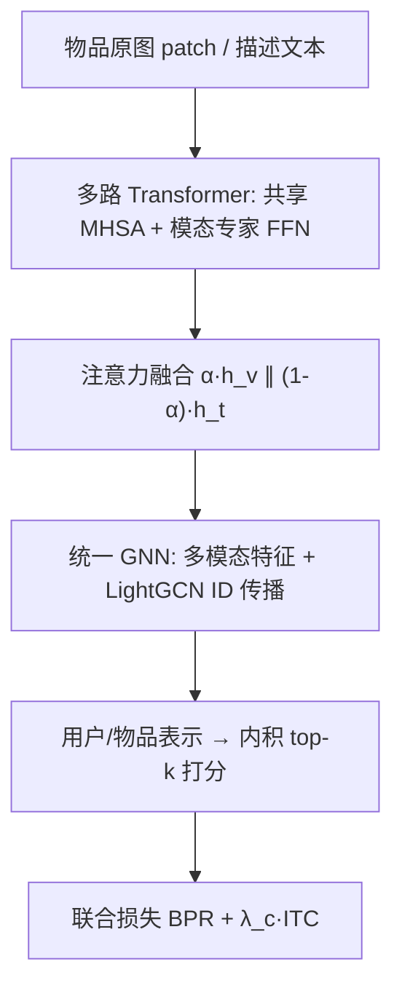
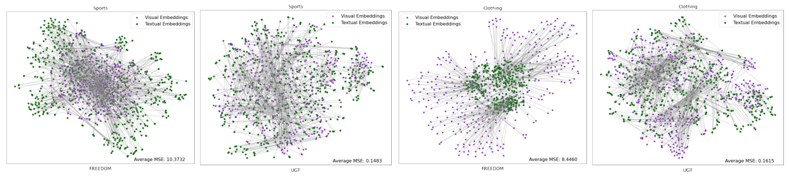

# A Unified Graph Transformer for Overcoming Isolations in Multi-modal Recommendation (克服多模态推荐中“孤立化”问题的统一图 Transformer)

- **会议/期刊**: RecSys 2024
- **作者与机构**: Zixuan Yi, Iadh Ounis（University of Glasgow）
- **推荐链路定位**: 端到端召回/表征学习（top-k 排序，双塔不属于本文范畴）
- **研究方向**: 多模态推荐 / 图神经网络推荐
- **论文原文**: [论文原文链接](https://arxiv.org/abs/2407.19886v1)
- **开源代码**: 暂未开源

## TL;DR (1分钟核心速览)

现有方法把多模态推荐拆成两段互不相关的流程：**离线预训练抽取器（ResNet/Sentence-Transformer）不参与推荐任务微调**（Isolation 1），**各模态在各自图/塔里独立编码后再简单拼接**（Isolation 2），造成不相关噪声注入与模态嵌入割裂。UGT 把多路 Transformer（共享 MHSA + 模态专家 FFN）与统一 GNN（模态特征与 LightGCN ID 传播同空间聚合 + 学习式注意力融合）级联为一个可端到端训练的整体，并以 BPR + 图文对比损失联合优化；在 Amazon Sports/Clothing/Baby 的 8:1:1 随机划分下，Recall@20 相对最强基线 LightGT 提升 6.60%/13.97%/6.41%，图文嵌入平均 MSE 从 10.37 降至 0.15。

## Background & Motivation (背景与核心矛盾)

- **主流范式**: 多模态推荐采用 “预训练抽取器（CNN/Sentence-Transformer/VGGish）→ 模态特定 GNN 或 item-item 图 → 简单拼接/独立图卷积融合” 两段式流水线（VBPR、MMGCN、MMGCL、SLMRec、LATTICE、FREEDOM、PMGT、LightGT）。
- **前人局限 (1)**: 抽取器与融合模块独立——抽取目标（通用视觉/语言任务）与推荐目标错位，无法反向剔除与用户偏好无关的视觉纹理/描述套话，且拼接式融合无法纠偏。
- **前人局限 (2)**: 各模态独立建流（多流 LightGCN），图文嵌入落入互不相交的子空间，仅有末端拼接或单头蒸馏（LightGT），缺失跨模态联合优化的机会。
- **核心洞察 (Key Insight)**: 若把“抽取”与“融合”放进同一可微架构，对比损失可同时向抽取器与图聚合器提供梯度，模态自然被拉到同一语义空间，从而同时缓解噪声注入与表示割裂。
- **本文切入点**: 用多路 Transformer 承担抽取、统一 GNN 承担融合，两者级联共享同一个损失端到端训练。

## Method (核心方法设计)

### 1. 整体框架 (Overall Architecture)

输入为物品原图（切 patch 展平投影）与描述文本（word embedding）；多路 Transformer 中共享的多头自注意力负责跨模态对齐、模态专家 FFN 负责保留模态特有信息，输出视觉/文本对齐嵌入；随后经注意力融合得到联合多模态节点表示，与 ID 嵌入一起放入统一 GNN，在同一次传播中同时聚合“邻居多模态特征 + 邻居 ID 嵌入”，并以缩放因子 $\epsilon$ 控制节点自身多模态特征的保留强度；最终用户/物品表示为各层输出求和，用内积打分排序，训练侧 BPR 与图文 ITC 联合优化。

### 2. 关键设计拆解 (Key Designs)

1. **多路 Transformer 抽取器（消除 Isolation 1）**：痛点是预训练抽取器与推荐目标脱钩。做法是以共享 MHSA 对齐模态、以模态专家 FFN 分流异构输入，层间隐状态为
$h_i^{(l_t)} = \mathrm{LN}\big(h_i^{(l_t-1)} + \mathrm{MHSA}(h_i^{(l_t-1)}, h_i^{(l_t-1)}, m_i) + \mathrm{FFN}(h_i^{(l_t-1)}, m_i)\big)$其中$m_i$ 为模态类型指示。直觉：共享注意力在浅层就把图文投影到同一坐标系，专家 FFN 又防止模态特性被抹平，且整个抽取器可被推荐损失反向微调（参数量 167M 与 CNN+Sentence-Transformer 的 170M 对齐，保证公平）。

2. **统一 GNN + 注意力融合（消除 Isolation 2）**：痛点是多流编码导致嵌入割裂。统一传播式为
$x_i^{(l_g)} = (1+\epsilon)\cdot x_{i-vt}^{(l_g-1)} + \big(x_{u-vt}^{(l_g)} + x_{u-id}^{(l_g)}\big)$即在同一层内一次聚合“邻居联合多模态特征$x_{u-vt}$”与“邻居 ID 嵌入$x_{u-id}$”（后者按 LightGCN 的$\frac{1}{\sqrt{|N_i||N_u|}}$ 归一化传播）；跨模态融合采用可学习权重而非拼接：
$x_{i-vt} = \alpha\, h_{i-v} \parallel (1-\alpha)\, h_{i-t}$直觉：$\alpha$让模型按物品自适应决定“看图”还是“读文案”，$\epsilon$的$(1+\epsilon)$ 系数保证节点自身多模态信号不被过度平滑吞没。

3. **训练目标、负采样与推理效率**：总损失
$\mathcal{L} = \mathcal{L}_{BPR} + \lambda_c \mathcal{L}_{ITC} + \lambda\lVert\Theta\rVert^2$其中$\mathcal{L}_{BPR}=\sum_{(u,i,j)\in D_s}\log\sigma(y_{ui}-x_u^\top x_i)$，$\mathcal{L}_{ITC}$ 为 batch 内图文双向 InfoNCE（正样本为同一物品的图-文对，负样本为 batch 内错配对）。负采样为 BPR 的未交互随机负采样（非硬负采样），推理为内积全库检索、无额外解码开销，主要成本在图文编码器前向。

## Experimental Setup & Evaluation Protocol (实验设置与评估协议)

- **数据集与预处理**: 三个 Amazon Review 原始数据（含图片 URL 与描述文本，可直接端到端训练）：

| 数据集 | #Users | #Items | #Interactions | 稀疏度/密度 | 特征/场景说明 |
| :--- | :---: | :---: | :---: | :---: | :--- |
| Sports | 35,598 | 18,287 | 295,366 | 0.00045 | 图 4096→768 / 文 384→768 (UGT) |
| Clothing | 39,387 | 22,499 | 271,001 | 0.00030 | 同上 |
| Baby | 19,445 | 7,037 | 160,522 | 0.00012 | 同上，最稀疏 |

- **数据划分与防穿越 (Splitting Strategy)**: 沿用 LATTICE 的 `比例划分`，训练/验证/测试 = 8:1:1 随机切分（非全局时间戳切分，存在轻量未来信息泄漏风险）。
- **排名评测协议 (Ranking Protocol)**: 遵循 LATTICE 设定的 `Full-Ranking`（全库未交互排序）口径；论文正文未显式给出采样负比例，训练负采样为 BPR 均匀随机负例。
- **对比基线与超参设置**: 9 个 SOTA——VBPR、MMGCN、MMGCL、SLMRec、LATTICE、BM3、FREEDOM（GNN/非 GNN）与 PMGT、LightGT（图 Transformer）；指标 Recall@{10,20}、NDCG@{10,20}，paired t-test + Holm-Bonferroni 校正（$p<0.05$）；Adam 优化，早停 50 epoch，$\epsilon,\lambda_c \in \{0,0.1,\dots,1.0\}$ 网格搜索。

## Key Experimental Results (实验关键数据)

### 1. 主实验对比 (Main Results)

| Dataset | Method | R@10 | R@20 | N@10 | N@20 |
| :--- | :--- | :---: | :---: | :---: | :---: |
| Sports | VBPR | 0.0509 | 0.0771 | 0.0280 | 0.0349 |
| | MMGCL | 0.0617 | 0.0913 | 0.0351 | 0.0428 |
| | SLMRec | 0.0605 | 0.0901 | 0.0341 | 0.0417 |
| | LATTICE | 0.0633 | 0.0944 | 0.0334 | 0.0424 |
| | BM3 | 0.0661 | 0.0970 | 0.0350 | 0.0438 |
| | FREEDOM | 0.0605 | 0.0918 | 0.0352 | 0.0449 |
| | LightGT | 0.0652 | 0.0953 | 0.0347 | 0.0440 |
| | **UGT** | **0.0705** | **0.1034** | **0.0391** | **0.0477** |
| | Improv. | +6.66% | +6.60% | +11.10% | +6.24% |
| Clothing | FREEDOM | 0.0538 | 0.0809 | 0.0290 | 0.0356 |
| | BM3 | 0.0535 | 0.0797 | 0.0305 | 0.0358 |
| | LightGT | 0.0514 | 0.0755 | 0.0299 | 0.0353 |
| | **UGT** | **0.0603** | **0.0922** | **0.0330** | **0.0402** |
| | Improv. | +12.08% | +13.97% | +8.20% | +12.29% |
| Baby | FREEDOM | 0.0551 | 0.0874 | 0.0303 | 0.0385 |
| | LightGT | 0.0544 | 0.0867 | 0.0294 | 0.0381 |
| | LATTICE | 0.0539 | 0.0860 | 0.0291 | 0.0374 |
| | **UGT** | **0.0602** | **0.0930** | **0.0325** | **0.0406** |
| | Improv. | +9.26% | +6.41% | +7.26% | +5.45% |

### 2. 消融实验 (Ablation Study)

| 变体 | Sports R@10/R@20 | Clothing R@10/R@20 | Baby R@10/R@20 |
| :--- | :---: | :---: | :---: |
| w/o Attn-Fuse（改简单拼接） | 0.0675 / 0.0986 | 0.0564 / 0.0823 | 0.0568 / 0.0894 |
| w/o UGNN（改多流 LightGCN） | 0.0667 / 0.0980 | 0.0540 / 0.0811 | 0.0551 / 0.0865 |
| w/o Trans（改 CNN+Sentence-Trans.） | 0.0628 / 0.0929 | 0.0483 / 0.0784 | 0.0535 / 0.0834 |
| w/o CL（去 ITC 损失） | 0.0680 / 0.0953 | 0.0578 / 0.0896 | 0.0543 / 0.0855 |
| **UGT 完整模型** | **0.0705 / 0.1034** | **0.0603 / 0.0922** | **0.0602 / 0.0930** |

### 3. 关键实验发现 (Key Findings)

1. **抽取器替换贡献最大**：去掉多路 Transformer（回退到 CNN+Sentence-Transformer）使 Clothing Recall@10 从 0.0603 掉到 0.0483（-19.9%），是四个消融项中降幅最大的，说明“抽取可微化”而非“更强编码器”才是收益主源；这也与 RQ1 中 PMGT/LightGT 仅把 Transformer 用于聚合而收益有限形成对照。
2. **融合方式与统一传播独立有效且互补**：注意力融合与统一 GNN 的移除分别造成 Sports Recall@20 下降 4.6%/5.2%，且二者叠加（w/o Attn-Fuse 仍保留 UGNN）优于任一单独移除，印证 Isolation 2 的两个子问题（跨模态权重 + 跨模态同图传播）需要同时解决。
3. **表示质量可用距离量化验证**：UGT 图文嵌入平均 MSE 在 Sports 为 0.1483、Clothing 为 0.1615，而 FREEDOM 分别为 10.3732 与 8.4460，相差约两个数量级；t-SNE 上 UGT 的星形/五边形分布重合，而 FREEDOM 的文本嵌入散落在视觉簇之外。

<figure class="paper-figure" markdown="span">
  <figcaption>图 5：Sports 和 Clothing 数据集上物品嵌入的 t-SNE 可视化。星形表示视觉嵌入，五边形表示文本嵌入。平均均方误差（MSE）值表示视觉嵌入与文本嵌入之间的平均距离。</figcaption>
</figure>

## Highlights & Limitations (亮点、对比与审稿批判)

- **与代表作对比 (vs. Prior Work)**: 与 MMGCL/SLMRec 相比，本文不再在“已冻结特征”上做增广或对比，而是让抽取器本身被推荐损失驱动；与 LATTICE/FREEDOM 相比，本文不额外构建 item-item 语义图，而是把语义直接注入 user-item 图传播；与 LightGT 相比，本文的 Transformer 用于抽取而非聚合，并把图文融合权重交给可学习 $\alpha$ 而非拼接。
- **可迁移亮点**: (1) “共享注意力 + 模态专家 FFN” 的多路结构可直接替换短视频/电商多模态塔的静态拼接；(2) 用图文嵌入的平均 MSE 作为模态对齐的轻量诊断指标，可低成本监控多模态表征质量。
- **审稿级局限批判**: (1) 端到端训练图文 Transformer（约 167M 参数）+ 每层跨模态聚合显著抬高训练与离线推理成本，论文未给显存/吞吐或增量更新代价的量化对比；(2) 8:1:1 随机划分存在时间穿越，且未报告采样负例排序结果，Recall@20 绝对值（~0.09）偏低；(3) $\epsilon$与$\lambda_c$的最优值依数据集漂移（Sports$\epsilon{=}0.5,\lambda_c{=}0.6$；Clothing$\epsilon{=}0.4,\lambda_c{=}0.4$），需网格搜索，未见跨域自动设定方案；(4) 仅覆盖图文两模态，音频/视频模态的可扩展性仅有口头声明。

## Rating (四维评分)

- **方法创新性 (Novelty)**: ⭐⭐⭐⭐ （把多路 Transformer 首次用于多模态推荐抽取并与统一 GNN 级联，思路清晰且真正回应了两个“孤立化”痛点，但单点算子层面的理论/谱分析支撑较弱）
- **评估协议与实验扎实度 (Protocol & Experiments)**: ⭐⭐⭐⭐ （三数据集 + 9 个 SOTA + 四项消融 + 显著性检验齐全，但划分非时间序、排序协议细节披露不足、缺长尾分桶与效率实验）
- **写作与数学规范度 (Clarity & Rigor)**: ⭐⭐⭐ （公式简洁、动机陈述清楚，但式 (4) 存在符号笔误、式 (2) 层标号与拼接符号混用，统一 GNN 的输出层聚合与复杂度未给出）
- **工业落地与复现价值 (Industrial & Practical Value)**: ⭐⭐⭐ （思路可直接用于图文电商召回侧表征，但未开源、端到端大模型训练成本高，落地需蒸馏或冻结专家层）

