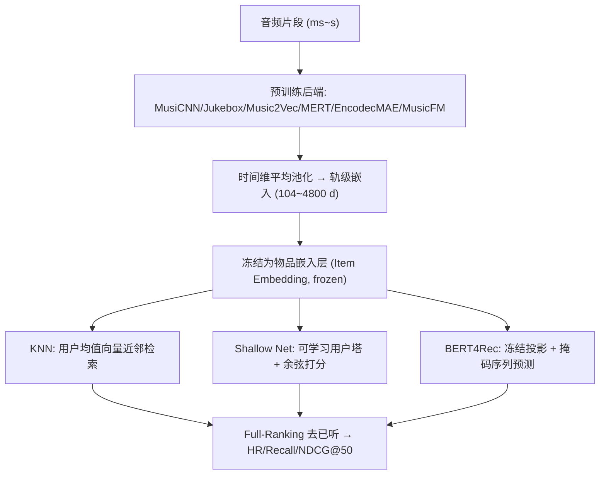

# Comparative Analysis of Pretrained Audio Representations in Music Recommender Systems (音乐推荐系统中预训练音频表征的对比分析)

- **会议/期刊**: RecSys 2024 (18th ACM Conference on Recommender Systems, Bari, Italy, 5-page short paper)
- **作者与机构**: Yan-Martin Tamm, Anna Aljanaki (University of Tartu, Estonia)
- **推荐链路定位**: 召回（内容侧物品表征供给）
- **研究方向**: 多模态推荐 / 协同过滤（内容-协同混合）
- **论文原文**: [https://arxiv.org/abs/2409.08987v1](https://arxiv.org/abs/2409.08987v1)
- **开源代码**: [https://github.com/Darel13712/pretrained-audio-representations](https://github.com/Darel13712/pretrained-audio-representations)

## TL;DR (1分钟核心速览)

音乐推荐（MRS）长期沿用端到端 CNN + Mel 频谱，而 MIR 社区已产出大量大规模预训练音频后端模型，二者却少有交叉验证。本文冻结 6 个预训练后端（MusiCNN、Jukebox、Music2Vec、MERT、EncodecMAE、MusicFM）与 MFCC 基线作为物品嵌入，接入 KNN / 浅层双塔 / BERT4Rec 三种推荐器，在 Music4All-Onion 上做**全库 Full-Ranking**、`HR/Recall/NDCG@50` 评测。结论：冻结内容嵌入可稳定增强纯协同模型（Shallow Net 相对随机初始化最高 15.7×），但 MIR 上最强的 MusicFM/Jukebox 在推荐上反而垫底，MusiCNN 全场景最优（BERT4Rec 上 HR@50 = 0.385，较随机初始化 +10.6%，$p<0.05$）。

## Background & Motivation (背景与核心矛盾)

- **主流范式**: 内容感知音乐推荐普遍将 Mel 频谱送入 CNN 端到端训练，物品表征与协同信号在同一目标下联合学习；MIR 社区则流行"大规模自监督/监督预训练 + 下游微调"。
- **前人局限**: 其一，MIR 论文几乎不验证后端模型在 MRS 上的有效性；其二，RS 社区偏好端到端学习，鲜有工作系统比较预训练音频表征（唯一接近的 [16] 只是借三个编码器论证负偏好方法的稳健性）。版权限制导致同时含音频与播放日志的数据集稀缺，端到端训练难以规模化。
- **核心洞察 (Key Insight)**: 若冻结的预训练嵌入本身已编码音色、乐器、情绪等语义，则无需微调后端即可为协同模型注入内容先验；但"MIR 榜单排名"未必等价于"MRS 增益排名"。
- **本文切入点**: 固定后端、只变推荐器复杂度（KNN → 浅层双塔 → BERT4Rec）与初始化方式（冻结预训练 vs 随机可学习），做受控对照实验。

## Method (核心方法设计)

### 1. 整体框架 (Overall Architecture)

论文不提出新网络，而是构建一条"音频后端 → 轨级池化 → 物品嵌入 → 三种推荐器"的评测流水线：每条曲目被切成短片段送预训练后端，得到帧级表征后**沿时间维平均**得到单一轨级向量（维度 104–4800 不等），该向量作为物品嵌入层权重并**冻结**，协同侧仅学习用户表征或序列上下文，最终对全库未听物品排序。

### 2. 关键设计拆解 (Key Designs)

1. **后端无关的轨级池化与冻结约束**：预训练后端输出的是片段级表征，直接与用户历史对齐会引入时间粒度过细的噪声；本文统一用均值池化压缩为轨级向量 $\mathbf{e}_i=\frac{1}{T}\sum_{t=1}^{T}\mathbf{h}_{i,t}$ 并冻结，使 KNN/双塔/BERT4Rec 共享同一内容空间。冻结的意义在于把"性能增益"完全归因于嵌入本身携带的信息量，而非模型容量——随机初始化对照组因此成为关键消融。

2. **KNN 与 Shallow Net：内容信息量的下界探测**：KNN 用用户历史嵌入均值 $\hat{\mathbf{u}}=\frac{1}{|\mathcal{H}_u|}\sum_{i\in\mathcal{H}_u}\mathbf{e}_i$，按$s(u,i)=\cos(\hat{\mathbf{u}},\mathbf{e}_i)$排序，衡量"纯内容可解释的偏好量"；Shallow Net 在此基础上引入协同：物品侧初始化自$\mathbf{e}_i$且冻结，用户侧由 ID 嵌入 + 保持维度的全连接 + ReLU 得到$\mathbf{p}_u$，打分仍为余弦$s(u,i)=\frac{\mathbf{p}_u^{\top}\mathbf{e}_i}{\|\mathbf{p}_u\|\|\mathbf{e}_i\|}$。直觉是：用户塔只需学习"如何在给定的内容坐标系中定位自己"，把内容空间当作固定基底。

3. **训练目标、负采样与推理开销**：Shallow Net 采用 Max-Margin Hinge Loss，对每个正样本 $(u,i)$**额外采样 20 个未交互用户**作为该物品的负例：$\mathcal{L}=\sum_{(u,i)}\max\big(0,\,m-s(u,i)+s(u,j)\big),\ j\sim p_{\text{neg}}(\cdot\mid i)$；BERT4Rec 沿用掩码物品预测的交叉熵，序列截断至 300（约等于用户历史均值，覆盖过半用户），推理时取最后时间步打分。因物品嵌入冻结，负采样开销仅作用于用户侧，训练成本远低于端到端音频编码。

## Experimental Setup & Evaluation Protocol (实验设置与评估协议)

- **数据集与预处理**: Music4All-Onion（含音频、播放日志与预计算 MFCC）：

| 数据集 | #Users | #Items | #Interactions | 稀疏度 | 特征/场景说明 |
| :--- | :---: | :---: | :---: | :---: | :--- |
| Train (前 12 个月) | 17,053 | 56,193 | 5,122,221 | 99.47% | 含音频与 MFCC，作为训练历史 |
| Validation | 6,092 | 36,942 | 132,425 | 99.94% | 最后一个月，按用户随机对半分 |
| Test | 6,092 | 37,797 | 138,299 | 99.94% | 同上；已剔除 train 中未出现用户/物品 |

- **数据划分与防穿越 (Splitting Strategy)**: **全局时间戳切分**——以 `2020-02-20` 为界，此前 12 个月为训练，最后一月按用户对半分为验证/测试；验证与测试集**只保留该用户在界前未听过的物品**，因此所有测试交互在用户历史中均为新物品（近冷启动设定），并显式剔除非重叠冷用户/冷物品（作者指出该数据集冷物品数量不足，无法单独做冷启动评测）。
- **排名评测协议 (Ranking Protocol)**: **Full-Ranking（全库未交互物品排序）**，不采样负例；各模型推荐结果中移除已听曲目，仅预测新物品。指标为 `HitRate@50 / Recall@50 / NDCG@50`；MRR 与 Precision 因与上述指标高度相关而未报告。
- **对比基线与超参设置**: 7 种嵌入（MFCC 104d、MusiCNN 200d、MusicFM 750d、EncodecMAE 768d、Music2Vec 768d、MERT 1024d、Jukebox 4800d）× 3 种推荐器（KNN / Shallow Net / BERT4Rec），外加"随机初始化且可学习"的协同参照组。Adam，lr = 0.001，plateau 降学习率 + early stopping；Shallow Net 100 epochs，BERT4Rec 200 epochs；显著性以 $p<0.05$ 判定。

## Key Experimental Results (实验关键数据)

### 1. 主实验对比 (Main Results)

表 1：三种推荐器下的 HR@50（括号内为 BERT4Rec 的 Recall@50 / NDCG@50；最优值加粗，`Improv.` 为相对同架构随机初始化组）：

| 嵌入 (维度) | KNN HR@50 | Shallow Net HR@50 | BERT4Rec HR@50 (R@50 / N@50) |
| :--- | :---: | :---: | :---: |
| Random (协同-only) | — | 0.021 | 0.348 (0.049 / 0.038) |
| MFCC (104) | 0.028 | 0.226 | 0.231 (0.019 / 0.014) |
| MusiCNN (200) | **0.089** | **0.329** | **0.385** (0.058 / **0.044**) |
| Music2Vec (768) | 0.033 | 0.291 | 0.281 (0.025 / 0.020) |
| MERT (1024) | 0.049 | 0.291 | 0.360 (0.051 / 0.038) |
| EncodecMAE (768) | 0.054 | 0.296 | 0.349 (0.050 / 0.038) |
| Jukebox (4800) | 0.057 | 0.272 | 0.219 (0.015 / 0.012) |
| MusicFM (750) | 0.009 | 0.108 | 0.261 (0.021 / 0.016) |
| `Improv.` (vs Random) | — | **+1466%** (MusiCNN) | **+10.6%** (MusiCNN) |

表 2：后端模型在 MIR 任务与 MRS 上的排名错位（MIR 数值取自各自原论文，Recs = 本文 BERT4Rec HR@50）：

| 模型 | Tags (mTT AUC) | Genres (GTZAN Acc) | Key (GiantSteps Acc) | Recs (HR@50) |
| :--- | :---: | :---: | :---: | :---: |
| MusicFM | **0.924** | — | **0.674** | 0.261 |
| Jukebox | 0.915 | **0.797** | 0.667 | 0.219 |
| MERT | 0.913 | 0.793 | 0.656 | 0.360 |
| MusiCNN | 0.906 | 0.790 | 0.128 | **0.385** |
| EncodecMAE | — | 0.862 | — | 0.349 |
| Music2Vec | 0.895 | 0.766 | 0.508 | 0.281 |

### 2. 消融实验 (Ablation Study)

| 配置 | Shallow Net HR@50 | BERT4Rec HR@50 | 说明 |
| :--- | :---: | :---: | :--- |
| 随机初始化（可学习物品嵌入） | 0.021 | **0.348** | 纯协同下界 |
| 冻结 MusiCNN | **0.329** | **0.385** | 全场景最优 |
| 冻结 MERT | 0.291 | 0.360 | BERT4Rec 上不显著 |
| 冻结 Jukebox | 0.272 | 0.219 | 高维嵌入拖累序列模型 |
| 冻结 MusicFM | 0.108 | 0.261 | 两架构均垫底 |
| 预训练初始化 + 解冻（文中未报告） | ≈ 冻结 | ≈ 冻结 | 作者称与冻结相近故省略 |

### 3. 关键实验发现 (Key Findings)

1. **内容先验在弱协同模型中收益极大、在强协同模型中被稀释**：Shallow Net 上所有后端均以 10× 以上幅度碾压随机初始化（0.021 → 0.108~0.329），而 BERT4Rec 的随机基线本身已达 0.348，仅 MusiCNN 显著超越（0.385，+10.6%）。说明序列模型已能从 ID 序列中学到大量协同结构，内容嵌入的边际增益取决于架构是否"缺信息"。
2. **MIR 榜单与 MRS 榜单近乎反相关，且与嵌入维度相关**：MusicFM 在 tag AUC 上以 0.924 居首却在推荐上仅 0.261；Jukebox 的 key detection 达 0.667 但 BERT4Rec 仅 0.219，其 4800 维表征在固定时间均值池化下明显欠处理。反之，Key 检测最差的 MusiCNN（0.128）却是推荐最优——作者据此推断其监督标签（风格、乐器、情绪）恰好对齐了推荐的语义粒度。
3. **监督式 auto-tagging 目标可能比自监督掩码建模更适配推荐**：MusiCNN 在 KNN（0.089 vs 次优 Jukebox 0.057）、Shallow Net（0.329 vs 0.296）、BERT4Rec（0.385 vs 0.360）三档全胜，提示"人类标签语义"比"声学重建/对比目标"更贴近用户偏好维度；而 MusicFM 作为 MERT 的改进版却全面落后，作者怀疑发布权重存在技术问题。

## Highlights & Limitations (亮点、对比与审稿批判)

- **与代表作对比 (vs. Prior Work)**: 相较 [22] 类端到端 CNN 内容推荐，本文以**冻结 + 多架构**解耦了"表征质量"与"网络容量"；相较 [16]（CLMR/MEE/Jukebox 仅用于论证负偏好方法的稳健性），本文把后端模型本身作为唯一自变量；相较 MIR 领域各自的评测论文，本文首次给出同一批模型在 MRS 任务上的横向排名，并暴露 MIR↔MRS 排名错位。
- **可迁移亮点**: ①"冻结物品嵌入 + 随机协同基线"是评估任何内容表征（图像、文本、视频）增益的干净范式；②用 20 个随机负用户（而非负物品）构造 Hinge 负例，在物品侧冻结时能稳定训练用户塔。
- **审稿级局限批判**: ①仅一个数据集（Music4All-Onion）、一个 50 截断的 Top-K 设置，且冷物品不足导致论文自己承认的"冷启动价值"未被验证，泛化性存疑；②池化方式单一（时间均值 + 冻结），对 Jukebox 这类 4800 维、帧级语义丰富的表征明显不利，"模型差"与"用法差"无法区分；③只做 RecSys 短文的对照实验，无置信区间/多次随机种子方差报告，$p<0.05$ 的显著性结论（如 MERT vs 随机 BERT4Rec）证据较薄。

## Rating (四维评分)

- **方法创新性 (Novelty)**: ⭐⭐ （本质是受控基准研究，无新模型或新损失；贡献在于评测视角与"冻结-随机"归因设计，而非算法创新）
- **评估协议与实验扎实度 (Protocol & Experiments)**: ⭐⭐⭐ （Full-Ranking 全库排序 + 时间切分防穿越是加分项，7 后端 × 3 架构矩阵完整，但单数据集、单种子、无冷启动验证削弱结论强度）
- **写作与数学规范度 (Clarity & Rigor)**: ⭐⭐⭐⭐ （5 页短文结构紧凑，RQ1–RQ3 与实验一一对应，公式与维度报告清楚；但未给池化/负采样的复杂度与方差分析）
- **工业落地与复现价值 (Industrial & Practical Value)**: ⭐⭐⭐⭐ （冻结嵌入免去音频端到端训练，工程成本低、可直接接入召回；代码开源且结论"MusiCNN 性价比最高"对音乐/短视频平台有直接选型参考价值）

