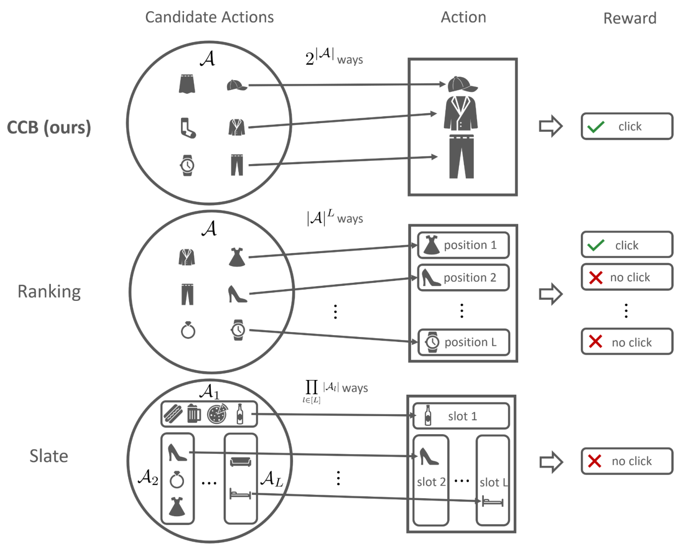
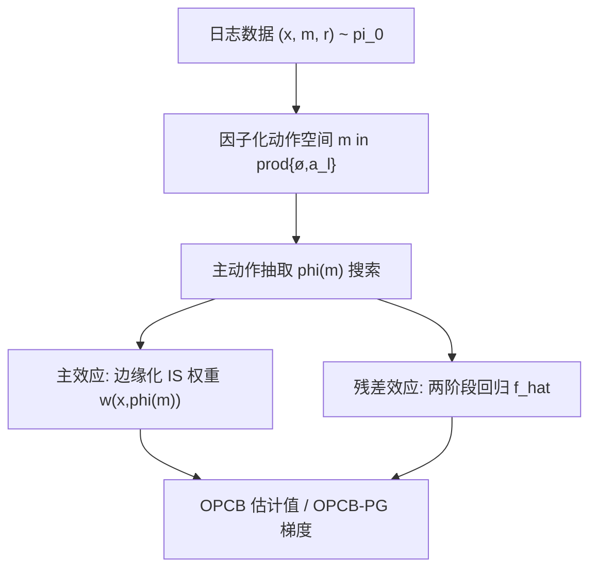

# Effective Off-Policy Evaluation and Learning in Contextual Combinatorial Bandits (上下文组合赌博机中的有效离线策略评估与学习)

- **会议/期刊**: RecSys 2024
- **作者与机构**: Tatsuhiro Shimizu (Independent Researcher)、Koichi Tanaka (Keio Univ.)、Ren Kishimoto (Tokyo Tech)、Haruka Kiyohara / Yuta Saito (Cornell)、Masahiro Nomura (CyberAgent)
- **推荐链路定位**: 重排 / 列表级子集选择（离线评估与策略学习层）
- **研究方向**: 强化学习与动态探索推荐 / 多任务学习与列表级重排
- **论文原文**: [arXiv:2408.11202](https://arxiv.org/abs/2408.11202v1)
- **开源代码**: 暂未开源

## TL;DR (1分钟核心速览)

上下文组合赌博机 (CCB) 的策略要从 $|\mathcal{A}|$个候选中挑出一个**子集**，子集空间$2^{|\mathcal{A}|}$指数膨胀，导致 DM 因未观测子集过多而高偏差、IPS/DR 因子集级重要性权重爆炸而高方差——这一点在现有 OPE 文献中完全空白。作者提出**因子化动作空间**，把子集拆成二值指示向量，将期望奖励分解为"主动作主效应 + 补充动作残差效应"，据此构造 OPCB：主效应用**边缘化重要性采样**无偏估计，残差用**回归**低方差兜底。KuaiRec 与小样本 ($n=500$) 合成数据上 MSE 较 IPS/DR 分别降 92%/86%，OPCB-PG 在$|\mathcal{A}|=10$ 时策略值超 DR-PG 约 25%。

## Background & Motivation (背景与核心矛盾)

- **主流范式**: 单动作上下文赌博机的 OPE 已成熟（DM / IPS / DR / OffCEM），ranking OPE 与 slate OPE 也已有专门估计器。
- **前人局限**: ① ranking OPE 依赖**位置级奖励** $(r_1,\dots,r_L)$，而 CCB 只能观测到子集级标量奖励$r$，估计器无法直接套用；slate OPE 每个槽位有独立动作空间$\mathcal{A}_l$，CCB 只有**单一共享**$\mathcal{A}$。② DM 对未在日志中出现的子集无覆盖能力（偏差大），IPS/DR 在$\mathcal{S}$上做重要性加权，权重随$|\mathcal{A}|$指数爆炸（方差大），$|\mathcal{A}|=10$ 时子集数已达 1024。
- **核心洞察 (Key Insight)**: 实际业务中奖励几乎由**少数关键动作**主导（如感冒药+退烧药决定疗效，配饰只微调整体搭配收益），因此无需在整个子集空间上纠偏，只需对"主动作"纠偏；同一主动作集合下不同子集之间的奖励**差值**远比绝对奖励容易回归。
- **本文切入点**: 用因子化动作空间显式区分主效应与残差效应，把 IPS 的方差与 DM 的偏差各取所需地"分而治之"。

<figure class="paper-figure" markdown="span">
  <figcaption>图8：CCB 与排序和槽位上下文赌博机问题相比的主要概念。就动作空间而言，CCB 中考虑候选动作 A 的子集，而排序设置中每个位置仅从候选动作 A 中选择一个动作，槽位设置中每个槽仅从各槽依赖的候选动作 A𝑙 中选择一个动作。因此，CCB 中有 2|A| 个动作子集，其随候选动作数量 |A| 呈指数增长，而排序和槽位设置考虑 |A|𝐿 和 Î</figcaption>
</figure>

## Method (核心方法设计)

### 1. 整体框架 (Overall Architecture)

输入是以 $x$为条件、由日志策略$\pi_0$采集的$(x_i,s_i,r_i)$。模型先把子集$s$编码为二值指示向量$m$，并分解$\mathcal{S}=\prod_{l=1}^{L}\{\emptyset,a_l\}$；再由主动作抽取函数$\phi(m)$划出"主动作 / 补充动作"两路：主动作路走边缘化重要性采样得到无偏主效应，补充动作路走两阶段回归得到低方差残差效应，二者相加成 OPCB 估计值。训练分两步：先用**同主动作对**做 pairwise 回归对齐相对奖励差（压偏差），再做普通回归对齐绝对奖励（压方差）；$\phi$ 本身用"估计 MSE 最小"在候选集上搜索得到。推理时可按式 (8) 转成策略梯度 OPCB-PG 直接学新策略。

### 2. 关键设计拆解 (Key Designs)

1. **因子化动作空间与奖励分解（把指数空间切片）**: 痛点是把子集当原子动作，纠偏范围无法收缩。本文令 $m\in\mathcal{M}=\prod_{l=1}^{L}\{\emptyset,a_l\}$，并写下**非假设性**恒等分解
 $q(x,m)=g\big(x,\phi(m)\big)+h(x,m)$，
 其中 $g$为仅依赖主动作集合的主效应、$h$为残差。由于是恒等变形而非建模假设，任何真实奖励都成立，只是"主效应占比$\lambda$越大、$h$ 越平滑，估计越准"。

2. **OPCB 估计器（主路 IS + 残差路回归）**: 仅对主动作构造边缘化权重 $w(x,\phi(m))=\pi(\phi(m)|x)/\pi_0(\phi(m)|x)$，
 $\hat{V}_{\text{OPCB}}=\frac{1}{n}\sum_{i=1}^{n}\Big[w(x_i,\phi(m_i))\big(r_i-\hat{f}(x_i,m_i)\big)+\mathbb{E}_{\pi(m|x_i)}[\hat{f}(x_i,m)]\Big]$。
 定理 3.3 给出仅需"主动作公共支撑 + 条件成对正确性"($\phi(m)=\phi(m')\Rightarrow\Delta q=\Delta\hat{f}$) 即无偏；定理 3.4 把残余偏差拆成三因子（日志策略在给定$\phi$下的随机性、补充动作上的分布偏移、$\hat{f}$的相对差误差），定理 3.5 证明方差只由$w(x,\phi(m))$ 的尺度决定——这正是相对 IPS/DR 方差大降的机理。

3. **两阶段回归、主动作搜索与 OPCB-PG**: 偏差项要求 $\hat{h}_\psi$对齐**相对差**，故在$\mathcal{D}_{\text{pair}}=\{(x,m,m')\mid x\ \text{同},\ \phi(m)=\phi(m')\}$上最小化$\ell_h(r_m-r_{m'},\hat{h}_\psi(x,m)-\hat{h}_\psi(x,m'))$；方差项要求对齐**绝对奖励**，再以$\hat{g}_\theta$拟合残差$r-\hat{h}_{\psi^*}$。$\phi$通过$\hat\phi=\arg\min_{\phi\in\Phi}\widehat{\text{Bias}}^2+\widehat{\text{Var}}$在 30 个候选中随机搜索。策略学习用$\nabla_\zeta\hat{V}_{\text{OPCB}}$（式 8），即主动作权重乘$(r_i-\hat{f})$的 log 梯度加回归项的期望梯度。无需负采样（离线日志驱动），但期望项$\mathbb{E}_{\pi(m|x)}$需枚举子集，$|\mathcal{A}|=10$ 时为 1024 次前向。

## Experimental Setup & Evaluation Protocol (实验设置与评估协议)

- **数据集与预处理**:

| 数据集 | #Users | #Items / #Actions | #Interactions | 密度 | 说明 |
| :--- | :---: | :---: | :---: | :---: | :--- |
| Synthetic | 200 | $\|\mathcal{A}\|=6\sim10$(子集 64→1024) |$n=500\sim8000$| — | 5 维标准正态 context，$\lambda=0.8$、$\sigma=3.0$、$\beta=-0.5$、$\epsilon=0.2$ |
| KuaiRec (dense) | 1,411 | 3,327 videos | ≈4.69M | ≈100% | 全观测子矩阵，特征作 $x$/ 动作特征；$\beta=-0.3$、$\epsilon=0.1$，偏差估计噪声$\sigma\in\{1,3,5\}$ |

- **数据划分与防穿越**: 无训练/测试比例划分，而是**日志策略 $\pi_0$采样模拟**——按$n$抽 i.i.d. 日志，另生成独立测试集评估真实$V(\pi)$；合成与真实数据都以"已知/可访问的$q(x,m)$"作为 ground-truth，故无穿越风险。
- **排名评测协议**: 非 Full-Ranking / Sampled Ranking，而是 OPE 标准指标 **MSE = Squared Bias + Variance**，100 个随机种子取均值；子集奖励由 $q(x,m)$加$\mathcal{N}(0,3^2)$ 噪声采样得到（KuaiRec 用各视频观看比的乘积均值合成子集奖励）。
- **对比基线与超参**: DM / IPS / DR 三类经典估计器 + OPCB 三个变体（`true` 用真实 $\phi$、`best` 用真实 MSE 选$\phi$、`ours` 用数据驱动估计 MSE）；回归器统一 3 层 MLP，OPL 侧对比 IPS-PG / DR-PG / Reg-based。

## Key Experimental Results (实验关键数据)

### 1. 主实验对比 (Main Results)

下表为按原文图 2–图 7 **归一化后的近似读数**（`OPCB(ours) = 1.00`，越小越好；原文未给出数值表）：

| 配置 (指标: 相对 MSE) | DM | IPS | DR | OPCB(true) | OPCB(best) | **OPCB(ours)** | Improv. |
| :--- | :---: | :---: | :---: | :---: | :---: | :---: | :---: |
| Synthetic, $n=500$ | ≈9.5 | ≈12.5 | ≈7.1 | ≈1.30 | ≈0.85 | **1.00** | 86% (vs DR) |
| Synthetic, $n=2000$ | ≈6.0 | ≈4.0 | ≈2.8 | ≈1.15 | ≈0.80 | **1.00** | ≈64% |
| Synthetic, $n=8000$ | ≈4.5 | ≈1.8 | ≈1.4 | ≈1.05 | ≈0.88 | **1.00** | ≈29% |
| Synthetic, $\|\mathcal{A}\|=10$($n=2000$) | ≈11 | ≈26 | ≈13 | ≈1.2 | ≈0.8 | **1.00** | ≈92% |
| KuaiRec, $n=2000$ | ≈5.0 | ≈7.0 | ≈4.5 | ≈1.2 | ≈0.9 | **1.00** | ≈78% |
| KuaiRec, $\sigma_{\text{bias}}=5.0$ | ≈4.8 | ≈6.5 | ≈4.2 | ≈1.25 | ≈0.95 | **1.00** | ≈76% |

### 2. 消融实验 (Ablation Study)

| 变体 | Squared Bias | Variance | 相对 MSE | 归因 |
| :--- | :---: | :---: | :---: | :--- |
| `OPCB(ours)`, $K=\|\hat\phi\|$| 基准 | 基准 | **1.00** | 数据驱动$\phi$，30 候选随机搜索 |
| `OPCB(true)`，$\phi=\phi_{\text{true}},K=3$ | ↑ | ↓ | ≈1.15 | 用真值主动作**并非**最优分解 |
| `OPCB(best)`，真实 MSE 选 $\phi$ | ↓↓ | ↑ | ≈0.85 | 故意多用主动作换偏差下降 |
| 去掉 pairwise 回归（单阶段） | ↑↑ | ↑ | ↑ | 相对奖励差未被对齐，触发定理 3.4 因子 (iii) |
| $K=1$（主效应覆盖不足） | ↑↑ | ↓↓ | ↑ | 残差过大，回归兜不住 |
| $K=5>K_{\text{true}}=3$ | ↓ | ↑ | 先降后升 | 图 5 偏差–方差权衡曲线 |

### 3. 关键实验发现 (Key Findings)

1. **小样本场景收益最大**: $n=500$时 OPCB 的 MSE 比 IPS 降 92%、比 DR 降 86%，且随$n$ 增大与基线收敛——说明其价值在于"日志稀缺 + 动作空间爆炸"这一真实推荐场景，而非大样本稳态。
2. **子集空间越大优势越显著**: $|\mathcal{A}|$从 6 增到 10（子集 64→1024）时 IPS/DR 因整个子集上的权重爆炸迅速失效，而 OPCB 权重只依赖主动作；同样的低方差红利传导到 OPL，$|\mathcal{A}|=10$ 时 OPCB-PG 策略值超次优 DR-PG 约 25%。
3. **"真值分解"不等于"最优估计"**: `OPCB(best)` 一致优于 `OPCB(true)`，且 $K>K_{\text{true}}$时 MSE 反而更低（图 5）——说明主动作集应作为**估计器的方差–偏差旋钮**来调，而非去拟合生成过程；同时$\lambda$ 越大（主效应越主导）OPCB 相对优势越强，印证分解前提。

## Highlights & Limitations (亮点、对比与审稿批判)

- **与代表作对比 (vs. Prior Work)**: 与 **OffCEM** (Saito et al. 2024) 相比，本文并非简单移植：OffCEM 只处理单动作大动作空间，本文必须先构造因子化子集空间才能定义"主动作"分解，且额外给出数据驱动 $\phi$ 选择与 OPL 扩展；与 **ranking OPE** 相比，本文不依赖位置级奖励；与 **slate OPE** 相比，本文处理共享单一动作空间而非分槽独立空间。
- **可迁移亮点**: ① "主效应 IS + 残差回归"可作为通用插件迁移到任何**大组合空间**的 off-policy 纠偏（如多品类捆绑、优惠券组合、多目标打包推荐）；② "用更多主动作换偏差、用回归换方差"的旋钮思想，可指导 OPE 估计器在线上小流量下的方差预算分配。
- **审稿级局限批判**: ① 实验只在 $|\mathcal{A}|\le10$上验证（作者自承），而真实电商候选动辄上千，$\mathbb{E}_{\pi(m|x)}$的子集枚举与$\phi$搜索成本会直接压垮在线可用性；② KuaiRec 实验的子集奖励仍由逐物品奖励乘积**合成**，真实子集奖励的交叉/替代效应（如互补品与替代品的非可加性）未被检验，导致分解前提在业务中可能被高估；③ 主动作选择依赖 MSE 的**估计量**（含$\delta_\phi$ 噪声），随机搜索 30 个候选的稳定性与候选集设计缺少敏感性分析。

## Rating (四维评分)

- **方法创新性 (Novelty)**: ⭐⭐⭐⭐ （首次形式化 CCB 的 OPE/L，因子化动作空间 + 主/残差分解是有理论支撑的真增量，但分解精神延续 OffCEM）
- **评估协议与实验扎实度 (Protocol & Experiments)**: ⭐⭐⭐⭐ （100 seed、MSE 拆解到 Bias²/Var、合成+KuaiRec 双验证、OPE 与 OPL 双任务齐备；扣分在于主结果全以图呈现、无表格与显著性检验，$|\mathcal{A}|\le10$ 规模偏小）
- **写作与数学规范度 (Clarity & Rigor)**: ⭐⭐⭐⭐⭐ （分解为恒等式而非假设、定理 3.3–3.5 给出无偏性条件、偏差三因子与方差表达式清晰可解释，理论—算法—实验闭环）
- **工业落地与复现价值 (Industrial & Practical Value)**: ⭐⭐⭐ （思路对推荐重排/打包场景极有吸引力，但子集枚举与 $\phi$ 搜索开销、无开源代码，短期更适合离线评估而非线上实时决策）

