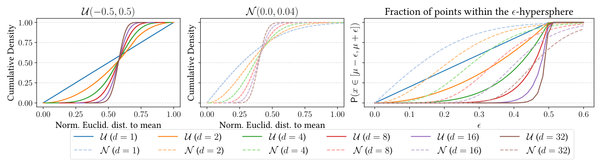
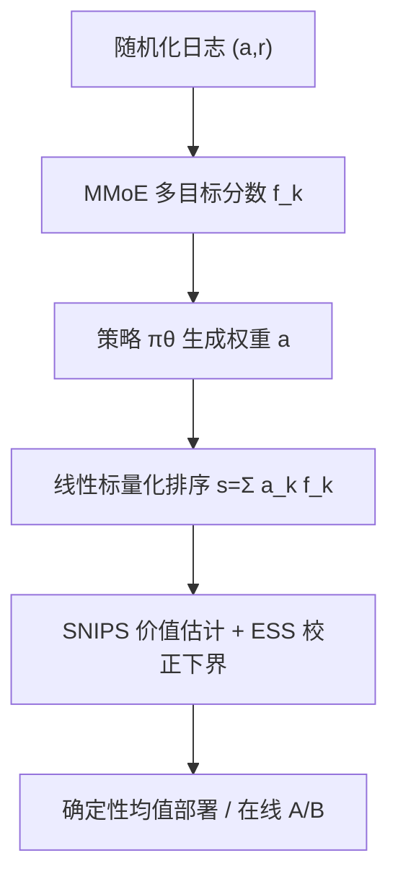
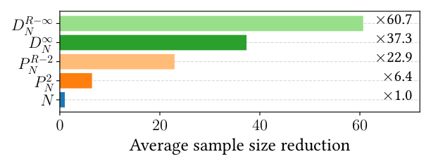

# Multi-Objective Recommendation via Multivariate Policy Learning (多目标推荐的多变量策略学习)

- **会议/期刊**: RecSys 2024
- **作者与机构**: Olivier Jeunen, Jatin Mandav, Ivan Potapov, Nakul Agarwal, Sourabh Vaid, Wenzhe Shi, Aleksei Ustimenko（ShareChat）
- **推荐链路定位**: 重排/多目标融合权重决策
- **研究方向**: 强化学习与动态探索推荐 / 多任务学习与列表级重排
- **论文原文**: [论文原文链接](https://arxiv.org/abs/2405.02141v2)
- **开源代码**: [开源代码仓库链接](https://github.com/olivierjeunen/multivariate-policy-learning-recsys-2024)（合成实验可复现；工业数据未公开）

## TL;DR (1分钟核心速览)

针对多目标推荐中线性融合权重靠人工网格搜索、且现有离策略学习多处理单目标/离散动作的问题，本文把权重向量视为连续多变量动作，用 CRM 优化 SNIPS 悲观下界，并提出 ESS 校正使小样本置信区间恢复覆盖。合成实验将达标样本量降至约 $1/60$，两个千万级短视频平台 A/B 中留存、时长与学习奖励显著提升。

## Background & Motivation (背景与核心矛盾)

- **主流范式**: 工业界常用线性标量化 $s(u,i)=\sum_{k=1}^{d} a_k f_k(u,i)$，由 MMoE 等模型产出多目标分数$f_k$，再用人工搜索/在线实验确定权重$a_k$。
- **前人局限**: ① 权重搜索空间大、调参昂贵，且难以保证落在 North Star 最优点；② 现有 bandit/OPL 多针对单奖励或离散动作，连续多变量动作下确定性策略密度为 0，IPS 方差大、置信区间覆盖不足。
- **核心洞察 (Key Insight)**: 融合权重不是预测参数，而是可直接优化的决策动作；随机化日志可做反事实评估，但 CRM 的悲观下界依赖准确方差，传统 CLT 在有限样本/低 ESS 下会低估不确定性。高维均匀日志还会破坏共同支撑，使 SNIPS 不稳定。
- **本文切入点**: 将 CRM 扩展到 $\mathbb{R}^d$ 连续动作空间，以高斯核平滑确定性策略，用 ESS 校正样本量构造更可信的下界，并用高敏感“学习型奖励”提升统计功效。

<figure class="paper-figure" markdown="span">
  <figcaption>图1：可视化高维中的维数灾难以及均匀分布的反直觉性质。左：虽然在一维中所有距离都等可能，但该性质在高维中很快消失。中：正态分布表现出类似但较不显著的行为，其累积密度的斜率较低。右：均匀采样不利于均值周围的超球体。正态采样可部分缓解这一问题。</figcaption>
</figure>

## Method (核心方法设计)

### 1. 整体框架 (Overall Architecture)

输入为随机化日志 $(a,r)$：基础排序模型 MMoE 输出 9 个行为信号$f_k(u,i)$；策略$\pi_\theta(a)$生成融合权重$a$，按$s(u,i)=\sum_k a_k f_k(u,i)$排序；用 SNIPS 估计目标策略价值，并以方差惩罚构成悲观下界训练；部署时取确定性均值$\mu$。闭环为“随机化日志→反事实估计→下界优化→在线 A/B 验证”。

### 2. 关键设计拆解 (Key Designs)

1. **连续多变量动作的核平滑 CRM**：确定性策略在连续空间密度为 0，$\pi_\theta(a)/\pi_0(a)$几乎不可算。作者用高斯核将策略平滑为$\pi_\theta(a)\approx \frac{\exp(-\frac12(a-\mu)^\top\Sigma^{-1}(a-\mu))}{(2\pi)^{d/2}\sqrt{|\Sigma|}}$；$\Sigma\to0$无偏但高方差，$\Sigma\to\infty$低方差但高偏差，部署仅用$\mu$。这使连续动作的 IPS/SNIPS 可计算，并显式暴露偏差-方差权衡。

2. **ESS 校正的悲观下界**：传统用样本量 $N$构造 CI，低 ESS 时方差被低估。定义$\tilde N=1+\frac{N(\mathrm{ESS}-1)}{\mathrm{ESS}}$，以$\tilde N$替代$N$；当$\mathrm{ESS}=N$时退化为$N$，大样本保持 CLT 一致性。CI 为$\hat V_{\mathrm{SNIPS}}\pm \Phi^{-1}(1-\alpha/2)\sqrt{\widehat{\mathrm{Var}}_{\mathrm{ESS}}/\tilde N}$。ESS 估计采用 reward-aware 的$\ell_\infty$形式$D^{R-\infty}_N=1/\max_i \tilde w_i$，其中$\tilde w_i=\pi_\theta(a_i)|r_i|/\sum_j\pi_\theta(a_j)|r_j|$。

3. **训练目标、奖励与推理**：总目标为 $\theta^\star=\arg\max_\theta \hat V_{\mathrm{SNIPS}}(\pi_\theta,\mathcal{D})-\lambda\,\mathrm{SE}_{\mathrm{ESS}}(\hat V_{\mathrm{SNIPS}})$，95% 下界取$\lambda\approx1.96$。奖励不直接用噪声大的“留存”，而用学习型敏感奖励（最大化 North Star 统计功效）。无需负采样；推理与生产一致：一次 MMoE 前向 + 权重加权求和，开销极低。

## Experimental Setup & Evaluation Protocol (实验设置与评估协议)

| 场景 | 规模/协议 | 动作与奖励 | 用途 |
| :--- | :--- | :--- | :--- |
| 合成仿真 | $d=5$，$N$从$2^3$到$2^{20}$，重复 2000 次 | 高斯日志策略，Poisson 奖励 | 验证 CI 覆盖与 ESS |
| 平台 A 离线 | 450 万用户 × 3 周随机权重日志 | 9 个行为信号，MMoE 基座 | 学习策略与核宽 $\sigma$ |
| 平台 A 在线 | 640 万用户 × 14 天 | 全局融合权重 | A/B 验证 |
| 平台 B 在线 | 1000 万用户 × 14 天 | 分 feed 融合权重 | 复现 A/B |

- **数据划分与防穿越**: 非标准 train/test；离线用随机化日志做 OPL，在线用 A/B 测试；无全库排序基准，top-$n$ 按标量化分数排序。
- **排名评测协议**: 工业场景 top-$n$ 排序；离线以 SNIPS 置信区间评估策略价值，在线以 Bonferroni 校正 95% CI 评估相对提升。
- **对比基线与超参**: 主要对照为生产 Direct Method 人工权重；ESS 变体包括 $P^2$、$P^{R-2}$、$D^\infty$、$D^{R-\infty}$；合成实验$d=5$，真实场景 9 个目标，$\lambda\approx1.96$。

## Key Experimental Results (实验关键数据)

### 1. 主实验对比 (Main Results)

原文无 5–8 个公开 SOTA 基线；下表为两个平台相对生产权重的在线 A/B 结果（95% CI，加粗为显著）。

| 平台/指标 | Retention | Time on Platform | Heavy Users | Learnt Reward |
| :--- | :---: | :---: | :---: | :---: |
| A 全局权重 | [-0.05, +0.07] | [-0.07, +0.34] | ** [+0.07, +0.30] ** | ** [+0.04, +0.27] ** |
| B 分 feed 权重 | ** [+0.01, +0.25] ** | ** [+0.08, +1.14] ** | [-0.07, +0.51] | ** [+0.03, +0.51] ** |

### 2. 消融实验 (Ablation Study)

| 组件/估计器 | 结果 |
| :--- | :--- |
| 原始 $N$（无 ESS 校正） | 达标样本量 ×1.0 |
| $P^2$ ESS | ×6.4 |
| $P^{R-2}$ ESS | ×22.9 |
| $D^\infty$ ESS | ×37.3 |
| $D^{R-\infty}$ ESS | **×60.7** |
| 奖励=Retained Users | CI 极宽，最高达 +300%，不显著 |
| 奖励=Learnt Reward | $\sigma\approx0.1$时 CI 排除 1，$p<0.05$ |

<figure class="paper-figure" markdown="span">
  <figcaption>图3：所有考虑的 C.I. 校正均显著降低了 C.I. 达到其指定覆盖水平所需的样本量：对于 𝐷𝑅−∞ 平均降至 60×。</figcaption>
</figure>

### 3. 关键实验发现 (Key Findings)

1. **ESS 校正显著降低样本成本**：传统 CLT CI 在 1 万样本内仍覆盖不足；$D^{R-\infty}$将达标样本量平均降至$1/60.7$，且大样本下收敛回 CLT，说明校正主要修复有限样本下的方差低估。
2. **奖励信号决定离线可判定性**：用“留存”作奖励时，离线估计方向为正但 CI 过宽，可能误判；改用学习型奖励后，$\sigma\approx0.1$即获得$p<0.05$ 的显著提升，验证了敏感奖励对统计功效的关键作用。
3. **线上收益小而一致**：平台 A 的 Heavy Users 与 Learnt Reward 显著提升；平台 B 的 Retention、Time 与 Learnt Reward 均显著提升。效果幅度小但跨平台复现，说明学习到的权重策略可迁移到真实业务。

## Highlights & Limitations (亮点、对比与审稿批判)

- **与代表作对比**: 相比 Spotify 的 Gini 公平聚合与腾讯的 RL 长期满意度方法，本文不手工设计聚合函数，而是把融合权重作为连续动作直接学；相比生产 Direct Method 的网格搜索，本文用 CRM 下界与 ESS 校正给出可置信的离线选择依据。
- **可迁移亮点**: ESS 校正可复用到任意 IPS/SNIPS 置信区间；高斯核平滑适用于其他“确定性连续动作”的离策略学习；学习型奖励设计可缓解 North Star 噪声大、实验功效低的问题。
- **审稿级局限批判**: ① 真实实验依赖两家平台私有日志，缺乏公开 benchmark 与标准全库排序协议，复现与横向比较受限；② 动作维度仅 9 个目标、合成实验 $d=5$，高维连续动作下的 ESS 与核宽敏感性仍未充分验证；③ 线上提升幅度较小，且平台 A 的留存/时长未显著，需更多场景检验。

## Rating (四维评分)

- **方法创新性 (Novelty)**: ⭐⭐⭐⭐ （将 CRM 扩展到连续多变量动作，并提出 ESS 校正与 reward-aware ESS 估计，机制有明确增量。）
- **评估协议与实验扎实度 (Protocol & Experiments)**: ⭐⭐⭐⭐ （合成覆盖验证 + 离线日志 + 两个千万级在线 A/B，协议完整；但无公开数据与标准排序基准。）
- **写作与数学规范度 (Clarity & Rigor)**: ⭐⭐⭐⭐ （SNIPS/CRM/ESS 推导清晰，偏差-方差解释直观；个别方差与标准误记号可更统一。）
- **工业落地与复现价值 (Industrial & Practical Value)**: ⭐⭐⭐⭐ （已部署于两个大平台，推理开销低；合成代码开源，工业数据与全链路复现仍受限。）

