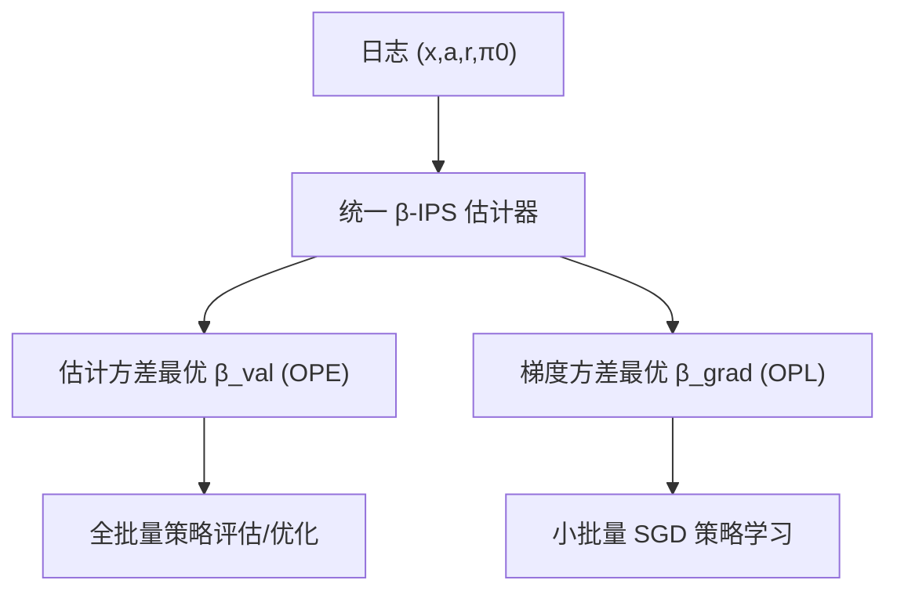

# Optimal Baseline Corrections for Off-Policy Contextual Bandits (离线上下文赌博机的最优基线校正)

- **会议/期刊**: RecSys 2024
- **作者与机构**: Shashank Gupta, Olivier Jeunen, Harrie Oosterhuis, Maarten de Rijke；University of Amsterdam / ShareChat / Radboud University
- **推荐链路定位**: 排序策略离线学习与离线评估（OPE/OPL）
- **研究方向**: 强化学习与动态探索推荐
- **论文原文**: [https://arxiv.org/abs/2405.05736v2](https://arxiv.org/abs/2405.05736v2)
- **开源代码**: [https://github.com/shashankg7/recsys2024_optimal_baseline](https://github.com/shashankg7/recsys2024_optimal_baseline)

## TL;DR (1分钟核心速览)

离线策略评估/学习中，IPS 无偏但方差大，SNIPS 仅渐近无偏且难以 mini-batch 优化，DR 依赖奖励模型且不保证降方差。本文将 SNIPS、BanditNet、常数奖励 DR 统一为带全局加法基线的 β-IPS，并分别给出最小化估计方差与梯度方差的闭式 β。OBP 合成日志与 ZOZOTOWN 真实日志上，β-IPS 的 OPE 相对误差降至 0.1078，优于 IPS/SNIPS/DR；mini-batch 学习收敛更快、梯度方差最低。

## Background & Motivation (背景与核心矛盾)

- **主流范式**: 用 IPS/SNIPS/DR 等反事实估计器，在离线日志上评估或直接优化排序策略。
- **前人局限**: IPS 无偏但方差高；SNIPS 的乘性控制变量仅渐近无偏，且其目标无法直接分解为单样本和，mini-batch 需借助 BanditNet 的 λ-IPS 重写；DR 需额外拟合奖励模型，方差降低不保证。
- **核心洞察 (Key Insight)**: 在优化视角下，SNIPS/BanditNet 与常数奖励 DR 的梯度都等价于 β-IPS 的某个 β，因此三者可被统一为“选最优 β”的问题。
- **本文切入点**: 将所有加法/乘性控制变量归约为 β-IPS，分别推导 OPE 的估计方差最优 β 与 OPL 的梯度方差最优 β。

## Method (核心方法设计)

### 1. 整体框架 (Overall Architecture)

输入为日志 $(x,a,r,\pi_0)$，先用倾向权重构造统一估计器 β-IPS；OPE 场景选择最小化估计方差的闭式 β，OPL 全批量场景同理，mini-batch 场景则选择最小化梯度方差的闭式 β，再用 SGD/Adam 优化策略。全程不拟合额外奖励模型，推理仅需对动作空间做 softmax。

### 2. 关键设计拆解 (Key Designs)

1. **统一 β-IPS 估计器**：固定 β 时 $\hat V_{\beta\text{-IPS}}=\beta+\frac{1}{|\mathcal D|}\sum_{(x,a,r)\in\mathcal D}\frac{\pi(a|x)}{\pi_0(a|x)}(r-\beta)$保持无偏；其梯度为$\frac{1}{|\mathcal B|}\sum\frac{\nabla\pi(a|x)}{\pi_0(a|x)}(r-\beta)$。当$\beta=\lambda$ 时等价 BanditNet，当 β 为常数奖励模型时等价 DR，从而把加法与乘性控制变量统一到同一族。

2. **OPE 的估计方差最优 β**：最小化 $\hat V_{\beta\text{-IPS}}$的方差，得到闭式$\beta^\star_{\mathrm{val}}=\frac{\mathbb E[((\pi/\pi_0)^2-\pi/\pi_0)r]}{\mathbb E[(\pi/\pi_0)^2-\pi/\pi_0]}$。由于固定 β 下估计器无偏，方差最小即 MSE 最小；样本估计为比率形式，仅带来渐近可忽略偏差。

3. **OPL 的梯度方差最优 β 与训练**：最小化梯度方差得到 $\beta^\star_{\mathrm{grad}}=\frac{\mathbb E[\|\nabla\pi\|_2^2\,\pi_0^{-2}r]}{\mathbb E[\|\nabla\pi\|_2^2\,\pi_0^{-2}]}$。关键点是期望对日志策略$\pi_0$采样，不需要目标策略的新 rollout，因此可直接从离线日志估计。训练无负采样，使用日志动作与倾向权重；全批量用$\beta^\star_{\mathrm{val}}$，mini-batch 用$\beta^\star_{\mathrm{grad}}$，每步开销为$O(B)$。

## Experimental Setup & Evaluation Protocol (实验设置与评估协议)

| 数据集/场景 | 类型 | 规模/动作空间 | 日志策略 | 评价指标 |
| :--- | :--- | :--- | :--- | :--- |
| OBP 合成日志 | 模拟上下文赌博机 | $N=10^2$–$10^6$，$|A|=25$–100 | softmax，逆温度$5/1/-1/-5$ | 测试策略值、梯度方差、OPE MSE/Var |
| ZOZOTOWN | 真实推荐日志 | 男装 campaign，原文未给统计量 | 均匀随机生产策略 | Abs. relative error |

- **数据划分与防穿越**: 合成实验在独立全信息测试集上评估策略值，OPE 用 100 次独立合成样本重复；真实日志用 campaign 数据，目标策略与日志策略分离，依赖 common support 假设。
- **排名评测协议**: 非传统 Top-N Full-Ranking；在全动作空间上估计策略值/OPE 误差，等价于全动作候选下的策略评估。
- **对比基线与超参**: IPS、SNIPS、BanditNet、DR；线性无偏置模型 + softmax，Adam，全批量最多 500 epochs，mini-batch batch size 1024，学习率 0.1/0.01/0.001；报告 32 次独立运行均值与 95% CI。

## Key Experimental Results (实验关键数据)

### 1. 主实验对比 (Main Results)

| 方法 | 类型 | ZOZOTOWN Abs. relative error ↓ | 合成 OPL/OPE 结论 |
| :--- | :--- | :---: | :--- |
| IPS | 无控制变量 | 0.1277 (0.0142) | 方差最高，OPL 策略值最低 |
| SNIPS | 乘性控制变量 | 0.1113 (0.0372) | 全批量优于 IPS，但慢于 β-IPS；mini-batch 不直接适用 |
| DR | 加法奖励模型 | 0.1144 (0.0366) | 依赖奖励模型，合成 OPE 不如 β-IPS 稳定 |
| BanditNet | λ-IPS 加法基线 | — | mini-batch 优于 IPS，但劣于 β-IPS |
| **β-IPS** | **闭式最优加法基线** | **0.1078 (0.0383)** | **OPE MSE 最低；mini-batch 梯度方差最低、策略值最高** |

相对最佳基线 SNIPS，β-IPS 在 ZOZOTOWN 上误差降低约 **3.1%**；相对 IPS 降低 **15.6%**，相对 DR 降低 **5.8%**。

### 2. 消融/对照实验 (Ablation & Controlled Comparison)

| 配置 | 控制变量/β | 优化目标 | 结果 |
| :--- | :--- | :--- | :--- |
| IPS | 无 | 原始 IPS | 梯度方差最大，收敛差 |
| SNIPS | 乘性归一化 | 估计值 | 全批量较好，但仅渐近无偏 |
| BanditNet | λ-IPS，λ 调参 | 梯度 | mini-batch 改善，但非最优 β |
| DR | 奖励模型 | 估计值 | 依赖模型质量 |
| β-IPS (val) | 闭式 $\beta^\star_{\mathrm{val}}$ | 估计方差 | 真实 OPE 误差最低 0.1078 |
| β-IPS (grad) | 闭式 $\beta^\star_{\mathrm{grad}}$ | 梯度方差 | mini-batch 策略值最高、梯度方差最低 |

### 3. 关键实验发现 (Key Findings)

- 在 ZOZOTOWN 上，β-IPS 的绝对相对误差 **0.1078** 低于 SNIPS 的 **0.1113**、DR 的 **0.1144** 与 IPS 的 **0.1277**，说明闭式估计基线在实际日志上可直接替代乘性归一化与常数奖励 DR。
- mini-batch OPL 中，梯度方差最优 β 使 β-IPS 在 0.1/0.01/0.001 三组学习率下均取得高于 IPS 与 BanditNet 的测试策略值；原文图 3 的对数坐标显示其梯度方差显著最低。
- 合成 OPE 在 $|A|=25$–100、逆温度$5/1/-1/-5$、$N=10^2$–$10^6$下，β-IPS 大多数设置 MSE 最低；仅$N<10^3$ 时 SNIPS 偶有更低方差，原因是比率型 β 估计的小样本偏差。

## Highlights & Limitations (亮点、对比与审稿批判)

- **与代表作对比**: 相比 BanditNet 只把 SNIPS 重写为 λ-IPS 并调 λ，本文给出方差最优 β 的闭式解；相比 DR 需奖励模型，β-IPS 仅用常数基线，参数自由且更易部署；相比 SNIPS，保留固定 β 下的无偏性。
- **可迁移亮点**: 任意 IPS 式排序/推荐策略都可加该闭式基线；OPE 用 $\beta^\star_{\mathrm{val}}$，mini-batch 学习用$\beta^\star_{\mathrm{grad}}$，几乎零额外推理成本。
- **审稿级局限**: (1) 估计方差最优 β 是比率估计，小样本有偏，且全批量 OPE 计算成本高；(2) 真实实验仅一个 ZOZOTOWN campaign，缺少大规模在线 A/B 与多场景验证；(3) 依赖 logging propensity 与 common support，倾向估计误差会放大方差。

## Rating (四维评分)

- **方法创新性 (Novelty)**: ⭐⭐⭐⭐ （统一控制变量族并给出两个闭式最优 β，理论简洁；但基于 IPS 控制变量的增量改进较明显）
- **评估协议与实验扎实度 (Protocol & Experiments)**: ⭐⭐⭐⭐ （OBP 可复现模拟 + 真实日志，32 次运行/95% CI；真实数据覆盖仍偏少）
- **写作与数学规范度 (Clarity & Rigor)**: ⭐⭐⭐⭐ （等价性与方差推导清晰，定理边界明确；估计 β 的有限样本偏差需读者留意）
- **工业落地与复现价值 (Industrial & Practical Value)**: ⭐⭐⭐⭐ （无额外奖励模型、参数自由、代码开源，适合作为 OPE/OPL 默认基线；全批量 OPE 与小样本偏差是落地约束）

