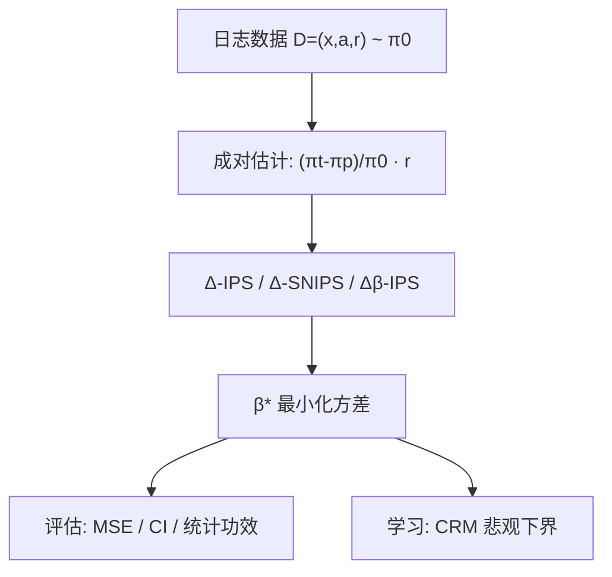
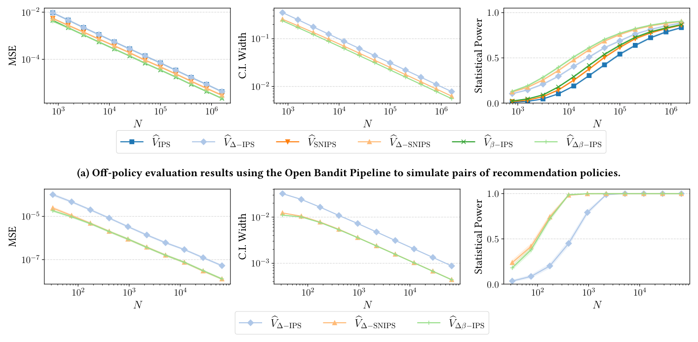

# Δ-OPE: Off-Policy Estimation with Pairs of Policies (成对策略的离线策略估计)

- **会议/期刊**: RecSys 2024 (Short Paper)
- **作者与机构**: Olivier Jeunen, Aleksei Ustimenko (ShareChat)
- **推荐链路定位**: 离线评估 / 反事实策略学习（用于线上排序策略的对照决策）
- **研究方向**: 强化学习与动态探索推荐 / 因果去偏
- **论文原文**: [arXiv:2405.10024](https://arxiv.org/abs/2405.10024v2)
- **开源代码**: [delta-OPE-recsys-2024](https://github.com/olivierjeunen/delta-OPE-recsys-2024)

## TL;DR (1分钟核心速览)

离线策略评估（OPE）的 IPS 类估计量虽无偏却高方差，置信区间过宽而无法支撑上线决策。本文指出工业界真正关心的不是 $V(\pi_t)$而是增量$V(\pi_t)-V(\pi_p)$，于是把 estimand 改写为对日志策略$\pi_0$的单一期望，导出 Δ-IPS / Δ-SNIPS / Δβ-IPS 三个成对估计量，并给出方差最优的闭式加性控制变量$\beta^\ast$。在 Open Bandit Pipeline 仿真、连续动作仿真与 160M MAU 短视频平台两周 A/B 上，Δ-OPE 的 MSE、CI 宽度与统计功效全面优于逐点估计，线上目标指标收益显著扩大。

## Background & Motivation (背景与核心矛盾)

- **主流范式**: 用日志策略 $\pi_0$采样的数据 + 逆倾向得分（IPS）无偏估计目标策略$\pi_t$ 的价值；方差缩减靠 SNIPS（乘性控制变量）或 β-IPS（加性控制变量），学习端靠 CRM 悲观下界。
- **前人局限**: ① 无偏性与高方差天然对立，逐点估计的 CI 过宽，type-II 错误率高，线上无法据其判断"是否值得替换现有生产策略"；② 生产策略 $\pi_p$与$\pi_t$ 高度相关，但逐点范式把二者当作独立个体分别估值，白白丢弃了相关性带来的可用信息。
- **核心洞察 (Key Insight)**: 由方差分解 $\mathrm{Var}(V_\Delta)=\mathrm{Var}(V(\pi_t))+\mathrm{Var}(V(\pi_p))-2\mathrm{Covar}(V(\pi_t),V(\pi_p))$，只要$\mathrm{Var}(V(\pi_p))<2\mathrm{Covar}(V(\pi_t),V(\pi_p))$成立，成对估计的方差就严格低于逐点估计——而这一条件在推荐场景几乎必然满足，因为$\pi_t$通常是对$\pi_p$ 的小幅微调。
- **本文切入点**: 将 OPE 重新定义为"成对"估计任务 Δ-OPE，把两个策略价值之差写成对 $\pi_0$ 的单一期望，从而在不牺牲无偏性的前提下获得更紧置信区间。

## Method (核心方法设计)

### 1. 整体框架 (Overall Architecture)

输入是由随机日志策略 $\pi_0$采集的三元组$\mathcal{D}=\{(x_i,a_i,r_i)\}$；核心模块将"两个策略价值的差"重写为可被同一条样本同时估计的量，即倾向比之差$(\pi_t(a|x)-\pi_p(a|x))/\pi_0(a|x)$乘奖励$r$。在此骨架上依次套用三种控制变量得到三个估计量，再由$\beta$ 的闭式解做方差最小化。输出既可作为评估统计量（配合样本方差与 CI），也可代入 CRM 悲观下界完成策略学习，最后在仿真环境与线上 A/B 完成闭环验证。

### 2. 关键设计拆解 (Key Designs)

1. **成对估计量 Δ-IPS（把差值写进单一期望）**：痛点是把 $V(\pi_t)$与$V(\pi_p)$ 分开估导致方差相加。核心改写为

$$V_\Delta(\pi_t,\pi_p)=\mathbb{E}_{a\sim\pi_0}\!\left[\frac{\pi_t(a|x)-\pi_p(a|x)}{\pi_0(a|x)}\,r\right],$$

对应的经验估计量即 $\hat V_{\Delta\text{-IPS}}$。直觉：分子是两个概率之差，当$\pi_t$与$\pi_p$ 越接近，分子越小、逐样本方差越低，"系统性的共同抖动"被相减抵消，这正是协方差项在起作用的物理表现。

2. **加性控制变量 Δβ-IPS 与最优 $\beta^\ast$**：在成对估计上再减一项$\beta$，利用$\mathbb{E}_{\pi_0}[\pi_t/\pi_0]=\mathbb{E}_{\pi_0}[\pi_p/\pi_0]=1$ 保证无偏性，形式化导出方差最小化条件

$$\beta^\ast=\frac{\mathbb{E}\big[\left(\tfrac{\pi_t-\pi_p}{\pi_0}\right)^2 r\big]}{\mathbb{E}\big[\left(\tfrac{\pi_t-\pi_p}{\pi_0}\right)^2\big]},$$

即"按倾向比之差平方加权的奖励均值"。相比 SNIPS 的比值形式，加性项保持线性、支持小批量优化，且因为是方差的二次函数，$\beta^\ast$使估计误差在 MSE 意义下最优。特例$\pi_p\equiv\pi_0$ 时 Δ-IPS 退化为 Williams 基线校正，说明本框架统一了既有做法。

3. **训练目标与推理开销**：学习端沿用 Counterfactual Risk Minimization，用样本方差惩罚构造悲观下界 $\mathcal{L}=-(\hat V_\Delta-\lambda\hat\sigma)$ 作为损失；估计器线性可加，无需额外负采样。相比 doubly robust 需要训练奖励模型，加性控制变量只多一次常数估计，推理/训练开销几乎为零，这是其在工业可部署性上的关键优势。

## Experimental Setup & Evaluation Protocol (实验设置与评估协议)

- **数据集与预处理**: 本文无传统交互数据集，采用三类实验，统计如下：

| 实验 | 来源 | 规模/参数 | 说明 |
| :--- | :--- | :--- | :--- |
| 离散动作仿真 | Open Bandit Pipeline | $\vert\mathcal{A}\vert\in\{5,10,15\}$，softmax 温度$\{1,2,4\}$，$N\in[800,1.6M]$|$\pi_{\text{lr}}$与$\pi_{\text{rf}}$ 两策略对 |
| 连续动作仿真 | 自建 Numpy/Scipy | 5 维各向同性高斯，$\Sigma=0.5I$，真实$\Delta=0.005$ | 模拟多目标标量化权重 |
| 线上 A/B | 短视频平台 | 160M MAU，两周，6.4M/14.8M 用户 | 生产环境对照 |

- **数据划分与防穿越**: 仿真以 $10^3{-}10^6$ 的样本量级逐一评估、重复 1000 次消除随机化噪声；线上采用两周随机对照 A/B，确保无穿越。
- **排名评测协议**: 属离策略评估协议，非全库排序——评估指标为 MSE、95% CI 宽度与统计功效（$1-$type-II error）；线上用 Bonferroni 校正的 95% CI，显著阈值$p<0.05$。
- **对比基线与超参**: 逐点 IPS/SNIPS/β-IPS 对成对 Δ-IPS/Δ-SNIPS/Δβ-IPS；$\beta$ 取经验闭式解，学习目标最大化相应下界。

## Key Experimental Results (实验关键数据)

### 1. 主实验对比 (Main Results)

估计量族在离散与连续仿真的相对表现（源文图 1 定性排序，↓为好，加粗为最优）：

| 估计量 | MSE | CI 宽度 | 统计功效 | 备注 |
| :--- | :---: | :---: | :---: | :--- |
| IPS (逐点) | 高 | 无法成对量化 | 低 | 基线 |
| SNIPS (逐点) | 中 | — | 中 | 乘性控制变量 |
| β-IPS (逐点) | 中 | — | 中 | 加性控制变量 |
| Δ-IPS (成对) | 中 | 中 | 中 | 成对基线 |
| Δ-SNIPS (成对) | 低 | 较窄 | 较高 | Delta 法近似方差 |
| **Δβ-IPS (成对)** | **最低** | **最窄** | **最高** | 仿真+连续双最优 |

线上 A/B（Bonferroni 校正 95% CI，加粗为相对更优的收益区间）：

| 优化目标 | 周期/规模 | Retention | Engaging Users | Learnt Reward |
| :--- | :--- | :---: | :---: | :---: |
| $\hat V_{\text{SNIPS}}$ 下界 (逐点) | 14d / 6.4M | [−0.05%, +0.07%] | [−0.12%, +0.12%] | [+0.04%, +0.27%] |
| $\hat V_{\Delta\text{-SNIPS}}$ 下界 (成对) | 14d / 14.8M | [−0.04%, +0.06%] | **[+0.00%, +0.19%]** | **[+0.14%, +0.32%]** |

### 2. 消融实验 (Ablation Study)

以"控制变量类型"作为消融维度（成对骨架固定）：

| 配置 | 离散动作仿真 | 连续动作仿真 | 结论 |
| :--- | :---: | :---: | :--- |
| w/o 成对 (逐点 IPS) | 功效低、CI 宽 | **统计功效≈0** | 成对是必要前提 |
| w/o 控制变量 (Δ-IPS) | 中等 | 中等 | 仅享受协方差收益 |
| w/ 乘性 (Δ-SNIPS) | 较好 | 较优 | 方差不稳定，需 Delta 法近似 |
| w/ 加性+$\beta^\ast$ (Δβ-IPS) | **最优** | **最优** | 闭式最优、可小批量 |

### 3. 关键实验发现 (Key Findings)

1. **成对骨架是增益主因**：连续动作仿真中逐点方法的统计功效为 0（CI 全部重叠），一旦切换成对估计即恢复可用功效，说明"高方差导致漏检"的诊断准确。
2. **加性控制变量优于乘性**：$\Delta\beta$-IPS 在两类仿真中都取得 MSE 最低、CI 最窄、功效最高，与$\beta^\ast$ 的方差最优性理论一致；同时保留线性可分小批量优化的工程优势。
3. **线上收益显著且外溢**：$\Delta$-SNIPS 下界训练的策略在 Engaging Users$[+0.00\%,+0.19\%]$与 Learnt Reward$[+0.14\%,+0.32\%]$ 均显著为正，而逐点 SNIPS 的 Engaging Users CI 跨越 0，直接印证成对目标带来更强决策力。

<figure class="paper-figure" markdown="span">
  <figcaption>图1：Δ-OPE 估计器系列显著提升性能，其中 Δ𝛽-IPS 始终表现最佳。</figcaption>
</figure>

## Highlights & Limitations (亮点、对比与审稿批判)

- **与代表作对比 (vs. Prior Work)**: Swaminathan & Joachims 的 CRM 与 Gupta 等的 β-IPS 均聚焦"单策略估值+控制变量"，把 $\pi_t$和$\pi_p$ 视作互不相关的个体；本文的关键增量是把二者放进同一期望、主动利用协方差，因而在同等样本量下 CI 更紧。相比 doubly robust，同类方差收益无需训练奖励模型，工程代价更低。
- **可迁移亮点**: ① "把两策略价值差写成单一期望"这一改写可用于其他 IPS 场景（如双模型对比、A/B 前置门控）；② 在 $\pi_p\equiv\pi_0$ 退化为基线校正的等价性，可作为旧有指标的免费升级。
- **审稿级局限批判**: ① 经典 OPE 的 common-support 与 unconfoundedness 假设仍被沿用，$\pi_t$与$\pi_0$支撑不交叠时倾向比爆炸的数值稳定性未讨论；② 仿真场景相对简单（模仿学习两模型或高斯均值），与真实高维曝光位置共享/连续动作对齐的复杂性尚有差距；③$\Delta$-SNIPS 只能渐近无偏且需 Delta 法近似方差，稳定性弱于加性版本。

## Rating (四维评分)

- **方法创新性 (Novelty)**: ⭐⭐⭐⭐ （把 OPE 从点估值翻转为成对差值，方差分解条件给出清晰的物理直觉与最优 β 闭式解）
- **评估协议与实验扎实度 (Protocol & Experiments)**: ⭐⭐⭐⭐ （仿真+连续+真实线上三层验证，Bonferroni 校正与统计功效指标严谨，但仿真规模偏小）
- **写作与数学规范度 (Clarity & Rigor)**: ⭐⭐⭐⭐ （估计量推导与无偏性证明简洁干净，Δ-SNIPS 方差近似虽需 Delta 法但表述清楚）
- **工业落地与复现价值 (Industrial & Practical Value)**: ⭐⭐⭐⭐⭐ （加性变量零额外推理开销、支持小批量，源码开源，160M MAU 线上 A/B 直接背书）

