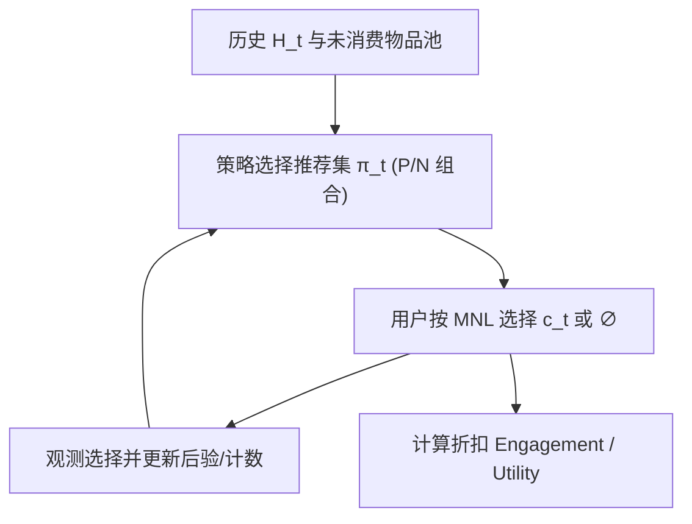

# The Fault in Our Recommendations: On the Perils of Optimizing the Measurable（我们的推荐之误：优化可测量指标的风险）

- **会议/期刊**: RecSys 2024
- **作者与机构**: Omar Besbes, Yash Kanoria, Akshit Kumar；Columbia Business School
- **推荐链路定位**: 在线推荐策略（列表级探索/重排）
- **研究方向**: 强化学习与动态探索推荐 / 曝光流行度去偏
- **论文原文**: [https://arxiv.org/abs/2405.03948v1](https://arxiv.org/abs/2405.03948v1)
- **开源代码**: 暂未开源

## TL;DR (1分钟核心速览)

本文直击推荐系统以点击/消费时长等**可测量 engagement** 作为 utility 代理所导致的错位：在两类物品、重复消费、MNL 选择模型下，纯 engagement 最优策略会退化为“永远推流行品”，造成显著 utility 损失。作者提出 **PEAR**：初始并排推荐流行品与 niche 品，用贝叶斯后验收紧探索，再切回流行品。理论证明当平台越前瞻（$\delta\to1$）时，PEAR 可同时逼近最优 utility 与最优 engagement；数值上$\delta=0.99$ 时 utility 相对 APP 提升 **53.4%**，engagement 仅降 **0.12%**。

## Background & Motivation (背景与核心矛盾)

- **主流范式**: 现代推荐多为 ranking-based，按预测 engagement 排序；点击、购买、停留时长被当作效用代理。
- **前人局限**: engagement 与用户真实 utility 常不一致；流行度偏差使系统过度推荐热门内容，niche 高价值物品探索不足。
- **核心洞察 (Key Insight)**: 推荐列表可容纳多个物品，故可把“高风险高回报”的 niche 品与流行品**并排**展示；用户可忽略不喜欢的项，从而以极低 engagement 成本完成探索。
- **本文切入点**: 用简约重复选择模型刻画 engagement-utility 错位，并设计不直接测量 utility 的 PEAR 策略。

## Method (核心方法设计)

### 1. 整体框架 (Overall Architecture)

系统每轮从流行类 $P$与 niche 类$N$中选$K=2$个未消费物品组成$\pi_t$；用户按多项 Logit 在$\pi_t\cup\{\emptyset\}$中选择效用最大项，平台仅观测选择$c_t$，不观测真实效用。PEAR 用$c_t$更新“该用户偏好 niche”的后验$p_t$：$p_t\ge p$时推荐一$P$一$N$，否则推荐双$P$。DICE 则先探索$T$轮，再按计数定制。评估用无限时域折扣期望 engagement/utility；理论在两点分布、$p\to0$ 下给闭式，数值在 Pareto 重尾下检验稳健性。

### 2. 关键设计拆解 (Key Designs)

1. **双指标重复选择模型（把“点不点”与“点后价值”解耦）**：痛点是以 engagement 代理 utility。模型令 $u_i=V_{\tau(i)}+\epsilon_i$，用户选择$c_t=\arg\max_{j\in\pi_t\cup\{\emptyset\}}u_j$；指标为$\mathrm{Eng}(\pi)=\mathbb{E}\sum_{t\ge0}\delta^t\mathbb{I}[c_t\neq\emptyset]$与$\mathrm{Util}(\pi)=\mathbb{E}\sum_{t\ge0}\delta^t\max_{j\in\pi_t\cup\{\emptyset\}}u_j$。这样可显式暴露“高点击低价值”与“低点击高价值”的不一致。

2. **PEAR 后验探索与停止（并排探索降低 engagement 成本）**：痛点是无 utility 标签时难以决定探索多久。PEAR 维护 niche 高价值概率后验，初始一 $P$一$N$；当$p_t$低于先验$p$即停止探索。后验更新为$p_{t+1}=\left(1+\frac{1-p}{p}\frac{\rho_2^S(1-\rho_2)^F}{\rho_1^S(1-\rho_1)^F}\right)^{-1}$，其中$S,F$ 为 niche 选择成功/失败计数。直觉是：niche 与流行品并排时，用户可忽略 niche，探索的短期 engagement 损失被“列表冗余”吸收。

3. **理论刻画与推理效率**：APP 永远双 $P$，在$p\to0$时是 engagement 最优；PEAR 在$\delta\to1$时满足$\lim_{\delta\to1}\lim_{p\to0}\mathrm{Eng(PEAR)}/\mathrm{Eng(APP)}=1$，且$\lim_{\delta\to1}\lim_{p\to0}\mathrm{Util(PEAR)}/\mathrm{Util(APP)}=1+\frac{1}{\ln(1+2e^{V_P})}$。无参数训练、无负采样；PEAR 每轮仅更新$S,F,p_t$，推理$O(1)$，但需$p,V_P$先验；DICE 免先验但$T$ 敏感。

## Experimental Setup & Evaluation Protocol (实验设置与评估协议)

- **数据集与预处理**: 本文非离线基准论文，无用户-物品交互数据集；以下为解析/数值仿真设置：

| 评估场景 | 用户/物品设定 | 交互/时域 | 关键参数 | 说明 |
| :--- | :--- | :--- | :--- | :--- |
| 两点分布理论 | 2 类物品；$P$均值$V_P$，$N$均值 0 | 无限时域折扣 |$p\to0$,$\delta\in[0,1)$,$V_P=1$ | 闭式定理/推论 |
| Pareto 数值 | niche $\sim \mathrm{GPD}(\mu=-1,\sigma=1-\xi)$| 同上 |$\xi\in\{0,.25,.5,.75,.9,.99\}$ | 检验重尾/轻尾 |
| 策略对比 | $K=2$，未消费物品 | 同上 | APP/PEAR/DICE/Oracle | 非真实数据 |

- **数据划分与防穿越 (Splitting Strategy)**: 无离线划分；策略为在线非预知，仅用历史 $H_t$，不使用未来选择；$p\to0$、$\delta\to1$ 为渐近分析。
- **排名评测协议 (Ranking Protocol)**: 非 Full-Ranking/Sampled Ranking；直接比较期望 engagement 与 utility，闭式或数值计算，无负采样、无 NDCG/AUC。
- **对比基线与超参设置**: APP（双 $P$，engagement greedy）、DO（首轮探索后接最优）、PEAR、DICE($T$)、Oracle OPT；$K=2$，$V_P=1$，$\delta\in\{0,0.9,0.99,0.999\}$；无 embedding 维度；无显著性检验，依赖解析不等式+数值。

## Key Experimental Results (实验关键数据)

### 1. 主实验对比 (Main Results)

原文非标准离线实验，核心策略对比如下（数值来自 Table 1，$\delta=0.99$ 时 PEAR 相对 APP：utility +53.4%，engagement -0.12%）：

| 策略 | 探索方式 | $\delta=0.99$ΔEng |$\delta=0.99$ ΔUtil | 理论/角色 |
| :--- | :--- | :---: | :---: | :--- |
| APP | 无 | **0（基准，Eng 最优）** | 0（基准） | $p\to0$ 时 Eng 最优 |
| DO | 仅首轮一 $P$一$N$ 后接 E-OPT | 低于 APP | — | 证明 APP 优于该探索 |
| PEAR | 后验停止 | -0.12% | **+53.4%** | Util 近最优，Eng 近 APP |
| DICE | 前 $T$轮探索后定制 | 图示近 0 | 图示显著 > APP | 免先验，$T$ 敏感 |
| Oracle OPT | 已知用户偏好 | — | 上界 | Util 最优 |

### 2. 消融实验 (Ablation Study)

以“探索强度/前瞻性”为消融维度，PEAR 相对 APP 的变化：

| 变体/参数 | 探索长度 | ΔEng | ΔUtil | 解释 |
| :--- | :--- | :---: | :---: | :--- |
| APP | 0 | 0 | 0 | 无探索，纯利用 |
| PEAR, $\delta=0$ | 后验停止（短视） | -10.6% | +29.3% | 探索成本被短期放大 |
| PEAR, $\delta=0.9$ | 后验停止 | -1.2% | +51.1% | 前瞻性提升后成本下降 |
| PEAR, $\delta=0.99$ | 后验停止 | -0.12% | **+53.4%** | 近“双优” |
| PEAR, $\delta=0.999$ | 后验停止 | **-0.011%** | **+53.7%** | 越长期主义越划算 |

### 3. 关键实验发现 (Key Findings)

- **错位是不对称的**：$\delta=0.99$时 PEAR 仅损失 **0.12%** engagement，却获得 **53.4%** utility；$\delta\to1$时 engagement 比趋 1，而 utility 比趋于$1+\frac{1}{\ln(1+2e^{V_P})}$，$V_P=1$ 时约 **+53.7%**。
- **平台越前瞻，探索越便宜**：$\delta=0$时 PEAR 需付 **-10.6%** engagement 换 **+29.3%** utility；$\delta=0.999$ 时仅 **-0.011%** engagement 换 **+53.7%** utility，说明长期折扣会改变最优探索结论。
- **多物品并排是关键机制**：APP 在 $p\to0$时 engagement 最优，但 utility 缺口不消失；PEAR 与 DICE 在 Pareto 重尾$\xi$ 较大时均显示“engagement 差很小、utility 增益显著”，验证了列表冗余可承载低成本探索。

## Highlights & Limitations (亮点、对比与审稿批判)

- **与代表作对比 (vs. Prior Work)**: 与流行度偏差的实证/案例研究不同，本文将 engagement-utility 错位写成可解析的重复选择模型；与经典 explore-then-commit 的 DICE 不同，PEAR 用后验停止而非固定 $T$；与纯 ranking 的 engagement 最大化相比，本文强调“列表内并排探索”而非单物品贪心。
- **可迁移亮点**: ①在精排/重排列表中固定保留一个探索位，与热门品并排展示；②用贝叶斯后验/计数停止代替固定探索轮数；③用长期折扣指标评估探索策略，而非只看次日点击。
- **审稿级局限批判**: 模型高度 stylized：仅两类物品、$K=2$、MNL、无饱和度/时间变化偏好，结论外推到真实多类目需谨慎；PEAR 依赖$p,V_P$先验，DICE 对$T$ 敏感；无真实数据与线上 A/B，且未开源代码。

## Rating (四维评分)

- **方法创新性 (Novelty)**: ⭐⭐⭐⭐ （把 engagement-utility 错位转化为列表级探索问题，PEAR 的后验停止与“并排探索”直觉清晰，但模型较 stylized）
- **评估协议与实验扎实度 (Protocol & Experiments)**: ⭐⭐⭐ （理论闭式与 Pareto 数值稳健性较好，但无真实数据集/线上实验，基线仅策略级）
- **写作与数学规范度 (Clarity & Rigor)**: ⭐⭐⭐⭐ （定理、推论与策略定义紧凑，MNL 推导规范；部分记号与算法描述可更统一）
- **工业落地与复现价值 (Industrial & Practical Value)**: ⭐⭐⭐ （“保留探索位+后验停止”易迁移，但效用不可测、先验依赖与无开源限制落地）

