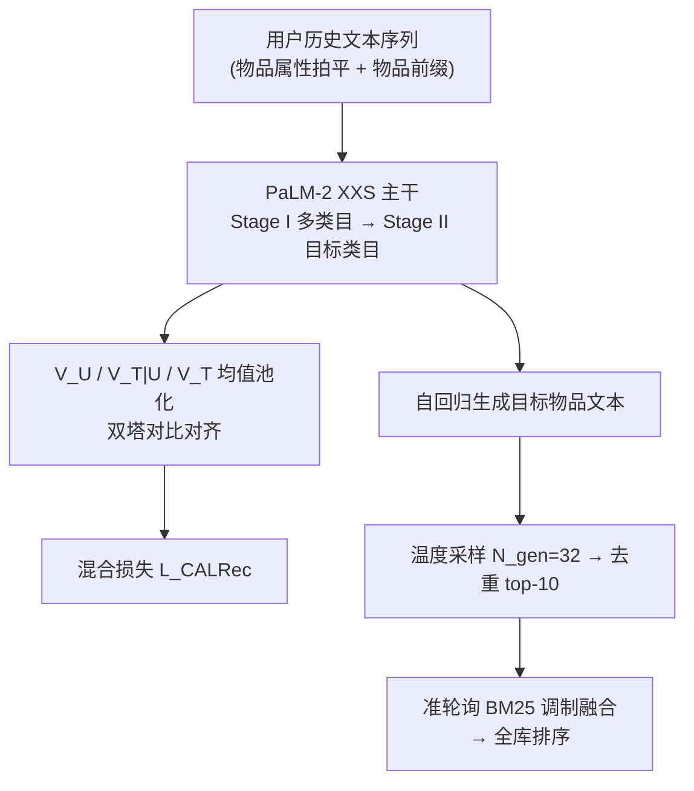
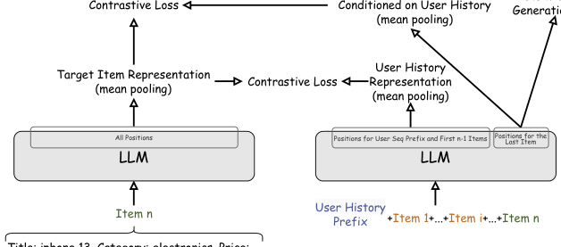

# CALRec: Contrastive Alignment of Generative LLMs for Sequential Recommendation (面向序列推荐的生成式 LLM 对比对齐)

- **会议/期刊**: RecSys 2024 (Long Paper)
- **作者与机构**: Yaoyiran Li, Xiang Zhai, Moustafa Alzantot, Keyi Yu, Ivan Vulić, Anna Korhonen, Mohamed Hammad（University of Cambridge / Google）
- **推荐链路定位**: 端到端生成式召回（LLM 直接生成下一物品文本，再由 BM25 落库）
- **研究方向**: 序列与会话推荐 / 大语言模型推荐
- **论文原文**: [https://arxiv.org/abs/2405.02429v2](https://arxiv.org/abs/2405.02429v2)
- **开源代码**: 暂未开源（基于 JAX + PAX 内部实现）

## TL;DR (1分钟核心速览)

纯文本序列推荐在“LLM 生成物品描述 → 文本模糊匹配回物品库”这条链路上存在两个断点：token 级语言建模目标与物品级偏好排序不对齐、单域微调难以跨类目迁移。CALRec 用「多类目联合微调 + 目标类目微调」两阶段，在生成损失之上叠加两个双塔 InfoNCE 对齐损失（预测-目标、历史-目标），并以准轮询 BM25 融合多次采样结果。在 Amazon Review 5-core 去重数据、Leave-One-Out 全库排序协议下，Recall@1 相对最优基线 +37.3%，NDCG@10 +23.8%。

## Background & Motivation (背景与核心矛盾)

- **主流范式**: 序列推荐以 ID 序列建模为主（SASRec/BERT4Rec），近期出现以物品文本表征替代/补充 ID 的方案（UniSRec、Recformer），以及把序列推荐写成“句子补全”或“问答”的 LLM 方案（GPT4Rec、P5）。
- **前人局限**: ① 文本或 ID 表征受限于固定的物品嵌入空间，序列与目标物品的对齐只在 embedding 层完成，缺乏生成式推理；② LLM 方案各自针对单个类目独立微调，跨类目共享知识未被打通；③ token 级自回归损失只约束“字面复现”，不直接约束“用户历史 → 目标物品”的语义距离。
- **核心洞察**: 文本生成与物品级对齐可以互补——NIG 负责学习物品属性文本格式与记忆，对比损失负责把历史表征与目标表征拉近；同时作者发现原始 Amazon 序列中 4%–9.4% 的相邻购买完全重复（同 ASIN 同时间戳），这才是“推荐上一件物品”类基线虚高的根源。
- **本文切入点**: 用两阶段、双目标（生成 + 双对比）微调，并在推理端用带生成分数调制的 BM25 融合完成文本到物品的落地。

## Method (核心方法设计)

### 1. 整体框架 (Overall Architecture)

每件物品把 title/category/brand/price 等属性拍平成 `Attribute Name: Value` 的单一 token 串，丢弃 ID 类噪声字段；用户序列前加用户级前缀（“This is the summary of a user's purchase history.”），每件物品前加相同物品前缀（“The first/next item bought is as follows.”），序列末尾再重复一次该物品前缀以触发补全式生成。Stage I 用 14 个类目混合数据让模型学习“序列推荐”这一任务形态与类目无关的文本模式；Stage II 在 6 个目标类目上各自继续微调。两个阶段目标函数一致：token 级 NIG + 两个物品/用户级 InfoNCE。推理时温度采样生成 32 条候选文本，去重取 top-10，与全库做 BM25 匹配并融合排序。

<figure class="paper-figure" markdown="span">
  <figcaption>图1：CALRec：训练框架。</figcaption>
</figure>

### 2. 关键设计拆解 (Key Designs)

1. **生成目标 NIG（只在目标物品 token 上计损失）**：把用户序列 token 化后前 $m$个 token 属于历史、后$l-m$个属于目标物品，损失只覆盖目标段，避免模型把算力浪费在复述历史上——$\mathcal{L}_{NIG}=\mathbb{E}_{\mathbf{t}\sim p(\mathbf{t})}\big[\sum_{j=m+1}^{l}\log P(t_j\mid t_{1:j-1};\theta)\big]$。物理直觉是把“下一物品”当作一段可生成的文本，从而复用 LLM 的属性知识与格式记忆能力。
2. **双塔对比对齐（TT + UT）**：NIG 停留在 token 级，无法保证历史语义与目标物品在同一空间靠近。对最后一层隐状态做 mean pooling 得到目标塔 $\mathbf{v}_T$、历史塔$\mathbf{v}_U$、历史条件下的目标塔$\mathbf{v}_{T\mid U}$，两个 InfoNCE 分别对齐“条件预测 ↔ 真目标”和“历史 ↔ 目标”，均使用 in-batch 负样本、温度$\tau_c=0.5$：$\mathcal{L}_{TT}=-\frac{1}{N_b}\sum_i\log\frac{\exp(\cos(\mathbf{v}_{T\mid U_i},\mathbf{v}_{T_i})/\tau_c)}{\sum_{j}\exp(\cos(\mathbf{v}_{T\mid U_j},\mathbf{v}_{T_i})/\tau_c)}$，$\mathcal{L}_{UT}$同构，仅把$\mathbf{v}_{T\mid U}$换成$\mathbf{v}_U$。总损失$\mathcal{L}_{CALRec}=(1-\alpha-\beta)\mathcal{L}_{NIG}+\alpha\mathcal{L}_{TT}+\beta\mathcal{L}_{UT}$，取$\alpha=0.125$、$\beta=-0.025$（负权重，实际是压低 UT 的贡献，仅在 Games 类目改为$\beta=0$）。
3. **准轮询 BM25 检索（训练无关的落库算子）**：生成文本不保证在库中，故对每条采样文本与全库算 BM25 得 $(N_c,N_{pred})$矩阵；每列先线性缩放至$[0,1]$，再乘调制因子$e^{\epsilon s}$（$s$为该样本对数概率，$\epsilon=1/5000$），最后沿采样轴 max-pool。缩放使各列可比、调制保证 top-1 生成的 top-1 命中仍是融合后 top-1；当$\epsilon\to0$ 时退化为“各文本最佳命中轮流占位”的轮询式融合。

## Experimental Setup & Evaluation Protocol (实验设置与评估协议)

- **数据集与预处理**: Amazon Review 2018，`5-core` 过滤；四个属性截断至 25/15/15/15 词；并对用户序列按（同 ASIN + 同 review 文本 + 同评分 + 同时间戳）做严格去重。

| 数据集(Stage II) | #Users | #Items | #Interactions | 密度 | 去重比例 |
| :--- | :---: | :---: | :---: | :---: | :---: |
| Scientific | 9,461 | 5,282 | 66,644 | 0.0013 | 5.5% |
| Instruments | 25,577 | 10,599 | 214,526 | 0.00079 | 4.0% |
| Arts | 47,197 | 22,828 | 411,449 | 0.00038 | 9.4% |
| Office (50% 采样) | 44,736 | 27,482 | 352,151 | 0.00029 | 6.3% |
| Games | 50,940 | 17,383 | 457,060 | 0.00051 | 4.7% |
| Pet (20% 采样) | 43,135 | 37,712 | 380,623 | 0.00023 | 5.9% |

- **数据划分与防穿越**: `Leave-One-Out` 变体——Stage I/II 训练用前 $n-2$ 件，倒数第二件作 Stage II 验证，最后一件为测试；Stage I 另有 7 个类目仅用于训练（3.37M 用户），`CD and Vinyls` 作 Stage I 模型选择。
- **排名评测协议**: 无偏 `Full-Ranking`（对全物品库按 BM25 匹配分排序），并首次对文本类方法同时报告 `opt`（并列时真值排最前）与 `pes`（并列时排最后）两种并列处理方式，避免与 ID 类方法比较时失真。
- **对比基线与超参**: ID-only（BERT4Rec、SASRec）、ID+Text（FDSA、S3-Rec、UniSRec-ID+Text）、Text-only（UniSRec-Text、Recformer、LIR 末项复读器）；主干 PaLM-2 XXS，batch 512，lr 1e-4，最大输入 1024 token、输出 80 token，训练时随机截断末 $k\in\{0..4\}$件做增广；模型选择用 NDCG@10(pes)，对比损失增益用配对 t 检验（$p<0.05$）。

## Key Experimental Results (实验关键数据)

### 1. 主实验对比 (Main Results)

6 类目平均（文本类方法报 `opt/pes`）：

| 模型 | NDCG@10 | Recall@1 | Recall@10 | MRR |
| :--- | :---: | :---: | :---: | :---: |
| BERT4Rec (ID) | 0.0482 | 0.0312 | 0.0701 | 0.0460 |
| SASRec (ID) | 0.0550 | 0.0108 | 0.1018 | 0.0461 |
| FDSA (ID+Text) | 0.0655 | 0.0424 | 0.0948 | 0.0619 |
| S3-Rec (ID+Text) | 0.0507 | 0.0187 | 0.0883 | 0.0446 |
| UniSRec (Text) | 0.0645 | 0.0190 | **0.1170** | 0.0552 |
| UniSRec (ID+Text) | 0.0581/0.0558 | 0.0228/0.0175 | 0.1003/0.1002 | 0.0514/0.0484 |
| Recformer | 0.0592/0.0556 | 0.0279/0.0197 | 0.0951/0.0949 | 0.0531/0.0483 |
| LIR (末项复读) | 0.0391/0.0364 | 0.0069/0.0036 | 0.0736/0.0717 | 0.0311/0.0283 |
| **CALRec** | **0.0811/0.0790** | **0.0582/0.0530** | 0.1093/0.1091 | **0.0757/0.0729** |
| Improv. (opt) | +23.8% | +37.3% | −6.6% | +22.3% |

### 2. 消融实验 (Ablation Study)

| 变体 | Sci NDCG@10 | Sci R@1 | Inst NDCG@10 | Inst R@1 |
| :--- | :---: | :---: | :---: | :---: |
| CALRec 完整 | **0.0788** | **0.0511** | **0.0909** | **0.0718** |
| w/o 多类目联合微调 (A) | 0.0727 | 0.0441 | 0.0870 | 0.0673 |
| w/o 类目特定微调 (B) | 0.0717 | 0.0424 | 0.0867 | 0.0715 |
| w/o 对比对齐 | 0.0771 | 0.0495 | 0.0905 | 0.0711 |
| 原始 PaLM-2（不微调） | 0.0326 | 0.0090 | 0.0257 | 0.0041 |

### 3. 关键实验发现 (Key Findings)

1. **两阶段缺一不可，但 Stage I 单阶段已“可部署”**：去掉 Stage I 使 Scientific NDCG@10 由 0.0788 降至 0.0727（−7.7%），去掉 Stage II 降至 0.0717（−9.0%）；而仅 Stage I 的多类目单模型已能与完整两阶段的单类目模型打平，意味着一个多租户模型可同时服务全部类目。
2. **对比对齐增益小而稳定，且主要抬升头部排序**：6 类目平均 NDCG@10 提升 1.00%、Recall@1 提升 1.39%，配对 t 检验 $p=0.0076$（Recall@1 为$p=0.0027$）；增益集中在 Recall@1/MRR 而非 Recall@10，说明 InfoNCE 拉近的是“最优那一个”而非扩大候选覆盖面。
3. **去重直接戳破“复读基线”的假象**：同一 LIR 基线在未去重数据上 Recall@1 为 0.0275–0.0511，去重后跌至 0.0015–0.0142（降幅 60%–95%），NDCG@10 降 36%–58%——此前文本类工作的部分领先极可能来自相邻重复购买的泄漏。
4. **Recall@10 是明确短板**：CALRec 该项 −6.6% 落后 UniSRec(ID+Text)，源于温度 0.5 的准贪婪采样使 top-10 多样性不足；改用分层属性精确匹配替代 BM25 时，多数类目仅小幅下降（−0.4% ~ −5.2%），仍优于全部基线。

## Highlights & Limitations (亮点、对比与审稿批判)

- **与代表作对比**: 相较 P5（把序列推荐做成 ID 生成），CALRec 生成的是属性文本并以双塔对比显式对齐物品级语义；相较 GPT4Rec（GPT-2 逐域微调 + 单向句补全、无对比项），本文增加了跨类目 Stage I 与 InfoNCE，且用模板消融证明共享物品前缀带来的 Recall@1 差距达 30%–45%；相较 Recformer（Longformer 编码器、MLM + 对比、未去重且只报 opt 指标），本文在评测口径上更严格（同时报告 pes）。
- **可迁移亮点**: ① 用 `opt/pes` 双口径报告文本生成式推荐的并列排名，可避免文本匹配导致的分数虚高；② 准轮询 BM25 融合（按列缩放 + $e^{\epsilon s}$ 调制 + max-pool）是任何“生成文本 → 落库”链路的通用轻量解码策略。
- **审稿级局限批判**: ① 物品冷启动被结构性封死——模型基本只复现训练中见过的物品描述，训练/验证均未覆盖的目标物品无法生成；② 万亿级物品库上 BM25 全库匹配不可行（作者建议改为 retrieve-and-rerank），且 32 次采样 + 全库匹配的推理开销与 $\alpha,\beta$ 取负值这类非标准配置缺乏敏感性分析。

## Rating (四维评分)

- **方法创新性 (Novelty)**: ⭐⭐⭐⭐ （把“生成 + 双塔对比 + 两阶段迁移”组合成完整可落地范式，单点算子不算新，但系统设计与准轮询检索融合有新意）
- **评估协议与实验扎实度 (Protocol & Experiments)**: ⭐⭐⭐⭐⭐ （首次系统性提出序列去重与 opt/pes 双口径，全库排序 + 配对 t 检验 + 5 组消融，评测规范性高于同期的文本类工作）
- **写作与数学规范度 (Clarity & Rigor)**: ⭐⭐⭐⭐ （公式与检索算法伪代码清晰，但 $\beta<0$ 的动机、BM25 调制的理论最优性仅有直觉论证，缺复杂度分析）
- **工业落地与复现价值 (Industrial & Practical Value)**: ⭐⭐⭐ （两阶段多租户模型与分层精确匹配便于部署，但代码未开源、依赖 PaLM-2/TPUv4，BM25 全库检索在大库场景需改造）

