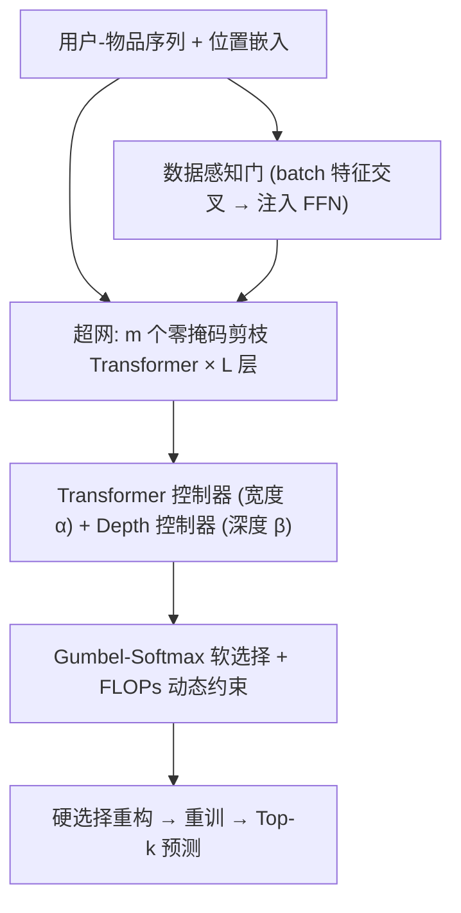
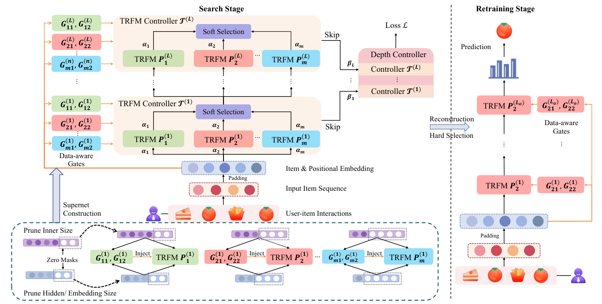

# DNS-Rec: Data-aware Neural Architecture Search for Recommender Systems (面向推荐系统的数据感知神经架构搜索)

- **会议/期刊**: RecSys 2024 (ACM Conference on Recommender Systems)
- **作者与机构**: Sheng Zhang, Maolin Wang, Xiangyu Zhao 等（香港城市大学、蚂蚁集团、字节跳动、昆士兰大学、吉林大学）
- **推荐链路定位**: 精排/端到端序列建模（服务于线上低时延推理）
- **研究方向**: 序列与会话推荐 / 工业级高效架构与评测
- **论文原文**: [https://arxiv.org/abs/2402.00390v2](https://arxiv.org/abs/2402.00390v2)
- **开源代码**: 暂未开源

## TL;DR (1分钟核心速览)

现有注意力式序列推荐（SASRec/BERT4Rec 类）在推理期过度参数化，而既有资源受限 NAS（DARTS、ProxylessNAS、RecNAS）往往一味压缩模型导致精度明显下降。本文提出 DNS-Rec：用零掩码构造可剪枝超网，用双层控制器（Transformer 控制器管宽度、Depth 控制器管深度）做 Gumbel-Softmax 软选择，并引入"数据感知门"把输入 batch 的交叉特征注入深层 FFN，配合按 epoch 动态估计 FLOPs 的资源约束。在 ML-1M/Gowalla/Douban 的 Leave-One-Out + 全库排序协议下，精度与 SOTA 持平或更优，推理时延最多降 87.6%、显存降 91.1%。

## Background & Motivation (背景与核心矛盾)

- **主流范式**: 以 SASRec 为代表的多头自注意力序列推荐 + 手工设计的 Transformer 变体（FDSA、SASRecF），以及 LinRec 这类线性注意力加速算子。
- **前人局限**: ① 剪枝与手工高效结构依赖经验调参，剪枝强度/层数设错即掉点；② 资源受限 NAS（ProxylessNAS、RecNAS）把优化目标过度偏向"更小"，精度回撤明显，且搜到的结构不感知输入数据分布。
- **核心洞察 (Key Insight)**: 序列信号在向深层 Transformer 传递时逐步衰减，小模型的信息损失更严重——因此"压缩"必须与"输入侧信息的重新注入"耦合，才可能在同等 FLOPs 下不掉点。
- **本文切入点**: 把架构搜索拆成宽度（剪枝强度）+ 深度（跳层）两个可微维度，并用数据感知门显式补偿压缩带来的信息损失。

## Method (核心方法设计)

### 1. 整体框架 (Overall Architecture)

框架分搜索与重训两阶段。搜索阶段：用户-物品序列经嵌入后进入超网，超网由 $m$个不同剪枝强度的候选 Transformer（隐藏维/内部维用零掩码屏蔽被剪维度）堆叠$L$层构成；Transformer 控制器输出权重$\alpha_i$决定每层选哪个候选（宽度），Depth 控制器输出$\beta_j$决定第$j$层后是继续前传还是跳至预测层（深度），二者经 Gumbel-Softmax 融合为软选择输出，叠加动态 FLOPs 惩罚联合优化。重训阶段：对$\alpha,\beta$ 取 argmax 做硬选择重构紧凑网络，继承搜索期权重后重新训练并推理。

<figure class="paper-figure" markdown="span">
  <figcaption>图1：所提出的数据感知神经架构搜索框架。我们的创新框架在两阶段结构中包含超网、双层控制器和数据感知门。我们使用零掩码对 Transformer 进行剪枝，并为构建超网将每个候选连接至一定数量的层。搜索过程中学习架构权重与模型权重，随后进行用于重构和参数重训练的硬选择。</figcaption>
</figure>

### 2. 关键设计拆解 (Key Designs)

1. **零掩码 + 双层可微剪枝控制器**：痛点是为每个候选单独布线会导致超网爆炸且搜索不稳定。做法是对每层候选用零掩码按比例 $\gamma_i d$、$\gamma'_i D$屏蔽隐藏/内部维度，并以 Gumbel-Softmax 权重融合候选输出$p_i=\frac{\exp((\log\alpha_i+g_i)/\tau)}{\sum_k \exp((\log\alpha_k+g_k)/\tau)}$，最终$\boldsymbol{Y}=\sum_{j}\sum_{i} p_i q_j \boldsymbol{P}^{(l)}_i(\cdot)$。直觉：α/β 共享同一组权重使层间维度对齐，宽度与深度因此可在同一 DAG 内联合可微搜索。
2. **数据感知门 (Data-aware Gates)**：针对"深层信息衰减 + 压缩放大损失"，用两层门从输入 batch 做特征交叉与感知：$\delta_k=\gamma\cdot\sigma(\boldsymbol{X}'_k \boldsymbol{W}^{(2)}_k+\boldsymbol{b}^{(2)}_k)$，再以逐元素门控注入 FFN：$\boldsymbol{F}^{(l)}_1=\mathrm{GeLU}((\delta^{(l)}_1\otimes\boldsymbol{S}^{(l)})\boldsymbol{W}^{(l)}_{F1}+\boldsymbol{b}^{(l)})$。直觉：门控随 batch 自适应，等价于给被剪枝的窄网络补一条"输入直连通路"，且每个门绑定特定深度的 FFN，实现逐层差异化调制。
3. **动态资源约束与线性注意力**：FLOPs 惩罚按当前 epoch 的临时硬选择估计层数 $L_t$：$\mathcal{L}_{RC}=\frac{L_t}{L}\sum_{j=1}^{L}\sum_{i=1}^{m}p_i q_j \mathrm{FLOPs}(\boldsymbol{T}^{(j)}_i)$；若用固定预算，搜索会退化为把所有质量堆到最小或最大候选上。总损失$\mathcal{L}=\mathcal{L}_{CE}+\lambda\mathcal{L}_{RC}$，采用双层优化（训练集更新$W$，验证集更新$\{\alpha,\beta\}$）。注意力用$\mathrm{elu}(\cdot)$+$L_2$归一化的线性注意力把复杂度从$O(N^2d)$降到$O(Nd^2)$；训练无负采样（softmax 全库交叉熵），推理为全库内积排序，无额外开销。

## Experimental Setup & Evaluation Protocol (实验设置与评估协议)

- **数据集与预处理**:

| 数据集 | #Users | #Items | #Interactions | 稀疏度/密度 | 特征/场景说明 |
| :--- | :---: | :---: | :---: | :---: | :--- |
| ML-1M | 6,041 | 3,707 | 1,000,209 | 165.60 / 269.89 (UA/IA 均值) | 电影评分，序列长、稠密 |
| Gowalla | 64,116 | 164,533 | 2,018,421 | 31.48 / 12.27 | LBS 签到，极稀疏、物品海量 |
| Douban | 110,091 | 29 | 2,125,056 | 10.55 / 41,496.71 | 短评，物品数极少、重复度极高 |

- **数据划分与防穿越**: `Leave-One-Out`，按用户时间序，倒数第二项作验证、最后一项作测试（验证:测试 = 1:1）。
- **排名评测协议**: `Full-Ranking`（对全部未交互物品排序），指标 Recall@10 / MRR@10 / NDCG@10；显著性用双侧 t-test，$p<0.05$。
- **对比基线与超参**: NAS 类 DARTS / ProxylessNAS / RecNAS + SASRec；手工架构 SASRec、FDSA、SASRecF（各含 w/ 与 w/o LinRec 两版）。超网 hidden $d$=128(ML-1M/Douban)/64(Gowalla)，inner$D$=256，序列长$N$=200/100/100，$L$=4 层、4 头，$\lambda$=0.1，学习率 1e-3，剪枝强度集$\{0\%,25\%,50\%\}$或$\{0\%,50\%,75\%\}$，温度$\tau=\max(0.01,1-5\times10^{-5}t)$。

## Key Experimental Results (实验关键数据)

### 1. 主实验对比 (Main Results)

Test 集结果（Evaluation 集结论一致，此处省略）：

| 数据集 | 方法 | Recall@10 | MRR@10 | NDCG@10 |
| :--- | :--- | :---: | :---: | :---: |
| ML-1M | **DNS-Rec (Ours)** | 0.6796 | **0.3991** | **0.4661** |
| ML-1M | DARTS + SASRec | **0.6846** | 0.3915 | 0.4614 |
| ML-1M | ProxylessNAS + SASRec | 0.6775 | 0.3819 | 0.4525 |
| ML-1M | RecNAS + SASRec | 0.6791 | 0.3852 | 0.4554 |
| ML-1M | SASRec (w/o LinRec) | 0.6793 | 0.3822 | 0.4533 |
| ML-1M | SASRec (w LinRec) | 0.6790 | 0.3949 | 0.4627 |
| ML-1M | SASRecF (w LinRec) | 0.6815 | 0.3978 | 0.4657 |
| Gowalla | **DNS-Rec (Ours)** | 0.9199 | **0.6715** | **0.7317** |
| Gowalla | DARTS + SASRec | 0.9179 | 0.6588 | 0.7217 |
| Gowalla | ProxylessNAS + SASRec | **0.9218** | 0.6438 | 0.7112 |
| Gowalla | RecNAS + SASRec | 0.9144 | 0.6494 | 0.7136 |
| Gowalla | SASRec (w LinRec) | 0.9174 | 0.6679 | 0.7284 |
| Gowalla | SASRecF (w LinRec) | 0.8987 | 0.6165 | 0.6847 |
| Douban | **DNS-Rec (Ours)** | 0.7854 | **0.3886** | **0.4833** |
| Douban | DARTS + SASRec | 0.7813 | 0.3762 | 0.4724 |
| Douban | RecNAS + SASRec | **0.7888** | 0.3797 | 0.4773 |
| Douban | FDSA (w/o LinRec) | **0.8050** | 0.3825 | 0.4827 |
| Douban | SASRec (w/o LinRec) | 0.7889 | 0.3858 | 0.4822 |
| Douban | SASRecF (w LinRec) | 0.7879 | 0.3780 | 0.4757 |

效率对比（同表 4）：ML-1M 推理 **14.8s / 7.78GB**（SASRec w/o LinRec 为 54.2s / 28.26GB）；Douban **70s / 1.20GB**（FDSA w/o LinRec 为 563s / 13.45GB）；Gowalla **232s / 5.54GB**。整体时延降幅 0.9%–87.6%，显存降幅 13.3%–91.1%。搜索-推理总成本（ML-1M）：DNS-Rec 训练 234min + 10M 交互推理 408min = 642min，显著低于 SASRec(w/o LinRec) 的 1669min。

### 2. 消融实验 (Ablation Study)

数据感知门层数消融（ML-1M，Evaluation 集）：

| 设置 | Recall@10 | MRR@10 | NDCG@10 | Δ 相对 No Gates |
| :--- | :---: | :---: | :---: | :---: |
| Retrain Only: 2 层门 | **0.7151** | **0.4207** | **0.4910** | +2.43% / +8.57% / +6.39% |
| Retrain Only: 1 层门 | 0.7043 | 0.4059 | 0.4771 | +0.95% / +4.75% / +3.38% |
| Retrain Only: No Gates | 0.6977 | 0.3875 | 0.4615 | — |
| Search & Retrain: 2 层 | **0.7151** | **0.4207** | **0.4910** | +0.87% / +1.59% / +1.32% |
| Search & Retrain: 1 层 | 0.7131 | 0.4169 | 0.4876 | +0.59% / +0.68% / +0.62% |
| Search & Retrain: No Gates | 0.7089 | 0.4141 | 0.4846 | — |

门层数 $L_d$与 FLOPs（ML-1M）：$L_d$=0/1/2/3/4 对应 FLOPs 20M/27M/26M/35M/64M，NDCG 为 0.4846/0.4876/0.4910/0.4929/0.4916——2–3 层为最佳性价比区间。

### 3. 关键实验发现 (Key Findings)

1. **精度不是靠"大模型"换来的**：DNS-Rec 在 Gowalla 上 MRR@10 达 0.6715，超过最强手工基线 SASRec(w LinRec) 的 0.6679 与 DARTS 的 0.6588，同时显存仅 5.54GB（DARTS 8.60GB）；说明"数据感知门补偿 + 结构压缩"可同时改善两端。
2. **增益主要来自门而非搜索本身**：Search & Retrain 去门仅掉 0.87%/1.59%/1.32%，而 Retrain Only 去门掉 2.43%/8.57%/6.39%，说明门的作用在于重训阶段的输入信息重建，搜索阶段留门有助于找到与门结构匹配的骨架。
3. **稀疏数据更吃"宽度剪枝"**：Gowalla（IA 均值仅 12.27）上剪枝强度开到 $\{0\%,50\%,75\%\}$ 且序列长仅 100，仍保持最高 MRR；而 Douban（29 个物品/41,496 次曝光）上 FDSA 类特征级模型在 Recall 上反超（0.8050 vs 0.7854），提示极端物品重复场景下纯度指标与召回指标存在结构性权衡。

## Highlights & Limitations (亮点、对比与审稿批判)

- **与代表作对比**: 与 RecNAS（退火 + 通道剪枝，只压宽度）相比，本文联合搜索宽度与深度并显式建模数据分布；与 ProxylessNAS（连续化时延损失）相比，本文用动态 FLOPs 惩罚避免"堆到极小候选"的搜索塌陷；与 LinRec（固定线性注意力替换）相比，本文把线性注意力作为超网基础算子并叠加结构搜索，效率与精度可同时获得。
- **可迁移亮点**: ① "零掩码 + Gumbel-Softmax 软选择 + 硬选择重训"三段式流程可直接套用到任意 Transformer 序列模型（如 BERT4Rec、S3-Rec）；② 数据感知门本质是轻量 FiLM 式条件调制，可迁移到多场景/多域推荐中做场景自适应注入。
- **审稿级局限批判**: ① 搜索阶段仍需 234min 训练 + 超网显存，且论文未报告多次搜索的方差，架构选择在小数据上可能不稳定（$\lambda$扫描显示不同$\lambda$ 可搜出相同结构，虽有鲁棒性论证但也暗示搜索空间的区分度有限）；② 评测仅三个公开数据集、全库排序、单一 Recall/MRR/NDCG@10 切面，缺少工业级 CTR/时长指标与大候选集线上 A/B，且 91.1% 显存降幅相对的是未压缩的 FDSA 类基线，对已优化的部署模型增益恐被高估。

## Rating (四维评分)

- **方法创新性 (Novelty)**: ⭐⭐⭐⭐ （把零掩码宽度剪枝、深度跳层控制器与数据感知门合成单一可微超网，思路组合新颖但各组件均可追溯到 DARTS/FiLM 谱系）
- **评估协议与实验扎实度 (Protocol & Experiments)**: ⭐⭐⭐⭐ （三数据集 + Full-Ranking + t-test 显著性 + 效率/消融/超参四组实验完整，但缺少线上验证与搜索方差报告）
- **写作与数学规范度 (Clarity & Rigor)**: ⭐⭐⭐ （公式链条清晰、符号可循，但 Eq.(8)(10) 与门控注入位置存在排版歧义，部分引用编号缺失）
- **工业落地与复现价值 (Industrial & Practical Value)**: ⭐⭐⭐⭐ （时延降 87.6%、显存降 91.1%、总训练+推理成本低于未压缩基线，工程收益直接；可惜未开源代码，超网搭建成本仍需自行复现）

