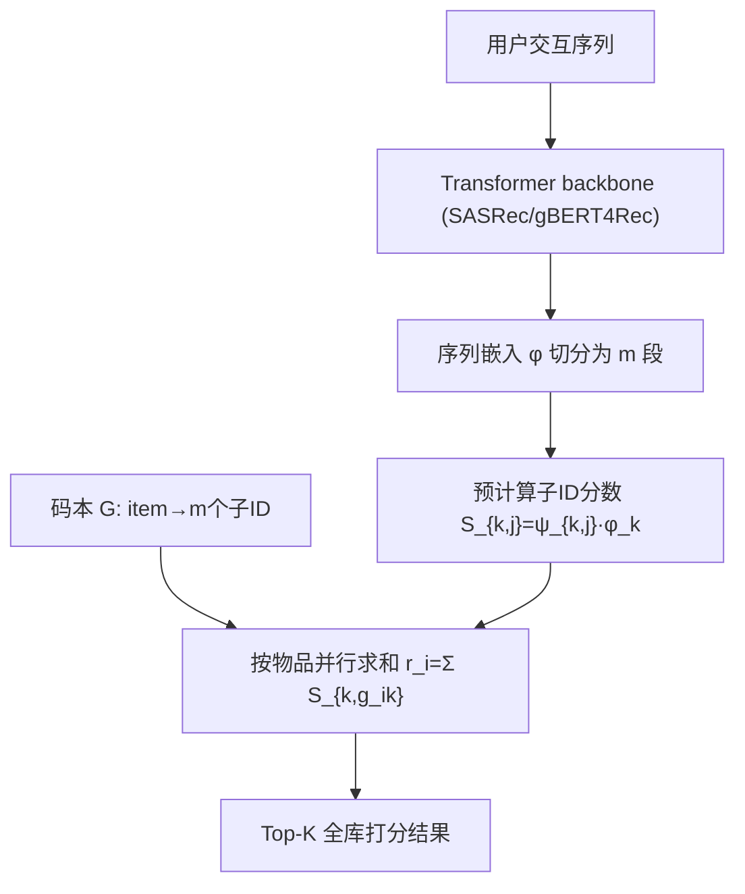
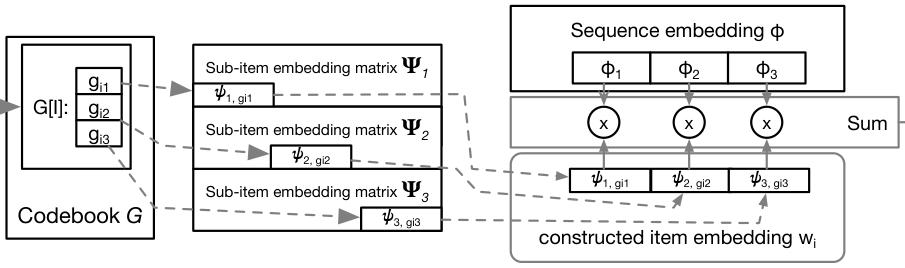

# Efficient Inference of Sub-Item Id-based Sequential Recommendation Models with Millions of Items（百万物品下子物品ID序列推荐模型的高效推理）

- **会议/期刊**: RecSys 2024（18th ACM Conference on Recommender Systems）
- **作者与机构**: Aleksandr V. Petrov, Craig Macdonald（University of Glasgow）；Nicola Tonellotto（University of Pisa）
- **推荐链路定位**: 召回/全库打分（推理阶段）
- **研究方向**: 序列与会话推荐 / 协同过滤与双塔召回（向量量化）
- **论文原文**: [https://arxiv.org/abs/2408.09992v1](https://arxiv.org/abs/2408.09992v1)
- **开源代码**: [https://github.com/asash/RecJPQ-TopK](https://github.com/asash/RecJPQ-TopK)

## TL;DR (1分钟核心速览)

针对 Transformer 序列推荐在百万级目录上全库打分慢、RecJPQ 虽压缩内存却未加速推理的痛点，本文把 LightRec 的 PQTopK 算法迁移到 RecJPQ-SASRec/BERT4Rec：预计算子 ID 分数，并按物品并行求和。Gowalla（1.27M 物品）CPU 全库打分下，SASRec 总响应时间较默认矩阵乘加速 4.5×、较原 RecJPQ 加速 1.56×，NDCG 不变；模拟目录到 1B 仍可离线打分。

## Background & Motivation (背景与核心矛盾)

- **主流范式**: SASRec/BERT4Rec 将下一物品预测视为 next-token prediction，用 Transformer 生成序列嵌入 $\phi$，再以$r=W\phi$ 对全目录打分。
- **前人局限**: 大目录下 $W$占显存、全库打分$O(|I|d)$；RecJPQ 用乘积量化把物品拆成共享子 ID，内存最多压缩 50×，但其打分循环按 split 外层累加，无法并行。ANN 索引虽可减少打分物品数，却存在召回不安全、且仍需先训练完整物品嵌入的问题。
- **核心洞察 (Key Insight)**: Transformer backbone 推理时间与 $|I|$无关，瓶颈在打分头；子 ID 分数矩阵$S$的规模$mb \ll |I|$，可一次预计算并复用。
- **本文切入点**: 不改模型与分数分布，只交换 RecJPQ 打分循环顺序，把“按 split 累加”改为“按物品独立求和”，释放并行性。

## Method (核心方法设计)

### 1. 整体框架 (Overall Architecture)

输入用户交互序列，经 SASRec/gBERT4Rec backbone 得到序列嵌入 $\phi$；按$m$个 split 切分为$\phi_1,\ldots,\phi_m$，用码本$G$将每个物品映射到$m$个子 ID，预计算子 ID 分数$S$，再对每个物品并行 gather 并求和得到全库分数，最后 Top-K。训练沿用 RecJPQ 的 SVD 码本与 gBERT4Rec 的 gBCE 负采样；推理只替换打分头，不改变排序分数。整体是“压缩表示 + 高效精确打分”的工程闭环。

### 2. 关键设计拆解 (Key Designs)

1. **PQTopK：交换循环顺序以释放并行**：原 RecJPQ 外层遍历 split、内层累积每个物品分数，累加器造成跨物品依赖，难以并行；PQTopK 外层遍历物品、内层只做 $m$次加法，物品间完全独立。复杂度从每物品$d$次乘加降为$m$次加法，$m=8 \ll d=512$，且$S$预计算与$|I|$ 无关。

$s_{k,j}=\psi_{k,j}\cdot\phi_k,\quad r_i=\sum_{k=1}^{m}s_{k,g_{ik}}$2. **子 ID 码本与嵌入重建**：RecJPQ 将物品$i$映射为$m$ 个共享子 ID，重建嵌入为子嵌入拼接：

$G[i]=\{g_{i1},\ldots,g_{im}\},\quad w_i=\psi_{1,g_{i1}}\Vert\cdots\Vert\psi_{m,g_{im}}$

打分等价于子嵌入点积求和，使“查表 + 加法”替代“完整向量乘加”。码本由交互矩阵截断 SVD 导出，兼顾压缩与可训练性。

<figure class="paper-figure" markdown="span">
  <figcaption>图1：使用 Product Quantisation 重建物品嵌入并计算物品得分，其中 m=3 个分割。</figcaption>
</figure>

3. **训练目标、负采样与推理效率**：本文不提出新损失，沿用 RecJPQ 配置；gBERT4Rec 使用负采样与 gBCE，SASRec 按原配置训练。推理阶段所有打分方法共享同一分数分布，故 NDCG 不变；PQTopK 仍为全库精确打分，无 ANN 召回损失，但复杂度仍随 $|I|$ 线性增长。

## Experimental Setup & Evaluation Protocol (实验设置与评估协议)

- **数据集与预处理**:

| 数据集 | #Users | #Items | #Interactions | 稀疏度/密度 | 特征/场景说明 |
| :--- | :---: | :---: | :---: | :---: | :--- |
| Booking.com | 140,746 | 34,742 | 917,729 | 密度 0.019% | 旅游预订，较小目录 |
| Gowalla | 86,168 | 1,271,638 | 6,397,903 | 密度 0.0058% | LBS 签到，百万级目录 |

两数据集均移除交互少于 5 的物品/用户（按原文“remove users with less than five items”）。

- **数据划分与防穿越 (Splitting Strategy)**: 原文未重述划分细节，沿用 RecJPQ 配置；本文无法核验 Leave-One-Out/时间切分细节，这是评估透明度短板。
- **排名评测协议 (Ranking Protocol)**: 采用全目录 Full-Ranking 式打分测量推理；NDCG@10 仅作效果完整性，不作为优化目标；未报告采样负例比例。
- **对比基线与超参设置**: 对比 Transformer Default 矩阵乘、原 RecJPQ 打分、PQTopK 三种打分头；backbone 为 SASRec（2 层）与 gBERT4Rec（3 层），$d=512$，主实验$m=8$，扩展实验$m=64$；CPU 为 AMD Ryzen 5950x、128GB、TensorFlow 2.11，不使用 GPU；以每用户中位响应时间 mRT 为主指标，未做显著性检验。

## Key Experimental Results (实验关键数据)

### 1. 主实验对比 (Main Results)

| 数据集 | Backbone | Scoring | mRT Scoring↓ | mRT Total↓ | NDCG@10 | vs Default | vs RecJPQ |
| :--- | :--- | :--- | ---: | ---: | ---: | ---: | ---: |
| Booking | gBERT4Rec | Default | 6.22 | 43.37 | 0.328 | 1.00× | — |
| Booking | gBERT4Rec | RecJPQ | 3.90 | 41.08 | 0.328 | 1.06× | 1.00× |
| Booking | gBERT4Rec | **PQTopK** | **3.09** | **40.23** | 0.328 | **1.08×** | **1.02×** |
| Booking | SASRec | Default | 6.27 | 30.03 | 0.188 | 1.00× | — |
| Booking | SASRec | RecJPQ | 3.77 | 27.53 | 0.188 | 1.09× | 1.00× |
| Booking | SASRec | **PQTopK** | **2.93** | **26.69** | 0.188 | **1.13×** | **1.03×** |
| Gowalla | gBERT4Rec | Default | 133.40 | 171.04 | 0.168 | 1.00× | — |
| Gowalla | gBERT4Rec | RecJPQ | 33.87 | 71.42 | 0.168 | 2.39× | 1.00× |
| Gowalla | gBERT4Rec | **PQTopK** | **13.79** | **51.33** | 0.168 | **3.33×** | **1.39×** |
| Gowalla | SASRec | Default | 131.35 | 156.07 | 0.120 | 1.00× | — |
| Gowalla | SASRec | RecJPQ | 29.65 | 54.32 | 0.120 | 2.87× | 1.00× |
| Gowalla | SASRec | **PQTopK** | **10.03** | **34.72** | 0.120 | **4.49×** | **1.56×** |

### 2. 消融实验 (Ablation Study)

本文无传统模块消融；核心“消融”体现为打分算法与目录规模、split 数的交互：

| 设置 | 目录规模 | 关键结果 | 归因 |
| :--- | :---: | :--- | :--- |
| Default vs PQTopK, $m=8$|$10^7$以上 | Default 耗尽 128GB 内存 | 显式$W$ 无法扩展 |
| PQTopK vs RecJPQ, $m=8$|$10^7$ | 146ms vs 253ms（RecJPQ 约慢 68%） | 累加器阻碍并行 |
| PQTopK, $m=8$|$10^8$ | 约 1s/用户 | 仅适合预计算 |
| PQTopK, $m=8$|$10^9$ | 超过 10s/用户 | 交互式场景不可用 |
| PQTopK vs Default, $m=64$|$10^6$ | 均约 100ms | 大 split 抵消加法优势 |
| PQTopK, $m=64$|$10^8$ | 约 10s/用户 | 可打分但延迟高 |

### 3. 关键实验发现 (Key Findings)

1. **瓶颈确在打分头而非 backbone**：Gowalla 上 SASRec Default 总时 156.07ms，其中打分 131.35ms；PQTopK 打分仅 10.03ms，总时 34.72ms，backbone 约 24.67ms，验证“目录越大，打分头优化收益越高”。
2. **循环顺序带来同分数下的纯工程加速**：Gowalla SASRec 上，PQTopK 打分较 Default 快 13.1×、较 RecJPQ 快 2.96×；总时较二者分别快 4.49× 与 1.56×，且 NDCG@10 完全不变，说明加速不牺牲排序质量。
3. **小目录收益有限，大目录决定可用性**：Booking 仅 35K 物品时 PQTopK 总时较 Default 仅快 1.08–1.13×，因 backbone 约 24–37ms 主导；$m=8$ 时 PQTopK 可处理 100M 目录约 1s，1B 目录超过 10s，适合离线预计算而非强交互。

## Highlights & Limitations (亮点、对比与审稿批判)

- **与代表作对比 (vs. Prior Work)**: RecJPQ 解决内存但打分循环不可并行；LightRec 用类似子 ID + PQTopK 但面向非序列推荐；本文首次将 PQTopK 用于 Transformer 序列推荐，并给出百万级真实数据与十亿级模拟分析。相较 ANN，本文是全库精确打分，无索引召回损失，但仍是 $O(|I|)$。
- **可迁移亮点**: 对任何“码本查表 + gather-sum”的打分头，优先把循环改为“按候选物品外层并行”；将 $m$作为延迟-内存可调旋钮，小$m$换速度、大$m$ 换可扩展性。
- **审稿级局限批判**: 仅 CPU 单机 TensorFlow 测量，缺 GPU、批吞吐与真实线上端到端延迟；未重述数据划分、负采样和 NDCG 协议细节，效果结论仅“同分”而非质量提升；$m=64$ 时 PQTopK 与矩阵乘在中等目录相近，且 1B 目录 >10s，交互式部署仍受限。

## Rating (四维评分)

- **方法创新性 (Novelty)**: ⭐⭐⭐（核心是已知 PQTopK 到序列推荐 RecJPQ 的算法移植与循环重排，理论新颖性有限，但工程增量明确）
- **评估协议与实验扎实度 (Protocol & Experiments)**: ⭐⭐⭐⭐（两个真实数据集 + 1B 模拟目录、三种打分头与 mRT 分析完整；但缺数据划分细节、GPU/吞吐与显著性检验）
- **写作与数学规范度 (Clarity & Rigor)**: ⭐⭐⭐⭐（算法伪代码与子 ID 打分公式简洁，复杂度动机清楚；部分实验配置依赖前作 RecJPQ，需回查）
- **工业落地与复现价值 (Industrial & Practical Value)**: ⭐⭐⭐⭐⭐（开源 TensorFlow 实现，直接给出百万级目录 CPU 部署路径与 m 可调权衡）

