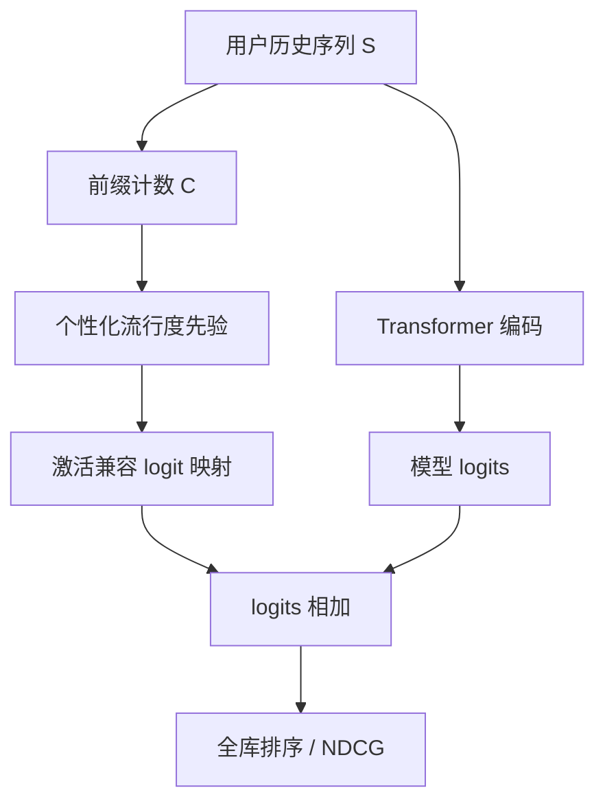

# Enhancing Sequential Music Recommendation with Personalized Popularity Awareness (基于个性化流行度感知的序列音乐推荐增强)

- **会议/期刊**: RecSys 2024 (LBR)
- **作者与机构**: Davide Abbattista, Vito Walter Anelli, Tommaso Di Noia (Politecnico di Bari); Craig Macdonald, Aleksandr Petrov (University of Glasgow)
- **推荐链路定位**: 召回/排序（序列 next-item 打分）
- **研究方向**: 序列与会话推荐
- **论文原文**: [https://arxiv.org/abs/2409.04329v1](https://arxiv.org/abs/2409.04329v1)
- **开源代码**: [https://github.com/sisinflab/personalized-popularity-awareness](https://github.com/sisinflab/personalized-popularity-awareness)

## TL;DR (1分钟核心速览)

针对音乐场景中 Transformer 序列模型难以刻画重复消费、个性化流行度未被显式利用的问题，本文把用户历史计数平滑为个性化流行度先验，并按 softmax/sigmoid 激活映射为可加 logit 偏移，直接注入 BERT4Rec/SASRec/gSASRec。在 Yandex 与 Last.fm-1K 的全局时间切分、NDCG@100 排序下，相对原模型提升 25.2%–69.8%，高截断处超过 Personalized Most Popular。

## Background & Motivation (背景与核心矛盾)

- **主流范式**: 音乐序列推荐沿用 SASRec/BERT4Rec 等 Transformer，以 item token 方式学习下一物品转移。
- **前人局限**: 音乐消费具有强重复性，Transformer 常低估“用户重播自己喜欢歌曲”的信号；同时全局 Most Popular 抹平用户差异，无法表达个体化重复偏好。
- **核心洞察 (Key Insight)**: 用户级流行度（个性化 Most Popular）在音乐域是极强信号；模型不应从零学习全分布，而应学习“相对个性化流行度先验的残差”。
- **本文切入点**: 将用户历史计数平滑为先验，并反解成与 softmax/sigmoid 兼容的 logit 加项，零参数注入现有序列模型。

## Method (核心方法设计)

### 1. 整体框架 (Overall Architecture)

模型输入用户历史序列 $S$，一方面由 BERT4Rec/SASRec/gSASRec 编码得到各位置物品 logits$L_i$；另一方面仅用当前位置之前的前缀序列统计物品计数$C$，构造个性化流行度先验$\hat{p}_P(j)$，再按 backbone 的激活函数反解为可加分数$P_i$。最终以$L_i+P_i$ 排序，训练仍沿用各 backbone 原损失。PPS 不引入可训练参数，也不改变候选集，本质是给序列模型注入“用户重播偏好”的先验偏移。

### 2. 关键设计拆解 (Key Designs)

1. **个性化流行度先验**：全局流行度无法区分“我喜欢重播的歌”和“大众热歌”。对每个位置只用前缀统计 $c_j$，平滑为$\hat{p}_P(j)=\frac{c_j+\epsilon}{\sum_{z=1}^{N}(c_z+\epsilon)}$。$\epsilon$ 越小，先验越强；它把重复消费转成用户级概率先验。
2. **激活函数兼容的 logit 注入**：PPS 不是拼接特征，而是反解为模型 logits 的可加项。Softmax 下 $\tilde{x}_j=\ln\frac{c_j+\epsilon}{\max(C+\epsilon)}$，与 BERT4Rec 的$L_i$相加；Sigmoid 下$\tilde{x}_j=-\ln\frac{1-\hat{p}_P(j)}{\hat{p}_P(j)}$，与 SASRec/gSASRec 的 logits 相加。模型因此学习相对先验的残差，类似 boosting。
3. **训练目标、负采样与推理效率**：总损失仍为 $\mathcal{L}=\mathcal{L}_{\text{backbone}}$（BERT4Rec 用 CE，SASRec 用 BCE，gSASRec 用 gBCE），不新增负采样。推理时逐位置计算$P_i$并加到模型分数，复杂度$O(N)$/位置，$N=30k$，相对 Transformer 前向可忽略；位置$i$ 只用前缀，避免未来信息穿越。

## Experimental Setup & Evaluation Protocol (实验设置与评估协议)

- **数据集与预处理**: 原始 Yandex 300k items、Last.fm-1K 961k items，因显存限制按全局流行度采样至 30k items；下表为采样后统计。

| 数据集 | #Users | #Items | #Interactions | 密度 | 特征/场景说明 |
| :--- | :---: | :---: | :---: | :---: | :--- |
| Yandex Music | 20,862 | 30,000 | 28,408,152 | 4.54% | like/dislike/play/skip 时间戳事件 |
| Last.fm-1K | 990 | 30,000 | 4,990,042 | 16.8% | 播放事件，近 1k 用户 |

- **数据划分与防穿越**: `Global Temporal Split`，按时间戳排序，验证/测试各 10%；测试为用户在全局测试边界后的交互。PPS 每个位置只用前缀序列统计。
- **排名评测协议**: 在 30k 物品目录上计算 `NDCG@5/10/40/100`；论文未采用采样负例评估。Yandex 标签 like=2、play=1、skip=-1、dislike=-2，负向映射为 0；重复交互按首次/绝对值更新规则标注。
- **对比基线与超参设置**: 基线含 Most Popular、Personalized Most Popular、BERT4Rec、SASRec、gSASRec 及其 PPS 变体。序列长度 150；$\epsilon\in\{0.01,0.05,0.1,0.2\}$，学习率$\{0.1,0.001,0.0001\}$；显著性用 paired t-test + Bonferroni，$p<0.05$。论文未报告统一 embedding 维度$d$。

## Key Experimental Results (实验关键数据)

### 1. 主实验对比 (Main Results)

| 模型 | Y@10 | Δ | Y@100 | Δ | L@10 | Δ | L@100 | Δ |
| :--- | :---: | :---: | :---: | :---: | :---: | :---: | :---: | :---: |
| Most Popular | 0.0416 | — | 0.0449 | — | 0.0889 | — | 0.0817 | — |
| Personalized Most Popular | **0.1826** | — | 0.1947 | — | **0.5056** | — | 0.3554 | — |
| BERT4Rec | 0.1263 | — | 0.1466 | — | 0.3164 | — | 0.2108 | — |
| BERT4Rec w/ PPS | 0.1745 | +38.2% | **0.2024** | +38.1% | 0.4812 | +52.1% | **0.3579** | +69.8% |
| SASRec | 0.1030 | — | 0.1332 | — | 0.3160 | — | 0.2317 | — |
| SASRec w/ PPS | 0.1647 | +59.9% | 0.2012 | +51.1% | 0.4258 | +34.8% | 0.3410 | +47.2% |
| gSASRec | 0.1364 | — | 0.1592 | — | 0.3222 | — | 0.2218 | — |
| gSASRec w/ PPS | 0.1737 | +27.3% | 0.2013 | +26.4% | 0.4710 | +46.2% | 0.3534 | +59.3% |

### 2. 消融实验 (Ablation Study)

| Backbone | Y@100 w/o → w/ PPS | Δ | L@100 w/o → w/ PPS | Δ |
| :--- | :---: | :---: | :---: | :---: |
| BERT4Rec | 0.1466 → 0.2024 | +38.1% | 0.2108 → 0.3579 | +69.8% |
| SASRec | 0.1332 → 0.2012 | +51.1% | 0.2317 → 0.3410 | +47.2% |
| gSASRec | 0.1592 → 0.2013 | +26.4% | 0.2218 → 0.3534 | +59.3% |

### 3. 关键实验发现 (Key Findings)

1. **个性化重复信号极强**：低截断处 Personalized Most Popular 全面超过 Transformer，如 Y@10 的 0.1826 vs BERT4Rec/SASRec/gSASRec 的 0.1263/0.1030/0.1364，L@10 的 0.5056 vs 0.3164/0.3160/0.3222。
2. **PPS 对三种 backbone 均稳定有效**：Y@100 上 BERT4Rec/SASRec/gSASRec 分别提升 38.1%/51.1%/26.4%，Last.fm@100 提升 69.8%/47.2%/59.3%；且 BERT4Rec w/ PPS 在 Y@100、L@100 反超 Personalized Most Popular（0.2024 vs 0.1947；0.3579 vs 0.3554）。
3. **先验与模型能力互补**：弱 backbone SASRec 在 Yandex 增益最大（@10 +59.9%），强 gSASRec 增益较小（@10 +27.3%）但仍显著；说明 PPS 不是替代序列建模，而是补足被模型低估的重复消费分布。

## Highlights & Limitations (亮点、对比与审稿批判)

- **与代表作对比**: 相比 SASRec/BERT4Rec/gSASRec 从零学转移，本文只加用户级重播先验；相比 Personalized Most Popular 只做重复排序，PPS 保留序列模型对新歌的探索能力。
- **可迁移亮点**: 激活感知的 logit 映射可直接迁移到其他“用户级重复/频次先验”场景；按流行度采样大目录也适合工业音乐推荐。
- **审稿级局限批判**: LBR 短文仅两个音乐数据集，30k 流行度采样可能放大热门物品效应；只报告 NDCG，未评估多样性、filter bubble 与在线满意度；$\epsilon$ 和采样策略的敏感性仍需更完整分析。

## Rating (四维评分)

- **方法创新性 (Novelty)**: ⭐⭐⭐ （机制简单但首次显式注入个性化流行度先验，理论直觉清楚）
- **评估协议与实验扎实度 (Protocol & Experiments)**: ⭐⭐⭐ （两数据集+显著性检验，但 LBR 规模、仅 NDCG、采样偏差限制较强）
- **写作与数学规范度 (Clarity & Rigor)**: ⭐⭐⭐⭐ （softmax/sigmoid 反解推导清晰，公式与防穿越说明到位）
- **工业落地与复现价值 (Industrial & Practical Value)**: ⭐⭐⭐⭐ （零参数、易插拔、代码开源，线上改造成本低）

