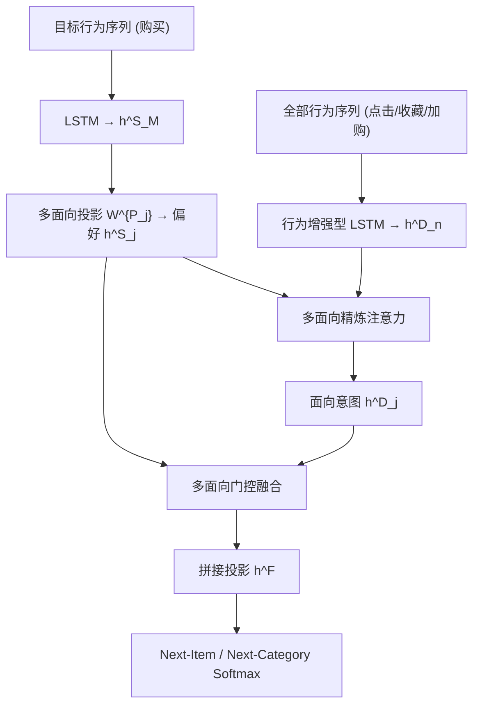
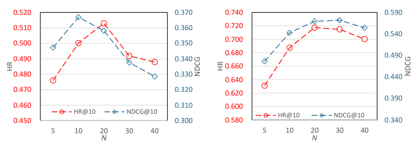

# Modeling Multi-aspect Preferences and Intents for Multi-behavioral Sequential Recommendation (多行为序列推荐中多面向偏好与意图的联合建模)

- **会议/期刊**: Knowledge-Based Systems (KBS) 2023
- **作者与机构**: Haobing Liu, Jianyu Ding, Yanmin Zhu, Feilong Tang, Jiadi Yu, Ruobing Jiang, Zhongwen Guo (中国海洋大学计算机科学与技术系；上海交通大学计算机科学与工程系)
- **推荐链路定位**: 召回（Next-Item / Next-Category 序列建模）
- **研究方向**: 序列与会话推荐 / 交互去噪与鲁棒表征
- **论文原文**: [论文原文链接](https://arxiv.org/abs/2309.14938v1)
- **开源代码**: 暂未开源

## TL;DR (1分钟核心速览)

针对多行为序列推荐中“偏好/意图只能由单一向量刻画 + 支持行为（点击/浏览）含大量噪声 + 偏好与意图重要性难以自适应”三大痛点，提出 MAINT：以多面向投影把目标行为序列压缩为 $J$个语义子空间的稳定偏好表征，以“行为增强型 LSTM + 多面向精炼注意力”从多类型行为序列中提取$J$ 个意图表征并顺带过滤噪声，最终按面向做门控融合。在 Taobao / Retailrocket 的 Leave-One-Out + 100 负采样排序协议下，MAINT 在 HR@10 上较最强基线 IARS-S 分别提升 5.6% 与 11.3%（Retailrocket NDCG@10 提升 20.2%），全部指标显著（p<0.05）。

## Background & Motivation (背景与核心矛盾)

- **主流范式**: 多行为非序列推荐（BF / MC-BPR / 多行为 GNN）将异质行为做静态矩阵分解或异构图卷积；多行为序列推荐要么把全部行为粗拼成一条长序列（ATRank / ASLI），要么只抽目标行为+会话两路序列（BINN），主体仍是 LSTM/Transformer 编解。
- **前人局限 1 — 偏好多面向性缺失**：图 1 的例子中，用户历史购买表明她喜欢“薯片类目”，近期点击表明她在逛“Oishi 品牌”——真实偏好/意图分别体现在类目与品牌两个隐式面向，单向量 $h$ 无法同时承载。
- **前人局限 2 — 支持行为噪声未被有效抑制**：表 1 的转化率显示淘宝点击/收藏仅 0.09/0.07、Retailrocket 浏览 0.16，误触与短时浏览把大量噪声注入序列，concat 或 vanilla attention 都会稀释预测下一样购买行为的信号。
- **核心洞察 (Key Insight)**: 作者观察到：①稳定偏好可作为“引导器 (guider)”重塑注意力分布、压制噪声交互；②不同面向（类目/品牌/价格等）应该由独立子空间承载，并以独立的门控权衡偏好与意图；③长期未购买但近期频繁点击的用户，其意图权重要高于偏好。
- **本文切入点**: 将“多面向”显式化为 $J$ 个隐语义子空间，三阶段（投影偏好 → 行为增强 LSTM+精炼注意力抽意图 → 面向级门控融合）拆解执行。

## Method (核心方法设计)

### 1. 整体框架 (Overall Architecture)

MAINT 采用双路 LSTM 的分工结构：左路仅取目标行为（购买）子序列，得到稳定偏好隐状态 $h^S_M$，再用多面向投影矩阵$W^{P_j}$生成$J$个子空间偏好$\tilde{h}^S_j$；右路用“行为增强型 LSTM”在输入/遗忘/输出三门同时注入行为类型嵌入$r_n$与时间间隔桶嵌入$s_n$，输出整条行为序列的动态状态$h^D_n$；随后$J$个精炼注意力以各面向偏好$\tilde{h}^S_j$作 query 引导$h^D_n$加权，得到面向意图$\tilde{h}^D_j$；再按面向门控$\beta_j$融合出$\tilde{h}^H_j$，拼接投影为$h^F$并同时预测$t{+}1$ 步的物品与类目。

### 2. 关键设计拆解 (Key Designs)

1. **多面向投影机制**：为让 $h^S_M$同时保留类目、品牌等多个语义面向，用$J$个独立投影$\tilde{h}^S_j = W^{P_j} h^S_M$，$j\in[1,J]$。类比 CNN 各 filter 关注不同特征，每个$W^{P_j}$ 专攻一个隐式面向，把“单一隐向量承载全部偏好”变成“按面向分流”，使下游注意力可对每个面向分别筛选交互，避免不同面向互相覆盖。

2. **行为增强型 LSTM + 多面向精炼注意力**：行为类型 $r_n$与时间间隔$s_n$虽不含物品语义，但能刻画交互重要性（加购 ≫ 点击）。作者把$r_n, s_n$注入 LSTM 三门，但候选 cell 状态仍只用$[p_n, q_n]$：
$\hat{c}_n = f_n \odot \hat{c}_{n-1} + i_n \odot \tanh(W_{\hat{c}}[p_n, q_n, h_{n-1}] + \hat{b}_{\hat{c}})$这样行为元信息只作为“控制信号”而不污染物品内容。再用每面向偏好作 guider 做注意力：$\alpha_{j,n} = \frac{\exp(v_j^\top \tanh(W^Q_j \tilde{h}^S_j + W^K_j h^D_n))}{\sum_{n'}\exp(v_j^\top \tanh(W^Q_j \tilde{h}^S_j + W^K_j h^D_{n'}))},\ \ \tilde{h}^D_j = \sum_n \alpha_{j,n} W^V_j h^D_n$
稳定偏好作 query 时，与偏好方向一致的交互会被抬高权重，误点等高噪声交互被压下去，从而在抽取意图的同时完成去噪。

3. **多面向门控融合 + 双监督目标**：每个面向独立门 $\beta_j = \sigma(w_j^\top[\tilde{h}^S_j, \tilde{h}^D_j]+\hat{b}^F_j)$，$\tilde{h}^H_j=(1-\beta_j)\tilde{h}^S_j+\beta_j \tilde{h}^D_j$。$J$个面向可分别决定偏好/意图的相对权重（用户 1 的面向 3 门值$\beta_3\approx 0.97$而$\beta_1\approx 0.35$，即类目面向由近期意图主导，符合她“很久前只买过几次、近期频繁点击”的数据形态）。总损失为 Next-Item +$\gamma \cdot$ Next-Category 的交叉熵再加 L2：
$\mathcal{L} = -\sum_{u\in\mathcal{U}}\sum_{m=1}^{M}\left(y^I_{m+1}\log \hat{y}^I_{m+1} + \gamma y^C_{m+1}\log \hat{y}^C_{m+1}\right) + \lambda\|\Theta\|_2^2$训练为整序列全 softmax 交叉熵，无负采样（评测阶段才做 1:100 采样打分）；类目辅助任务$\gamma{=}1$起明显增益。训练/推理复杂度$O(JN d^2)$，比 IARS-S 的$O(\Lambda N d^2)$（$\Lambda$ 个 GRU）略高，实测在线 100–300 请求下多出约 10–15% 延迟，但精度优势远大于这一开销。

## Experimental Setup & Evaluation Protocol (实验设置与评估协议)

- **数据集与预处理**:

| 数据集 | #Users | #Items | #Categories | #Interactions (按类型) | 密度/说明 |
| :--- | :---: | :---: | :---: | :--- | :--- |
| Taobao | 10,000 | 2,876,947 | 8,916 | 11,550,581 点击 / 242,556 收藏 / 343,564 加购 / 120,205 购买 | user<10, item<20 过滤；4 类行为 |
| Retailrocket | 1,407,580 | 417,053 | 1,086 | 2,664,312 浏览 / 69,332 加购 / 22,457 购买 | user<5, item<10 过滤；3 类行为 |

- **数据划分与防穿越 (Splitting Strategy)**: **Leave-One-Out** 按目标行为（购买）时间排序，最近一次作测试、倒数第二次作验证、其余作训练；并删除训练集中与测试物品相同的记录，防止未来-信息泄漏（相似于 NCF/NMTR 协议）。
- **排名评测协议 (Ranking Protocol)**: **Sampled Ranking（1:100 采样排序）**——每条正样本配 100 个用户未交互负样本；指标为 HR@{2,6,10} 与 NDCG@{2,6,10}；5 次随机种子平均结果，作双侧 unpaired t-test，`⋆` 表示 p<0.05 显著优于最强基线。
- **对比基线与超参设置**: 基线含非序列多行为 BF / MC-BPR / NMTR，单行为序列 GRU4Rec / MCPRN / HGN，多行为序列 ATRank / BINN / ASLI / IARS-S；对 MCPRN、HGN、BINN 补齐类目输入以保证公平。超参：Embedding $d=64$，batch 512，学习率 0.01，$\lambda=10^{-5}$，dropout 0.2，面向数$J=3$，$\gamma=1$，序列最大长度$N=20$。
- 序列长度（图 9）：$N$由 5 增至 20 时 NDCG 与 HR 同步上升，超过 20 后因偏好/意图漂移与计算开销下降（Taobao NDCG 峰值在 N=10、Retailrocket 在 N=30，HR 峰值均在 N=20），最终取$N=20$。

<figure class="paper-figure" markdown="span">
  <figcaption>图 9. 我们观察到，随着长度增加，性能</figcaption>
</figure>

## Key Experimental Results (实验关键数据)

### 1. 主实验对比 (Main Results)

**Taobao**

| 方法 | HR@2 | NDCG@2 | HR@6 | NDCG@6 | HR@10 | NDCG@10 |
| :--- | :---: | :---: | :---: | :---: | :---: | :---: |
| BF | 0.1142 | 0.1015 | 0.2053 | 0.1399 | 0.2670 | 0.1592 |
| NMTR | 0.1224 | 0.1073 | 0.2502 | 0.1613 | 0.3327 | 0.1871 |
| GRU4Rec | 0.0989 | 0.0850 | 0.2113 | 0.1328 | 0.2971 | 0.1600 |
| MCPRN | 0.2753 | 0.2564 | 0.3968 | 0.3114 | 0.4621 | 0.3328 |
| HGN | 0.2552 | 0.2381 | 0.3898 | 0.2958 | 0.4655 | 0.3210 |
| ASLI | 0.2186 | 0.2019 | 0.3626 | 0.2754 | 0.4424 | 0.3027 |
| IARS-S | 0.3020 | 0.2740 | 0.4095 | 0.3278 | 0.4857 | 0.3568 |
| **MAINT** | **0.3078⋆** | **0.2773⋆** | **0.4285⋆** | **0.3289⋆** | **0.5130⋆** | **0.3582⋆** |
| Improv. vs IARS-S | +1.9% | +1.2% | +4.6% | +0.3% | +5.6% | +0.4% |

**Retailrocket**

| 方法 | HR@2 | NDCG@2 | HR@6 | NDCG@6 | HR@10 | NDCG@10 |
| :--- | :---: | :---: | :---: | :---: | :---: | :---: |
| BF | 0.1039 | 0.1028 | 0.2174 | 0.1363 | 0.3104 | 0.1654 |
| NMTR | 0.2680 | 0.2387 | 0.4166 | 0.3022 | 0.5041 | 0.3295 |
| GRU4Rec | 0.1030 | 0.0965 | 0.1827 | 0.1245 | 0.2323 | 0.1436 |
| ATRank | 0.3686 | 0.3573 | 0.5363 | 0.4246 | 0.6413 | 0.4525 |
| BINN | 0.3564 | 0.3418 | 0.5228 | 0.4151 | 0.6231 | 0.4370 |
| ASLI | 0.4165 | 0.3862 | 0.5527 | 0.4460 | 0.6423 | 0.4698 |
| IARS-S | 0.4179 | 0.3875 | 0.5634 | 0.4482 | 0.6444 | 0.4735 |
| **MAINT** | **0.5187⋆** | **0.4802⋆** | **0.6525⋆** | **0.5450⋆** | **0.7175⋆** | **0.5693⋆** |
| Improv. vs IARS-S | +24.1% | +23.9% | +15.8% | +21.6% | +11.3% | +20.2% |

### 2. 消融实验 (Ablation Study)

| 变体 | Taobao HR@10 | Taobao NDCG@10 | Retailrocket HR@10 | Retailrocket NDCG@10 |
| :--- | :---: | :---: | :---: | :---: |
| MAINT-MP（合并为 $J=1$） | 0.4977 (-3.0%) | 0.3471 (-3.1%) | 0.7144 (-0.4%) | 0.5560 (-2.3%) |
| MAINT-BLSTM（去行为增强门） | 0.4977 (-3.0%) | 0.3465 (-3.3%) | 0.7066 (-1.5%) | 0.5600 (-1.6%) |
| MAINT-RAtt（换 vanilla attention） | 0.4876 (-5.0%) | 0.3482 (-2.8%) | 0.7109 (-0.9%) | 0.5550 (-2.5%) |
| MAINT-MGFus（换 concat 融合） | 0.4925 (-4.0%) | 0.3470 (-3.1%) | 0.6938 (-3.3%) | 0.5302 (-6.9%) |
| **MAINT** | **0.5130** | **0.3582** | **0.7175** | **0.5693** |

### 3. 关键实验发现 (Key Findings)

- **多面向投影在 Taobao 收益明确、在大稠密 Retailrocket 上收益较小**：MP 消融在 Taobao 上 HR@10 掉 3.0%、NDCG@10 掉 3.1%，而 Retailrocket 仅 -0.4%，与该数据集行为种类较少（3 类 vs 4 类）、面向信息密度低一致；说明多面向机制的价值随行为/类目丰富度上升，$J=3$最优、$J=4$因过拟合掉点，$J$ 应在参数与数据复杂度间折衷。
- **门控融合在稀疏大规模数据上决定成败**：Retailrocket 上换 concat 后 NDCG@10 由 0.5693 跌到 0.5302（-6.9%），是所有变体中最大单项损失，表明“设备/用户几乎无购买但高频浏览”场景下偏好与意图权重的自适应比面向解耦更关键；而 Taobao 上去掉精炼注意力 HR@10 掉最多（-5.0%），印证点击噪声占主导时 guider 注意力是首要去噪通道。
- **支持行为即使高噪声也不可舍弃**：图 5 逐类移除支持行为后性能均下降；淘宝上移除点击/收藏跌幅最大（对应表 1 中点击转化率 0.09、收藏 0.07 的极低值），Retailrocket 上移除浏览骤降，说明“噪声大但信息量大”的点击信号被 MAINT 用偏好引导注意力成功挽救；此外在 Movielens-1M 上以 1–5 星评分作为 5 类行为，MAINT 仍优于 IARS-S，展示了对评测维度（从类别到评分）的可迁移性。

## Highlights & Limitations (亮点、对比与审稿批判)

- **与代表作对比**: 相比 IARS-S（多 GRU 硬切分意图 + 三辅助任务），MAINT 用 $J$ 个软投影面向 + guider 注意力 + 独立门控，Retailrocket NDCG@10 拉升 20.2%（IARS-S 较 ASLI 仅提升 0.8%），量级差距来自“面向解耦 + 去噪”的双重增益；相比 ASLI 只能从单一类目行为抽取意图，MAINT 可并行兼顾类目导向与品牌导向的推荐；相比 BINN/HGN 只做 concat 或 gating 融合长期偏好与近期行为，MAINT 实现了偏好与意图的面向级解耦融合。
- **可迁移亮点**: ① 行为增强 LSTM 把行为元信息（类型/时间间隔）注入门控而不污染 cell 候选，可迁移到任何带多类型反馈的序列编码器；② 以稳定偏好作 query 的“guider attention”可用于任何噪声较大的短期行为序列过滤。
- **审稿级局限**: ① 评测仅用 Sampled Ranking（1:100），未做 Full-Ranking，可能高估噪声鲁棒性；且 Taobao 上 NDCG@10 相对提升仅 0.4%，显著但幅度极小，对超参 $J$与$\gamma$ 较敏感；② 面向的语义解释缺乏监督，案例研究（图 10）仅能推断第 3 面向为“类目面向”，其余面向具体语义不可辨识；③ 效率上（图 12）训练与在线推理均慢于 IARS-S 约 10–15%，超大规模场景需依赖蒸馏轻量版；开源代码缺失，复现成本较高。

## Rating (四维评分)

- **方法创新性 (Novelty)**: ⭐⭐⭐⭐ （多面向投影 + guider attention + 面向级门控三段递进结构清晰，但底层仍为 LSTM + attention 的模块拼接式创新，缺理论支撑）
- **评估协议与实验扎实度 (Protocol & Experiments)**: ⭐⭐⭐ （Leave-One-Out + 1:100 采样排序，10 个基线 + 3 个数据集且含 Movielens-1M 可扩展性验证，但缺 Full-Ranking 与方差报告）
- **写作与数学规范度 (Clarity & Rigor)**: ⭐⭐⭐⭐ （模型结构与公式定义完整、附 Algorithm 1 伪代码、复杂度推导明确，但面向语义解释偏弱）
- **工业落地与复现价值 (Industrial & Practical Value)**: ⭐⭐⭐ （离线/在线全链路描述清晰、TensorFlow 实现；但推理延迟略高且无开源仓库，向工业界迁移需重写）

